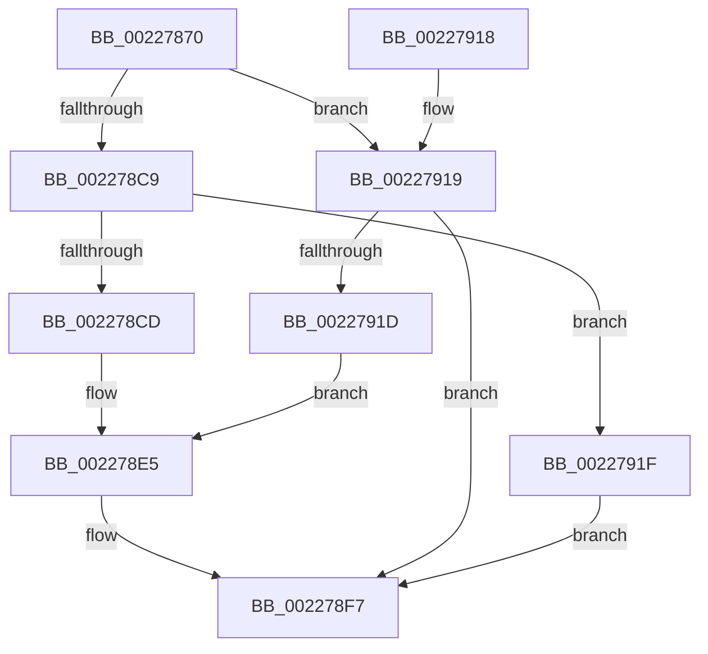

# EtwpStackWalkApc

- RVA: `0x00227870`–`0x00227A03` (길이 `403` bytes)
- VA: `0x0000000140227870`
- 실행 섹션: `.text`
- PDB 이름 있음: `예`; PDB Function 태그: `아니요`
- unwind 정보 RVA: `0x0005FB68`
- 디코드: `78`개 명령, `403/403` bytes 표시
- 미해석 바이트: `0` (있으면 어셈블리에 `.byte`로 보존)

> 이 문서는 커널 이미지의 기계어와 PDB 기호를 분석해 생성했습니다. 4번과 5번은 함수 원형과 자료형을 바이너리 사용 방식에서 추정한 C 해석이며 원본 소스 복구 결과는 아닙니다.

## 1. Dependencies

- 직접 호출 지점: **4**; 고유 호출 대상: **4**
- 직접 호출자로 확인된 함수: **0**
- RIP 상대 이미지 참조: **4**

### Outgoing calls
- `0x002278E0` → [EtwpTraceStackWalk](../2F/EtwpTraceStackWalk_function_002F8D60.md) (function, `0x002F8D60`)
- `0x00227902` → [_security_check_cookie](../6A/_security_check_cookie_function_006AC640.md) (function, `0x006AC640`)
- `0x0022792F` → [memset](../6C/memset_function_006C6C40.md) (function, `0x006C6C40`)
- `0x002279F9` → [EtwpEventWriteFull](EtwpEventWriteFull_function_00225C10.md) (function, `0x00225C10`)

### Direct callers
- 이 함수 시작 RVA로 연결되는 직접 call은 확인되지 않았습니다. 간접 호출은 완전히 역산할 수 없습니다.

### Static image references
- `0x0022787D` → RVA `0x00E0A740` (`.data`; read)
- `0x00227934` → RVA `0x00013050` (`.rdata`; read)
- `0x00227968` → RVA `0x00010980` (`.rdata`; read)
- `0x002279C6` → RVA `0x00010FF8` (`.rdata`; read)

## 2. Other-region calls and transfers

- 다른 실행 섹션으로 향하는 call: **0**
- 별도 외부 분기/꼬리 이동을 확인하지 못했습니다.

## 3. Assembly (complete function range)

```asm
00227870  48 89 5C 24 18                  mov qword ptr [rsp + 0x18], rbx
00227875  57                              push rdi
00227876  48 81 EC 60 03 00 00            sub rsp, 0x360
0022787D  48 8B 05 BC 2E BE 00            mov rax, qword ptr [rip + 0xbe2ebc]
00227884  48 33 C4                        xor rax, rsp
00227887  48 89 84 24 50 03 00 00         mov qword ptr [rsp + 0x350], rax
0022788F  4C 8B 94 24 90 03 00 00         mov r10, qword ptr [rsp + 0x390]
00227897  48 8B FA                        mov rdi, rdx
0022789A  65 48 8B 14 25 88 01 00 00      mov rdx, qword ptr gs:[0x188]
002278A3  48 8B 19                        mov rbx, qword ptr [rcx]
002278A6  41 8B 09                        mov ecx, dword ptr [r9]
002278A9  41 0F B6 00                     movzx eax, byte ptr [r8]
002278AD  89 8C 24 94 00 00 00            mov dword ptr [rsp + 0x94], ecx
002278B4  41 8B 0A                        mov ecx, dword ptr [r10]
002278B7  89 8C 24 90 00 00 00            mov dword ptr [rsp + 0x90], ecx
002278BE  8B 8A A0 05 00 00               mov ecx, dword ptr [rdx + 0x5a0]
002278C4  F6 C1 01                        test cl, 1
002278C7  75 50                           jne 0x140227919
002278C9  84 C0                           test al, al
002278CB  75 52                           jne 0x14022791f
002278CD  4C 8B C2                        mov r8, rdx
002278D0  4C 8D 8C 24 90 00 00 00         lea r9, [rsp + 0x90]
002278D8  BA 00 10 00 00                  mov edx, 0x1000
002278DD  48 8B CB                        mov rcx, rbx
002278E0  E8 7B 14 0D 00                  call 0x1402f8d60
002278E5  0F B7 83 32 03 00 00            movzx eax, word ptr [rbx + 0x332]
002278EC  83 E0 07                        and eax, 7
002278EF  83 C0 18                        add eax, 0x18
002278F2  F0 0F B3 47 78                  lock btr dword ptr [rdi + 0x78], eax
002278F7  48 8B 8C 24 50 03 00 00         mov rcx, qword ptr [rsp + 0x350]
002278FF  48 33 CC                        xor rcx, rsp
00227902  E8 39 4D 48 00                  call 0x1406ac640
00227907  48 8B 9C 24 80 03 00 00         mov rbx, qword ptr [rsp + 0x380]
0022790F  48 81 C4 60 03 00 00            add rsp, 0x360
00227916  5F                              pop rdi
00227917  C3                              ret
00227918  CC                              int3
00227919  84 C0                           test al, al
0022791B  75 DA                           jne 0x1402278f7
0022791D  EB C6                           jmp 0x1402278e5
0022791F  33 D2                           xor edx, edx
00227921  48 8D 8C 24 A0 00 00 00         lea rcx, [rsp + 0xa0]
00227929  41 B8 A8 02 00 00               mov r8d, 0x2a8
0022792F  E8 0C F3 49 00                  call 0x1406c6c40
00227934  0F 10 05 15 B7 DE FF            movups xmm0, xmmword ptr [rip - 0x2148eb]
0022793B  48 8B 84 24 90 00 00 00         mov rax, qword ptr [rsp + 0x90]
00227943  48 8D 8C 24 A0 00 00 00         lea rcx, [rsp + 0xa0]
0022794B  48 89 84 24 F0 00 00 00         mov qword ptr [rsp + 0xf0], rax
00227953  45 33 C9                        xor r9d, r9d
00227956  0F 11 84 24 C8 00 00 00         movups xmmword ptr [rsp + 0xc8], xmm0
0022795E  48 8B 83 50 05 00 00            mov rax, qword ptr [rbx + 0x550]
00227965  45 33 C0                        xor r8d, r8d
00227968  66 0F 6F 05 10 90 DE FF         movdqa xmm0, xmmword ptr [rip - 0x216ff0]
00227970  48 89 84 24 28 03 00 00         mov qword ptr [rsp + 0x328], rax
00227978  0F B7 03                        movzx eax, word ptr [rbx]
0022797B  66 89 84 24 26 01 00 00         mov word ptr [rsp + 0x126], ax
00227983  33 C0                           xor eax, eax
00227985  48 89 84 24 80 00 00 00         mov qword ptr [rsp + 0x80], rax
0022798D  48 89 44 24 78                  mov qword ptr [rsp + 0x78], rax
00227992  66 89 44 24 70                  mov word ptr [rsp + 0x70], ax
00227997  48 89 44 24 68                  mov qword ptr [rsp + 0x68], rax
0022799C  8D 50 01                        lea edx, [rax + 1]
0022799F  48 89 44 24 60                  mov qword ptr [rsp + 0x60], rax
002279A4  48 89 44 24 58                  mov qword ptr [rsp + 0x58], rax
002279A9  48 89 44 24 50                  mov qword ptr [rsp + 0x50], rax
002279AE  89 44 24 48                     mov dword ptr [rsp + 0x48], eax
002279B2  48 89 44 24 40                  mov qword ptr [rsp + 0x40], rax
002279B7  48 89 44 24 38                  mov qword ptr [rsp + 0x38], rax
002279BC  66 89 44 24 30                  mov word ptr [rsp + 0x30], ax
002279C1  66 89 44 24 28                  mov word ptr [rsp + 0x28], ax
002279C6  48 8D 05 2B 96 DE FF            lea rax, [rip - 0x2169d5]
002279CD  48 89 44 24 20                  mov qword ptr [rsp + 0x20], rax
002279D2  C7 84 24 20 01 00 00 01 00 00 00  mov dword ptr [rsp + 0x120], 1
002279DD  C7 84 24 28 01 00 00 44 00 00 00  mov dword ptr [rsp + 0x128], 0x44
002279E8  C6 84 24 24 01 00 00 FF         mov byte ptr [rsp + 0x124], 0xff
002279F0  66 0F 7F 84 24 30 01 00 00      movdqa xmmword ptr [rsp + 0x130], xmm0
002279F9  E8 12 E2 FF FF                  call 0x140225c10
002279FE  E9 F4 FE FF FF                  jmp 0x1402278f7
```

## 4. C-style interpretation (structured pseudocode)

```c
__int64 __fastcall EtwpStackWalkApc(__int64 a1, __int64 a2, __int64 a3, __int64 a4, __int64 a5)
{
    __int64 result;
    __int64 v_rsp;
    unsigned __int64 v_stack_m18;
    unsigned int v_stack_m2D4;
    unsigned int v_stack_m2D8;
    unsigned int v_stack_p120;
    unsigned __int8 v_stack_p124;
    unsigned __int16 v_stack_p126;
    unsigned int v_stack_p128;
    unsigned __int64 v_stack_p130;
    unsigned __int64 v_stack_p18;
    unsigned __int64 v_stack_p20;
    unsigned __int16 v_stack_p28;
    unsigned __int16 v_stack_p30;
    unsigned __int64 v_stack_p328;
    unsigned __int64 v_stack_p38;
    unsigned __int64 v_stack_p40;
    unsigned int v_stack_p48;
    unsigned __int64 v_stack_p50;
    unsigned __int64 v_stack_p58;
    unsigned __int64 v_stack_p60;
    unsigned __int64 v_stack_p68;
    unsigned __int16 v_stack_p70;
    unsigned __int64 v_stack_p78;
    unsigned __int64 v_stack_p80;
    unsigned __int64 v_stack_p90;
    unsigned __int64 v_stack_pA0;
    unsigned __int64 v_stack_pC8;
    unsigned __int64 v_stack_pF0;

    v_stack_p18 = v_rbx;
    v_rsp = (v_rsp) - (864);
    result = (*(unsigned __int64 *)(v_rip + 12463804)) ^ (v_rsp);
    v_stack_m18 = result;
    v_stack_m2D4 = (unsigned int)((unsigned int)(*(unsigned int *)(a4)));
    v_stack_m2D8 = (unsigned int)((unsigned int)(*(unsigned int *)(a5)));
    if ((((unsigned __int8)((unsigned int)(*(unsigned int *)(*(unsigned __int64 *)(gs_base + (0 + 392)) + 1440)))) & (1)) != 0) goto loc_00227919;
    if ((unsigned __int8)(*(unsigned __int8 *)(a3)) != 0) goto loc_0022791F;
    result = EtwpTraceStackWalk(*(unsigned __int64 *)(a1), (unsigned int)(0x1000ULL), *(unsigned __int64 *)(gs_base + (0 + 392)), v_stack_m2D8);
loc_002278E5:
    result = (unsigned int)((*(unsigned __int16 *)(*(unsigned __int64 *)(a1) + 818)) & (7));
    result = (unsigned int)((result) + (24));
loc_002278F7:
    a1 = (v_stack_m18) ^ (v_rsp);
    result = _security_check_cookie(a1, (unsigned int)(0x1000ULL), *(unsigned __int64 *)(gs_base + (0 + 392)), v_stack_m2D8);
    v_rsp = (v_rsp) + (864);
    return result;
loc_00227919:
    if ((unsigned __int8)(result) != 0) goto loc_002278F7;
    goto loc_002278E5;
loc_0022791F:
    a2 = 0;
    result = memset(v_stack_pA0, a2, 680, v_stack_m2D8);
    v_stack_pF0 = v_stack_p90;
    a4 = 0;
    v_stack_pC8 = v_xmm0;
    a3 = 0;
    v_stack_p328 = *(unsigned __int64 *)(v_stack_p18 + 1360);
    v_stack_p126 = (unsigned __int16)(*(unsigned __int16 *)(v_stack_p18));
    result = 0;
    v_stack_p80 = 0;
    v_stack_p78 = 0;
    v_stack_p70 = 0;
    v_stack_p68 = 0;
    v_stack_p60 = 0;
    v_stack_p58 = 0;
    v_stack_p50 = 0;
    v_stack_p48 = 0;
    v_stack_p40 = 0;
    v_stack_p38 = 0;
    v_stack_p30 = 0;
    v_stack_p28 = 0;
    v_stack_p20 = v_rip - 2189781;
    v_stack_p120 = 1;
    v_stack_p128 = 68;
    v_stack_p124 = 255;
    v_stack_p130 = v_xmm0;
    result = EtwpEventWriteFull(v_stack_pA0, result + 1, a3, a4);
    goto loc_002278F7;
}
```

## 5. (Beta) C Style

```c
int64_t EtwpStackWalkApc(void *Arg1, void *Arg2, void *Arg3, void *Arg4, void *Arg5)
{
    uint8_t *arg1 = (uint8_t *)Arg1;
    uint8_t *arg2 = (uint8_t *)Arg2;
    uint8_t *arg3 = (uint8_t *)Arg3;
    uint8_t *arg4 = (uint8_t *)Arg4;
    uint8_t *arg5 = (uint8_t *)Arg5;

    int64_t result;
    int64_t local_rsp;
    uint64_t v_stack_m18;
    uint32_t v_stack_m2D4;
    uint32_t v_stack_m2D8;
    uint32_t v_stack_p120;
    uint8_t v_stack_p124;
    uint16_t v_stack_p126;
    uint32_t v_stack_p128;
    uint64_t v_stack_p130;
    uint64_t v_stack_p18;
    uint64_t v_stack_p20;
    uint16_t v_stack_p28;
    uint16_t v_stack_p30;
    uint64_t v_stack_p328;
    uint64_t v_stack_p38;
    uint64_t v_stack_p40;
    uint32_t v_stack_p48;
    uint64_t v_stack_p50;
    uint64_t v_stack_p58;
    uint64_t v_stack_p60;
    uint64_t v_stack_p68;
    uint16_t v_stack_p70;
    uint64_t v_stack_p78;
    uint64_t v_stack_p80;
    uint64_t v_stack_p90;
    uint64_t v_stack_pA0;
    uint64_t v_stack_pC8;
    uint64_t v_stack_pF0;

    v_stack_p18 = local_rbx;
    local_rsp = (local_rsp) - (864);
    result = (*(uint64_t *)(v_rip + 0xBE2EBC)) ^ (local_rsp);
    v_stack_m18 = result;
    v_stack_m2D4 = (uint32_t)((uint32_t)(*(uint32_t *)(arg4)));
    v_stack_m2D8 = (uint32_t)((uint32_t)(*(uint32_t *)(arg5)));
    if ((((uint8_t)((uint32_t)(*(uint32_t *)(*(uint64_t *)(gs_base + (0 + 0x188)) + 0x5A0)))) & (1)) != 0) goto loc_00227919;
    if ((uint8_t)(*(uint8_t *)(arg3)) != 0) goto loc_0022791F;
    result = EtwpTraceStackWalk(*(uint64_t *)(arg1), (uint32_t)(0x1000ULL), *(uint64_t *)(gs_base + (0 + 0x188)), v_stack_m2D8);
loc_002278E5:
    result = (uint32_t)((*(uint16_t *)(*(uint64_t *)(arg1) + 0x332)) & (7));
    result = (uint32_t)((result) + (24));
loc_002278F7:
    Arg1 = (v_stack_m18) ^ (local_rsp);
    result = _security_check_cookie(Arg1, (uint32_t)(0x1000ULL), *(uint64_t *)(gs_base + (0 + 0x188)), v_stack_m2D8);
    local_rsp = (local_rsp) + (864);
    return result;
loc_00227919:
    if ((uint8_t)(result) != 0) goto loc_002278F7;
    goto loc_002278E5;
loc_0022791F:
    Arg2 = 0;
    result = memset(v_stack_pA0, Arg2, 680, v_stack_m2D8);
    v_stack_pF0 = v_stack_p90;
    Arg4 = 0;
    v_stack_pC8 = v_xmm0;
    Arg3 = 0;
    v_stack_p328 = *(uint64_t *)(v_stack_p18 + 0x550);
    v_stack_p126 = (uint16_t)(*(uint16_t *)(v_stack_p18));
    result = 0;
    v_stack_p80 = 0;
    v_stack_p78 = 0;
    v_stack_p70 = 0;
    v_stack_p68 = 0;
    v_stack_p60 = 0;
    v_stack_p58 = 0;
    v_stack_p50 = 0;
    v_stack_p48 = 0;
    v_stack_p40 = 0;
    v_stack_p38 = 0;
    v_stack_p30 = 0;
    v_stack_p28 = 0;
    v_stack_p20 = v_rip - 2189781;
    v_stack_p120 = 1;
    v_stack_p128 = 68;
    v_stack_p124 = 255;
    v_stack_p130 = v_xmm0;
    result = EtwpEventWriteFull(v_stack_pA0, result + 1, Arg3, Arg4);
    goto loc_002278F7;
}
```

### 관측된 메모리 오프셋

구조체 형식이 확인되지 않은 접근은 인자 기준의 오프셋으로만 기록했습니다.

| 기준 인자 | 오프셋 표현 | 폭 (bit) | 접근 |
|---|---:|---:|---|
| `Arg1` | `+ 0x0` | `64` | `R` |
| `Arg2` | `+ 0x78` | `32` | `R/W` |
| `Arg3` | `+ 0x0` | `8` | `R` |
| `Arg4` | `+ 0x0` | `32` | `R` |
| `Arg5` | `+ 0x0` | `32` | `R` |

## 6. Execution-region graph

[열기: 2D/3D 그래프와 함수 탐색 컨트롤 패널](../../../control-panel.html?section=text&rva=0x00227870&view=graph)

- 2D 그래프는 위에서 아래로 흐르고, 3D 그래프는 빈 공간을 드래그해 회전합니다. Shift+드래그는 이동, 휠은 확대·축소, 함수 노드 선택은 대상 보고서 이동입니다.

### Static fallback


