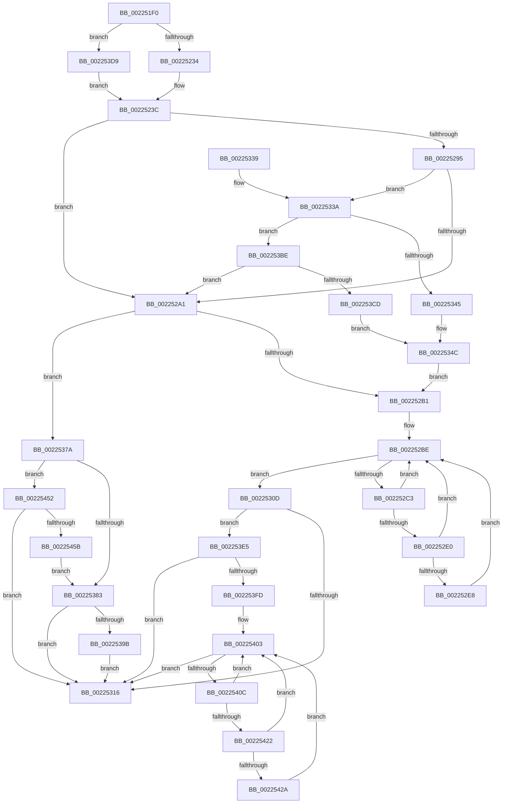

# EtwpTraceFileName

- RVA: `0x002251F0`–`0x00225460` (길이 `624` bytes)
- VA: `0x00000001402251F0`
- 실행 섹션: `.text`
- PDB 이름 있음: `예`; PDB Function 태그: `아니요`
- unwind 정보 RVA: `0x0005FA1C`
- 디코드: `144`개 명령, `624/624` bytes 표시
- 미해석 바이트: `0` (있으면 어셈블리에 `.byte`로 보존)

> 이 문서는 커널 이미지의 기계어와 PDB 기호를 분석해 생성했습니다. 4번과 5번은 함수 원형과 자료형을 바이너리 사용 방식에서 추정한 C 해석이며 원본 소스 복구 결과는 아닙니다.

## 1. Dependencies

- 직접 호출 지점: **8**; 고유 호출 대상: **5**
- 직접 호출자로 확인된 함수: **0**
- RIP 상대 이미지 참조: **5**

### Outgoing calls
- `0x00225234` → [PsGetCurrentServerSilo](PsGetCurrentServerSilo_function_00225710.md) (function, `0x00225710`)
- `0x00225306` → [EtwpLogKernelEvent](../25/EtwpLogKernelEvent_function_0025CC00.md) (function, `0x0025CC00`)
- `0x0022531D` → [_security_check_cookie](../6A/_security_check_cookie_function_006AC640.md) (function, `0x006AC640`)
- `0x00225370` → [EtwWriteEx](../25/EtwWriteEx_function_0025F0D0.md) (function, `0x0025F0D0`)
- `0x00225386` → [PsGetServerSiloGlobals](PsGetServerSiloGlobals_function_002250A0.md) (function, `0x002250A0`)
- `0x002253B4` → [EtwpLogKernelEvent](../25/EtwpLogKernelEvent_function_0025CC00.md) (function, `0x0025CC00`)
- `0x002253E8` → [PsGetServerSiloGlobals](PsGetServerSiloGlobals_function_002250A0.md) (function, `0x002250A0`)
- `0x0022544B` → [EtwpLogKernelEvent](../25/EtwpLogKernelEvent_function_0025CC00.md) (function, `0x0025CC00`)

### Direct callers
- 이 함수 시작 RVA로 연결되는 직접 call은 확인되지 않았습니다. 간접 호출은 완전히 역산할 수 없습니다.

### Static image references
- `0x00225208` → RVA `0x00E0A740` (`.data`; read)
- `0x0022527A` → RVA `0x00FC6AA8` (`ALMOSTRO`; read)
- `0x00225345` → RVA `0x00010560` (`.rdata`; read)
- `0x0022534C` → RVA `0x00EFF838` (`.data`; read)
- `0x002253CD` → RVA `0x00010570` (`.rdata`; read)

## 2. Other-region calls and transfers

- 다른 실행 섹션으로 향하는 call: **0**
- 별도 외부 분기/꼬리 이동을 확인하지 못했습니다.

## 3. Assembly (complete function range)

```asm
002251F0  48 89 5C 24 10                  mov qword ptr [rsp + 0x10], rbx
002251F5  55                              push rbp
002251F6  56                              push rsi
002251F7  57                              push rdi
002251F8  41 56                           push r14
002251FA  41 57                           push r15
002251FC  48 8D 6C 24 D9                  lea rbp, [rsp - 0x27]
00225201  48 81 EC 90 00 00 00            sub rsp, 0x90
00225208  48 8B 05 31 55 BE 00            mov rax, qword ptr [rip + 0xbe5531]
0022520F  48 33 C4                        xor rax, rsp
00225212  48 89 45 1F                     mov qword ptr [rbp + 0x1f], rax
00225216  45 33 FF                        xor r15d, r15d
00225219  49 8B D9                        mov rbx, r9
0022521C  4C 89 7D E7                     mov qword ptr [rbp - 0x19], r15
00225220  49 8B F0                        mov rsi, r8
00225223  66 44 89 7D D7                  mov word ptr [rbp - 0x29], r15w
00225228  4C 8B F2                        mov r14, rdx
0022522B  48 85 C9                        test rcx, rcx
0022522E  0F 85 A5 01 00 00               jne 0x1402253d9
00225234  E8 D7 04 00 00                  call 0x140225710
00225239  48 8B F8                        mov rdi, rax
0022523C  0F B7 0E                        movzx ecx, word ptr [rsi]
0022523F  B8 00 20 00 00                  mov eax, 0x2000
00225244  3B C8                           cmp ecx, eax
00225246  4C 89 75 DF                     mov qword ptr [rbp - 0x21], r14
0022524A  44 0F B7 75 7F                  movzx r14d, word ptr [rbp + 0x7f]
0022524F  0F 47 C8                        cmova ecx, eax
00225252  48 C7 45 F7 08 00 00 00         mov qword ptr [rbp - 9], 8
0022525A  48 8D 45 DF                     lea rax, [rbp - 0x21]
0022525E  89 4D 07                        mov dword ptr [rbp + 7], ecx
00225261  48 89 45 EF                     mov qword ptr [rbp - 0x11], rax
00225265  48 8B 46 08                     mov rax, qword ptr [rsi + 8]
00225269  BE 03 00 00 00                  mov esi, 3
0022526E  48 89 45 FF                     mov qword ptr [rbp - 1], rax
00225272  48 8D 45 D7                     lea rax, [rbp - 0x29]
00225276  48 89 45 0F                     mov qword ptr [rbp + 0xf], rax
0022527A  48 8B 05 27 18 DA 00            mov rax, qword ptr [rip + 0xda1827]
00225281  44 89 7D 0B                     mov dword ptr [rbp + 0xb], r15d
00225285  48 C7 45 17 02 00 00 00         mov qword ptr [rbp + 0x17], 2
0022528D  48 05 CC 12 00 00               add rax, 0x12cc
00225293  74 0C                           je 0x1402252a1
00225295  F7 00 00 02 00 00               test dword ptr [rax], 0x200
0022529B  0F 85 99 00 00 00               jne 0x14022533a
002252A1  41 B8 24 04 00 00               mov r8d, 0x424
002252A7  66 45 3B F0                     cmp r14w, r8w
002252AB  0F 84 C9 00 00 00               je 0x14022537a
002252B1  48 8B 05 F0 17 DA 00            mov rax, qword ptr [rip + 0xda17f0]
002252B8  8B 98 A8 11 00 00               mov ebx, dword ptr [rax + 0x11a8]
002252BE  0F BC CB                        bsf ecx, ebx
002252C1  74 4A                           je 0x14022530d
002252C3  48 8B 15 DE 17 DA 00            mov rdx, qword ptr [rip + 0xda17de]
002252CA  8D 43 FF                        lea eax, [rbx - 1]
002252CD  23 D8                           and ebx, eax
002252CF  8B C1                           mov eax, ecx
002252D1  48 C1 E0 05                     shl rax, 5
002252D5  48 05 CC 11 00 00               add rax, 0x11cc
002252DB  48 03 C2                        add rax, rdx
002252DE  74 DE                           je 0x1402252be
002252E0  F7 00 00 02 00 00               test dword ptr [rax], 0x200
002252E6  74 D6                           je 0x1402252be
002252E8  44 0F B6 84 4A 98 11 00 00      movzx r8d, byte ptr [rdx + rcx*2 + 0x1198]
002252F1  44 8B CE                        mov r9d, esi
002252F4  48 8D 4D EF                     lea rcx, [rbp - 0x11]
002252F8  C7 44 24 28 02 18 50 00         mov dword ptr [rsp + 0x28], 0x501802
00225300  66 44 89 74 24 20               mov word ptr [rsp + 0x20], r14w
00225306  E8 F5 78 03 00                  call 0x14025cc00
0022530B  EB B1                           jmp 0x1402252be
0022530D  48 85 FF                        test rdi, rdi
00225310  0F 85 CF 00 00 00               jne 0x1402253e5
00225316  48 8B 4D 1F                     mov rcx, qword ptr [rbp + 0x1f]
0022531A  48 33 CC                        xor rcx, rsp
0022531D  E8 1E 73 48 00                  call 0x1406ac640
00225322  48 8B 9C 24 C8 00 00 00         mov rbx, qword ptr [rsp + 0xc8]
0022532A  48 81 C4 90 00 00 00            add rsp, 0x90
00225331  41 5F                           pop r15
00225333  41 5E                           pop r14
00225335  5F                              pop rdi
00225336  5E                              pop rsi
00225337  5D                              pop rbp
00225338  C3                              ret
00225339  CC                              int3
0022533A  B8 20 04 00 00                  mov eax, 0x420
0022533F  66 44 3B F0                     cmp r14w, ax
00225343  75 79                           jne 0x1402253be
00225345  48 8D 15 14 B2 DE FF            lea rdx, [rip - 0x214dec]
0022534C  48 8B 0D E5 A4 CD 00            mov rcx, qword ptr [rip + 0xcda4e5]
00225353  48 8D 45 EF                     lea rax, [rbp - 0x11]
00225357  48 89 44 24 38                  mov qword ptr [rsp + 0x38], rax
0022535C  45 33 C9                        xor r9d, r9d
0022535F  89 74 24 30                     mov dword ptr [rsp + 0x30], esi
00225363  45 33 C0                        xor r8d, r8d
00225366  4C 89 7C 24 28                  mov qword ptr [rsp + 0x28], r15
0022536B  4C 89 7C 24 20                  mov qword ptr [rsp + 0x20], r15
00225370  E8 5B 9D 03 00                  call 0x14025f0d0
00225375  E9 37 FF FF FF                  jmp 0x1402252b1
0022537A  48 85 DB                        test rbx, rbx
0022537D  0F 85 CF 00 00 00               jne 0x140225452
00225383  48 8B CB                        mov rcx, rbx
00225386  E8 15 FD FF FF                  call 0x1402250a0
0022538B  48 8B 90 40 03 00 00            mov rdx, qword ptr [rax + 0x340]
00225392  48 85 D2                        test rdx, rdx
00225395  0F 84 7B FF FF FF               je 0x140225316
0022539B  C7 44 24 28 02 18 50 00         mov dword ptr [rsp + 0x28], 0x501802
002253A3  48 8D 4D EF                     lea rcx, [rbp - 0x11]
002253A7  66 44 89 44 24 20               mov word ptr [rsp + 0x20], r8w
002253AD  44 8B CE                        mov r9d, esi
002253B0  44 8B 45 77                     mov r8d, dword ptr [rbp + 0x77]
002253B4  E8 47 78 03 00                  call 0x14025cc00
002253B9  E9 58 FF FF FF                  jmp 0x140225316
002253BE  B8 23 04 00 00                  mov eax, 0x423
002253C3  66 44 3B F0                     cmp r14w, ax
002253C7  0F 85 D4 FE FF FF               jne 0x1402252a1
002253CD  48 8D 15 9C B1 DE FF            lea rdx, [rip - 0x214e64]
002253D4  E9 73 FF FF FF                  jmp 0x14022534c
002253D9  48 8B B9 F0 05 00 00            mov rdi, qword ptr [rcx + 0x5f0]
002253E0  E9 57 FE FF FF                  jmp 0x14022523c
002253E5  48 8B CF                        mov rcx, rdi
002253E8  E8 B3 FC FF FF                  call 0x1402250a0
002253ED  48 8B B8 40 03 00 00            mov rdi, qword ptr [rax + 0x340]
002253F4  48 85 FF                        test rdi, rdi
002253F7  0F 84 19 FF FF FF               je 0x140225316
002253FD  8B 9F A8 11 00 00               mov ebx, dword ptr [rdi + 0x11a8]
00225403  0F BC CB                        bsf ecx, ebx
00225406  0F 84 0A FF FF FF               je 0x140225316
0022540C  8D 43 FF                        lea eax, [rbx - 1]
0022540F  23 D8                           and ebx, eax
00225411  8B C1                           mov eax, ecx
00225413  48 C1 E0 05                     shl rax, 5
00225417  48 05 CC 11 00 00               add rax, 0x11cc
0022541D  48 03 C7                        add rax, rdi
00225420  74 E1                           je 0x140225403
00225422  F7 00 00 02 00 00               test dword ptr [rax], 0x200
00225428  74 D9                           je 0x140225403
0022542A  44 0F B6 84 4F 98 11 00 00      movzx r8d, byte ptr [rdi + rcx*2 + 0x1198]
00225433  44 8B CE                        mov r9d, esi
00225436  48 8D 4D EF                     lea rcx, [rbp - 0x11]
0022543A  C7 44 24 28 02 18 50 00         mov dword ptr [rsp + 0x28], 0x501802
00225442  48 8B D7                        mov rdx, rdi
00225445  66 44 89 74 24 20               mov word ptr [rsp + 0x20], r14w
0022544B  E8 B0 77 03 00                  call 0x14025cc00
00225450  EB B1                           jmp 0x140225403
00225452  48 3B DF                        cmp rbx, rdi
00225455  0F 85 BB FE FF FF               jne 0x140225316
0022545B  E9 23 FF FF FF                  jmp 0x140225383
```

## 4. C-style interpretation (structured pseudocode)

```c
__int64 __fastcall EtwpTraceFileName(__int64 a1, __int64 a2, __int64 a3, __int64 a4, unsigned int a5, unsigned __int16 a6)
{
    __int64 result;
    __int64 v_r15;
    __int64 v_rbx;
    __int64 v_rsp;
    unsigned __int64 v_stack_m30;
    unsigned __int64 v_stack_m38;
    unsigned __int64 v_stack_m40;
    unsigned int v_stack_m44;
    unsigned int v_stack_m48;
    unsigned __int64 v_stack_m4F;
    unsigned __int64 v_stack_m50;
    unsigned __int64 v_stack_m58;
    unsigned __int64 v_stack_m60;
    unsigned __int64 v_stack_m68;
    unsigned __int64 v_stack_m70;
    unsigned __int16 v_stack_m78;
    unsigned int v_stack_m90;
    unsigned __int16 v_stack_m98;
    unsigned __int64 v_stack_p10;
    unsigned __int64 v_stack_p20;
    unsigned __int64 v_stack_p28;
    unsigned int v_stack_p30;
    unsigned __int64 v_stack_p38;

    v_stack_p10 = v_rbx;
    v_rsp = (v_rsp) - (144);
    result = (*(unsigned __int64 *)(v_rip + 12473649)) ^ (v_rsp);
    v_stack_m30 = result;
    v_r15 = 0;
    v_stack_m68 = 0;
    v_stack_m78 = 0;
    if (a1 != 0) goto loc_002253D9;
    result = PsGetCurrentServerSilo(a1, a2, a3, a4);
loc_0022523C:
    v_stack_m70 = a2;
    a1 = *(unsigned __int16 *)(a3);
    if (((unsigned int)(*(unsigned __int16 *)(a3))) > ((unsigned int)((unsigned int)(0x2000ULL)))) { a1 = (unsigned int)((unsigned int)(0x2000ULL)); }
    v_stack_m58 = 8;
    v_stack_m48 = (unsigned int)(a1);
    v_stack_m60 = v_stack_m70;
    v_stack_m50 = *(unsigned __int64 *)(a3 + 8);
    v_stack_m40 = v_stack_m78;
    v_stack_m44 = 0;
    v_stack_m38 = 2;
    result = (*(unsigned __int64 *)(v_rip + 14293031)) + (0x12CCULL);
    if (condition_is_equal) goto loc_002252A1;
    if (((*(unsigned int *)(result)) & (512)) != 0) goto loc_0022533A;
loc_002252A1:
    if (a6 == ((unsigned __int16)((unsigned int)(0x424ULL)))) goto loc_0022537A;
loc_002252B1:
loc_002252BE:
    if (a6 == ((unsigned __int16)((unsigned int)(0x424ULL)))) goto loc_0022530D;
    v_rbx = (unsigned int)(((unsigned int)(*(unsigned int *)(*(unsigned __int64 *)(v_rip + 14292976) + 4520))) & ((unsigned int)((unsigned int)(*(unsigned int *)(*(unsigned __int64 *)(v_rip + 14292976) + 4520)) - 1)));
    result = ((unsigned int)((unsigned int)(a1))) << (5);
    result = (result) + (0x11CCULL);
    result = (result) + (*(unsigned __int64 *)(v_rip + 14292958));
    if (condition_is_equal) goto loc_002252BE;
    if (((*(unsigned int *)(result)) & (512)) == 0) goto loc_002252BE;
    v_stack_m90 = 0x501802ULL;
    v_stack_m98 = a6;
    result = EtwpLogKernelEvent(v_stack_m60, *(unsigned __int64 *)(v_rip + 14292958), *(unsigned __int8 *)(*(unsigned __int64 *)(v_rip + 14292958) + a1 * 2 + 4504), 3);
    goto loc_002252BE;
loc_0022530D:
    if (result != 0) goto loc_002253E5;
loc_00225316:
    a1 = (v_stack_m30) ^ (v_rsp);
    result = _security_check_cookie(a1, *(unsigned __int64 *)(v_rip + 14292958), *(unsigned __int8 *)(*(unsigned __int64 *)(v_rip + 14292958) + a1 * 2 + 4504), 3);
    v_rsp = (v_rsp) + (144);
    return result;
loc_0022533A:
    if (a6 != ((unsigned __int16)((unsigned int)(0x420ULL)))) goto loc_002253BE;
loc_0022534C:
    v_stack_p38 = v_stack_m60;
    a4 = 0;
    v_stack_p30 = 3;
    a3 = 0;
    v_stack_p28 = 0;
    v_stack_p20 = 0;
    result = EtwWriteEx(*(unsigned __int64 *)(v_rip + 13477093), v_rip - 2182636, a3, a4);
    goto loc_002252B1;
loc_0022537A:
    if (v_stack_p10 != 0) goto loc_00225452;
loc_00225383:
    result = PsGetServerSiloGlobals(v_stack_p10, v_rip - 2182636, a3, a4);
    if (*(unsigned __int64 *)(result + 832) == 0) goto loc_00225316;
    v_stack_p28 = 0x501802ULL;
    v_stack_p20 = 0;
    result = EtwpLogKernelEvent(v_stack_m60, *(unsigned __int64 *)(result + 832), (unsigned int)(a5), 3);
    goto loc_00225316;
loc_002253BE:
    if (a6 != ((unsigned __int16)((unsigned int)(0x423ULL)))) goto loc_002252A1;
    goto loc_0022534C;
loc_002253D9:
    goto loc_0022523C;
loc_002253E5:
    result = PsGetServerSiloGlobals(*(unsigned __int64 *)(v_stack_m60 + 1520), v_rip - 2182756, (unsigned int)(a5), 3);
    if (*(unsigned __int64 *)(result + 832) == 0) goto loc_00225316;
loc_00225403:
    if (*(unsigned __int64 *)(result + 832) == 0) goto loc_00225316;
    v_rbx = (unsigned int)(((unsigned int)(*(unsigned int *)(*(unsigned __int64 *)(result + 832) + 4520))) & ((unsigned int)((unsigned int)(*(unsigned int *)(*(unsigned __int64 *)(result + 832) + 4520)) - 1)));
    result = ((unsigned int)((unsigned int)(*(unsigned __int64 *)(v_stack_m60 + 1520)))) << (5);
    result = (result) + (0x11CCULL);
    result = (result) + (*(unsigned __int64 *)(result + 832));
    if (condition_is_equal) goto loc_00225403;
    if (((*(unsigned int *)(result)) & (512)) == 0) goto loc_00225403;
    v_stack_p28 = 0x501802ULL;
    v_stack_p20 = a6;
    result = EtwpLogKernelEvent(v_stack_m60, *(unsigned __int64 *)(result + 832), *(unsigned __int8 *)(*(unsigned __int64 *)(result + 832) + *(unsigned __int64 *)(v_stack_m60 + 1520) * 2 + 4504), 3);
    goto loc_00225403;
loc_00225452:
    if (v_rbx != (*(unsigned __int64 *)(result + 832))) goto loc_00225316;
    goto loc_00225383;
}
```

## 5. (Beta) C Style

```c
int64_t EtwpTraceFileName(int64_t Arg1, int64_t Arg2, void *Arg3, int64_t Arg4, uint32_t Arg5, uint16_t Arg6)
{
    uint8_t *arg3 = (uint8_t *)Arg3;

    int64_t result;
    int64_t local_r15;
    int64_t local_rbx;
    int64_t local_rsp;
    uint64_t v_stack_m30;
    uint64_t v_stack_m38;
    uint64_t v_stack_m40;
    uint32_t v_stack_m44;
    uint32_t v_stack_m48;
    uint64_t v_stack_m4F;
    uint64_t v_stack_m50;
    uint64_t v_stack_m58;
    uint64_t v_stack_m60;
    uint64_t v_stack_m68;
    uint64_t v_stack_m70;
    uint16_t v_stack_m78;
    uint32_t v_stack_m90;
    uint16_t v_stack_m98;
    uint64_t v_stack_p10;
    uint64_t v_stack_p20;
    uint64_t v_stack_p28;
    uint32_t v_stack_p30;
    uint64_t v_stack_p38;

    v_stack_p10 = local_rbx;
    local_rsp = (local_rsp) - (144);
    result = (*(uint64_t *)(v_rip + 0xBE5531)) ^ (local_rsp);
    v_stack_m30 = result;
    local_r15 = 0;
    v_stack_m68 = 0;
    v_stack_m78 = 0;
    if (Arg1 != 0) goto loc_002253D9;
    result = PsGetCurrentServerSilo(Arg1, Arg2, Arg3, Arg4);
loc_0022523C:
    v_stack_m70 = Arg2;
    Arg1 = *(uint16_t *)(arg3);
    if (((uint32_t)(*(uint16_t *)(arg3))) > ((uint32_t)((uint32_t)(0x2000ULL)))) { Arg1 = (uint32_t)((uint32_t)(0x2000ULL)); }
    v_stack_m58 = 8;
    v_stack_m48 = (uint32_t)(Arg1);
    v_stack_m60 = v_stack_m70;
    v_stack_m50 = *(uint64_t *)(arg3 + 0x8);
    v_stack_m40 = v_stack_m78;
    v_stack_m44 = 0;
    v_stack_m38 = 2;
    result = (*(uint64_t *)(v_rip + 0xDA1827)) + (0x12CCULL);
    if (condition_is_equal) goto loc_002252A1;
    if (((*(uint32_t *)(result)) & (512)) != 0) goto loc_0022533A;
loc_002252A1:
    if (Arg6 == ((uint16_t)((uint32_t)(0x424ULL)))) goto loc_0022537A;
loc_002252B1:
loc_002252BE:
    if (Arg6 == ((uint16_t)((uint32_t)(0x424ULL)))) goto loc_0022530D;
    local_rbx = (uint32_t)(((uint32_t)(*(uint32_t *)(*(uint64_t *)(v_rip + 0xDA17F0) + 0x11A8))) & ((uint32_t)((uint32_t)(*(uint32_t *)(*(uint64_t *)(v_rip + 0xDA17F0) + 0x11A8)) - 1)));
    result = ((uint32_t)((uint32_t)(Arg1))) << (5);
    result = (result) + (0x11CCULL);
    result = (result) + (*(uint64_t *)(v_rip + 0xDA17DE));
    if (condition_is_equal) goto loc_002252BE;
    if (((*(uint32_t *)(result)) & (512)) == 0) goto loc_002252BE;
    v_stack_m90 = 0x501802ULL;
    v_stack_m98 = Arg6;
    result = EtwpLogKernelEvent(v_stack_m60, *(uint64_t *)(v_rip + 0xDA17DE), *(uint8_t *)(*(uint64_t *)(v_rip + 0xDA17DE) + Arg1 * 2 + 0x1198), 3);
    goto loc_002252BE;
loc_0022530D:
    if (result != 0) goto loc_002253E5;
loc_00225316:
    Arg1 = (v_stack_m30) ^ (local_rsp);
    result = _security_check_cookie(Arg1, *(uint64_t *)(v_rip + 0xDA17DE), *(uint8_t *)(*(uint64_t *)(v_rip + 0xDA17DE) + Arg1 * 2 + 0x1198), 3);
    local_rsp = (local_rsp) + (144);
    return result;
loc_0022533A:
    if (Arg6 != ((uint16_t)((uint32_t)(0x420ULL)))) goto loc_002253BE;
loc_0022534C:
    v_stack_p38 = v_stack_m60;
    Arg4 = 0;
    v_stack_p30 = 3;
    Arg3 = 0;
    v_stack_p28 = 0;
    v_stack_p20 = 0;
    result = EtwWriteEx(*(uint64_t *)(v_rip + 0xCDA4E5), v_rip - 2182636, Arg3, Arg4);
    goto loc_002252B1;
loc_0022537A:
    if (v_stack_p10 != 0) goto loc_00225452;
loc_00225383:
    result = PsGetServerSiloGlobals(v_stack_p10, v_rip - 2182636, Arg3, Arg4);
    if (*(uint64_t *)(result + 0x340) == 0) goto loc_00225316;
    v_stack_p28 = 0x501802ULL;
    v_stack_p20 = 0;
    result = EtwpLogKernelEvent(v_stack_m60, *(uint64_t *)(result + 0x340), (uint32_t)(Arg5), 3);
    goto loc_00225316;
loc_002253BE:
    if (Arg6 != ((uint16_t)((uint32_t)(0x423ULL)))) goto loc_002252A1;
    goto loc_0022534C;
loc_002253D9:
    goto loc_0022523C;
loc_002253E5:
    result = PsGetServerSiloGlobals(*(uint64_t *)(v_stack_m60 + 0x5F0), v_rip - 2182756, (uint32_t)(Arg5), 3);
    if (*(uint64_t *)(result + 0x340) == 0) goto loc_00225316;
loc_00225403:
    if (*(uint64_t *)(result + 0x340) == 0) goto loc_00225316;
    local_rbx = (uint32_t)(((uint32_t)(*(uint32_t *)(*(uint64_t *)(result + 0x340) + 0x11A8))) & ((uint32_t)((uint32_t)(*(uint32_t *)(*(uint64_t *)(result + 0x340) + 0x11A8)) - 1)));
    result = ((uint32_t)((uint32_t)(*(uint64_t *)(v_stack_m60 + 0x5F0)))) << (5);
    result = (result) + (0x11CCULL);
    result = (result) + (*(uint64_t *)(result + 0x340));
    if (condition_is_equal) goto loc_00225403;
    if (((*(uint32_t *)(result)) & (512)) == 0) goto loc_00225403;
    v_stack_p28 = 0x501802ULL;
    v_stack_p20 = Arg6;
    result = EtwpLogKernelEvent(v_stack_m60, *(uint64_t *)(result + 0x340), *(uint8_t *)(*(uint64_t *)(result + 0x340) + *(uint64_t *)(v_stack_m60 + 0x5F0) * 2 + 0x1198), 3);
    goto loc_00225403;
loc_00225452:
    if (local_rbx != (*(uint64_t *)(result + 0x340))) goto loc_00225316;
    goto loc_00225383;
}
```

### 관측된 메모리 오프셋

구조체 형식이 확인되지 않은 접근은 인자 기준의 오프셋으로만 기록했습니다.

| 기준 인자 | 오프셋 표현 | 폭 (bit) | 접근 |
|---|---:|---:|---|
| `Arg3` | `+ 0x0` | `16` | `R` |
| `Arg3` | `+ 0x8` | `64` | `R` |

## 6. Execution-region graph

[열기: 2D/3D 그래프와 함수 탐색 컨트롤 패널](../../../control-panel.html?section=text&rva=0x002251F0&view=graph)

- 2D 그래프는 위에서 아래로 흐르고, 3D 그래프는 빈 공간을 드래그해 회전합니다. Shift+드래그는 이동, 휠은 확대·축소, 함수 노드 선택은 대상 보고서 이동입니다.

### Static fallback


