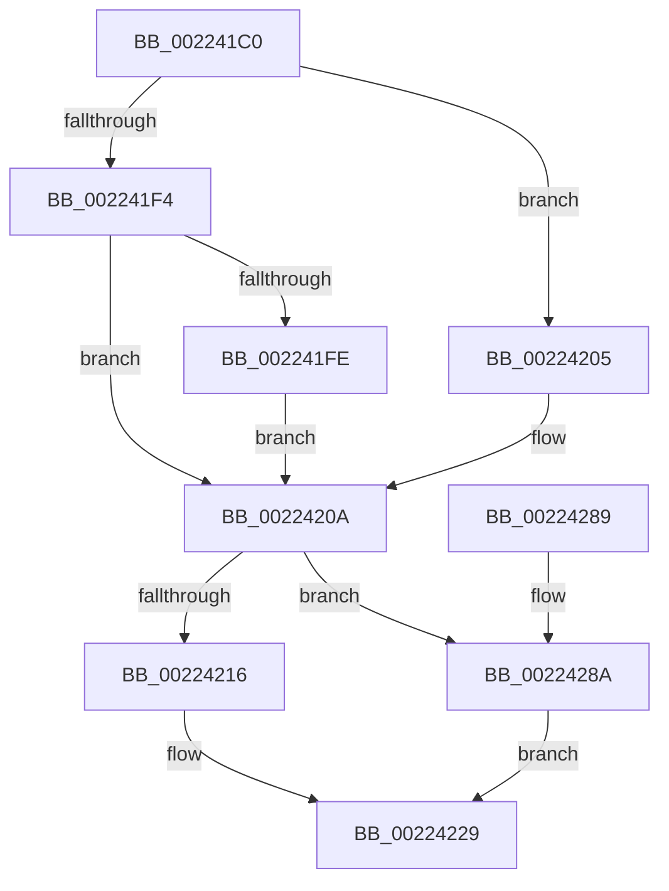

# EtwpTraceIoInit

- RVA: `0x002241C0`–`0x00224296` (길이 `214` bytes)
- VA: `0x00000001402241C0`
- 실행 섹션: `.text`
- PDB 이름 있음: `예`; PDB Function 태그: `아니요`
- unwind 정보 RVA: `0x0005F8CC`
- 디코드: `52`개 명령, `214/214` bytes 표시
- 미해석 바이트: `0` (있으면 어셈블리에 `.byte`로 보존)

> 이 문서는 커널 이미지의 기계어와 PDB 기호를 분석해 생성했습니다. 4번과 5번은 함수 원형과 자료형을 바이너리 사용 방식에서 추정한 C 해석이며 원본 소스 복구 결과는 아닙니다.

## 1. Dependencies

- 직접 호출 지점: **3**; 고유 호출 대상: **3**
- 직접 호출자로 확인된 함수: **0**
- RIP 상대 이미지 참조: **1**

### Outgoing calls
- `0x00224219` → [PsGetThreadServerSilo](PsGetThreadServerSilo_function_002247B0.md) (function, `0x002247B0`)
- `0x00224265` → [EtwTraceSiloKernelEvent](EtwTraceSiloKernelEvent_function_002242A0.md) (function, `0x002242A0`)
- `0x00224272` → [_security_check_cookie](../6A/_security_check_cookie_function_006AC640.md) (function, `0x006AC640`)

### Direct callers
- 이 함수 시작 RVA로 연결되는 직접 call은 확인되지 않았습니다. 간접 호출은 완전히 역산할 수 없습니다.

### Static image references
- `0x002241CF` → RVA `0x00E0A740` (`.data`; read)

## 2. Other-region calls and transfers

- 다른 실행 섹션으로 향하는 call: **0**
- 별도 외부 분기/꼬리 이동을 확인하지 못했습니다.

## 3. Assembly (complete function range)

```asm
002241C0  48 89 5C 24 10                  mov qword ptr [rsp + 0x10], rbx
002241C5  48 89 74 24 18                  mov qword ptr [rsp + 0x18], rsi
002241CA  57                              push rdi
002241CB  48 83 EC 60                     sub rsp, 0x60
002241CF  48 8B 05 6A 65 BE 00            mov rax, qword ptr [rip + 0xbe656a]
002241D6  48 33 C4                        xor rax, rsp
002241D9  48 89 44 24 50                  mov qword ptr [rsp + 0x50], rax
002241DE  83 64 24 3C 00                  and dword ptr [rsp + 0x3c], 0
002241E3  48 8B D9                        mov rbx, rcx
002241E6  48 8B 81 B8 00 00 00            mov rax, qword ptr [rcx + 0xb8]
002241ED  8A 08                           mov cl, byte ptr [rax]
002241EF  80 F9 03                        cmp cl, 3
002241F2  74 11                           je 0x140224205
002241F4  BF 0F 01 00 00                  mov edi, 0x10f
002241F9  80 F9 09                        cmp cl, 9
002241FC  74 0C                           je 0x14022420a
002241FE  BF 0D 01 00 00                  mov edi, 0x10d
00224203  EB 05                           jmp 0x14022420a
00224205  BF 0C 01 00 00                  mov edi, 0x10c
0022420A  48 8B B3 98 00 00 00            mov rsi, qword ptr [rbx + 0x98]
00224211  48 85 F6                        test rsi, rsi
00224214  74 74                           je 0x14022428a
00224216  48 8B CE                        mov rcx, rsi
00224219  E8 92 05 00 00                  call 0x1402247b0
0022421E  48 89 5C 24 30                  mov qword ptr [rsp + 0x30], rbx
00224223  8B 8E 10 05 00 00               mov ecx, dword ptr [rsi + 0x510]
00224229  83 64 24 4C 00                  and dword ptr [rsp + 0x4c], 0
0022422E  48 8D 54 24 40                  lea rdx, [rsp + 0x40]
00224233  89 4C 24 38                     mov dword ptr [rsp + 0x38], ecx
00224237  41 B9 00 04 00 00               mov r9d, 0x400
0022423D  48 8D 4C 24 30                  lea rcx, [rsp + 0x30]
00224242  C7 44 24 28 03 19 60 01         mov dword ptr [rsp + 0x28], 0x1601903
0022424A  48 89 4C 24 40                  mov qword ptr [rsp + 0x40], rcx
0022424F  41 B8 01 00 00 00               mov r8d, 1
00224255  48 8B C8                        mov rcx, rax
00224258  C7 44 24 48 0C 00 00 00         mov dword ptr [rsp + 0x48], 0xc
00224260  66 89 7C 24 20                  mov word ptr [rsp + 0x20], di
00224265  E8 36 00 00 00                  call 0x1402242a0
0022426A  48 8B 4C 24 50                  mov rcx, qword ptr [rsp + 0x50]
0022426F  48 33 CC                        xor rcx, rsp
00224272  E8 C9 83 48 00                  call 0x1406ac640
00224277  4C 8D 5C 24 60                  lea r11, [rsp + 0x60]
0022427C  49 8B 5B 18                     mov rbx, qword ptr [r11 + 0x18]
00224280  49 8B 73 20                     mov rsi, qword ptr [r11 + 0x20]
00224284  49 8B E3                        mov rsp, r11
00224287  5F                              pop rdi
00224288  C3                              ret
00224289  CC                              int3
0022428A  33 C0                           xor eax, eax
0022428C  48 89 5C 24 30                  mov qword ptr [rsp + 0x30], rbx
00224291  83 C9 FF                        or ecx, 0xffffffff
00224294  EB 93                           jmp 0x140224229
```

## 4. C-style interpretation (structured pseudocode)

```c
__int64 __fastcall EtwpTraceIoInit(__int64 a1)
{
    __int64 result;
    __int64 v_rsp;
    unsigned __int64 v_stack_m18;
    unsigned int v_stack_m1C;
    unsigned int v_stack_m20;
    unsigned __int64 v_stack_m28;
    unsigned int v_stack_m2C;
    unsigned int v_stack_m30;
    unsigned __int64 v_stack_m38;
    unsigned int v_stack_m40;
    unsigned __int16 v_stack_m48;
    unsigned __int64 v_stack_m8;
    unsigned __int64 v_stack_p10;
    unsigned __int64 v_stack_p18;

    v_stack_p10 = v_rbx;
    v_stack_p18 = v_rsi;
    v_rsp = (v_rsp) - (96);
    result = (*(unsigned __int64 *)(v_rip + 12477802)) ^ (v_rsp);
    v_stack_m18 = result;
    if (((unsigned __int8)(*(unsigned __int8 *)(*(unsigned __int64 *)(a1 + 184)))) == 3) goto loc_00224205;
    if (((unsigned __int8)(*(unsigned __int8 *)(*(unsigned __int64 *)(a1 + 184)))) == 9) goto loc_0022420A;
    goto loc_0022420A;
loc_00224205:
loc_0022420A:
    if (*(unsigned __int64 *)(a1 + 152) == 0) goto loc_0022428A;
    result = PsGetThreadServerSilo(*(unsigned __int64 *)(a1 + 152), a2, a3, a4);
    v_stack_m38 = a1;
loc_00224229:
    v_stack_m30 = (unsigned int)((unsigned int)(*(unsigned int *)(*(unsigned __int64 *)(a1 + 152) + 1296)));
    v_stack_m40 = 0x1601903ULL;
    v_stack_m28 = v_stack_m38;
    v_stack_m20 = 12;
    v_stack_m48 = 268;
    result = EtwTraceSiloKernelEvent(result, v_stack_m28, 1, (unsigned int)(0x400ULL));
    a1 = (v_stack_m18) ^ (v_rsp);
    result = _security_check_cookie(a1, v_stack_m28, 1, (unsigned int)(0x400ULL));
    return result;
loc_0022428A:
    result = 0;
    v_stack_m30 = *(unsigned __int64 *)(v_stack_m8 + 24);
    a1 = (unsigned int)((a1) | (0xFFFFFFFFULL));
    goto loc_00224229;
}
```

## 5. (Beta) C Style

```c
int64_t EtwpTraceIoInit(void *Arg1)
{
    uint8_t *arg1 = (uint8_t *)Arg1;

    int64_t result;
    int64_t local_rsp;
    uint64_t v_stack_m18;
    uint32_t v_stack_m1C;
    uint32_t v_stack_m20;
    uint64_t v_stack_m28;
    uint32_t v_stack_m2C;
    uint32_t v_stack_m30;
    uint64_t v_stack_m38;
    uint32_t v_stack_m40;
    uint16_t v_stack_m48;
    uint64_t v_stack_m8;
    uint64_t v_stack_p10;
    uint64_t v_stack_p18;

    v_stack_p10 = local_rbx;
    v_stack_p18 = local_rsi;
    local_rsp = (local_rsp) - (96);
    result = (*(uint64_t *)(v_rip + 0xBE656A)) ^ (local_rsp);
    v_stack_m18 = result;
    if (((uint8_t)(*(uint8_t *)(*(uint64_t *)(arg1 + 0xB8)))) == 3) goto loc_00224205;
    if (((uint8_t)(*(uint8_t *)(*(uint64_t *)(arg1 + 0xB8)))) == 9) goto loc_0022420A;
    goto loc_0022420A;
loc_00224205:
loc_0022420A:
    if (*(uint64_t *)(arg1 + 0x98) == 0) goto loc_0022428A;
    result = PsGetThreadServerSilo(*(uint64_t *)(arg1 + 0x98), a2, a3, a4);
    v_stack_m38 = Arg1;
loc_00224229:
    v_stack_m30 = (uint32_t)((uint32_t)(*(uint32_t *)(*(uint64_t *)(arg1 + 0x98) + 0x510)));
    v_stack_m40 = 0x1601903ULL;
    v_stack_m28 = v_stack_m38;
    v_stack_m20 = 12;
    v_stack_m48 = 268;
    result = EtwTraceSiloKernelEvent(result, v_stack_m28, 1, (uint32_t)(0x400ULL));
    Arg1 = (v_stack_m18) ^ (local_rsp);
    result = _security_check_cookie(Arg1, v_stack_m28, 1, (uint32_t)(0x400ULL));
    return result;
loc_0022428A:
    result = 0;
    v_stack_m30 = *(uint64_t *)(v_stack_m8 + 0x18);
    Arg1 = (uint32_t)((Arg1) | (0xFFFFFFFFULL));
    goto loc_00224229;
}
```

### 관측된 메모리 오프셋

구조체 형식이 확인되지 않은 접근은 인자 기준의 오프셋으로만 기록했습니다.

| 기준 인자 | 오프셋 표현 | 폭 (bit) | 접근 |
|---|---:|---:|---|
| `Arg1` | `+ 0x98` | `64` | `R` |
| `Arg1` | `+ 0xB8` | `64` | `R` |

## 6. Execution-region graph

[열기: 2D/3D 그래프와 함수 탐색 컨트롤 패널](../../../control-panel.html?section=text&rva=0x002241C0&view=graph)

- 2D 그래프는 위에서 아래로 흐르고, 3D 그래프는 빈 공간을 드래그해 회전합니다. Shift+드래그는 이동, 휠은 확대·축소, 함수 노드 선택은 대상 보고서 이동입니다.

### Static fallback


