# EtwpTraceIo

- RVA: `0x00224400`–`0x002247A6` (길이 `934` bytes)
- VA: `0x0000000140224400`
- 실행 섹션: `.text`
- PDB 이름 있음: `예`; PDB Function 태그: `아니요`
- unwind 정보 RVA: `0x0005F908`
- 디코드: `223`개 명령, `934/934` bytes 표시
- 미해석 바이트: `0` (있으면 어셈블리에 `.byte`로 보존)

> 이 문서는 커널 이미지의 기계어와 PDB 기호를 분석해 생성했습니다. 4번과 5번은 함수 원형과 자료형을 바이너리 사용 방식에서 추정한 C 해석이며 원본 소스 복구 결과는 아닙니다.

## 1. Dependencies

- 직접 호출 지점: **7**; 고유 호출 대상: **5**
- 직접 호출자로 확인된 함수: **0**
- RIP 상대 이미지 참조: **2**

### Outgoing calls
- `0x00224476` → [PsGetThreadServerSilo](PsGetThreadServerSilo_function_002247B0.md) (function, `0x002247B0`)
- `0x00224575` → [EtwpLogKernelEvent](../25/EtwpLogKernelEvent_function_0025CC00.md) (function, `0x0025CC00`)
- `0x002245AA` → [_security_check_cookie](../6A/_security_check_cookie_function_006AC640.md) (function, `0x006AC640`)
- `0x002246CC` → [EtwpDiskProvTraceDisk](EtwpDiskProvTraceDisk_function_00225A1C.md) (function, `0x00225A1C`)
- `0x00224704` → [EtwpDiskProvTraceDisk](EtwpDiskProvTraceDisk_function_00225A1C.md) (function, `0x00225A1C`)
- `0x00224711` → [PsGetServerSiloGlobals](PsGetServerSiloGlobals_function_002250A0.md) (function, `0x002250A0`)
- `0x00224782` → [EtwpLogKernelEvent](../25/EtwpLogKernelEvent_function_0025CC00.md) (function, `0x0025CC00`)

### Direct callers
- 이 함수 시작 RVA로 연결되는 직접 call은 확인되지 않았습니다. 간접 호출은 완전히 역산할 수 없습니다.

### Static image references
- `0x00224424` → RVA `0x00E0A740` (`.data`; read)
- `0x00224519` → RVA `0x00FC6AA8` (`ALMOSTRO`; read)

## 2. Other-region calls and transfers

- 다른 실행 섹션으로 향하는 call: **0**
- 별도 외부 분기/꼬리 이동을 확인하지 못했습니다.

## 3. Assembly (complete function range)

```asm
00224400  48 89 5C 24 08                  mov qword ptr [rsp + 8], rbx
00224405  48 89 74 24 10                  mov qword ptr [rsp + 0x10], rsi
0022440A  48 89 7C 24 20                  mov qword ptr [rsp + 0x20], rdi
0022440F  55                              push rbp
00224410  41 54                           push r12
00224412  41 55                           push r13
00224414  41 56                           push r14
00224416  41 57                           push r15
00224418  48 8D 6C 24 C9                  lea rbp, [rsp - 0x37]
0022441D  48 81 EC C0 00 00 00            sub rsp, 0xc0
00224424  48 8B 05 15 63 BE 00            mov rax, qword ptr [rip + 0xbe6315]
0022442B  48 33 C4                        xor rax, rsp
0022442E  48 89 45 27                     mov qword ptr [rbp + 0x27], rax
00224432  4D 8B B8 98 00 00 00            mov r15, qword ptr [r8 + 0x98]
00224439  0F 57 C9                        xorps xmm1, xmm1
0022443C  49 8B 98 B8 00 00 00            mov rbx, qword ptr [r8 + 0xb8]
00224443  33 C0                           xor eax, eax
00224445  0F 57 C0                        xorps xmm0, xmm0
00224448  48 89 45 D7                     mov qword ptr [rbp - 0x29], rax
0022444C  45 33 ED                        xor r13d, r13d
0022444F  4D 8B F0                        mov r14, r8
00224452  8B F2                           mov esi, edx
00224454  8B F9                           mov edi, ecx
00224456  0F 11 45 E7                     movups xmmword ptr [rbp - 0x19], xmm0
0022445A  0F 11 45 F7                     movups xmmword ptr [rbp - 9], xmm0
0022445E  0F 11 4D A7                     movups xmmword ptr [rbp - 0x59], xmm1
00224462  0F 11 4D B7                     movups xmmword ptr [rbp - 0x49], xmm1
00224466  0F 11 4D C7                     movups xmmword ptr [rbp - 0x39], xmm1
0022446A  4D 85 FF                        test r15, r15
0022446D  0F 84 24 02 00 00               je 0x140224697
00224473  49 8B CF                        mov rcx, r15
00224476  E8 35 03 00 00                  call 0x1402247b0
0022447B  4C 8B E0                        mov r12, rax
0022447E  0F B6 13                        movzx edx, byte ptr [rbx]
00224481  41 8B 4E 10                     mov ecx, dword ptr [r14 + 0x10]
00224485  80 FA 09                        cmp dl, 9
00224488  0F 84 C1 01 00 00               je 0x14022464f
0022448E  41 8B 46 38                     mov eax, dword ptr [r14 + 0x38]
00224492  80 FA 03                        cmp dl, 3
00224495  45 8B C5                        mov r8d, r13d
00224498  89 75 A7                        mov dword ptr [rbp - 0x59], esi
0022449B  89 4D AB                        mov dword ptr [rbp - 0x55], ecx
0022449E  41 0F 95 C0                     setne r8b
002244A2  4C 89 75 C7                     mov qword ptr [rbp - 0x39], r14
002244A6  66 41 81 C0 0A 01               add r8w, 0x10a
002244AC  89 45 AF                        mov dword ptr [rbp - 0x51], eax
002244AF  48 8B 43 18                     mov rax, qword ptr [rbx + 0x18]
002244B3  48 89 45 B7                     mov qword ptr [rbp - 0x49], rax
002244B7  48 8B 43 08                     mov rax, qword ptr [rbx + 8]
002244BB  48 89 45 CF                     mov qword ptr [rbp - 0x31], rax
002244BF  44 89 6D B3                     mov dword ptr [rbp - 0x4d], r13d
002244C3  4D 85 FF                        test r15, r15
002244C6  0F 84 0A 02 00 00               je 0x1402246d6
002244CC  41 8B 87 10 05 00 00            mov eax, dword ptr [r15 + 0x510]
002244D3  89 45 D7                        mov dword ptr [rbp - 0x29], eax
002244D6  8B C7                           mov eax, edi
002244D8  25 00 00 FF FF                  and eax, 0xffff0000
002244DD  3D 00 00 53 56                  cmp eax, 0x56530000
002244E2  0F 85 E9 00 00 00               jne 0x1402245d1
002244E8  C7 45 B3 01 00 00 00            mov dword ptr [rbp - 0x4d], 1
002244EF  F6 C1 08                        test cl, 8
002244F2  0F 84 F7 00 00 00               je 0x1402245ef
002244F8  49 8B 46 18                     mov rax, qword ptr [r14 + 0x18]
002244FC  48 85 C0                        test rax, rax
002244FF  0F 85 8C 02 00 00               jne 0x140224791
00224505  4C 89 6D BF                     mov qword ptr [rbp - 0x41], r13
00224509  48 8D 45 A7                     lea rax, [rbp - 0x59]
0022450D  48 C7 45 0F 34 00 00 00         mov qword ptr [rbp + 0xf], 0x34
00224515  41 0F B7 F8                     movzx edi, r8w
00224519  48 8B 1D 88 25 DA 00            mov rbx, qword ptr [rip + 0xda2588]
00224520  48 89 45 07                     mov qword ptr [rbp + 7], rax
00224524  8B 9B A8 11 00 00               mov ebx, dword ptr [rbx + 0x11a8]
0022452A  0F BC CB                        bsf ecx, ebx
0022452D  74 50                           je 0x14022457f
0022452F  90                              nop
00224530  48 8B 15 71 25 DA 00            mov rdx, qword ptr [rip + 0xda2571]
00224537  8D 43 FF                        lea eax, [rbx - 1]
0022453A  23 D8                           and ebx, eax
0022453C  8B C1                           mov eax, ecx
0022453E  48 C1 E0 05                     shl rax, 5
00224542  48 05 CC 11 00 00               add rax, 0x11cc
00224548  48 03 C2                        add rax, rdx
0022454B  74 2D                           je 0x14022457a
0022454D  F7 00 00 01 00 00               test dword ptr [rax], 0x100
00224553  74 25                           je 0x14022457a
00224555  44 0F B6 84 4A 98 11 00 00      movzx r8d, byte ptr [rdx + rcx*2 + 0x1198]
0022455E  41 B9 01 00 00 00               mov r9d, 1
00224564  48 8D 4D 07                     lea rcx, [rbp + 7]
00224568  C7 44 24 28 03 18 50 00         mov dword ptr [rsp + 0x28], 0x501803
00224570  66 89 7C 24 20                  mov word ptr [rsp + 0x20], di
00224575  E8 86 86 03 00                  call 0x14025cc00
0022457A  0F BC CB                        bsf ecx, ebx
0022457D  75 B1                           jne 0x140224530
0022457F  4D 85 E4                        test r12, r12
00224582  0F 85 86 01 00 00               jne 0x14022470e
00224588  48 8B 05 19 25 DA 00            mov rax, qword ptr [rip + 0xda2519]
0022458F  48 05 CC 12 00 00               add rax, 0x12cc
00224595  74 0C                           je 0x1402245a3
00224597  F7 00 00 01 00 00               test dword ptr [rax], 0x100
0022459D  0F 85 FC 00 00 00               jne 0x14022469f
002245A3  48 8B 4D 27                     mov rcx, qword ptr [rbp + 0x27]
002245A7  48 33 CC                        xor rcx, rsp
002245AA  E8 91 80 48 00                  call 0x1406ac640
002245AF  4C 8D 9C 24 C0 00 00 00         lea r11, [rsp + 0xc0]
002245B7  49 8B 5B 30                     mov rbx, qword ptr [r11 + 0x30]
002245BB  49 8B 73 38                     mov rsi, qword ptr [r11 + 0x38]
002245BF  49 8B 7B 48                     mov rdi, qword ptr [r11 + 0x48]
002245C3  49 8B E3                        mov rsp, r11
002245C6  41 5F                           pop r15
002245C8  41 5E                           pop r14
002245CA  41 5D                           pop r13
002245CC  41 5C                           pop r12
002245CE  5D                              pop rbp
002245CF  C3                              ret
002245D0  CC                              int3
002245D1  81 E7 FF FF FF 00               and edi, 0xffffff
002245D7  81 FF 42 52 53 00               cmp edi, 0x535242
002245DD  0F 85 A3 00 00 00               jne 0x140224686
002245E3  C7 45 B3 02 00 00 00            mov dword ptr [rbp - 0x4d], 2
002245EA  E9 00 FF FF FF                  jmp 0x1402244ef
002245EF  49 8B 8E C0 00 00 00            mov rcx, qword ptr [r14 + 0xc0]
002245F6  48 85 C9                        test rcx, rcx
002245F9  75 47                           jne 0x140224642
002245FB  41 0F B6 56 43                  movzx edx, byte ptr [r14 + 0x43]
00224600  45 0F BE 4E 42                  movsx r9d, byte ptr [r14 + 0x42]
00224605  41 3B D1                        cmp edx, r9d
00224608  0F 8F F7 FE FF FF               jg 0x140224505
0022460E  48 83 C3 30                     add rbx, 0x30
00224612  48 8B 0B                        mov rcx, qword ptr [rbx]
00224615  48 85 C9                        test rcx, rcx
00224618  75 28                           jne 0x140224642
0022461A  FE C2                           inc dl
0022461C  48 83 C3 48                     add rbx, 0x48
00224620  0F B6 C2                        movzx eax, dl
00224623  41 3B C1                        cmp eax, r9d
00224626  0F 8F D9 FE FF FF               jg 0x140224505
0022462C  EB E4                           jmp 0x140224612
0022462E  48 8B 80 B8 00 00 00            mov rax, qword ptr [rax + 0xb8]
00224635  48 8B 48 30                     mov rcx, qword ptr [rax + 0x30]
00224639  48 85 C9                        test rcx, rcx
0022463C  0F 84 C3 FE FF FF               je 0x140224505
00224642  48 8B 41 18                     mov rax, qword ptr [rcx + 0x18]
00224646  48 89 45 BF                     mov qword ptr [rbp - 0x41], rax
0022464A  E9 BA FE FF FF                  jmp 0x140224509
0022464F  89 75 E7                        mov dword ptr [rbp - 0x19], esi
00224652  BF 0E 01 00 00                  mov edi, 0x10e
00224657  89 4D EB                        mov dword ptr [rbp - 0x15], ecx
0022465A  48 8B 4B 08                     mov rcx, qword ptr [rbx + 8]
0022465E  48 89 4D EF                     mov qword ptr [rbp - 0x11], rcx
00224662  4C 89 75 F7                     mov qword ptr [rbp - 9], r14
00224666  4D 85 FF                        test r15, r15
00224669  74 75                           je 0x1402246e0
0022466B  41 8B 87 10 05 00 00            mov eax, dword ptr [r15 + 0x510]
00224672  89 45 FF                        mov dword ptr [rbp - 1], eax
00224675  48 8D 45 E7                     lea rax, [rbp - 0x19]
00224679  48 C7 45 0F 1C 00 00 00         mov qword ptr [rbp + 0xf], 0x1c
00224681  E9 93 FE FF FF                  jmp 0x140224519
00224686  81 FF 64 6D 53 00               cmp edi, 0x536d64
0022468C  0F 85 5D FE FF FF               jne 0x1402244ef
00224692  E9 4C FF FF FF                  jmp 0x1402245e3
00224697  4D 8B E5                        mov r12, r13
0022469A  E9 DF FD FF FF                  jmp 0x14022447e
0022469F  49 8B 86 C8 00 00 00            mov rax, qword ptr [r14 + 0xc8]
002246A6  0F 57 C0                        xorps xmm0, xmm0
002246A9  0F 11 45 17                     movups xmmword ptr [rbp + 0x17], xmm0
002246AD  90                              nop
002246AE  45 38 6E 47                     cmp byte ptr [r14 + 0x47], r13b
002246B2  7C 0B                           jl 0x1402246bf
002246B4  48 85 C0                        test rax, rax
002246B7  74 06                           je 0x1402246bf
002246B9  F6 40 02 01                     test byte ptr [rax + 2], 1
002246BD  75 28                           jne 0x1402246e7
002246BF  45 33 C9                        xor r9d, r9d
002246C2  48 8D 55 07                     lea rdx, [rbp + 7]
002246C6  4D 8B C7                        mov r8, r15
002246C9  0F B7 CF                        movzx ecx, di
002246CC  E8 4B 13 00 00                  call 0x140225a1c
002246D1  E9 CD FE FF FF                  jmp 0x1402245a3
002246D6  B8 FF FF FF FF                  mov eax, 0xffffffff
002246DB  E9 F3 FD FF FF                  jmp 0x1402244d3
002246E0  B8 FF FF FF FF                  mov eax, 0xffffffff
002246E5  EB 8B                           jmp 0x140224672
002246E7  49 8B 86 C8 00 00 00            mov rax, qword ptr [r14 + 0xc8]
002246EE  4C 8D 4D 17                     lea r9, [rbp + 0x17]
002246F2  4D 8B C7                        mov r8, r15
002246F5  48 8D 55 07                     lea rdx, [rbp + 7]
002246F9  0F B7 CF                        movzx ecx, di
002246FC  0F 10 40 18                     movups xmm0, xmmword ptr [rax + 0x18]
00224700  0F 11 45 17                     movups xmmword ptr [rbp + 0x17], xmm0
00224704  E8 13 13 00 00                  call 0x140225a1c
00224709  E9 95 FE FF FF                  jmp 0x1402245a3
0022470E  49 8B CC                        mov rcx, r12
00224711  E8 8A 09 00 00                  call 0x1402250a0
00224716  48 8B B0 40 03 00 00            mov rsi, qword ptr [rax + 0x340]
0022471D  48 85 F6                        test rsi, rsi
00224720  0F 84 62 FE FF FF               je 0x140224588
00224726  8B 9E A8 11 00 00               mov ebx, dword ptr [rsi + 0x11a8]
0022472C  0F BC CB                        bsf ecx, ebx
0022472F  0F 84 53 FE FF FF               je 0x140224588
00224735  66 66 66 0F 1F 84 00 00 00 00 00  nop word ptr [rax + rax]
00224740  8D 43 FF                        lea eax, [rbx - 1]
00224743  23 D8                           and ebx, eax
00224745  48 8B C1                        mov rax, rcx
00224748  48 C1 E0 05                     shl rax, 5
0022474C  48 05 CC 11 00 00               add rax, 0x11cc
00224752  48 03 C6                        add rax, rsi
00224755  74 30                           je 0x140224787
00224757  F7 00 00 01 00 00               test dword ptr [rax], 0x100
0022475D  74 28                           je 0x140224787
0022475F  44 0F B6 84 4E 98 11 00 00      movzx r8d, byte ptr [rsi + rcx*2 + 0x1198]
00224768  41 B9 01 00 00 00               mov r9d, 1
0022476E  48 8D 4D 07                     lea rcx, [rbp + 7]
00224772  C7 44 24 28 03 18 50 00         mov dword ptr [rsp + 0x28], 0x501803
0022477A  48 8B D6                        mov rdx, rsi
0022477D  66 89 7C 24 20                  mov word ptr [rsp + 0x20], di
00224782  E8 79 84 03 00                  call 0x14025cc00
00224787  0F BC CB                        bsf ecx, ebx
0022478A  75 B4                           jne 0x140224740
0022478C  E9 F7 FD FF FF                  jmp 0x140224588
00224791  48 8B 88 C0 00 00 00            mov rcx, qword ptr [rax + 0xc0]
00224798  48 85 C9                        test rcx, rcx
0022479B  0F 85 A1 FE FF FF               jne 0x140224642
002247A1  E9 88 FE FF FF                  jmp 0x14022462e
```

## 4. C-style interpretation (structured pseudocode)

```c
__int64 __fastcall EtwpTraceIo(int a1, int a2, __int64 a3)
{
    __int64 result;
    __int64 v_r13;
    __int64 v_rbx;
    __int64 v_rdi;
    __int64 v_rsp;
    unsigned __int64 v_stack_m28;
    unsigned __int64 v_stack_m38;
    unsigned __int64 v_stack_m48;
    unsigned __int64 v_stack_m50;
    unsigned __int64 v_stack_m58;
    unsigned __int64 v_stack_m5F;
    unsigned int v_stack_m60;
    unsigned __int64 v_stack_m68;
    unsigned __int64 v_stack_m70;
    unsigned int v_stack_m74;
    unsigned __int64 v_stack_m78;
    unsigned __int64 v_stack_m88;
    unsigned __int64 v_stack_m90;
    unsigned __int64 v_stack_m98;
    unsigned __int64 v_stack_mA0;
    unsigned __int64 v_stack_mA8;
    unsigned int v_stack_mAC;
    unsigned int v_stack_mB0;
    unsigned int v_stack_mB4;
    unsigned __int64 v_stack_mB8;
    unsigned int v_stack_mC0;
    unsigned __int16 v_stack_mC8;
    unsigned __int64 v_stack_p10;
    unsigned __int64 v_stack_p20;
    unsigned __int64 v_stack_p8;

    v_stack_p8 = v_rbx;
    v_stack_p10 = v_rsi;
    v_stack_p20 = v_rdi;
    v_rsp = (v_rsp) - (192);
    result = (*(unsigned __int64 *)(v_rip + 12477205)) ^ (v_rsp);
    v_stack_m38 = result;
    result = 0;
    v_stack_m88 = 0;
    v_r13 = 0;
    v_stack_m78 = v_xmm0;
    v_stack_m68 = v_xmm0;
    v_stack_mB8 = v_xmm1;
    v_stack_mA8 = v_xmm1;
    v_stack_m98 = v_xmm1;
    if (*(unsigned __int64 *)(a3 + 152) == 0) goto loc_00224697;
    result = PsGetThreadServerSilo(*(unsigned __int64 *)(a3 + 152), a2, a3, a4);
loc_0022447E:
    if (((unsigned __int8)(*(unsigned __int8 *)(*(unsigned __int64 *)(a3 + 184)))) == 9) goto loc_0022464F;
    v_stack_mB8 = (unsigned int)((unsigned int)(a2));
    v_stack_mB4 = (unsigned int)((unsigned int)(*(unsigned int *)(a3 + 16)));
    a3 = (((unsigned __int8)(*(unsigned __int8 *)(*(unsigned __int64 *)(a3 + 184)))) != 3) ? 1 : 0;
    v_stack_m98 = a3;
    a3 = (unsigned __int16)((a3) + (266));
    v_stack_mB0 = (unsigned int)((unsigned int)(*(unsigned int *)(a3 + 56)));
    v_stack_mA8 = *(unsigned __int64 *)(*(unsigned __int64 *)(a3 + 184) + 24);
    v_stack_m90 = *(unsigned __int64 *)(*(unsigned __int64 *)(a3 + 184) + 8);
    v_stack_mAC = 0;
    if (*(unsigned __int64 *)(a3 + 152) == 0) goto loc_002246D6;
loc_002244D3:
    v_stack_m88 = (unsigned int)((unsigned int)(*(unsigned int *)(*(unsigned __int64 *)(a3 + 152) + 1296)));
    result = (unsigned int)(((unsigned int)((unsigned int)((unsigned int)(a1)))) & (0xFFFF0000ULL));
    if (((unsigned int)(result)) != 0x56530000ULL) goto loc_002245D1;
    v_stack_mAC = 1;
loc_002244EF:
    if ((((unsigned __int8)((unsigned int)(*(unsigned int *)(a3 + 16)))) & (8)) == 0) goto loc_002245EF;
    if (*(unsigned __int64 *)(a3 + 24) != 0) goto loc_00224791;
loc_00224505:
    v_stack_mA0 = 0;
loc_00224509:
    v_stack_m50 = 52;
loc_00224519:
    v_stack_m58 = v_stack_mB8;
    if (*(unsigned __int64 *)(a3 + 24) == 0) goto loc_0022457F;
loc_00224530:
    v_rbx = (unsigned int)(((unsigned int)(*(unsigned int *)(*(unsigned __int64 *)(v_rip + 14296456) + 4520))) & ((unsigned int)((unsigned int)(*(unsigned int *)(*(unsigned __int64 *)(v_rip + 14296456) + 4520)) - 1)));
    result = ((unsigned int)((unsigned int)((unsigned int)(*(unsigned int *)(a3 + 16))))) << (5);
    result = (result) + (0x11CCULL);
    result = (result) + (*(unsigned __int64 *)(v_rip + 14296433));
    if (condition_is_equal) goto loc_0022457A;
    if (((*(unsigned int *)(result)) & (256)) != 0) {
        a3 = *(unsigned __int8 *)(*(unsigned __int64 *)(v_rip + 14296433) + (unsigned int)(*(unsigned int *)(a3 + 16)) * 2 + 4504);
        a4 = 1;
        a1 = v_stack_m58;
        v_stack_mC0 = 0x501803ULL;
        v_stack_mC8 = (unsigned __int16)((unsigned __int16)(a3));
        result = EtwpLogKernelEvent(a1, *(unsigned __int64 *)(v_rip + 14296433), a3, a4);
    }
    if (((*(unsigned int *)(result)) & (256)) != 0) goto loc_00224530;
loc_0022457F:
    if (result != 0) goto loc_0022470E;
loc_00224588:
    result = (*(unsigned __int64 *)(v_rip + 14296345)) + (0x12CCULL);
    if (condition_is_equal) goto loc_002245A3;
    if (((*(unsigned int *)(result)) & (256)) != 0) goto loc_0022469F;
loc_002245A3:
    a1 = (v_stack_m38) ^ (v_rsp);
    result = _security_check_cookie(a1, *(unsigned __int64 *)(v_rip + 14296433), a3, a4);
    return result;
loc_002245D1:
    v_rdi = (unsigned int)((*(unsigned __int64 *)(v_stack_m28 + 72)) & (0xFFFFFFULL));
    if (((unsigned int)(v_rdi)) != 0x535242ULL) goto loc_00224686;
loc_002245E3:
    v_stack_mAC = 2;
    goto loc_002244EF;
loc_002245EF:
    if (*(unsigned __int64 *)(a3 + 192) != 0) goto loc_00224642;
    if (((unsigned int)(*(unsigned __int8 *)(a3 + 67))) > ((unsigned int)((__int8)(*(unsigned __int8 *)(a3 + 66))))) goto loc_00224505;
    v_rbx = (*(unsigned __int64 *)(v_stack_m28 + 48)) + (48);
loc_00224612:
    if (*(unsigned __int64 *)(v_rbx) != 0) goto loc_00224642;
    a2 = (unsigned __int8)((*(unsigned __int8 *)(a3 + 67)) + 1);
    v_rbx = (v_rbx) + (72);
    if (((unsigned int)((unsigned __int8)(a2))) > ((unsigned int)((__int8)(*(unsigned __int8 *)(a3 + 66))))) goto loc_00224505;
    goto loc_00224612;
loc_0022462E:
    if (*(unsigned __int64 *)(*(unsigned __int64 *)((unsigned __int8)(a2) + 184) + 48) == 0) goto loc_00224505;
loc_00224642:
    v_stack_mA0 = *(unsigned __int64 *)(*(unsigned __int64 *)(*(unsigned __int64 *)((unsigned __int8)(a2) + 184) + 48) + 24);
    goto loc_00224509;
loc_0022464F:
    v_stack_m78 = (unsigned int)(*(unsigned __int64 *)(v_stack_m28 + 56));
    v_stack_m74 = (unsigned int)(*(unsigned __int64 *)(*(unsigned __int64 *)((unsigned __int8)(a2) + 184) + 48));
    v_stack_m70 = *(unsigned __int64 *)(v_rbx + 8);
    v_stack_m68 = a3;
    if (*(unsigned __int64 *)(a3 + 152) == 0) goto loc_002246E0;
loc_00224672:
    v_stack_m60 = (unsigned int)((unsigned int)(*(unsigned int *)(*(unsigned __int64 *)(a3 + 152) + 1296)));
    v_stack_m50 = 28;
    goto loc_00224519;
loc_00224686:
    if (270 != 0x536D64ULL) goto loc_002244EF;
    goto loc_002245E3;
loc_00224697:
    goto loc_0022447E;
loc_0022469F:
    v_stack_m48 = v_xmm0;
    if ((*(unsigned __int8 *)(a3 + 71)) < 0) goto loc_002246BF;
    if (*(unsigned __int64 *)(a3 + 200) == 0) goto loc_002246BF;
    if (((*(unsigned __int8 *)(*(unsigned __int64 *)(a3 + 200) + 2)) & (1)) != 0) goto loc_002246E7;
loc_002246BF:
    a4 = 0;
    result = EtwpDiskProvTraceDisk(270, v_stack_m58, *(unsigned __int64 *)(a3 + 152), a4);
    goto loc_002245A3;
loc_002246D6:
    goto loc_002244D3;
loc_002246E0:
    goto loc_00224672;
loc_002246E7:
    v_stack_m48 = v_xmm0;
    result = EtwpDiskProvTraceDisk(270, v_stack_m58, *(unsigned __int64 *)(a3 + 152), v_stack_m48);
    goto loc_002245A3;
loc_0022470E:
    result = PsGetServerSiloGlobals(0, v_stack_m58, *(unsigned __int64 *)(a3 + 152), v_stack_m48);
    if (*(unsigned __int64 *)(result + 832) == 0) goto loc_00224588;
    if (*(unsigned __int64 *)(result + 832) == 0) goto loc_00224588;
loc_00224740:
    v_rbx = (unsigned int)(((unsigned int)(*(unsigned int *)(*(unsigned __int64 *)(result + 832) + 4520))) & ((unsigned int)((unsigned int)(*(unsigned int *)(*(unsigned __int64 *)(result + 832) + 4520)) - 1)));
    result = (0) << (5);
    result = (result) + (0x11CCULL);
    result = (result) + (*(unsigned __int64 *)(result + 832));
    if (condition_is_equal) goto loc_00224787;
    if (((*(unsigned int *)(result)) & (256)) != 0) {
        a3 = *(unsigned __int8 *)(*(unsigned __int64 *)(result + 832) + 0 * 2 + 4504);
        a4 = 1;
        a1 = v_stack_m58;
        v_stack_m98 = 0x501803ULL;
        a2 = *(unsigned __int64 *)(result + 832);
        v_stack_mA0 = 270;
        result = EtwpLogKernelEvent(a1, a2, a3, a4);
    }
    if (((*(unsigned int *)(result)) & (256)) != 0) goto loc_00224740;
    goto loc_00224588;
loc_00224791:
    if (*(unsigned __int64 *)(result + 192) != 0) goto loc_00224642;
    goto loc_0022462E;
}
```

## 5. (Beta) C Style

```c
int64_t EtwpTraceIo(int32_t Arg1, int32_t Arg2, void *Arg3)
{
    uint8_t *arg3 = (uint8_t *)Arg3;

    int64_t result;
    int64_t local_r13;
    int64_t local_rbx;
    int64_t local_rdi;
    int64_t local_rsp;
    uint64_t v_stack_m28;
    uint64_t v_stack_m38;
    uint64_t v_stack_m48;
    uint64_t v_stack_m50;
    uint64_t v_stack_m58;
    uint64_t v_stack_m5F;
    uint32_t v_stack_m60;
    uint64_t v_stack_m68;
    uint64_t v_stack_m70;
    uint32_t v_stack_m74;
    uint64_t v_stack_m78;
    uint64_t v_stack_m88;
    uint64_t v_stack_m90;
    uint64_t v_stack_m98;
    uint64_t v_stack_mA0;
    uint64_t v_stack_mA8;
    uint32_t v_stack_mAC;
    uint32_t v_stack_mB0;
    uint32_t v_stack_mB4;
    uint64_t v_stack_mB8;
    uint32_t v_stack_mC0;
    uint16_t v_stack_mC8;
    uint64_t v_stack_p10;
    uint64_t v_stack_p20;
    uint64_t v_stack_p8;

    v_stack_p8 = local_rbx;
    v_stack_p10 = local_rsi;
    v_stack_p20 = local_rdi;
    local_rsp = (local_rsp) - (192);
    result = (*(uint64_t *)(v_rip + 0xBE6315)) ^ (local_rsp);
    v_stack_m38 = result;
    result = 0;
    v_stack_m88 = 0;
    local_r13 = 0;
    v_stack_m78 = v_xmm0;
    v_stack_m68 = v_xmm0;
    v_stack_mB8 = v_xmm1;
    v_stack_mA8 = v_xmm1;
    v_stack_m98 = v_xmm1;
    if (*(uint64_t *)(arg3 + 0x98) == 0) goto loc_00224697;
    result = PsGetThreadServerSilo(*(uint64_t *)(arg3 + 0x98), Arg2, Arg3, a4);
loc_0022447E:
    if (((uint8_t)(*(uint8_t *)(*(uint64_t *)(arg3 + 0xB8)))) == 9) goto loc_0022464F;
    v_stack_mB8 = (uint32_t)((uint32_t)(Arg2));
    v_stack_mB4 = (uint32_t)((uint32_t)(*(uint32_t *)(arg3 + 0x10)));
    Arg3 = (((uint8_t)(*(uint8_t *)(*(uint64_t *)(arg3 + 0xB8)))) != 3) ? 1 : 0;
    v_stack_m98 = Arg3;
    Arg3 = (uint16_t)((Arg3) + (266));
    v_stack_mB0 = (uint32_t)((uint32_t)(*(uint32_t *)(arg3 + 0x38)));
    v_stack_mA8 = *(uint64_t *)(*(uint64_t *)(arg3 + 0xB8) + 0x18);
    v_stack_m90 = *(uint64_t *)(*(uint64_t *)(arg3 + 0xB8) + 0x8);
    v_stack_mAC = 0;
    if (*(uint64_t *)(arg3 + 0x98) == 0) goto loc_002246D6;
loc_002244D3:
    v_stack_m88 = (uint32_t)((uint32_t)(*(uint32_t *)(*(uint64_t *)(arg3 + 0x98) + 0x510)));
    result = (uint32_t)(((uint32_t)((uint32_t)((uint32_t)(Arg1)))) & (0xFFFF0000ULL));
    if (((uint32_t)(result)) != 0x56530000ULL) goto loc_002245D1;
    v_stack_mAC = 1;
loc_002244EF:
    if ((((uint8_t)((uint32_t)(*(uint32_t *)(arg3 + 0x10)))) & (8)) == 0) goto loc_002245EF;
    if (*(uint64_t *)(arg3 + 0x18) != 0) goto loc_00224791;
loc_00224505:
    v_stack_mA0 = 0;
loc_00224509:
    v_stack_m50 = 52;
loc_00224519:
    v_stack_m58 = v_stack_mB8;
    if (*(uint64_t *)(arg3 + 0x18) == 0) goto loc_0022457F;
loc_00224530:
    local_rbx = (uint32_t)(((uint32_t)(*(uint32_t *)(*(uint64_t *)(v_rip + 0xDA2588) + 0x11A8))) & ((uint32_t)((uint32_t)(*(uint32_t *)(*(uint64_t *)(v_rip + 0xDA2588) + 0x11A8)) - 1)));
    result = ((uint32_t)((uint32_t)((uint32_t)(*(uint32_t *)(arg3 + 0x10))))) << (5);
    result = (result) + (0x11CCULL);
    result = (result) + (*(uint64_t *)(v_rip + 0xDA2571));
    if (condition_is_equal) goto loc_0022457A;
    if (((*(uint32_t *)(result)) & (256)) != 0) {
        Arg3 = *(uint8_t *)(*(uint64_t *)(v_rip + 0xDA2571) + (uint32_t)(*(uint32_t *)(arg3 + 0x10)) * 2 + 0x1198);
        a4 = 1;
        Arg1 = v_stack_m58;
        v_stack_mC0 = 0x501803ULL;
        v_stack_mC8 = (uint16_t)((uint16_t)(Arg3));
        result = EtwpLogKernelEvent(Arg1, *(uint64_t *)(v_rip + 0xDA2571), Arg3, a4);
    }
    if (((*(uint32_t *)(result)) & (256)) != 0) goto loc_00224530;
loc_0022457F:
    if (result != 0) goto loc_0022470E;
loc_00224588:
    result = (*(uint64_t *)(v_rip + 0xDA2519)) + (0x12CCULL);
    if (condition_is_equal) goto loc_002245A3;
    if (((*(uint32_t *)(result)) & (256)) != 0) goto loc_0022469F;
loc_002245A3:
    Arg1 = (v_stack_m38) ^ (local_rsp);
    result = _security_check_cookie(Arg1, *(uint64_t *)(v_rip + 0xDA2571), Arg3, a4);
    return result;
loc_002245D1:
    local_rdi = (uint32_t)((*(uint64_t *)(v_stack_m28 + 0x48)) & (0xFFFFFFULL));
    if (((uint32_t)(local_rdi)) != 0x535242ULL) goto loc_00224686;
loc_002245E3:
    v_stack_mAC = 2;
    goto loc_002244EF;
loc_002245EF:
    if (*(uint64_t *)(arg3 + 0xC0) != 0) goto loc_00224642;
    if (((uint32_t)(*(uint8_t *)(arg3 + 0x43))) > ((uint32_t)((int8_t)(*(uint8_t *)(arg3 + 0x42))))) goto loc_00224505;
    local_rbx = (*(uint64_t *)(v_stack_m28 + 0x30)) + (48);
loc_00224612:
    if (*(uint64_t *)(local_rbx) != 0) goto loc_00224642;
    Arg2 = (uint8_t)((*(uint8_t *)(arg3 + 0x43)) + 1);
    local_rbx = (local_rbx) + (72);
    if (((uint32_t)((uint8_t)(Arg2))) > ((uint32_t)((int8_t)(*(uint8_t *)(arg3 + 0x42))))) goto loc_00224505;
    goto loc_00224612;
loc_0022462E:
    if (*(uint64_t *)(*(uint64_t *)((uint8_t)(Arg2) + 0xB8) + 0x30) == 0) goto loc_00224505;
loc_00224642:
    v_stack_mA0 = *(uint64_t *)(*(uint64_t *)(*(uint64_t *)((uint8_t)(Arg2) + 0xB8) + 0x30) + 0x18);
    goto loc_00224509;
loc_0022464F:
    v_stack_m78 = (uint32_t)(*(uint64_t *)(v_stack_m28 + 0x38));
    v_stack_m74 = (uint32_t)(*(uint64_t *)(*(uint64_t *)((uint8_t)(Arg2) + 0xB8) + 0x30));
    v_stack_m70 = *(uint64_t *)(local_rbx + 0x8);
    v_stack_m68 = Arg3;
    if (*(uint64_t *)(arg3 + 0x98) == 0) goto loc_002246E0;
loc_00224672:
    v_stack_m60 = (uint32_t)((uint32_t)(*(uint32_t *)(*(uint64_t *)(arg3 + 0x98) + 0x510)));
    v_stack_m50 = 28;
    goto loc_00224519;
loc_00224686:
    if (270 != 0x536D64ULL) goto loc_002244EF;
    goto loc_002245E3;
loc_00224697:
    goto loc_0022447E;
loc_0022469F:
    v_stack_m48 = v_xmm0;
    if ((*(uint8_t *)(arg3 + 0x47)) < 0) goto loc_002246BF;
    if (*(uint64_t *)(arg3 + 0xC8) == 0) goto loc_002246BF;
    if (((*(uint8_t *)(*(uint64_t *)(arg3 + 0xC8) + 0x2)) & (1)) != 0) goto loc_002246E7;
loc_002246BF:
    a4 = 0;
    result = EtwpDiskProvTraceDisk(270, v_stack_m58, *(uint64_t *)(arg3 + 0x98), a4);
    goto loc_002245A3;
loc_002246D6:
    goto loc_002244D3;
loc_002246E0:
    goto loc_00224672;
loc_002246E7:
    v_stack_m48 = v_xmm0;
    result = EtwpDiskProvTraceDisk(270, v_stack_m58, *(uint64_t *)(arg3 + 0x98), v_stack_m48);
    goto loc_002245A3;
loc_0022470E:
    result = PsGetServerSiloGlobals(0, v_stack_m58, *(uint64_t *)(arg3 + 0x98), v_stack_m48);
    if (*(uint64_t *)(result + 0x340) == 0) goto loc_00224588;
    if (*(uint64_t *)(result + 0x340) == 0) goto loc_00224588;
loc_00224740:
    local_rbx = (uint32_t)(((uint32_t)(*(uint32_t *)(*(uint64_t *)(result + 0x340) + 0x11A8))) & ((uint32_t)((uint32_t)(*(uint32_t *)(*(uint64_t *)(result + 0x340) + 0x11A8)) - 1)));
    result = (0) << (5);
    result = (result) + (0x11CCULL);
    result = (result) + (*(uint64_t *)(result + 0x340));
    if (condition_is_equal) goto loc_00224787;
    if (((*(uint32_t *)(result)) & (256)) != 0) {
        Arg3 = *(uint8_t *)(*(uint64_t *)(result + 0x340) + 0x0 * 2 + 0x1198);
        a4 = 1;
        Arg1 = v_stack_m58;
        v_stack_m98 = 0x501803ULL;
        Arg2 = *(uint64_t *)(result + 0x340);
        v_stack_mA0 = 270;
        result = EtwpLogKernelEvent(Arg1, Arg2, Arg3, a4);
    }
    if (((*(uint32_t *)(result)) & (256)) != 0) goto loc_00224740;
    goto loc_00224588;
loc_00224791:
    if (*(uint64_t *)(result + 0xC0) != 0) goto loc_00224642;
    goto loc_0022462E;
}
```

### 관측된 메모리 오프셋

구조체 형식이 확인되지 않은 접근은 인자 기준의 오프셋으로만 기록했습니다.

| 기준 인자 | 오프셋 표현 | 폭 (bit) | 접근 |
|---|---:|---:|---|
| `Arg3` | `+ 0x10` | `32` | `R` |
| `Arg3` | `+ 0x18` | `64` | `R` |
| `Arg3` | `+ 0x38` | `32` | `R` |
| `Arg3` | `+ 0x42` | `8` | `R` |
| `Arg3` | `+ 0x43` | `8` | `R` |
| `Arg3` | `+ 0x47` | `8` | `R` |
| `Arg3` | `+ 0x98` | `64` | `R` |
| `Arg3` | `+ 0xB8` | `64` | `R` |
| `Arg3` | `+ 0xC0` | `64` | `R` |
| `Arg3` | `+ 0xC8` | `64` | `R` |

## 6. Execution-region graph

[열기: 2D/3D 그래프와 함수 탐색 컨트롤 패널](../../../control-panel.html?section=text&rva=0x00224400&view=graph)

- 2D 그래프는 위에서 아래로 흐르고, 3D 그래프는 빈 공간을 드래그해 회전합니다. Shift+드래그는 이동, 휠은 확대·축소, 함수 노드 선택은 대상 보고서 이동입니다.

### Static fallback

```mermaid
flowchart TD
  bb_00224400[BB_00224400]
  bb_00224473[BB_00224473]
  bb_0022447E[BB_0022447E]
  bb_0022448E[BB_0022448E]
  bb_002244CC[BB_002244CC]
  bb_002244D3[BB_002244D3]
  bb_002244E8[BB_002244E8]
  bb_002244EF[BB_002244EF]
  bb_002244F8[BB_002244F8]
  bb_00224505[BB_00224505]
  bb_00224509[BB_00224509]
  bb_00224519[BB_00224519]
  bb_0022452F[BB_0022452F]
  bb_00224530[BB_00224530]
  bb_0022454D[BB_0022454D]
  bb_00224555[BB_00224555]
  bb_0022457A[BB_0022457A]
  bb_0022457F[BB_0022457F]
  bb_00224588[BB_00224588]
  bb_00224597[BB_00224597]
  bb_002245A3[BB_002245A3]
  bb_002245D0[BB_002245D0]
  bb_002245D1[BB_002245D1]
  bb_002245E3[BB_002245E3]
  bb_002245EF[BB_002245EF]
  bb_002245FB[BB_002245FB]
  bb_0022460E[BB_0022460E]
  bb_00224612[BB_00224612]
  bb_0022461A[BB_0022461A]
  bb_0022462C[BB_0022462C]
  bb_0022462E[BB_0022462E]
  bb_00224642[BB_00224642]
  bb_0022464F[BB_0022464F]
  bb_0022466B[BB_0022466B]
  bb_00224672[BB_00224672]
  bb_00224686[BB_00224686]
  bb_00224692[BB_00224692]
  bb_00224697[BB_00224697]
  bb_0022469F[BB_0022469F]
  bb_002246B4[BB_002246B4]
  bb_002246B9[BB_002246B9]
  bb_002246BF[BB_002246BF]
  bb_002246D6[BB_002246D6]
  bb_002246E0[BB_002246E0]
  bb_002246E7[BB_002246E7]
  bb_0022470E[BB_0022470E]
  bb_00224726[BB_00224726]
  bb_00224735[BB_00224735]
  bb_00224740[BB_00224740]
  bb_00224757[BB_00224757]
  bb_0022475F[BB_0022475F]
  bb_00224787[BB_00224787]
  bb_0022478C[BB_0022478C]
  bb_00224791[BB_00224791]
  bb_002247A1[BB_002247A1]
  bb_00224400 -->|branch| bb_00224697
  bb_00224400 -->|fallthrough| bb_00224473
  bb_00224473 -->|flow| bb_0022447E
  bb_0022447E -->|branch| bb_0022464F
  bb_0022447E -->|fallthrough| bb_0022448E
  bb_0022448E -->|branch| bb_002246D6
  bb_0022448E -->|fallthrough| bb_002244CC
  bb_002244CC -->|flow| bb_002244D3
  bb_002244D3 -->|branch| bb_002245D1
  bb_002244D3 -->|fallthrough| bb_002244E8
  bb_002244E8 -->|flow| bb_002244EF
  bb_002244EF -->|branch| bb_002245EF
  bb_002244EF -->|fallthrough| bb_002244F8
  bb_002244F8 -->|branch| bb_00224791
  bb_002244F8 -->|fallthrough| bb_00224505
  bb_00224505 -->|flow| bb_00224509
  bb_00224509 -->|flow| bb_00224519
  bb_00224519 -->|branch| bb_0022457F
  bb_00224519 -->|fallthrough| bb_0022452F
  bb_0022452F -->|flow| bb_00224530
  bb_00224530 -->|branch| bb_0022457A
  bb_00224530 -->|fallthrough| bb_0022454D
  bb_0022454D -->|branch| bb_0022457A
  bb_0022454D -->|fallthrough| bb_00224555
  bb_00224555 -->|flow| bb_0022457A
  bb_0022457A -->|branch| bb_00224530
  bb_0022457A -->|fallthrough| bb_0022457F
  bb_0022457F -->|branch| bb_0022470E
  bb_0022457F -->|fallthrough| bb_00224588
  bb_00224588 -->|branch| bb_002245A3
  bb_00224588 -->|fallthrough| bb_00224597
  bb_00224597 -->|branch| bb_0022469F
  bb_00224597 -->|fallthrough| bb_002245A3
  bb_002245D0 -->|flow| bb_002245D1
  bb_002245D1 -->|branch| bb_00224686
  bb_002245D1 -->|fallthrough| bb_002245E3
  bb_002245E3 -->|branch| bb_002244EF
  bb_002245EF -->|branch| bb_00224642
  bb_002245EF -->|fallthrough| bb_002245FB
  bb_002245FB -->|branch| bb_00224505
  bb_002245FB -->|fallthrough| bb_0022460E
  bb_0022460E -->|flow| bb_00224612
  bb_00224612 -->|branch| bb_00224642
  bb_00224612 -->|fallthrough| bb_0022461A
  bb_0022461A -->|branch| bb_00224505
  bb_0022461A -->|fallthrough| bb_0022462C
  bb_0022462C -->|branch| bb_00224612
  bb_0022462E -->|branch| bb_00224505
  bb_0022462E -->|fallthrough| bb_00224642
  bb_00224642 -->|branch| bb_00224509
  bb_0022464F -->|branch| bb_002246E0
  bb_0022464F -->|fallthrough| bb_0022466B
  bb_0022466B -->|flow| bb_00224672
  bb_00224672 -->|branch| bb_00224519
  bb_00224686 -->|branch| bb_002244EF
  bb_00224686 -->|fallthrough| bb_00224692
  bb_00224692 -->|branch| bb_002245E3
  bb_00224697 -->|branch| bb_0022447E
  bb_0022469F -->|branch| bb_002246BF
  bb_0022469F -->|fallthrough| bb_002246B4
  bb_002246B4 -->|branch| bb_002246BF
  bb_002246B4 -->|fallthrough| bb_002246B9
  bb_002246B9 -->|branch| bb_002246E7
  bb_002246B9 -->|fallthrough| bb_002246BF
  bb_002246BF -->|branch| bb_002245A3
  bb_002246D6 -->|branch| bb_002244D3
  bb_002246E0 -->|branch| bb_00224672
  bb_002246E7 -->|branch| bb_002245A3
  bb_0022470E -->|branch| bb_00224588
  bb_0022470E -->|fallthrough| bb_00224726
  bb_00224726 -->|branch| bb_00224588
  bb_00224726 -->|fallthrough| bb_00224735
  bb_00224735 -->|flow| bb_00224740
  bb_00224740 -->|branch| bb_00224787
  bb_00224740 -->|fallthrough| bb_00224757
  bb_00224757 -->|branch| bb_00224787
  bb_00224757 -->|fallthrough| bb_0022475F
  bb_0022475F -->|flow| bb_00224787
  bb_00224787 -->|branch| bb_00224740
  bb_00224787 -->|fallthrough| bb_0022478C
  bb_0022478C -->|branch| bb_00224588
  bb_00224791 -->|branch| bb_00224642
  bb_00224791 -->|fallthrough| bb_002247A1
  bb_002247A1 -->|branch| bb_0022462E
```


