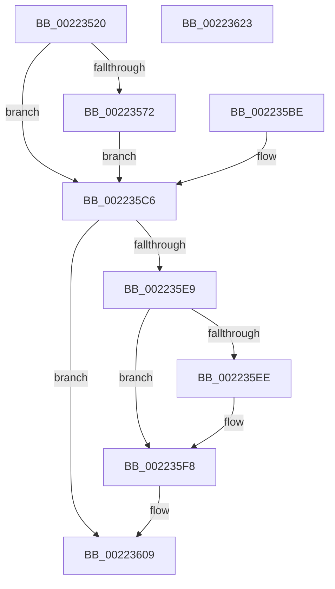

# ExpCenturyDpcRoutine

- RVA: `0x00223520`–`0x00223624` (길이 `260` bytes)
- VA: `0x0000000140223520`
- 실행 섹션: `.text`
- PDB 이름 있음: `예`; PDB Function 태그: `아니요`
- unwind 정보 RVA: `0x0005F77C`
- 디코드: `64`개 명령, `260/260` bytes 표시
- 미해석 바이트: `0` (있으면 어셈블리에 `.byte`로 보존)

> 이 문서는 커널 이미지의 기계어와 PDB 기호를 분석해 생성했습니다. 4번과 5번은 함수 원형과 자료형을 바이너리 사용 방식에서 추정한 C 해석이며 원본 소스 복구 결과는 아닙니다.

## 1. Dependencies

- 직접 호출 지점: **5**; 고유 호출 대상: **5**
- 직접 호출자로 확인된 함수: **0**
- RIP 상대 이미지 참조: **0**

### Outgoing calls
- `0x0022355D` → [memset](../6C/memset_function_006C6C40.md) (function, `0x006C6C40`)
- `0x002235B6` → [KiCustomAccessRoutine9](../6B/KiCustomAccessRoutine9_function_006BC4C0.md) (function, `0x006BC4C0`)
- `0x002235C9` → [PsGetServerSiloGlobals](PsGetServerSiloGlobals_function_002250A0.md) (function, `0x002250A0`)
- `0x002235F3` → [ObfReferenceObjectWithTag](../21/ObfReferenceObjectWithTag_function_00210710.md) (function, `0x00210710`)
- `0x00223604` → [ExQueueWorkItem](../2F/ExQueueWorkItem_function_002F9520.md) (function, `0x002F9520`)

### Direct callers
- 이 함수 시작 RVA로 연결되는 직접 call은 확인되지 않았습니다. 간접 호출은 완전히 역산할 수 없습니다.

### Static image references
- 디코드된 RIP-relative 메모리 참조가 없습니다.

## 2. Other-region calls and transfers

- 다른 실행 섹션으로 향하는 call: **0**
- 별도 외부 분기/꼬리 이동을 확인하지 못했습니다.

## 3. Assembly (complete function range)

```asm
00223520  48 8B C4                        mov rax, rsp
00223523  48 89 58 08                     mov qword ptr [rax + 8], rbx
00223527  48 89 70 18                     mov qword ptr [rax + 0x18], rsi
0022352B  48 89 78 20                     mov qword ptr [rax + 0x20], rdi
0022352F  48 89 50 10                     mov qword ptr [rax + 0x10], rdx
00223533  41 56                           push r14
00223535  48 81 EC 50 01 00 00            sub rsp, 0x150
0022353C  48 89 A4 24 40 01 00 00         mov qword ptr [rsp + 0x140], rsp
00223544  4D 8B F1                        mov r14, r9
00223547  49 8B F0                        mov rsi, r8
0022354A  48 8B DA                        mov rbx, rdx
0022354D  48 8B F9                        mov rdi, rcx
00223550  33 D2                           xor edx, edx
00223552  44 8D 42 62                     lea r8d, [rdx + 0x62]
00223556  48 8D 88 28 FF FF FF            lea rcx, [rax - 0xd8]
0022355D  E8 DE 36 4A 00                  call 0x1406c6c40
00223562  48 8B C3                        mov rax, rbx
00223565  48 C1 F8 2F                     sar rax, 0x2f
00223569  48 FF C0                        inc rax
0022356C  48 83 F8 01                     cmp rax, 1
00223570  76 54                           jbe 0x1402235c6
00223572  83 64 24 30 00                  and dword ptr [rsp + 0x30], 0
00223577  C6 07 00                        mov byte ptr [rdi], 0
0022357A  49 8B C6                        mov rax, r14
0022357D  48 C1 E8 08                     shr rax, 8
00223581  48 89 47 20                     mov qword ptr [rdi + 0x20], rax
00223585  48 89 B4 24 DA 00 00 00         mov qword ptr [rsp + 0xda], rsi
0022358D  8B CE                           mov ecx, esi
0022358F  48 8B C3                        mov rax, rbx
00223592  48 D3 C0                        rol rax, cl
00223595  48 89 84 24 D2 00 00 00         mov qword ptr [rsp + 0xd2], rax
0022359D  48 8B C7                        mov rax, rdi
002235A0  48 D3 C8                        ror rax, cl
002235A3  48 89 84 24 8A 00 00 00         mov qword ptr [rsp + 0x8a], rax
002235AB  4C 31 77 28                     xor qword ptr [rdi + 0x28], r14
002235AF  48 31 77 30                     xor qword ptr [rdi + 0x30], rsi
002235B3  48 8B CB                        mov rcx, rbx
002235B6  E8 05 8F 49 00                  call 0x1406bc4c0
002235BB  90                              nop
002235BC  EB 08                           jmp 0x1402235c6
002235BE  48 8B 9C 24 68 01 00 00         mov rbx, qword ptr [rsp + 0x168]
002235C6  48 8B CB                        mov rcx, rbx
002235C9  E8 D2 1A 00 00                  call 0x1402250a0
002235CE  48 8B B8 C8 04 00 00            mov rdi, qword ptr [rax + 0x4c8]
002235D5  B8 01 00 00 00                  mov eax, 1
002235DA  F0 0F C1 87 A0 03 00 00         lock xadd dword ptr [rdi + 0x3a0], eax
002235E2  FF C0                           inc eax
002235E4  83 F8 01                        cmp eax, 1
002235E7  75 20                           jne 0x140223609
002235E9  48 85 DB                        test rbx, rbx
002235EC  74 0A                           je 0x1402235f8
002235EE  BA 45 78 70 53                  mov edx, 0x53707845
002235F3  E8 18 D1 FE FF                  call 0x140210710
002235F8  48 8D 8F E0 02 00 00            lea rcx, [rdi + 0x2e0]
002235FF  BA 01 00 00 00                  mov edx, 1
00223604  E8 17 5F 0D 00                  call 0x1402f9520
00223609  4C 8D 9C 24 50 01 00 00         lea r11, [rsp + 0x150]
00223611  49 8B 5B 10                     mov rbx, qword ptr [r11 + 0x10]
00223615  49 8B 73 20                     mov rsi, qword ptr [r11 + 0x20]
00223619  49 8B 7B 28                     mov rdi, qword ptr [r11 + 0x28]
0022361D  49 8B E3                        mov rsp, r11
00223620  41 5E                           pop r14
00223622  C3                              ret
00223623  CC                              int3
```

## 4. C-style interpretation (structured pseudocode)

```c
__int64 __fastcall ExpCenturyDpcRoutine(__int64 a1, __int64 a2, __int64 a3, __int64 a4)
{
    __int64 result;
    __int64 v_rsp;
    unsigned int v_stack_m128;
    unsigned __int64 v_stack_m18;
    unsigned __int64 v_stack_m7E;
    unsigned __int64 v_stack_m8;
    unsigned __int64 v_stack_m86;
    unsigned __int64 v_stack_mCE;
    unsigned __int64 v_stack_p10;

    *(unsigned __int64 *)(v_rsp + 8) = v_rbx;
    *(unsigned __int64 *)(v_rsp + 24) = v_rsi;
    *(unsigned __int64 *)(v_rsp + 32) = v_rdi;
    *(unsigned __int64 *)(v_rsp + 16) = a2;
    v_rsp = (v_rsp) - (336);
    v_stack_m18 = v_rsp;
    a2 = 0;
    result = memset(v_rsp - 216, a2, a2 + 98, a4);
    result = (0) >> (47);
    result = (result) + 1;
    if (result <= 1) goto loc_002235C6;
    *(unsigned __int8 *)(a1) = 0;
    result = (a4) >> (8);
    *(unsigned __int64 *)(a1 + 32) = result;
    v_stack_m7E = a3;
    v_stack_m86 = 0;
    v_stack_mCE = a1;
    result = KiCustomAccessRoutine9(0, a2, a2 + 98, a4);
    goto loc_002235C6;
loc_002235C6:
    result = PsGetServerSiloGlobals(0, a2, a2 + 98, a4);
    result = (unsigned int)((1) + 1);
    if (((unsigned int)(result)) != 1) goto loc_00223609;
    if (0 != 0) {
        a2 = 0x53707845ULL;
        result = ObfReferenceObjectWithTag(0, a2, a2 + 98, a4);
    }
    result = ExQueueWorkItem(*(unsigned __int64 *)(result + 1224) + 736, 1, a2 + 98, a4);
loc_00223609:
    return result;
}
```

## 5. (Beta) C Style

```c
int64_t ExpCenturyDpcRoutine(void *Arg1, int64_t Arg2, int64_t Arg3, int64_t Arg4)
{
    uint8_t *arg1 = (uint8_t *)Arg1;

    int64_t result;
    int64_t local_rsp;
    uint32_t v_stack_m128;
    uint64_t v_stack_m18;
    uint64_t v_stack_m7E;
    uint64_t v_stack_m8;
    uint64_t v_stack_m86;
    uint64_t v_stack_mCE;
    uint64_t v_stack_p10;

    *(uint64_t *)(local_rsp + 0x8) = local_rbx;
    *(uint64_t *)(local_rsp + 0x18) = local_rsi;
    *(uint64_t *)(local_rsp + 0x20) = local_rdi;
    *(uint64_t *)(local_rsp + 0x10) = Arg2;
    local_rsp = (local_rsp) - (336);
    v_stack_m18 = local_rsp;
    Arg2 = 0;
    result = memset(local_rsp - 216, Arg2, Arg2 + 98, Arg4);
    result = (0) >> (47);
    result = (result) + 1;
    if (result <= 1) goto loc_002235C6;
    *(uint8_t *)(arg1) = 0;
    result = (Arg4) >> (8);
    *(uint64_t *)(arg1 + 0x20) = result;
    v_stack_m7E = Arg3;
    v_stack_m86 = 0;
    v_stack_mCE = Arg1;
    result = KiCustomAccessRoutine9(0, Arg2, Arg2 + 98, Arg4);
    goto loc_002235C6;
loc_002235C6:
    result = PsGetServerSiloGlobals(0, Arg2, Arg2 + 98, Arg4);
    result = (uint32_t)((1) + 1);
    if (((uint32_t)(result)) != 1) goto loc_00223609;
    if (0 != 0) {
        Arg2 = 0x53707845ULL;
        result = ObfReferenceObjectWithTag(0, Arg2, Arg2 + 98, Arg4);
    }
    result = ExQueueWorkItem(*(uint64_t *)(result + 0x4C8) + 736, 1, Arg2 + 98, Arg4);
loc_00223609:
    return result;
}
```

### 관측된 메모리 오프셋

구조체 형식이 확인되지 않은 접근은 인자 기준의 오프셋으로만 기록했습니다.

| 기준 인자 | 오프셋 표현 | 폭 (bit) | 접근 |
|---|---:|---:|---|
| `Arg1` | `+ 0x0` | `8` | `W` |
| `Arg1` | `+ 0x20` | `64` | `W` |
| `Arg1` | `+ 0x28` | `64` | `R/W` |
| `Arg1` | `+ 0x30` | `64` | `R/W` |

## 6. Execution-region graph

[열기: 2D/3D 그래프와 함수 탐색 컨트롤 패널](../../../control-panel.html?section=text&rva=0x00223520&view=graph)

- 2D 그래프는 위에서 아래로 흐르고, 3D 그래프는 빈 공간을 드래그해 회전합니다. Shift+드래그는 이동, 휠은 확대·축소, 함수 노드 선택은 대상 보고서 이동입니다.

### Static fallback


