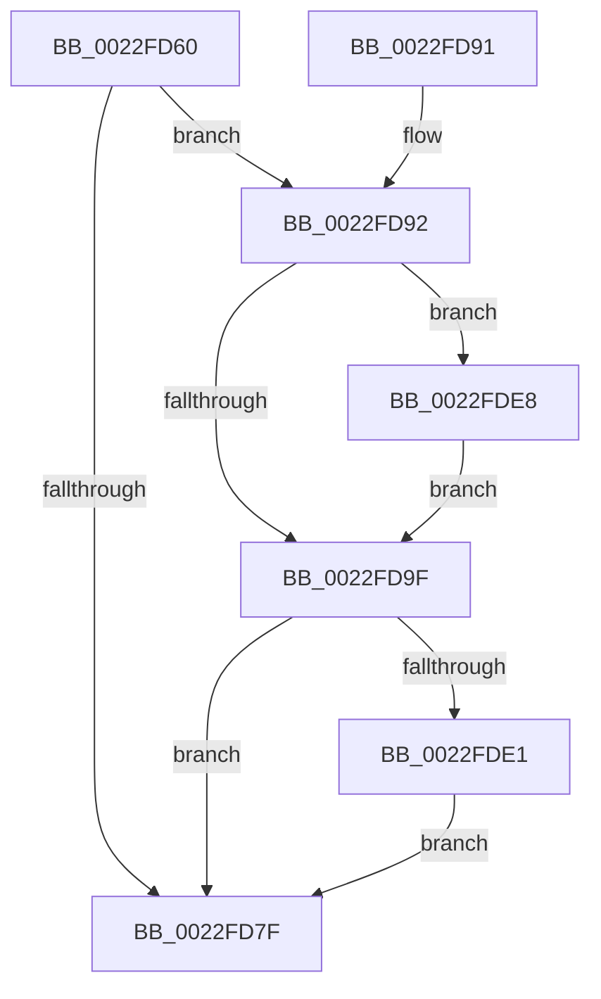

# ExpTimerResume

- RVA: `0x0022FD60`–`0x0022FDFA` (길이 `154` bytes)
- VA: `0x000000014022FD60`
- 실행 섹션: `.text`
- PDB 이름 있음: `예`; PDB Function 태그: `아니요`
- unwind 정보 RVA: `0x000601F4`
- 디코드: `41`개 명령, `154/154` bytes 표시
- 미해석 바이트: `0` (있으면 어셈블리에 `.byte`로 보존)

> 이 문서는 커널 이미지의 기계어와 PDB 기호를 분석해 생성했습니다. 4번과 5번은 함수 원형과 자료형을 바이너리 사용 방식에서 추정한 C 해석이며 원본 소스 복구 결과는 아닙니다.

## 1. Dependencies

- 직접 호출 지점: **1**; 고유 호출 대상: **1**
- 직접 호출자로 확인된 함수: **3**
- RIP 상대 이미지 참조: **0**

### Outgoing calls
- `0x0022FDD6` → [KeSetCoalescableTimer](KeSetCoalescableTimer_function_0022FFD0.md) (function, `0x0022FFD0`)

### Direct callers
- [ExRemoveVirtualizedTimer](ExRemoveVirtualizedTimer_function_0022FCEC.md) at `0x0022FD31`
- [PspSetProcessFreezeStateCallback](../4E/PspSetProcessFreezeStateCallback_function_004E98E0.md) at `0x004E99BF`
- [ExWakeTimersResume](../65/ExWakeTimersResume_function_00659270.md) at `0x00659305`

### Static image references
- 디코드된 RIP-relative 메모리 참조가 없습니다.

## 2. Other-region calls and transfers

- 다른 실행 섹션으로 향하는 call: **0**
- 별도 외부 분기/꼬리 이동을 확인하지 못했습니다.

## 3. Assembly (complete function range)

```asm
0022FD60  48 89 5C 24 08                  mov qword ptr [rsp + 8], rbx
0022FD65  57                              push rdi
0022FD66  48 83 EC 30                     sub rsp, 0x30
0022FD6A  40 8A B9 F8 00 00 00            mov dil, byte ptr [rcx + 0xf8]
0022FD71  45 33 C0                        xor r8d, r8d
0022FD74  48 8B C2                        mov rax, rdx
0022FD77  48 8B D9                        mov rbx, rcx
0022FD7A  40 84 FF                        test dil, dil
0022FD7D  75 13                           jne 0x14022fd92
0022FD7F  80 A3 30 01 00 00 FD            and byte ptr [rbx + 0x130], 0xfd
0022FD86  48 8B 5C 24 40                  mov rbx, qword ptr [rsp + 0x40]
0022FD8B  48 83 C4 30                     add rsp, 0x30
0022FD8F  5F                              pop rdi
0022FD90  C3                              ret
0022FD91  CC                              int3
0022FD92  48 8B 91 38 01 00 00            mov rdx, qword ptr [rcx + 0x138]
0022FD99  40 80 FF 03                     cmp dil, 3
0022FD9D  74 49                           je 0x14022fde8
0022FD9F  44 8A 91 30 01 00 00            mov r10b, byte ptr [rcx + 0x130]
0022FDA6  48 81 C1 A0 00 00 00            add rcx, 0xa0
0022FDAD  41 80 E2 01                     and r10b, 1
0022FDB1  41 8A C2                        mov al, r10b
0022FDB4  F6 D8                           neg al
0022FDB6  4D 1B C9                        sbb r9, r9
0022FDB9  4C 23 C9                        and r9, rcx
0022FDBC  48 8B CB                        mov rcx, rbx
0022FDBF  45 84 D2                        test r10b, r10b
0022FDC2  4C 89 4C 24 20                  mov qword ptr [rsp + 0x20], r9
0022FDC7  44 8B 8B 40 01 00 00            mov r9d, dword ptr [rbx + 0x140]
0022FDCE  44 0F 44 83 F0 00 00 00         cmove r8d, dword ptr [rbx + 0xf0]
0022FDD6  E8 F5 01 00 00                  call 0x14022ffd0
0022FDDB  40 80 FF 03                     cmp dil, 3
0022FDDF  75 9E                           jne 0x14022fd7f
0022FDE1  F0 0F BA 2B 09                  lock bts dword ptr [rbx], 9
0022FDE6  EB 97                           jmp 0x14022fd7f
0022FDE8  48 2B C2                        sub rax, rdx
0022FDEB  48 8B D0                        mov rdx, rax
0022FDEE  48 C1 E8 20                     shr rax, 0x20
0022FDF2  85 C0                           test eax, eax
0022FDF4  49 0F 49 D0                     cmovns rdx, r8
0022FDF8  EB A5                           jmp 0x14022fd9f
```

## 4. C-style interpretation (structured pseudocode)

```c
__int64 __fastcall ExpTimerResume(__int64 a1, __int64 a2, int a3, __int64 a4)
{
    __int64 result;
    __int64 v_r10;
    __int64 v_rsp;
    unsigned __int64 v_stack_p20;
    unsigned __int64 v_stack_p8;

    v_stack_p8 = v_rbx;
    v_rsp = (v_rsp) - (48);
    a3 = 0;
    if ((unsigned __int8)(*(unsigned __int8 *)(a1 + 248)) != 0) goto loc_0022FD92;
loc_0022FD7F:
    v_rsp = (v_rsp) + (48);
    return a2;
loc_0022FD92:
    if (((unsigned __int8)(*(unsigned __int8 *)(a1 + 248))) == 3) goto loc_0022FDE8;
loc_0022FD9F:
    a1 = (a1) + (160);
    v_r10 = (unsigned __int8)((*(unsigned __int8 *)(a1 + 304)) & (1));
    result = (unsigned __int8)(-((unsigned __int8)(v_r10)));
    a4 = (a4) & (a1);
    v_stack_p20 = a4;
    if ((unsigned __int8)(v_r10) == 0) { a3 = *(unsigned int *)(v_stack_p8 + 240); }
    result = KeSetCoalescableTimer(v_stack_p8, *(unsigned __int64 *)(a1 + 312), a3, (unsigned int)(*(unsigned int *)(v_stack_p8 + 320)));
    if (((unsigned __int8)(*(unsigned __int8 *)(a1 + 248))) != 3) goto loc_0022FD7F;
    goto loc_0022FD7F;
loc_0022FDE8:
    result = (result) - (*(unsigned __int64 *)(a1 + 312));
    result = (result) >> (32);
    a2 = result;
    if (!sign_flag) { a2 = a3; }
    goto loc_0022FD9F;
}
```

## 5. (Beta) C Style

```c
int64_t ExpTimerResume(void *Arg1, int64_t Arg2, int32_t Arg3, int64_t Arg4)
{
    uint8_t *arg1 = (uint8_t *)Arg1;

    int64_t result;
    int64_t local_r10;
    int64_t local_rsp;
    uint64_t v_stack_p20;
    uint64_t v_stack_p8;

    v_stack_p8 = local_rbx;
    local_rsp = (local_rsp) - (48);
    Arg3 = 0;
    if ((uint8_t)(*(uint8_t *)(arg1 + 0xF8)) != 0) goto loc_0022FD92;
loc_0022FD7F:
    local_rsp = (local_rsp) + (48);
    return Arg2;
loc_0022FD92:
    if (((uint8_t)(*(uint8_t *)(arg1 + 0xF8))) == 3) goto loc_0022FDE8;
loc_0022FD9F:
    Arg1 = (Arg1) + (160);
    local_r10 = (uint8_t)((*(uint8_t *)(arg1 + 0x130)) & (1));
    result = (uint8_t)(-((uint8_t)(local_r10)));
    Arg4 = (Arg4) & (Arg1);
    v_stack_p20 = Arg4;
    if ((uint8_t)(local_r10) == 0) { Arg3 = *(uint32_t *)(v_stack_p8 + 0xF0); }
    result = KeSetCoalescableTimer(v_stack_p8, *(uint64_t *)(arg1 + 0x138), Arg3, (uint32_t)(*(uint32_t *)(v_stack_p8 + 0x140)));
    if (((uint8_t)(*(uint8_t *)(arg1 + 0xF8))) != 3) goto loc_0022FD7F;
    goto loc_0022FD7F;
loc_0022FDE8:
    result = (result) - (*(uint64_t *)(arg1 + 0x138));
    result = (result) >> (32);
    Arg2 = result;
    if (!sign_flag) { Arg2 = Arg3; }
    goto loc_0022FD9F;
}
```

### 관측된 메모리 오프셋

구조체 형식이 확인되지 않은 접근은 인자 기준의 오프셋으로만 기록했습니다.

| 기준 인자 | 오프셋 표현 | 폭 (bit) | 접근 |
|---|---:|---:|---|
| `Arg1` | `+ 0x0` | `32` | `R/W` |
| `Arg1` | `+ 0xF0` | `32` | `R` |
| `Arg1` | `+ 0xF8` | `8` | `R` |
| `Arg1` | `+ 0x130` | `8` | `R` |
| `Arg1` | `+ 0x130` | `8` | `R/W` |
| `Arg1` | `+ 0x138` | `64` | `R` |
| `Arg1` | `+ 0x140` | `32` | `R` |

## 6. Execution-region graph

[열기: 2D/3D 그래프와 함수 탐색 컨트롤 패널](../../../control-panel.html?section=text&rva=0x0022FD60&view=graph)

- 2D 그래프는 위에서 아래로 흐르고, 3D 그래프는 빈 공간을 드래그해 회전합니다. Shift+드래그는 이동, 휠은 확대·축소, 함수 노드 선택은 대상 보고서 이동입니다.

### Static fallback


