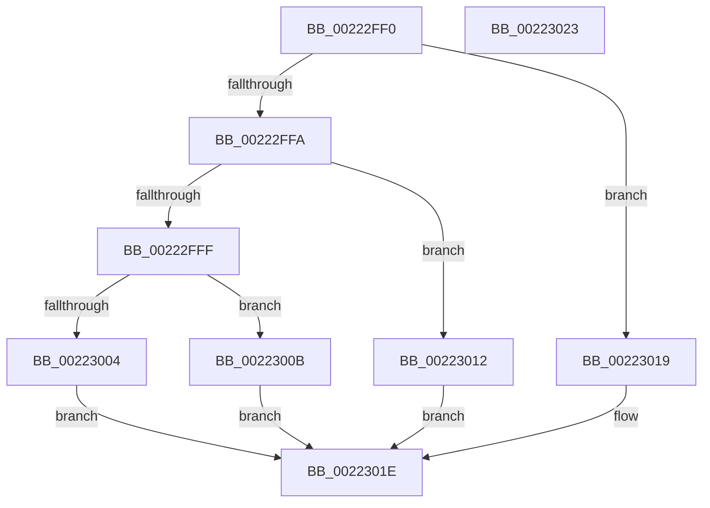

# Feature_Servicing_AutoBoostEtwEventingFixes__private_IsEnabledWithReporting

- RVA: `0x00222FF0`–`0x00223024` (길이 `52` bytes)
- VA: `0x0000000140222FF0`
- 실행 섹션: `.text`
- PDB 이름 있음: `예`; PDB Function 태그: `아니요`
- unwind 정보 RVA: `0x0005C788`
- 디코드: `18`개 명령, `52/52` bytes 표시
- 미해석 바이트: `0` (있으면 어셈블리에 `.byte`로 보존)

> 이 문서는 커널 이미지의 기계어와 PDB 기호를 분석해 생성했습니다. 4번과 5번은 함수 원형과 자료형을 바이너리 사용 방식에서 추정한 C 해석이며 원본 소스 복구 결과는 아닙니다.

## 1. Dependencies

- 직접 호출 지점: **4**; 고유 호출 대상: **4**
- 직접 호출자로 확인된 함수: **3**
- RIP 상대 이미지 참조: **0**

### Outgoing calls
- `0x00223004` → [Feature_Servicing_AutoBoostEtwEventingFixes__private_IsEnabledOtherReporting](../65/Feature_Servicing_AutoBoostEtwEventingFixes__private_IsEnabledOtherReporting_function_0065137C.md) (function, `0x0065137C`)
- `0x0022300B` → [Feature_Servicing_AutoBoostEtwEventingFixes__private_IsEnabledDeviceOpportunityNoInline](../65/Feature_Servicing_AutoBoostEtwEventingFixes__private_IsEnabledDeviceOpportunityNoInline_function_0065130C.md) (function, `0x0065130C`)
- `0x00223012` → [Feature_Servicing_AutoBoostEtwEventingFixes__private_IsEnabledDeviceUsageNoInline](../65/Feature_Servicing_AutoBoostEtwEventingFixes__private_IsEnabledDeviceUsageNoInline_function_00651344.md) (function, `0x00651344`)
- `0x00223019` → [Feature_Servicing_AutoBoostEtwEventingFixes__private_IsEnabledNoReportingNoInline](../4F/Feature_Servicing_AutoBoostEtwEventingFixes__private_IsEnabledNoReportingNoInline_function_004F6A14.md) (function, `0x004F6A14`)

### Direct callers
- [EtwTraceAutoBoostProcessLockEntry](EtwTraceAutoBoostProcessLockEntry_function_00221C7C.md) at `0x00221CB1`
- [EtwTraceAutoBoostSetFloor](EtwTraceAutoBoostSetFloor_function_00222EF0.md) at `0x00222F6A`
- [EtwTraceAutoBoostConvertWaiterToOwner](../4D/EtwTraceAutoBoostConvertWaiterToOwner_function_004DAF98.md) at `0x004DAFCD`

### Static image references
- 디코드된 RIP-relative 메모리 참조가 없습니다.

## 2. Other-region calls and transfers

- 다른 실행 섹션으로 향하는 call: **0**
- 별도 외부 분기/꼬리 이동을 확인하지 못했습니다.

## 3. Assembly (complete function range)

```asm
00222FF0  48 83 EC 28                     sub rsp, 0x28
00222FF4  8B D1                           mov edx, ecx
00222FF6  85 C9                           test ecx, ecx
00222FF8  74 1F                           je 0x140223019
00222FFA  83 EA 03                        sub edx, 3
00222FFD  74 13                           je 0x140223012
00222FFF  83 FA 01                        cmp edx, 1
00223002  74 07                           je 0x14022300b
00223004  E8 73 E3 42 00                  call 0x14065137c
00223009  EB 13                           jmp 0x14022301e
0022300B  E8 FC E2 42 00                  call 0x14065130c
00223010  EB 0C                           jmp 0x14022301e
00223012  E8 2D E3 42 00                  call 0x140651344
00223017  EB 05                           jmp 0x14022301e
00223019  E8 F6 39 2D 00                  call 0x1404f6a14
0022301E  48 83 C4 28                     add rsp, 0x28
00223022  C3                              ret
00223023  CC                              int3
```

## 4. C-style interpretation (structured pseudocode)

```c
__int64 __fastcall Feature_Servicing_AutoBoostEtwEventingFixes__private_IsEnabledWithReporting(int a1)
{
    __int64 result;
    __int64 v_rsp;

    v_rsp = (v_rsp) - (40);
    if (a1 == 0) goto loc_00223019;
    a2 = (unsigned int)(((unsigned int)(a1)) - (3));
    if (condition_is_equal) goto loc_00223012;
    if (((unsigned int)(a2)) == 1) goto loc_0022300B;
    result = Feature_Servicing_AutoBoostEtwEventingFixes__private_IsEnabledOtherReporting(a1, a2, a3, a4);
    goto loc_0022301E;
loc_0022300B:
    result = Feature_Servicing_AutoBoostEtwEventingFixes__private_IsEnabledDeviceOpportunityNoInline(a1, a2, a3, a4);
    goto loc_0022301E;
loc_00223012:
    result = Feature_Servicing_AutoBoostEtwEventingFixes__private_IsEnabledDeviceUsageNoInline(a1, a2, a3, a4);
    goto loc_0022301E;
loc_00223019:
    result = Feature_Servicing_AutoBoostEtwEventingFixes__private_IsEnabledNoReportingNoInline(a1, a2, a3, a4);
loc_0022301E:
    v_rsp = (v_rsp) + (40);
    return result;
}
```

## 5. (Beta) C Style

```c
int64_t Feature_Servicing_AutoBoostEtwEventingFixes__private_IsEnabledWithReporting(int32_t Arg1)
{
    int64_t result;
    int64_t local_rsp;

    local_rsp = (local_rsp) - (40);
    if (Arg1 == 0) goto loc_00223019;
    a2 = (uint32_t)(((uint32_t)(Arg1)) - (3));
    if (condition_is_equal) goto loc_00223012;
    if (((uint32_t)(a2)) == 1) goto loc_0022300B;
    result = Feature_Servicing_AutoBoostEtwEventingFixes__private_IsEnabledOtherReporting(Arg1, a2, a3, a4);
    goto loc_0022301E;
loc_0022300B:
    result = Feature_Servicing_AutoBoostEtwEventingFixes__private_IsEnabledDeviceOpportunityNoInline(Arg1, a2, a3, a4);
    goto loc_0022301E;
loc_00223012:
    result = Feature_Servicing_AutoBoostEtwEventingFixes__private_IsEnabledDeviceUsageNoInline(Arg1, a2, a3, a4);
    goto loc_0022301E;
loc_00223019:
    result = Feature_Servicing_AutoBoostEtwEventingFixes__private_IsEnabledNoReportingNoInline(Arg1, a2, a3, a4);
loc_0022301E:
    local_rsp = (local_rsp) + (40);
    return result;
}
```

## 6. Execution-region graph

[열기: 2D/3D 그래프와 함수 탐색 컨트롤 패널](../../../control-panel.html?section=text&rva=0x00222FF0&view=graph)

- 2D 그래프는 위에서 아래로 흐르고, 3D 그래프는 빈 공간을 드래그해 회전합니다. Shift+드래그는 이동, 휠은 확대·축소, 함수 노드 선택은 대상 보고서 이동입니다.

### Static fallback


