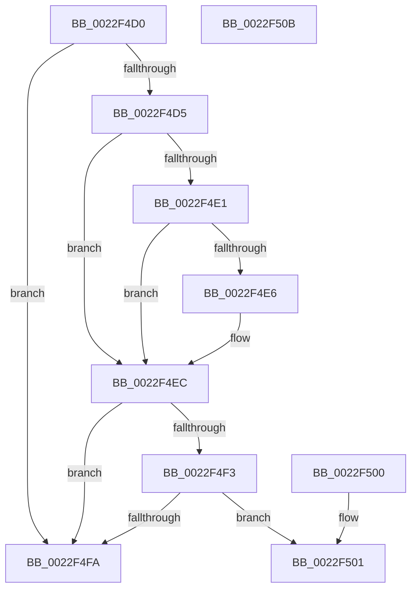

# IS_PTE_NOT_DEMAND_ZERO

- RVA: `0x0022F4D0`–`0x0022F50C` (길이 `60` bytes)
- VA: `0x000000014022F4D0`
- 실행 섹션: `.text`
- PDB 이름 있음: `예`; PDB Function 태그: `아니요`
- unwind 정보 RVA: `0x000DB714`
- 디코드: `21`개 명령, `60/60` bytes 표시
- 미해석 바이트: `0` (있으면 어셈블리에 `.byte`로 보존)

> 이 문서는 커널 이미지의 기계어와 PDB 기호를 분석해 생성했습니다. 4번과 5번은 함수 원형과 자료형을 바이너리 사용 방식에서 추정한 C 해석이며 원본 소스 복구 결과는 아닙니다.

## 1. Dependencies

- 직접 호출 지점: **0**; 고유 호출 대상: **0**
- 직접 호출자로 확인된 함수: **14**
- RIP 상대 이미지 참조: **1**

### Outgoing calls
- 직접 디코드된 call 명령이 없습니다.

### Direct callers
- [MiBuildForkPte](MiBuildForkPte_function_0022E32C.md) at `0x0022E7FF`
- [MiEncodeProtoFill](MiEncodeProtoFill_function_0022F3B0.md) at `0x0022F43E`
- [MiAbandonPrivatePfn](MiAbandonPrivatePfn_function_0022F548.md) at `0x0022F5AD`
- [MiDecommitHandlePageFileFormatPte](../24/MiDecommitHandlePageFileFormatPte_function_00242A5C.md) at `0x00242AD0`
- [MiDecommitHandlePageFileFormatPte](../24/MiDecommitHandlePageFileFormatPte_function_00242A5C.md) at `0x00242B79`
- [MiActOnPte](../24/MiActOnPte_function_00244C90.md) at `0x00244DDC`
- [sub_002C3A7C](../2C/Unknown_function_002C3A7C.md) at `0x002C439D`
- [MiUserFault](../32/MiUserFault_function_00329840.md) at `0x00329FDF`
- [sub_0032FE5C](../32/Unknown_function_0032FE5C.md) at `0x0032FF2A`
- [MiPrefetchJumpVad](../4D/MiPrefetchJumpVad_function_004D7A28.md) at `0x004D7AFC`
- [MiGetClusterPage](../4D/MiGetClusterPage_function_004DC57C.md) at `0x004DC837`
- [MmStoreIsVirtualAddressPoisoned](../69/MmStoreIsVirtualAddressPoisoned_function_00693120.md) at `0x006931B6`
- [MiPfPrepareReadList](../../page/93/MiPfPrepareReadList_function_0093CD5C.md) at `0x0093D020`
- [MiPfPrepareSequentialReadList](../../page/93/MiPfPrepareSequentialReadList_function_0093D8E8.md) at `0x0093DDF6`
- [MiAllocatePerSessionProtos](../../page/A6/MiAllocatePerSessionProtos_function_00A66830.md) at `0x00A66906`

### Static image references
- `0x0022F4D5` → RVA `0x00E2DC80` (`.data`; read)

## 2. Other-region calls and transfers

- 다른 실행 섹션으로 향하는 call: **0**
- 별도 외부 분기/꼬리 이동을 확인하지 못했습니다.

## 3. Assembly (complete function range)

```asm
0022F4D0  F6 C1 01                        test cl, 1
0022F4D3  75 25                           jne 0x14022f4fa
0022F4D5  48 8B 05 A4 E7 BF 00            mov rax, qword ptr [rip + 0xbfe7a4]
0022F4DC  48 85 C0                        test rax, rax
0022F4DF  74 0B                           je 0x14022f4ec
0022F4E1  F6 C1 10                        test cl, 0x10
0022F4E4  75 06                           jne 0x14022f4ec
0022F4E6  48 F7 D0                        not rax
0022F4E9  48 23 C8                        and rcx, rax
0022F4EC  48 0F BA E1 0A                  bt rcx, 0xa
0022F4F1  72 07                           jb 0x14022f4fa
0022F4F3  48 0F BA E1 0B                  bt rcx, 0xb
0022F4F8  73 07                           jae 0x14022f501
0022F4FA  B8 01 00 00 00                  mov eax, 1
0022F4FF  C3                              ret
0022F500  CC                              int3
0022F501  48 C1 E9 02                     shr rcx, 2
0022F505  83 E1 01                        and ecx, 1
0022F508  8B C1                           mov eax, ecx
0022F50A  C3                              ret
0022F50B  CC                              int3
```

## 4. C-style interpretation (structured pseudocode)

```c
__int64 __fastcall IS_PTE_NOT_DEMAND_ZERO(__int64 a1)
{
    __int64 result;

    if ((((unsigned __int8)(a1)) & (1)) != 0) goto loc_0022F4FA;
    if (*(unsigned __int64 *)(v_rip + 12576676) == 0) goto loc_0022F4EC;
    result = *(unsigned __int64 *)(v_rip + 12576676);
    if ((((unsigned __int8)(a1)) & (16)) == 0) {
        result = ~(*(unsigned __int64 *)(v_rip + 12576676));
        a1 = (a1) & (result);
    }
    if (condition_is_below) goto loc_0022F4FA;
    if (condition_is_above_or_equal) goto loc_0022F501;
loc_0022F4FA:
    return 1;
loc_0022F501:
    a1 = (a1) >> (2);
    a1 = (unsigned int)((a1) & (1));
    return (unsigned int)((unsigned int)(a1));
}
```

## 5. (Beta) C Style

```c
int64_t IS_PTE_NOT_DEMAND_ZERO(int64_t Arg1)
{
    int64_t result;

    if ((((uint8_t)(Arg1)) & (1)) != 0) goto loc_0022F4FA;
    if (*(uint64_t *)(v_rip + 0xBFE7A4) == 0) goto loc_0022F4EC;
    result = *(uint64_t *)(v_rip + 0xBFE7A4);
    if ((((uint8_t)(Arg1)) & (16)) == 0) {
        result = ~(*(uint64_t *)(v_rip + 0xBFE7A4));
        Arg1 = (Arg1) & (result);
    }
    if (condition_is_below) goto loc_0022F4FA;
    if (condition_is_above_or_equal) goto loc_0022F501;
loc_0022F4FA:
    return 1;
loc_0022F501:
    Arg1 = (Arg1) >> (2);
    Arg1 = (uint32_t)((Arg1) & (1));
    return (uint32_t)((uint32_t)(Arg1));
}
```

## 6. Execution-region graph

[열기: 2D/3D 그래프와 함수 탐색 컨트롤 패널](../../../control-panel.html?section=text&rva=0x0022F4D0&view=graph)

- 2D 그래프는 위에서 아래로 흐르고, 3D 그래프는 빈 공간을 드래그해 회전합니다. Shift+드래그는 이동, 휠은 확대·축소, 함수 노드 선택은 대상 보고서 이동입니다.

### Static fallback


