# IoRaiseHardError

- RVA: `0x002230D0`–`0x00223358` (길이 `648` bytes)
- VA: `0x00000001402230D0`
- 실행 섹션: `.text`
- PDB 이름 있음: `예`; PDB Function 태그: `예`
- unwind 정보 RVA: `0x0005F710`
- 디코드: `154`개 명령, `648/648` bytes 표시
- 미해석 바이트: `0` (있으면 어셈블리에 `.byte`로 보존)

> 이 문서는 커널 이미지의 기계어와 PDB 기호를 분석해 생성했습니다. 4번과 5번은 함수 원형과 자료형을 바이너리 사용 방식에서 추정한 C 해석이며 원본 소스 복구 결과는 아닙니다.

## 1. Dependencies

- 직접 호출 지점: **10**; 고유 호출 대상: **10**
- 직접 호출자로 확인된 함수: **1**
- RIP 상대 이미지 참조: **2**

### Outgoing calls
- `0x0022312B` → [IopGetThreadActiveConsoleId](../../page/AB/IopGetThreadActiveConsoleId_function_00AB4EE8.md) (function, `0x00AB4EE8`)
- `0x0022313A` → [PsGetProcessSessionId](PsGetProcessSessionId_function_002233A0.md) (function, `0x002233A0`)
- `0x00223179` → [ExAllocatePool2](../../poolcode/B8/ExAllocatePool2_function_00B820F0.md) (function, `0x00B820F0`)
- `0x002231AB` → [ExQueueWorkItem](../2F/ExQueueWorkItem_function_002F9520.md) (function, `0x002F9520`)
- `0x002231DF` → [ExAcquireRundownProtection](../21/ExAcquireRundownProtection_function_00216620.md) (function, `0x00216620`)
- `0x00223234` → [KiStackAttachProcess](../21/KiStackAttachProcess_function_00216820.md) (function, `0x00216820`)
- `0x002232B6` → [ExReleaseRundownProtection](../34/ExReleaseRundownProtection_function_00349E80.md) (function, `0x00349E80`)
- `0x002232CA` → [IofCompleteRequest](../29/IofCompleteRequest_function_0029B5C0.md) (function, `0x0029B5C0`)
- `0x002232DA` → [_security_check_cookie](../6A/_security_check_cookie_function_006AC640.md) (function, `0x006AC640`)
- `0x00223331` → [KiUnstackDetachProcess](../21/KiUnstackDetachProcess_function_00217D30.md) (function, `0x00217D30`)

### Direct callers
- [DifIoRaiseHardErrorWrapper](../62/DifIoRaiseHardErrorWrapper_function_0062BD80.md) at `0x0062BE64`

### Static image references
- `0x002230EF` → RVA `0x00E0A740` (`.data`; read)
- `0x00223187` → RVA `0x009ECE30` (`IopStartApcHardError`; read)

## 2. Other-region calls and transfers

- 다른 실행 섹션으로 향하는 call: **2**
  - `0x0022312B` → [IopGetThreadActiveConsoleId](../../page/AB/IopGetThreadActiveConsoleId_function_00AB4EE8.md) (`.text` → `PAGE`)
  - `0x00223179` → [ExAllocatePool2](../../poolcode/B8/ExAllocatePool2_function_00B820F0.md) (`.text` → `POOLCODE`)
- call이 아닌 외부 분기/꼬리 이동: **1**
  - `0x002231B8` → [sub_006D6A04](../6D/Unknown_function_006D6A04.md) (`tail-transfer`)

## 3. Assembly (complete function range)

```asm
002230D0  48 89 74 24 20                  mov qword ptr [rsp + 0x20], rsi
002230D5  4C 89 44 24 18                  mov qword ptr [rsp + 0x18], r8
002230DA  48 89 54 24 10                  mov qword ptr [rsp + 0x10], rdx
002230DF  57                              push rdi
002230E0  41 54                           push r12
002230E2  41 55                           push r13
002230E4  41 56                           push r14
002230E6  41 57                           push r15
002230E8  48 81 EC 90 00 00 00            sub rsp, 0x90
002230EF  48 8B 05 4A 76 BE 00            mov rax, qword ptr [rip + 0xbe764a]
002230F6  48 33 C4                        xor rax, rsp
002230F9  48 89 84 24 88 00 00 00         mov qword ptr [rsp + 0x88], rax
00223101  4D 8B E0                        mov r12, r8
00223104  4C 8B FA                        mov r15, rdx
00223107  48 8B F9                        mov rdi, rcx
0022310A  48 89 4C 24 48                  mov qword ptr [rsp + 0x48], rcx
0022310F  40 32 F6                        xor sil, sil
00223112  4C 8B B1 98 00 00 00            mov r14, qword ptr [rcx + 0x98]
00223119  41 8B 86 A0 05 00 00            mov eax, dword ptr [r14 + 0x5a0]
00223120  A8 10                           test al, 0x10
00223122  0F 85 20 02 00 00               jne 0x140223348
00223128  49 8B CE                        mov rcx, r14
0022312B  E8 B8 1D 89 00                  call 0x140ab4ee8
00223130  44 8B C0                        mov r8d, eax
00223133  49 8B 8E 20 02 00 00            mov rcx, qword ptr [r14 + 0x220]
0022313A  E8 61 02 00 00                  call 0x1402233a0
0022313F  41 3B C0                        cmp eax, r8d
00223142  0F 85 00 02 00 00               jne 0x140223348
00223148  48 8B 8F B8 00 00 00            mov rcx, qword ptr [rdi + 0xb8]
0022314F  8B 47 10                        mov eax, dword ptr [rdi + 0x10]
00223152  25 FF FF F1 3F                  and eax, 0x3ff1ffff
00223157  83 F8 43                        cmp eax, 0x43
0022315A  0F 85 99 01 00 00               jne 0x1402232f9
00223160  B1 01                           mov cl, 1
00223162  84 C9                           test cl, cl
00223164  74 4F                           je 0x1402231b5
00223166  40 84 F6                        test sil, sil
00223169  75 53                           jne 0x1402231be
0022316B  BA 38 00 00 00                  mov edx, 0x38
00223170  8D 4A 08                        lea ecx, [rdx + 8]
00223173  41 B8 49 6F 45 72               mov r8d, 0x72456f49
00223179  E8 72 EF 95 00                  call 0x140b820f0
0022317E  48 85 C0                        test rax, rax
00223181  0F 84 3E 01 00 00               je 0x1402232c5
00223187  48 8D 0D A2 9C 7C 00            lea rcx, [rip + 0x7c9ca2]
0022318E  48 89 48 10                     mov qword ptr [rax + 0x10], rcx
00223192  48 89 40 18                     mov qword ptr [rax + 0x18], rax
00223196  48 83 20 00                     and qword ptr [rax], 0
0022319A  48 89 78 20                     mov qword ptr [rax + 0x20], rdi
0022319E  4C 89 78 28                     mov qword ptr [rax + 0x28], r15
002231A2  4C 89 60 30                     mov qword ptr [rax + 0x30], r12
002231A6  33 D2                           xor edx, edx
002231A8  48 8B C8                        mov rcx, rax
002231AB  E8 70 63 0D 00                  call 0x1402f9520
002231B0  E9 1A 01 00 00                  jmp 0x1402232cf
002231B5  40 84 F6                        test sil, sil
002231B8  0F 84 46 38 4B 00               je 0x1406d6a04
002231BE  41 F7 46 74 00 04 00 00         test dword ptr [r14 + 0x74], 0x400
002231C6  75 A3                           jne 0x14022316b
002231C8  40 B6 01                        mov sil, 1
002231CB  40 88 74 24 40                  mov byte ptr [rsp + 0x40], sil
002231D0  4D 8D BE 88 05 00 00            lea r15, [r14 + 0x588]
002231D7  4C 89 7C 24 50                  mov qword ptr [rsp + 0x50], r15
002231DC  49 8B CF                        mov rcx, r15
002231DF  E8 3C 34 FF FF                  call 0x140216620
002231E4  84 C0                           test al, al
002231E6  0F 84 CF 00 00 00               je 0x1402232bb
002231EC  0F 57 C0                        xorps xmm0, xmm0
002231EF  0F 11 44 24 58                  movups xmmword ptr [rsp + 0x58], xmm0
002231F4  0F 11 44 24 68                  movups xmmword ptr [rsp + 0x68], xmm0
002231F9  0F 11 44 24 78                  movups xmmword ptr [rsp + 0x78], xmm0
002231FE  4D 8B AE F0 00 00 00            mov r13, qword ptr [r14 + 0xf0]
00223205  49 8B B6 20 02 00 00            mov rsi, qword ptr [r14 + 0x220]
0022320C  65 48 8B 04 25 88 01 00 00      mov rax, qword ptr gs:[0x188]
00223215  48 3B B0 B8 00 00 00            cmp rsi, qword ptr [rax + 0xb8]
0022321C  0F 84 FB 00 00 00               je 0x14022331d
00223222  41 B6 01                        mov r14b, 1
00223225  44 88 74 24 41                  mov byte ptr [rsp + 0x41], r14b
0022322A  4C 8D 44 24 58                  lea r8, [rsp + 0x58]
0022322F  33 D2                           xor edx, edx
00223231  48 8B CE                        mov rcx, rsi
00223234  E8 E7 35 FF FF                  call 0x140216820
00223239  90                              nop
0022323A  41 8B 85 B0 16 00 00            mov eax, dword ptr [r13 + 0x16b0]
00223241  89 44 24 44                     mov dword ptr [rsp + 0x44], eax
00223245  48 83 BE 10 03 00 00 00         cmp qword ptr [rsi + 0x310], 0
0022324D  74 30                           je 0x14022327f
0022324F  0F B7 8E EC 06 00 00            movzx ecx, word ptr [rsi + 0x6ec]
00223256  BA 4C 01 00 00                  mov edx, 0x14c
0022325B  66 3B CA                        cmp cx, dx
0022325E  74 0E                           je 0x14022326e
00223260  BA C4 01 00 00                  mov edx, 0x1c4
00223265  66 3B CA                        cmp cx, dx
00223268  74 04                           je 0x14022326e
0022326A  32 C9                           xor cl, cl
0022326C  EB 02                           jmp 0x140223270
0022326E  B1 01                           mov cl, 1
00223270  84 C9                           test cl, cl
00223272  74 0B                           je 0x14022327f
00223274  41 0B 85 28 2F 00 00            or eax, dword ptr [r13 + 0x2f28]
0022327B  89 44 24 44                     mov dword ptr [rsp + 0x44], eax
0022327F  24 10                           and al, 0x10
00223281  F6 D8                           neg al
00223283  40 1A F6                        sbb sil, sil
00223286  40 22 74 24 40                  and sil, byte ptr [rsp + 0x40]
0022328B  40 88 74 24 40                  mov byte ptr [rsp + 0x40], sil
00223290  EB 1C                           jmp 0x1402232ae
00223292  4C 8B A4 24 D0 00 00 00         mov r12, qword ptr [rsp + 0xd0]
0022329A  40 8A 74 24 40                  mov sil, byte ptr [rsp + 0x40]
0022329F  44 8A 74 24 41                  mov r14b, byte ptr [rsp + 0x41]
002232A4  48 8B 7C 24 48                  mov rdi, qword ptr [rsp + 0x48]
002232A9  4C 8B 7C 24 50                  mov r15, qword ptr [rsp + 0x50]
002232AE  45 84 F6                        test r14b, r14b
002232B1  75 77                           jne 0x14022332a
002232B3  49 8B CF                        mov rcx, r15
002232B6  E8 C5 6B 12 00                  call 0x140349e80
002232BB  40 84 F6                        test sil, sil
002232BE  74 7B                           je 0x14022333b
002232C0  48 83 67 38 00                  and qword ptr [rdi + 0x38], 0
002232C5  B2 01                           mov dl, 1
002232C7  48 8B CF                        mov rcx, rdi
002232CA  E8 F1 82 07 00                  call 0x14029b5c0
002232CF  48 8B 8C 24 88 00 00 00         mov rcx, qword ptr [rsp + 0x88]
002232D7  48 33 CC                        xor rcx, rsp
002232DA  E8 61 93 48 00                  call 0x1406ac640
002232DF  48 8B B4 24 D8 00 00 00         mov rsi, qword ptr [rsp + 0xd8]
002232E7  48 81 C4 90 00 00 00            add rsp, 0x90
002232EE  41 5F                           pop r15
002232F0  41 5E                           pop r14
002232F2  41 5D                           pop r13
002232F4  41 5C                           pop r12
002232F6  5F                              pop rdi
002232F7  C3                              ret
002232F8  CC                              int3
002232F9  80 39 12                        cmp byte ptr [rcx], 0x12
002232FC  0F 84 5E FE FF FF               je 0x140223160
00223302  32 C9                           xor cl, cl
00223304  65 48 8B 04 25 88 01 00 00      mov rax, qword ptr gs:[0x188]
0022330D  83 B8 E4 01 00 00 00            cmp dword ptr [rax + 0x1e4], 0
00223314  40 0F 95 C6                     setne sil
00223318  E9 45 FE FF FF                  jmp 0x140223162
0022331D  45 32 F6                        xor r14b, r14b
00223320  44 88 74 24 41                  mov byte ptr [rsp + 0x41], r14b
00223325  E9 10 FF FF FF                  jmp 0x14022323a
0022332A  33 D2                           xor edx, edx
0022332C  48 8D 4C 24 58                  lea rcx, [rsp + 0x58]
00223331  E8 FA 49 FF FF                  call 0x140217d30
00223336  E9 78 FF FF FF                  jmp 0x1402232b3
0022333B  4C 8B BC 24 C8 00 00 00         mov r15, qword ptr [rsp + 0xc8]
00223343  E9 23 FE FF FF                  jmp 0x14022316b
00223348  8B 47 10                        mov eax, dword ptr [rdi + 0x10]
0022334B  A8 40                           test al, 0x40
0022334D  0F 84 72 FF FF FF               je 0x1402232c5
00223353  E9 68 FF FF FF                  jmp 0x1402232c0
```

## 4. C-style interpretation (structured pseudocode)

```c
__int64 __fastcall IoRaiseHardError(__int64 a1, __int64 a2, __int64 a3)
{
    __int64 result;
    __int64 v_r14;
    __int64 v_rsi;
    __int64 v_rsp;
    unsigned __int64 v_stack_m30;
    unsigned __int64 v_stack_m40;
    unsigned __int64 v_stack_m50;
    unsigned __int64 v_stack_m60;
    unsigned __int64 v_stack_m68;
    unsigned __int64 v_stack_m70;
    unsigned int v_stack_m74;
    unsigned __int8 v_stack_m77;
    unsigned __int8 v_stack_m78;
    unsigned __int64 v_stack_p10;
    unsigned __int64 v_stack_p18;
    unsigned __int64 v_stack_p20;
    unsigned __int8 v_stack_p41;
    unsigned __int64 v_stack_p58;
    unsigned __int64 v_stack_pC8;

    v_stack_p20 = v_rsi;
    v_stack_p18 = a3;
    v_stack_p10 = a2;
    v_rsp = (v_rsp) - (144);
    result = (*(unsigned __int64 *)(v_rip + 12482122)) ^ (v_rsp);
    v_stack_m30 = result;
    v_stack_m70 = a1;
    v_rsi = 0;
    if ((((unsigned __int8)((unsigned int)(*(unsigned int *)(*(unsigned __int64 *)(a1 + 152) + 1440)))) & (16)) != 0) goto loc_00223348;
    result = IopGetThreadActiveConsoleId(*(unsigned __int64 *)(a1 + 152), a2, a3, a4);
    result = PsGetProcessSessionId(*(unsigned __int64 *)(*(unsigned __int64 *)(a1 + 152) + 544), a2, (unsigned int)((unsigned int)(result)), a4);
    if (((unsigned int)(result)) != ((unsigned int)((unsigned int)((unsigned int)(result))))) goto loc_00223348;
    result = (unsigned int)(((unsigned int)(*(unsigned int *)(a1 + 16))) & (0x3FF1FFFFULL));
    if (((unsigned int)(result)) != 67) goto loc_002232F9;
loc_00223160:
loc_00223162:
    if (1 == 0) goto loc_002231B5;
    if (0 != 0) goto loc_002231BE;
loc_0022316B:
    result = ExAllocatePool2(56 + 8, 56, (unsigned int)(0x72456F49ULL), a4);
    if (result == 0) goto loc_002232C5;
    *(unsigned __int64 *)(result + 16) = v_rip + 8166562;
    *(unsigned __int64 *)(result + 24) = result;
    *(unsigned __int64 *)(result + 32) = a1;
    *(unsigned __int64 *)(result + 40) = a2;
    *(unsigned __int64 *)(result + 48) = a3;
    a2 = 0;
    result = ExQueueWorkItem(result, a2, (unsigned int)(0x72456F49ULL), a4);
    goto loc_002232CF;
loc_002231B5:
loc_002231BE:
    if (((*(unsigned int *)(*(unsigned __int64 *)(a1 + 152) + 116)) & (0x400ULL)) != 0) goto loc_0022316B;
    v_stack_m78 = 1;
    v_stack_m68 = *(unsigned __int64 *)(a1 + 152) + 1416;
    result = ExAcquireRundownProtection(*(unsigned __int64 *)(a1 + 152) + 1416, a2, (unsigned int)(0x72456F49ULL), a4);
    if ((unsigned __int8)(result) == 0) goto loc_002232BB;
    v_stack_m60 = v_xmm0;
    v_stack_m50 = v_xmm0;
    v_stack_m40 = v_xmm0;
    if ((*(unsigned __int64 *)(*(unsigned __int64 *)(a1 + 152) + 544)) == (*(unsigned __int64 *)(*(unsigned __int64 *)(gs_base + (0 + 392)) + 184))) goto loc_0022331D;
    v_stack_m77 = 1;
    a2 = 0;
    result = KiStackAttachProcess(*(unsigned __int64 *)(*(unsigned __int64 *)(a1 + 152) + 544), a2, v_stack_m60, a4);
loc_0022323A:
    v_stack_m74 = (unsigned int)((unsigned int)(*(unsigned int *)(*(unsigned __int64 *)(*(unsigned __int64 *)(a1 + 152) + 240) + 5808)));
    if ((*(unsigned __int64 *)(*(unsigned __int64 *)(*(unsigned __int64 *)(a1 + 152) + 544) + 784)) == 0) goto loc_0022327F;
    if (((unsigned __int16)(*(unsigned __int16 *)(*(unsigned __int64 *)(*(unsigned __int64 *)(a1 + 152) + 544) + 1772))) == 332) goto loc_0022326E;
    if (((unsigned __int16)(*(unsigned __int16 *)(*(unsigned __int64 *)(*(unsigned __int64 *)(a1 + 152) + 544) + 1772))) == 452) goto loc_0022326E;
    a1 = 0;
    goto loc_00223270;
loc_0022326E:
loc_00223270:
    result = (unsigned int)(*(unsigned int *)(*(unsigned __int64 *)(*(unsigned __int64 *)(a1 + 152) + 240) + 5808));
    if (1 != 0) {
        result = (unsigned int)(((unsigned int)(*(unsigned int *)(*(unsigned __int64 *)(*(unsigned __int64 *)(a1 + 152) + 240) + 5808))) | (*(unsigned int *)(*(unsigned __int64 *)(*(unsigned __int64 *)(a1 + 152) + 240) + 12072)));
        v_stack_m74 = (unsigned int)(result);
    }
    result = (unsigned __int8)((result) & (16));
    result = (unsigned __int8)(-(result));
    v_rsi = (unsigned __int8)((*(unsigned __int64 *)(*(unsigned __int64 *)(a1 + 152) + 544)) & (v_stack_m78));
    v_stack_m78 = (unsigned __int8)(v_rsi);
    goto loc_002232AE;
loc_002232AE:
    if (1 != 0) goto loc_0022332A;
loc_002232B3:
    result = ExReleaseRundownProtection(*(unsigned __int64 *)(a1 + 152) + 1416, 452, v_stack_m60, a4);
loc_002232BB:
    if ((unsigned __int8)(v_rsi) == 0) goto loc_0022333B;
loc_002232C0:
loc_002232C5:
    result = IofCompleteRequest(0, 1, v_stack_m60, a4);
loc_002232CF:
    a1 = (v_stack_m30) ^ (v_rsp);
    result = _security_check_cookie(a1, 1, v_stack_m60, a4);
    v_rsp = (v_rsp) + (144);
    return result;
loc_002232F9:
    if ((*(unsigned __int8 *)(a1)) == 18) goto loc_00223160;
    a1 = 0;
    v_rsi = ((*(unsigned int *)(*(unsigned __int64 *)(gs_base + (0 + 392)) + 484)) != 0) ? 1 : 0;
    goto loc_00223162;
loc_0022331D:
    v_r14 = 0;
    v_stack_p41 = 0;
    goto loc_0022323A;
loc_0022332A:
    a2 = 0;
    result = KiUnstackDetachProcess(v_stack_p58, a2, v_stack_m60, a4);
    goto loc_002232B3;
loc_0022333B:
    goto loc_0022316B;
loc_00223348:
    if ((((unsigned __int8)((unsigned int)(*(unsigned int *)(a1 + 16)))) & (64)) == 0) goto loc_002232C5;
    goto loc_002232C0;
}
```

## 5. (Beta) C Style

```c
int64_t IoRaiseHardError(void *Arg1, int64_t Arg2, int64_t Arg3)
{
    uint8_t *arg1 = (uint8_t *)Arg1;

    int64_t result;
    int64_t local_r14;
    int64_t local_rsi;
    int64_t local_rsp;
    uint64_t v_stack_m30;
    uint64_t v_stack_m40;
    uint64_t v_stack_m50;
    uint64_t v_stack_m60;
    uint64_t v_stack_m68;
    uint64_t v_stack_m70;
    uint32_t v_stack_m74;
    uint8_t v_stack_m77;
    uint8_t v_stack_m78;
    uint64_t v_stack_p10;
    uint64_t v_stack_p18;
    uint64_t v_stack_p20;
    uint8_t v_stack_p41;
    uint64_t v_stack_p58;
    uint64_t v_stack_pC8;

    v_stack_p20 = local_rsi;
    v_stack_p18 = Arg3;
    v_stack_p10 = Arg2;
    local_rsp = (local_rsp) - (144);
    result = (*(uint64_t *)(v_rip + 0xBE764A)) ^ (local_rsp);
    v_stack_m30 = result;
    v_stack_m70 = Arg1;
    local_rsi = 0;
    if ((((uint8_t)((uint32_t)(*(uint32_t *)(*(uint64_t *)(arg1 + 0x98) + 0x5A0)))) & (16)) != 0) goto loc_00223348;
    result = IopGetThreadActiveConsoleId(*(uint64_t *)(arg1 + 0x98), Arg2, Arg3, a4);
    result = PsGetProcessSessionId(*(uint64_t *)(*(uint64_t *)(arg1 + 0x98) + 0x220), Arg2, (uint32_t)((uint32_t)(result)), a4);
    if (((uint32_t)(result)) != ((uint32_t)((uint32_t)((uint32_t)(result))))) goto loc_00223348;
    result = (uint32_t)(((uint32_t)(*(uint32_t *)(arg1 + 0x10))) & (0x3FF1FFFFULL));
    if (((uint32_t)(result)) != 67) goto loc_002232F9;
loc_00223160:
loc_00223162:
    if (1 == 0) goto loc_002231B5;
    if (0 != 0) goto loc_002231BE;
loc_0022316B:
    result = ExAllocatePool2(56 + 8, 56, (uint32_t)(0x72456F49ULL), a4);
    if (result == 0) goto loc_002232C5;
    *(uint64_t *)(result + 0x10) = v_rip + 8166562;
    *(uint64_t *)(result + 0x18) = result;
    *(void **)(result + 0x20) = Arg1;
    *(uint64_t *)(result + 0x28) = Arg2;
    *(uint64_t *)(result + 0x30) = Arg3;
    Arg2 = 0;
    result = ExQueueWorkItem(result, Arg2, (uint32_t)(0x72456F49ULL), a4);
    goto loc_002232CF;
loc_002231B5:
loc_002231BE:
    if (((*(uint32_t *)(*(uint64_t *)(arg1 + 0x98) + 0x74)) & (0x400ULL)) != 0) goto loc_0022316B;
    v_stack_m78 = 1;
    v_stack_m68 = *(uint64_t *)(arg1 + 0x98) + 1416;
    result = ExAcquireRundownProtection(*(uint64_t *)(arg1 + 0x98) + 1416, Arg2, (uint32_t)(0x72456F49ULL), a4);
    if ((uint8_t)(result) == 0) goto loc_002232BB;
    v_stack_m60 = v_xmm0;
    v_stack_m50 = v_xmm0;
    v_stack_m40 = v_xmm0;
    if ((*(uint64_t *)(*(uint64_t *)(arg1 + 0x98) + 0x220)) == (*(uint64_t *)(*(uint64_t *)(gs_base + (0 + 0x188)) + 0xB8))) goto loc_0022331D;
    v_stack_m77 = 1;
    Arg2 = 0;
    result = KiStackAttachProcess(*(uint64_t *)(*(uint64_t *)(arg1 + 0x98) + 0x220), Arg2, v_stack_m60, a4);
loc_0022323A:
    v_stack_m74 = (uint32_t)((uint32_t)(*(uint32_t *)(*(uint64_t *)(*(uint64_t *)(arg1 + 0x98) + 0xF0) + 0x16B0)));
    if ((*(uint64_t *)(*(uint64_t *)(*(uint64_t *)(arg1 + 0x98) + 0x220) + 0x310)) == 0) goto loc_0022327F;
    if (((uint16_t)(*(uint16_t *)(*(uint64_t *)(*(uint64_t *)(arg1 + 0x98) + 0x220) + 0x6EC))) == 332) goto loc_0022326E;
    if (((uint16_t)(*(uint16_t *)(*(uint64_t *)(*(uint64_t *)(arg1 + 0x98) + 0x220) + 0x6EC))) == 452) goto loc_0022326E;
    Arg1 = 0;
    goto loc_00223270;
loc_0022326E:
loc_00223270:
    result = (uint32_t)(*(uint32_t *)(*(uint64_t *)(*(uint64_t *)(arg1 + 0x98) + 0xF0) + 0x16B0));
    if (1 != 0) {
        result = (uint32_t)(((uint32_t)(*(uint32_t *)(*(uint64_t *)(*(uint64_t *)(arg1 + 0x98) + 0xF0) + 0x16B0))) | (*(uint32_t *)(*(uint64_t *)(*(uint64_t *)(arg1 + 0x98) + 0xF0) + 0x2F28)));
        v_stack_m74 = (uint32_t)(result);
    }
    result = (uint8_t)((result) & (16));
    result = (uint8_t)(-(result));
    local_rsi = (uint8_t)((*(uint64_t *)(*(uint64_t *)(arg1 + 0x98) + 0x220)) & (v_stack_m78));
    v_stack_m78 = (uint8_t)(local_rsi);
    goto loc_002232AE;
loc_002232AE:
    if (1 != 0) goto loc_0022332A;
loc_002232B3:
    result = ExReleaseRundownProtection(*(uint64_t *)(arg1 + 0x98) + 1416, 452, v_stack_m60, a4);
loc_002232BB:
    if ((uint8_t)(local_rsi) == 0) goto loc_0022333B;
loc_002232C0:
loc_002232C5:
    result = IofCompleteRequest(0, 1, v_stack_m60, a4);
loc_002232CF:
    Arg1 = (v_stack_m30) ^ (local_rsp);
    result = _security_check_cookie(Arg1, 1, v_stack_m60, a4);
    local_rsp = (local_rsp) + (144);
    return result;
loc_002232F9:
    if ((*(uint8_t *)(arg1)) == 18) goto loc_00223160;
    Arg1 = 0;
    local_rsi = ((*(uint32_t *)(*(uint64_t *)(gs_base + (0 + 0x188)) + 0x1E4)) != 0) ? 1 : 0;
    goto loc_00223162;
loc_0022331D:
    local_r14 = 0;
    v_stack_p41 = 0;
    goto loc_0022323A;
loc_0022332A:
    Arg2 = 0;
    result = KiUnstackDetachProcess(v_stack_p58, Arg2, v_stack_m60, a4);
    goto loc_002232B3;
loc_0022333B:
    goto loc_0022316B;
loc_00223348:
    if ((((uint8_t)((uint32_t)(*(uint32_t *)(arg1 + 0x10)))) & (64)) == 0) goto loc_002232C5;
    goto loc_002232C0;
}
```

### 관측된 메모리 오프셋

구조체 형식이 확인되지 않은 접근은 인자 기준의 오프셋으로만 기록했습니다.

| 기준 인자 | 오프셋 표현 | 폭 (bit) | 접근 |
|---|---:|---:|---|
| `Arg1` | `+ 0x10` | `32` | `R` |
| `Arg1` | `+ 0x38` | `64` | `R/W` |
| `Arg1` | `+ 0x98` | `64` | `R` |
| `Arg1` | `+ 0xB8` | `64` | `R` |

## 6. Execution-region graph

[열기: 2D/3D 그래프와 함수 탐색 컨트롤 패널](../../../control-panel.html?section=text&rva=0x002230D0&view=graph)

- 2D 그래프는 위에서 아래로 흐르고, 3D 그래프는 빈 공간을 드래그해 회전합니다. Shift+드래그는 이동, 휠은 확대·축소, 함수 노드 선택은 대상 보고서 이동입니다.

### Static fallback

```mermaid
flowchart TD
  bb_002230D0[BB_002230D0]
  bb_00223128[BB_00223128]
  bb_00223148[BB_00223148]
  bb_00223160[BB_00223160]
  bb_00223162[BB_00223162]
  bb_00223166[BB_00223166]
  bb_0022316B[BB_0022316B]
  bb_00223187[BB_00223187]
  bb_002231B5[BB_002231B5]
  bb_002231BE[BB_002231BE]
  bb_002231C8[BB_002231C8]
  bb_002231EC[BB_002231EC]
  bb_00223222[BB_00223222]
  bb_0022323A[BB_0022323A]
  bb_0022324F[BB_0022324F]
  bb_00223260[BB_00223260]
  bb_0022326A[BB_0022326A]
  bb_0022326E[BB_0022326E]
  bb_00223270[BB_00223270]
  bb_00223274[BB_00223274]
  bb_0022327F[BB_0022327F]
  bb_00223292[BB_00223292]
  bb_002232AE[BB_002232AE]
  bb_002232B3[BB_002232B3]
  bb_002232BB[BB_002232BB]
  bb_002232C0[BB_002232C0]
  bb_002232C5[BB_002232C5]
  bb_002232CF[BB_002232CF]
  bb_002232F8[BB_002232F8]
  bb_002232F9[BB_002232F9]
  bb_00223302[BB_00223302]
  bb_0022331D[BB_0022331D]
  bb_0022332A[BB_0022332A]
  bb_0022333B[BB_0022333B]
  bb_00223348[BB_00223348]
  bb_00223353[BB_00223353]
  bb_002230D0 -->|branch| bb_00223348
  bb_002230D0 -->|fallthrough| bb_00223128
  bb_00223128 -->|branch| bb_00223348
  bb_00223128 -->|fallthrough| bb_00223148
  bb_00223148 -->|branch| bb_002232F9
  bb_00223148 -->|fallthrough| bb_00223160
  bb_00223160 -->|flow| bb_00223162
  bb_00223162 -->|branch| bb_002231B5
  bb_00223162 -->|fallthrough| bb_00223166
  bb_00223166 -->|branch| bb_002231BE
  bb_00223166 -->|fallthrough| bb_0022316B
  bb_0022316B -->|branch| bb_002232C5
  bb_0022316B -->|fallthrough| bb_00223187
  bb_00223187 -->|branch| bb_002232CF
  bb_002231B5 -->|fallthrough| bb_002231BE
  bb_002231BE -->|branch| bb_0022316B
  bb_002231BE -->|fallthrough| bb_002231C8
  bb_002231C8 -->|branch| bb_002232BB
  bb_002231C8 -->|fallthrough| bb_002231EC
  bb_002231EC -->|branch| bb_0022331D
  bb_002231EC -->|fallthrough| bb_00223222
  bb_00223222 -->|flow| bb_0022323A
  bb_0022323A -->|branch| bb_0022327F
  bb_0022323A -->|fallthrough| bb_0022324F
  bb_0022324F -->|branch| bb_0022326E
  bb_0022324F -->|fallthrough| bb_00223260
  bb_00223260 -->|branch| bb_0022326E
  bb_00223260 -->|fallthrough| bb_0022326A
  bb_0022326A -->|branch| bb_00223270
  bb_0022326E -->|flow| bb_00223270
  bb_00223270 -->|branch| bb_0022327F
  bb_00223270 -->|fallthrough| bb_00223274
  bb_00223274 -->|flow| bb_0022327F
  bb_0022327F -->|branch| bb_002232AE
  bb_00223292 -->|flow| bb_002232AE
  bb_002232AE -->|branch| bb_0022332A
  bb_002232AE -->|fallthrough| bb_002232B3
  bb_002232B3 -->|flow| bb_002232BB
  bb_002232BB -->|branch| bb_0022333B
  bb_002232BB -->|fallthrough| bb_002232C0
  bb_002232C0 -->|flow| bb_002232C5
  bb_002232C5 -->|flow| bb_002232CF
  bb_002232F8 -->|flow| bb_002232F9
  bb_002232F9 -->|branch| bb_00223160
  bb_002232F9 -->|fallthrough| bb_00223302
  bb_00223302 -->|branch| bb_00223162
  bb_0022331D -->|branch| bb_0022323A
  bb_0022332A -->|branch| bb_002232B3
  bb_0022333B -->|branch| bb_0022316B
  bb_00223348 -->|branch| bb_002232C5
  bb_00223348 -->|fallthrough| bb_00223353
  bb_00223353 -->|branch| bb_002232C0
```


