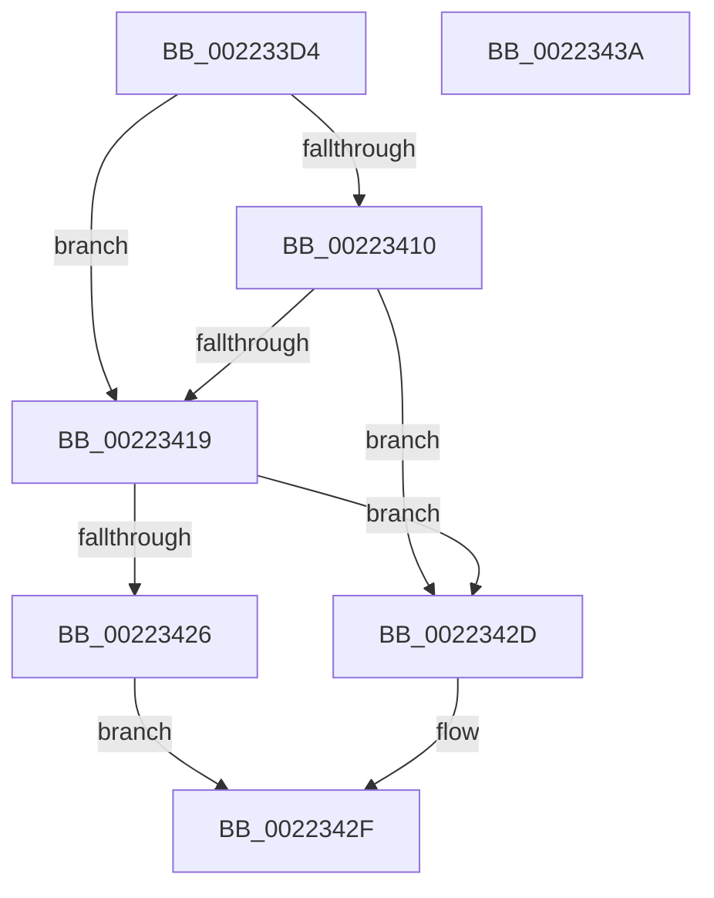

# IopCheckSessionDeviceAccess

- RVA: `0x002233D4`–`0x0022343B` (길이 `103` bytes)
- VA: `0x00000001402233D4`
- 실행 섹션: `.text`
- PDB 이름 있음: `예`; PDB Function 태그: `아니요`
- unwind 정보 RVA: `0x0005CAAC`
- 디코드: `29`개 명령, `103/103` bytes 표시
- 미해석 바이트: `0` (있으면 어셈블리에 `.byte`로 보존)

> 이 문서는 커널 이미지의 기계어와 PDB 기호를 분석해 생성했습니다. 4번과 5번은 함수 원형과 자료형을 바이너리 사용 방식에서 추정한 C 해석이며 원본 소스 복구 결과는 아닙니다.

## 1. Dependencies

- 직접 호출 지점: **4**; 고유 호출 대상: **4**
- 직접 호출자로 확인된 함수: **1**
- RIP 상대 이미지 참조: **1**

### Outgoing calls
- `0x002233F1` → [PsGetProcessSessionId](PsGetProcessSessionId_function_002233A0.md) (function, `0x002233A0`)
- `0x002233F8` → [PsGetCurrentServerSilo](PsGetCurrentServerSilo_function_00225710.md) (function, `0x00225710`)
- `0x00223400` → [PsGetServerSiloGlobals](PsGetServerSiloGlobals_function_002250A0.md) (function, `0x002250A0`)
- `0x0022341C` → [IopGetSessionIdFromPDO](../../page/8F/IopGetSessionIdFromPDO_function_008FFDD8.md) (function, `0x008FFDD8`)

### Direct callers
- [IopParseDevice](../../page/89/IopParseDevice_function_0089E510.md) at `0x008A023F`

### Static image references
- `0x00223410` → RVA `0x00E66120` (`.data`; read)

## 2. Other-region calls and transfers

- 다른 실행 섹션으로 향하는 call: **1**
  - `0x0022341C` → [IopGetSessionIdFromPDO](../../page/8F/IopGetSessionIdFromPDO_function_008FFDD8.md) (`.text` → `PAGE`)
- 별도 외부 분기/꼬리 이동을 확인하지 못했습니다.

## 3. Assembly (complete function range)

```asm
002233D4  48 89 5C 24 08                  mov qword ptr [rsp + 8], rbx
002233D9  57                              push rdi
002233DA  48 83 EC 20                     sub rsp, 0x20
002233DE  48 8B F9                        mov rdi, rcx
002233E1  65 48 8B 0C 25 88 01 00 00      mov rcx, qword ptr gs:[0x188]
002233EA  48 8B 89 B8 00 00 00            mov rcx, qword ptr [rcx + 0xb8]
002233F1  E8 AA FF FF FF                  call 0x1402233a0
002233F6  8B D8                           mov ebx, eax
002233F8  E8 13 23 00 00                  call 0x140225710
002233FD  48 8B C8                        mov rcx, rax
00223400  E8 9B 1C 00 00                  call 0x1402250a0
00223405  48 8B 90 08 05 00 00            mov rdx, qword ptr [rax + 0x508]
0022340C  3B 1A                           cmp ebx, dword ptr [rdx]
0022340E  75 09                           jne 0x140223419
00223410  83 3D 09 2D C4 00 00            cmp dword ptr [rip + 0xc42d09], 0
00223417  74 14                           je 0x14022342d
00223419  48 8B CF                        mov rcx, rdi
0022341C  E8 B7 C9 6D 00                  call 0x1408ffdd8
00223421  83 F8 FF                        cmp eax, -1
00223424  74 07                           je 0x14022342d
00223426  3B D8                           cmp ebx, eax
00223428  0F 94 C0                        sete al
0022342B  EB 02                           jmp 0x14022342f
0022342D  B0 01                           mov al, 1
0022342F  48 8B 5C 24 30                  mov rbx, qword ptr [rsp + 0x30]
00223434  48 83 C4 20                     add rsp, 0x20
00223438  5F                              pop rdi
00223439  C3                              ret
0022343A  CC                              int3
```

## 4. C-style interpretation (structured pseudocode)

```c
__int64 __fastcall IopCheckSessionDeviceAccess(__int64 a1)
{
    __int64 result;
    __int64 v_rsp;
    unsigned __int64 v_stack_p8;

    v_stack_p8 = v_rbx;
    v_rsp = (v_rsp) - (32);
    result = PsGetProcessSessionId(*(unsigned __int64 *)(*(unsigned __int64 *)(gs_base + (0 + 392)) + 184), a2, a3, a4);
    result = PsGetCurrentServerSilo(*(unsigned __int64 *)(*(unsigned __int64 *)(gs_base + (0 + 392)) + 184), a2, a3, a4);
    result = PsGetServerSiloGlobals(result, a2, a3, a4);
    if (((unsigned int)((unsigned int)((unsigned int)(result)))) != (*(unsigned int *)(*(unsigned __int64 *)(result + 1288)))) goto loc_00223419;
    if ((*(unsigned int *)(v_rip + 12856585)) == 0) goto loc_0022342D;
loc_00223419:
    result = IopGetSessionIdFromPDO(a1, *(unsigned __int64 *)(result + 1288), a3, a4);
    if (((unsigned int)(result)) == -1) goto loc_0022342D;
    result = (((unsigned int)((unsigned int)((unsigned int)(result)))) == ((unsigned int)(result))) ? 1 : 0;
    goto loc_0022342F;
loc_0022342D:
loc_0022342F:
    v_rsp = (v_rsp) + (32);
    return 1;
}
```

## 5. (Beta) C Style

```c
int64_t IopCheckSessionDeviceAccess(int64_t Arg1)
{
    int64_t result;
    int64_t local_rsp;
    uint64_t v_stack_p8;

    v_stack_p8 = local_rbx;
    local_rsp = (local_rsp) - (32);
    result = PsGetProcessSessionId(*(uint64_t *)(*(uint64_t *)(gs_base + (0 + 0x188)) + 0xB8), a2, a3, a4);
    result = PsGetCurrentServerSilo(*(uint64_t *)(*(uint64_t *)(gs_base + (0 + 0x188)) + 0xB8), a2, a3, a4);
    result = PsGetServerSiloGlobals(result, a2, a3, a4);
    if (((uint32_t)((uint32_t)((uint32_t)(result)))) != (*(uint32_t *)(*(uint64_t *)(result + 0x508)))) goto loc_00223419;
    if ((*(uint32_t *)(v_rip + 0xC42D09)) == 0) goto loc_0022342D;
loc_00223419:
    result = IopGetSessionIdFromPDO(Arg1, *(uint64_t *)(result + 0x508), a3, a4);
    if (((uint32_t)(result)) == -1) goto loc_0022342D;
    result = (((uint32_t)((uint32_t)((uint32_t)(result)))) == ((uint32_t)(result))) ? 1 : 0;
    goto loc_0022342F;
loc_0022342D:
loc_0022342F:
    local_rsp = (local_rsp) + (32);
    return 1;
}
```

## 6. Execution-region graph

[열기: 2D/3D 그래프와 함수 탐색 컨트롤 패널](../../../control-panel.html?section=text&rva=0x002233D4&view=graph)

- 2D 그래프는 위에서 아래로 흐르고, 3D 그래프는 빈 공간을 드래그해 회전합니다. Shift+드래그는 이동, 휠은 확대·축소, 함수 노드 선택은 대상 보고서 이동입니다.

### Static fallback


