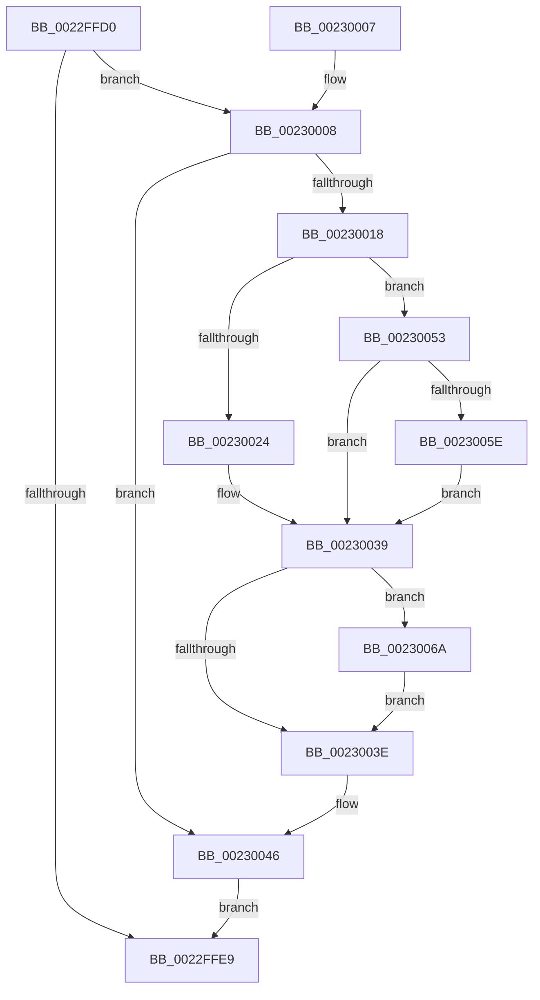

# KeSetCoalescableTimer

- RVA: `0x0022FFD0`–`0x00230096` (길이 `198` bytes)
- VA: `0x000000014022FFD0`
- 실행 섹션: `.text`
- PDB 이름 있음: `예`; PDB Function 태그: `아니요`
- unwind 정보 RVA: `0x0006022C`
- 디코드: `55`개 명령, `198/198` bytes 표시
- 미해석 바이트: `0` (있으면 어셈블리에 `.byte`로 보존)

> 이 문서는 커널 이미지의 기계어와 PDB 기호를 분석해 생성했습니다. 4번과 5번은 함수 원형과 자료형을 바이너리 사용 방식에서 추정한 C 해석이며 원본 소스 복구 결과는 아닙니다.

## 1. Dependencies

- 직접 호출 지점: **2**; 고유 호출 대상: **2**
- 직접 호출자로 확인된 함수: **28**
- RIP 상대 이미지 참조: **0**

### Outgoing calls
- `0x0022FFFC` → [KiSetTimerEx](../23/KiSetTimerEx_function_00232CB0.md) (function, `0x00232CB0`)
- `0x00230046` → [KiEncodeTolerableDelayValue](../23/KiEncodeTolerableDelayValue_function_0023141C.md) (function, `0x0023141C`)

### Direct callers
- [sub_00204895](../20/Unknown_function_00204895.md) at `0x0020492B`
- [CmpCompleteLazyWrite](CmpCompleteLazyWrite_function_0022FA10.md) at `0x0022FAB3`
- [ExpTimerResume](ExpTimerResume_function_0022FD60.md) at `0x0022FDD6`
- [CcRescheduleLazyWriteScanOnVolume](CcRescheduleLazyWriteScanOnVolume_function_0022FE00.md) at `0x0022FE5F`
- [PopFxScheduleDeviceIdleTimer](PopFxScheduleDeviceIdleTimer_function_0022FF18.md) at `0x0022FF92`
- [PopFxArmResidentTimer](../2C/PopFxArmResidentTimer_function_002C0680.md) at `0x002C06E7`
- [PopPepArmIdleTimer](../2C/PopPepArmIdleTimer_function_002C0B9C.md) at `0x002C0C09`
- [EtwpRequestFlushTimer](../2F/EtwpRequestFlushTimer_function_002FE6B0.md) at `0x002FE723`
- [CcRescheduleLazyWriteScan](../3C/CcRescheduleLazyWriteScan_function_003CA134.md) at `0x003CA1CD`
- [ExpTimerDpcRoutine](../4A/ExpTimerDpcRoutine_function_004A1570.md) at `0x004A1666`
- [CcPostPVCMDelayedDelete](../4C/CcPostPVCMDelayedDelete_function_004C2EE4.md) at `0x004C2F86`
- [CcBcbProfiler](../50/CcBcbProfiler_function_005099B0.md) at `0x00509B9C`
- [CcProcessDelayedDeletePVCM](../57/CcProcessDelayedDeletePVCM_function_0057DCD0.md) at `0x0057DDD1`
- [IopEnableTimer](../59/IopEnableTimer_function_00597240.md) at `0x00597292`
- [ExpTimerAdjust](../65/ExpTimerAdjust_function_006593CC.md) at `0x006594C3`
- [sub_00705ED0](../../page/70/Unknown_function_00705ED0.md) at `0x00706085`
- [PiDrvDbNodeActionCallback](../../page/93/PiDrvDbNodeActionCallback_function_00931980.md) at `0x00931A24`
- [IopErrorLogQueueRequest](../../page/A5/IopErrorLogQueueRequest_function_00A5E438.md) at `0x00A5E499`
- [ExpSetWorkerFactoryDeferredCreateTimer](../../page/A6/ExpSetWorkerFactoryDeferredCreateTimer_function_00A6B2CC.md) at `0x00A6B327`
- [CcTelemetryPeriodicTimerCallback](../../page/A8/CcTelemetryPeriodicTimerCallback_function_00A88370.md) at `0x00A8841E`
- [CcSetTelemetryPeriodicTimer](../../page/AD/CcSetTelemetryPeriodicTimer_function_00ADB788.md) at `0x00ADB7BC`
- [ExpWorkQueueManagerThread](../../page/AF/ExpWorkQueueManagerThread_function_00AF6D60.md) at `0x00AF71CE`
- [AnFwProgressIndicatorTransition](../../pagebgfx/BC/AnFwProgressIndicatorTransition_function_00BC0008.md) at `0x00BC0051`
- [AnFwDisplayBackgroundUpdate](../../pagebgfx/BC/AnFwDisplayBackgroundUpdate_function_00BC1E44.md) at `0x00BC1F80`
- [AnFwDisplayProgressIndicator](../../pagebgfx/BC/AnFwDisplayProgressIndicator_function_00BC1FD0.md) at `0x00BC2156`
- [sub_00BC65EE](../../pagebgfx/BC/Unknown_function_00BC65EE.md) at `0x00BC67B7`
- [CcInitializeBcbProfiler](../../init/BE/CcInitializeBcbProfiler_function_00BEF294.md) at `0x00BEFA23`
- [PopInitializeSystemIdleDetection](../../init/C4/PopInitializeSystemIdleDetection_function_00C408EC.md) at `0x00C4099F`

### Static image references
- 디코드된 RIP-relative 메모리 참조가 없습니다.

## 2. Other-region calls and transfers

- 다른 실행 섹션으로 향하는 call: **0**
- 별도 외부 분기/꼬리 이동을 확인하지 못했습니다.

## 3. Assembly (complete function range)

```asm
0022FFD0  40 53                           push rbx
0022FFD2  48 83 EC 30                     sub rsp, 0x30
0022FFD6  41 8B C1                        mov eax, r9d
0022FFD9  45 8B D8                        mov r11d, r8d
0022FFDC  45 33 C9                        xor r9d, r9d
0022FFDF  4C 8B D2                        mov r10, rdx
0022FFE2  48 8B D9                        mov rbx, rcx
0022FFE5  85 C0                           test eax, eax
0022FFE7  75 1F                           jne 0x140230008
0022FFE9  48 8B 44 24 60                  mov rax, qword ptr [rsp + 0x60]
0022FFEE  45 8B C3                        mov r8d, r11d
0022FFF1  49 8B D2                        mov rdx, r10
0022FFF4  48 89 44 24 20                  mov qword ptr [rsp + 0x20], rax
0022FFF9  48 8B CB                        mov rcx, rbx
0022FFFC  E8 AF 2C 00 00                  call 0x140232cb0
00230001  48 83 C4 30                     add rsp, 0x30
00230005  5B                              pop rbx
00230006  C3                              ret
00230007  CC                              int3
00230008  48 69 C8 10 27 00 00            imul rcx, rax, 0x2710
0023000F  48 81 F9 00 7C 92 00            cmp rcx, 0x927c00
00230016  76 2E                           jbe 0x140230046
00230018  48 81 C1 00 84 6D FF            add rcx, -0x927c00
0023001F  48 85 D2                        test rdx, rdx
00230022  78 2F                           js 0x140230053
00230024  4C 8D 04 11                     lea r8, [rcx + rdx]
00230028  48 B8 FF FF FF FF FF FF FF 7F   movabs rax, 0x7fffffffffffffff
00230032  4C 3B C2                        cmp r8, rdx
00230035  4C 0F 4C C0                     cmovl r8, rax
00230039  45 85 DB                        test r11d, r11d
0023003C  75 2C                           jne 0x14023006a
0023003E  B9 00 7C 92 00                  mov ecx, 0x927c00
00230043  4D 8B D0                        mov r10, r8
00230046  E8 D1 13 00 00                  call 0x14023141c
0023004B  C0 E0 02                        shl al, 2
0023004E  44 8A C8                        mov r9b, al
00230051  EB 96                           jmp 0x14022ffe9
00230053  4C 8B C2                        mov r8, rdx
00230056  4C 2B C1                        sub r8, rcx
00230059  4C 3B C2                        cmp r8, rdx
0023005C  7E DB                           jle 0x140230039
0023005E  49 B8 00 00 00 00 00 00 00 80   movabs r8, 0x8000000000000000
00230068  EB CF                           jmp 0x140230039
0023006A  48 B8 4B 59 86 38 D6 C5 6D 34   movabs rax, 0x346dc5d63886594b
00230074  48 F7 E9                        imul rcx
00230077  83 C8 FF                        or eax, 0xffffffff
0023007A  48 C1 FA 0B                     sar rdx, 0xb
0023007E  48 8B CA                        mov rcx, rdx
00230081  48 C1 E9 3F                     shr rcx, 0x3f
00230085  48 03 CA                        add rcx, rdx
00230088  41 03 CB                        add ecx, r11d
0023008B  41 3B CB                        cmp ecx, r11d
0023008E  0F 43 C1                        cmovae eax, ecx
00230091  44 8B D8                        mov r11d, eax
00230094  EB A8                           jmp 0x14023003e
```

## 4. C-style interpretation (structured pseudocode)

```c
__int64 __fastcall KeSetCoalescableTimer(__int64 a1, __int64 a2, int a3, int a4, __int64 a5)
{
    __int64 result;
    __int64 v_rsp;
    unsigned __int64 v_stack_m18;

    v_rsp = (v_rsp) - (48);
    a4 = 0;
    if ((unsigned int)((unsigned int)(a4)) != 0) goto loc_00230008;
loc_0022FFE9:
    v_stack_m18 = a5;
    result = KiSetTimerEx(a1, a2, (unsigned int)((unsigned int)((unsigned int)(a3))), a4);
    v_rsp = (v_rsp) + (48);
    return result;
loc_00230008:
    a1 = (a1) * (result);
    if (a1 <= 0x927C00ULL) goto loc_00230046;
    a1 = (a1) + (0xFFFFFFFFFF6D8400ULL);
    if (sign_flag) goto loc_00230053;
    a3 = a1 + a2 * 1;
    if ((a1 + a2 * 1) < a2) { a3 = result; }
loc_00230039:
    if ((unsigned int)((unsigned int)(a3)) != 0) goto loc_0023006A;
loc_0023003E:
loc_00230046:
    result = KiEncodeTolerableDelayValue((unsigned int)(0x927C00ULL), a2, a3, a4);
    result = (unsigned __int8)((result) << (2));
    goto loc_0022FFE9;
loc_00230053:
    a3 = (a2) - ((unsigned int)(0x927C00ULL));
    if (a3 <= a2) goto loc_00230039;
    goto loc_00230039;
loc_0023006A:
    result = (unsigned int)((result) | (0xFFFFFFFFULL));
    a2 = (a2) >> (11);
    a1 = (a2) >> (63);
    a1 = (a1) + (a2);
    a1 = (unsigned int)((a1) + ((unsigned int)((unsigned int)(a3))));
    if (((unsigned int)(a1)) >= ((unsigned int)((unsigned int)(a3)))) { result = (unsigned int)(a1); }
    goto loc_0023003E;
}
```

## 5. (Beta) C Style

```c
int64_t KeSetCoalescableTimer(int64_t Arg1, int64_t Arg2, int32_t Arg3, int32_t Arg4, int64_t Arg5)
{
    int64_t result;
    int64_t local_rsp;
    uint64_t v_stack_m18;

    local_rsp = (local_rsp) - (48);
    Arg4 = 0;
    if ((uint32_t)((uint32_t)(Arg4)) != 0) goto loc_00230008;
loc_0022FFE9:
    v_stack_m18 = Arg5;
    result = KiSetTimerEx(Arg1, Arg2, (uint32_t)((uint32_t)((uint32_t)(Arg3))), Arg4);
    local_rsp = (local_rsp) + (48);
    return result;
loc_00230008:
    Arg1 = (Arg1) * (result);
    if (Arg1 <= 0x927C00ULL) goto loc_00230046;
    Arg1 = (Arg1) + (0xFFFFFFFFFF6D8400ULL);
    if (sign_flag) goto loc_00230053;
    Arg3 = Arg1 + Arg2 * 1;
    if ((Arg1 + Arg2 * 1) < Arg2) { Arg3 = result; }
loc_00230039:
    if ((uint32_t)((uint32_t)(Arg3)) != 0) goto loc_0023006A;
loc_0023003E:
loc_00230046:
    result = KiEncodeTolerableDelayValue((uint32_t)(0x927C00ULL), Arg2, Arg3, Arg4);
    result = (uint8_t)((result) << (2));
    goto loc_0022FFE9;
loc_00230053:
    Arg3 = (Arg2) - ((uint32_t)(0x927C00ULL));
    if (Arg3 <= Arg2) goto loc_00230039;
    goto loc_00230039;
loc_0023006A:
    result = (uint32_t)((result) | (0xFFFFFFFFULL));
    Arg2 = (Arg2) >> (11);
    Arg1 = (Arg2) >> (63);
    Arg1 = (Arg1) + (Arg2);
    Arg1 = (uint32_t)((Arg1) + ((uint32_t)((uint32_t)(Arg3))));
    if (((uint32_t)(Arg1)) >= ((uint32_t)((uint32_t)(Arg3)))) { result = (uint32_t)(Arg1); }
    goto loc_0023003E;
}
```

## 6. Execution-region graph

[열기: 2D/3D 그래프와 함수 탐색 컨트롤 패널](../../../control-panel.html?section=text&rva=0x0022FFD0&view=graph)

- 2D 그래프는 위에서 아래로 흐르고, 3D 그래프는 빈 공간을 드래그해 회전합니다. Shift+드래그는 이동, 휠은 확대·축소, 함수 노드 선택은 대상 보고서 이동입니다.

### Static fallback


