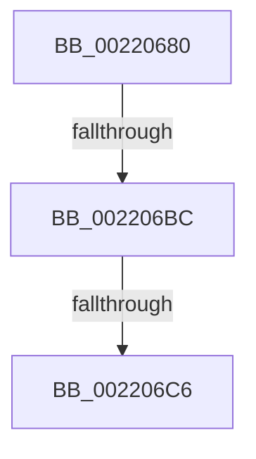

# KiAbCpuBoostOwners

- RVA: `0x00220680`–`0x002206D0` (길이 `80` bytes)
- VA: `0x0000000140220680`
- 실행 섹션: `.text`
- PDB 이름 있음: `예`; PDB Function 태그: `아니요`
- unwind 정보 RVA: `0x0005F3F8`
- 디코드: `25`개 명령, `80/80` bytes 표시
- 미해석 바이트: `0` (있으면 어셈블리에 `.byte`로 보존)

> 이 문서는 커널 이미지의 기계어와 PDB 기호를 분석해 생성했습니다. 4번과 5번은 함수 원형과 자료형을 바이너리 사용 방식에서 추정한 C 해석이며 원본 소스 복구 결과는 아닙니다.

## 1. Dependencies

- 직접 호출 지점: **0**; 고유 호출 대상: **0**
- 직접 호출자로 확인된 함수: **3**
- RIP 상대 이미지 참조: **0**

### Outgoing calls
- 직접 디코드된 call 명령이 없습니다.

### Direct callers
- [KiAbConvertWaiterToOwnerEntry](../21/KiAbConvertWaiterToOwnerEntry_function_00219430.md) at `0x002197E0`
- [sub_00221FB6](Unknown_function_00221FB6.md) at `0x002223A6`
- [sub_00221FB6](Unknown_function_00221FB6.md) at `0x00222454`
- [KiAbForceProcessLockEntry](../41/KiAbForceProcessLockEntry_function_00419078.md) at `0x004191AC`

### Static image references
- 디코드된 RIP-relative 메모리 참조가 없습니다.

## 2. Other-region calls and transfers

- 다른 실행 섹션으로 향하는 call: **0**
- call이 아닌 외부 분기/꼬리 이동: **2**
  - `0x002206B6` → [sub_002207EF](Unknown_function_002207EF.md) (`tail-transfer`)
  - `0x002206C0` → [sub_002209C5](Unknown_function_002209C5.md) (`tail-transfer`)

## 3. Assembly (complete function range)

```asm
00220680  4C 89 4C 24 20                  mov qword ptr [rsp + 0x20], r9
00220685  4C 89 44 24 18                  mov qword ptr [rsp + 0x18], r8
0022068A  53                              push rbx
0022068B  55                              push rbp
0022068C  56                              push rsi
0022068D  57                              push rdi
0022068E  41 55                           push r13
00220690  41 56                           push r14
00220692  41 57                           push r15
00220694  48 83 EC 70                     sub rsp, 0x70
00220698  48 8B 59 30                     mov rbx, qword ptr [rcx + 0x30]
0022069C  33 FF                           xor edi, edi
0022069E  89 7C 24 58                     mov dword ptr [rsp + 0x58], edi
002206A2  4D 8B E9                        mov r13, r9
002206A5  88 54 24 58                     mov byte ptr [rsp + 0x58], dl
002206A9  0F B6 EA                        movzx ebp, dl
002206AC  89 7C 24 54                     mov dword ptr [rsp + 0x54], edi
002206B0  48 8B F1                        mov rsi, rcx
002206B3  48 85 DB                        test rbx, rbx
002206B6  0F 85 33 01 00 00               jne 0x1402207ef
002206BC  80 7E 09 00                     cmp byte ptr [rsi + 9], 0
002206C0  0F 85 FF 02 00 00               jne 0x1402209c5
002206C6  0F B6 46 08                     movzx eax, byte ptr [rsi + 8]
002206CA  48 8B DE                        mov rbx, rsi
002206CD  83 E0 3F                        and eax, 0x3f
```

## 4. C-style interpretation (structured pseudocode)

```c
__int64 __fastcall KiAbCpuBoostOwners(__int64 a1, unsigned __int8 a2, __int64 a3, __int64 a4)
{
    __int64 result;
    __int64 v_rdi;
    __int64 v_rsp;
    unsigned int v_stack_m50;
    unsigned int v_stack_m54;
    unsigned __int64 v_stack_p18;
    unsigned __int64 v_stack_p20;

    v_stack_p20 = a4;
    v_stack_p18 = a3;
    v_rsp = (v_rsp) - (112);
    v_rdi = 0;
    v_stack_m50 = 0;
    v_stack_m50 = a2;
    v_stack_m54 = 0;
    result = (unsigned int)((*(unsigned __int8 *)(a1 + 8)) & (63));
    return result;
}
```

## 5. (Beta) C Style

```c
int64_t KiAbCpuBoostOwners(void *Arg1, uint8_t Arg2, int64_t Arg3, int64_t Arg4)
{
    uint8_t *arg1 = (uint8_t *)Arg1;

    int64_t result;
    int64_t local_rdi;
    int64_t local_rsp;
    uint32_t v_stack_m50;
    uint32_t v_stack_m54;
    uint64_t v_stack_p18;
    uint64_t v_stack_p20;

    v_stack_p20 = Arg4;
    v_stack_p18 = Arg3;
    local_rsp = (local_rsp) - (112);
    local_rdi = 0;
    v_stack_m50 = 0;
    v_stack_m50 = Arg2;
    v_stack_m54 = 0;
    result = (uint32_t)((*(uint8_t *)(arg1 + 0x8)) & (63));
    return result;
}
```

### 관측된 메모리 오프셋

구조체 형식이 확인되지 않은 접근은 인자 기준의 오프셋으로만 기록했습니다.

| 기준 인자 | 오프셋 표현 | 폭 (bit) | 접근 |
|---|---:|---:|---|
| `Arg1` | `+ 0x8` | `8` | `R` |
| `Arg1` | `+ 0x9` | `8` | `R` |
| `Arg1` | `+ 0x30` | `64` | `R` |

## 6. Execution-region graph

[열기: 2D/3D 그래프와 함수 탐색 컨트롤 패널](../../../control-panel.html?section=text&rva=0x00220680&view=graph)

- 2D 그래프는 위에서 아래로 흐르고, 3D 그래프는 빈 공간을 드래그해 회전합니다. Shift+드래그는 이동, 휠은 확대·축소, 함수 노드 선택은 대상 보고서 이동입니다.

### Static fallback


