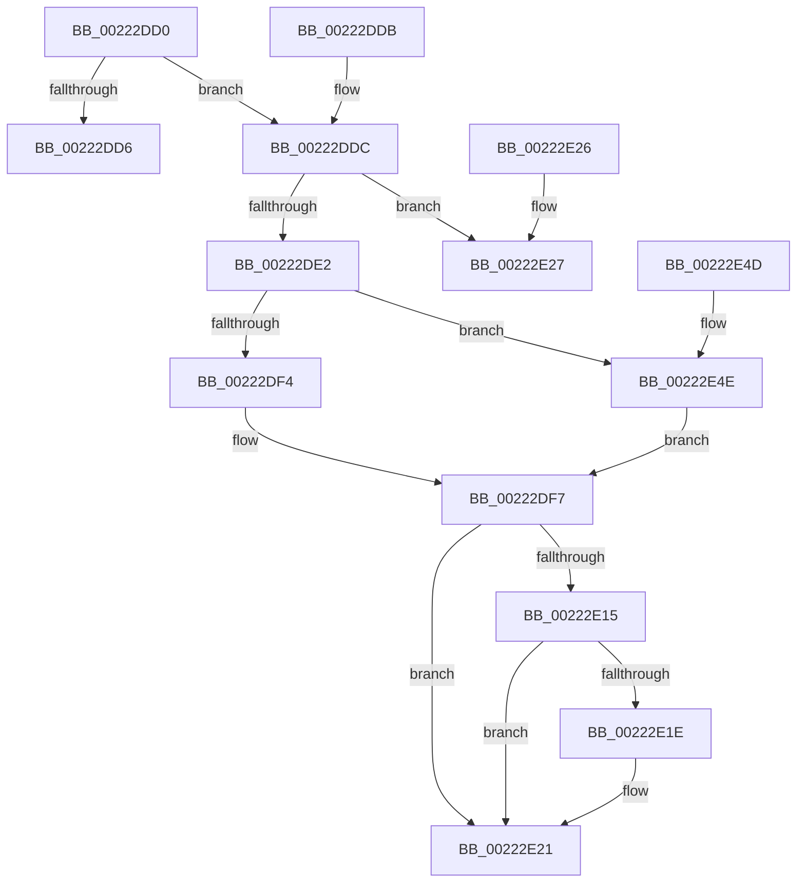

# KiAbEntryGetCpuPriorityKey

- RVA: `0x00222DD0`–`0x00222E57` (길이 `135` bytes)
- VA: `0x0000000140222DD0`
- 실행 섹션: `.text`
- PDB 이름 있음: `예`; PDB Function 태그: `아니요`
- unwind 정보 RVA: `0x000DB714`
- 디코드: `42`개 명령, `135/135` bytes 표시
- 미해석 바이트: `0` (있으면 어셈블리에 `.byte`로 보존)

> 이 문서는 커널 이미지의 기계어와 PDB 기호를 분석해 생성했습니다. 4번과 5번은 함수 원형과 자료형을 바이너리 사용 방식에서 추정한 C 해석이며 원본 소스 복구 결과는 아닙니다.

## 1. Dependencies

- 직접 호출 지점: **0**; 고유 호출 대상: **0**
- 직접 호출자로 확인된 함수: **3**
- RIP 상대 이미지 참조: **0**

### Outgoing calls
- 직접 디코드된 call 명령이 없습니다.

### Direct callers
- [KiAbConvertWaiterToOwnerEntry](../21/KiAbConvertWaiterToOwnerEntry_function_00219430.md) at `0x00219782`
- [sub_00221FB6](Unknown_function_00221FB6.md) at `0x00222664`
- [sub_00221FB6](Unknown_function_00221FB6.md) at `0x00222976`
- [KiAbForceProcessLockEntry](../41/KiAbForceProcessLockEntry_function_00419078.md) at `0x0041915C`

### Static image references
- 디코드된 RIP-relative 메모리 참조가 없습니다.

## 2. Other-region calls and transfers

- 다른 실행 섹션으로 향하는 call: **0**
- 별도 외부 분기/꼬리 이동을 확인하지 못했습니다.

## 3. Assembly (complete function range)

```asm
00222DD0  F6 41 0B 01                     test byte ptr [rcx + 0xb], 1
00222DD4  75 06                           jne 0x140222ddc
00222DD6  0F B6 41 28                     movzx eax, byte ptr [rcx + 0x28]
00222DDA  C3                              ret
00222DDB  CC                              int3
00222DDC  80 79 09 00                     cmp byte ptr [rcx + 9], 0
00222DE0  75 45                           jne 0x140222e27
00222DE2  8B 41 50                        mov eax, dword ptr [rcx + 0x50]
00222DE5  C7 44 24 08 00 00 00 00         mov dword ptr [rsp + 8], 0
00222DED  25 FF FF FF 3F                  and eax, 0x3fffffff
00222DF2  77 5A                           ja 0x140222e4e
00222DF4  45 32 C0                        xor r8b, r8b
00222DF7  0F B6 41 08                     movzx eax, byte ptr [rcx + 8]
00222DFB  83 E0 3F                        and eax, 0x3f
00222DFE  48 6B D0 58                     imul rdx, rax, 0x58
00222E02  48 2B CA                        sub rcx, rdx
00222E05  48 8B 41 F0                     mov rax, qword ptr [rcx - 0x10]
00222E09  0F B6 88 33 02 00 00            movzx ecx, byte ptr [rax + 0x233]
00222E10  41 3A C8                        cmp cl, r8b
00222E13  7E 0C                           jle 0x140222e21
00222E15  44 0F B6 C1                     movzx r8d, cl
00222E19  80 F9 1E                        cmp cl, 0x1e
00222E1C  7E 03                           jle 0x140222e21
00222E1E  41 B0 1E                        mov r8b, 0x1e
00222E21  41 0F B6 C0                     movzx eax, r8b
00222E25  C3                              ret
00222E26  CC                              int3
00222E27  0F B6 41 08                     movzx eax, byte ptr [rcx + 8]
00222E2B  83 E0 3F                        and eax, 0x3f
00222E2E  48 6B D0 58                     imul rdx, rax, 0x58
00222E32  48 2B CA                        sub rcx, rdx
00222E35  BA 1E 00 00 00                  mov edx, 0x1e
00222E3A  48 8B 41 F0                     mov rax, qword ptr [rcx - 0x10]
00222E3E  0F B6 88 C3 00 00 00            movzx ecx, byte ptr [rax + 0xc3]
00222E45  3A CA                           cmp cl, dl
00222E47  8B C1                           mov eax, ecx
00222E49  0F 4F C2                        cmovg eax, edx
00222E4C  C3                              ret
00222E4D  CC                              int3
00222E4E  44 0F BD C0                     bsr r8d, eax
00222E52  41 FE C0                        inc r8b
00222E55  EB A0                           jmp 0x140222df7
```

## 4. C-style interpretation (structured pseudocode)

```c
__int64 __fastcall KiAbEntryGetCpuPriorityKey(__int64 a1, __int64 a2, unsigned __int8 a3)
{
    __int64 result;
    unsigned int v_stack_p8;

    if (((*(unsigned __int8 *)(a1 + 11)) & (1)) != 0) goto loc_00222DDC;
    return *(unsigned __int8 *)(a1 + 40);
loc_00222DDC:
    if ((*(unsigned __int8 *)(a1 + 9)) != 0) goto loc_00222E27;
    v_stack_p8 = 0;
    result = (unsigned int)(((unsigned int)(*(unsigned int *)(a1 + 80))) & (0x3FFFFFFFULL));
    if (condition_is_above) goto loc_00222E4E;
    a3 = 0;
loc_00222DF7:
    result = (unsigned int)((*(unsigned __int8 *)(a1 + 8)) & (63));
    a2 = (a2) * (result);
    a1 = (a1) - (a2);
    if (((unsigned __int8)(*(unsigned __int8 *)(*(unsigned __int64 *)(a1 - 16) + 563))) <= 0) goto loc_00222E21;
    if (((unsigned __int8)(*(unsigned __int8 *)(*(unsigned __int64 *)(a1 - 16) + 563))) >= = 30) {
        a3 = 30;
    }
    return a3;
loc_00222E27:
    result = (unsigned int)((*(unsigned __int8 *)(*(unsigned __int8 *)(*(unsigned __int64 *)(a1 - 16) + 563) + 8)) & (63));
    a2 = (a2) * (result);
    a1 = (*(unsigned __int8 *)(*(unsigned __int64 *)(a1 - 16) + 563)) - (a2);
    result = (unsigned int)((unsigned int)(*(unsigned __int8 *)(*(unsigned __int64 *)(a1 - 16) + 195)));
    if (((unsigned __int8)(*(unsigned __int8 *)(*(unsigned __int64 *)(a1 - 16) + 195))) > 30) { result = 30; }
    return result;
loc_00222E4E:
    a3 = (unsigned __int8)((a3) + 1);
    goto loc_00222DF7;
}
```

## 5. (Beta) C Style

```c
int64_t KiAbEntryGetCpuPriorityKey(void *Arg1, int64_t Arg2, uint8_t Arg3)
{
    uint8_t *arg1 = (uint8_t *)Arg1;

    int64_t result;
    uint32_t v_stack_p8;

    if (((*(uint8_t *)(arg1 + 0xB)) & (1)) != 0) goto loc_00222DDC;
    return *(uint8_t *)(arg1 + 0x28);
loc_00222DDC:
    if ((*(uint8_t *)(arg1 + 0x9)) != 0) goto loc_00222E27;
    v_stack_p8 = 0;
    result = (uint32_t)(((uint32_t)(*(uint32_t *)(arg1 + 0x50))) & (0x3FFFFFFFULL));
    if (condition_is_above) goto loc_00222E4E;
    Arg3 = 0;
loc_00222DF7:
    result = (uint32_t)((*(uint8_t *)(arg1 + 0x8)) & (63));
    Arg2 = (Arg2) * (result);
    Arg1 = (Arg1) - (Arg2);
    if (((uint8_t)(*(uint8_t *)(*(uint64_t *)(arg1 - 0x10) + 0x233))) <= 0) goto loc_00222E21;
    if (((uint8_t)(*(uint8_t *)(*(uint64_t *)(arg1 - 0x10) + 0x233))) >= = 30) {
        Arg3 = 30;
    }
    return Arg3;
loc_00222E27:
    result = (uint32_t)((*(uint8_t *)(*(uint8_t *)(*(uint64_t *)(arg1 - 0x10) + 0x233) + 0x8)) & (63));
    Arg2 = (Arg2) * (result);
    Arg1 = (*(uint8_t *)(*(uint64_t *)(arg1 - 0x10) + 0x233)) - (Arg2);
    result = (uint32_t)((uint32_t)(*(uint8_t *)(*(uint64_t *)(arg1 - 0x10) + 0xC3)));
    if (((uint8_t)(*(uint8_t *)(*(uint64_t *)(arg1 - 0x10) + 0xC3))) > 30) { result = 30; }
    return result;
loc_00222E4E:
    Arg3 = (uint8_t)((Arg3) + 1);
    goto loc_00222DF7;
}
```

### 관측된 메모리 오프셋

구조체 형식이 확인되지 않은 접근은 인자 기준의 오프셋으로만 기록했습니다.

| 기준 인자 | 오프셋 표현 | 폭 (bit) | 접근 |
|---|---:|---:|---|
| `Arg1` | `- 0x10` | `64` | `R` |
| `Arg1` | `+ 0x8` | `8` | `R` |
| `Arg1` | `+ 0x9` | `8` | `R` |
| `Arg1` | `+ 0xB` | `8` | `R` |
| `Arg1` | `+ 0x28` | `8` | `R` |
| `Arg1` | `+ 0x50` | `32` | `R` |

## 6. Execution-region graph

[열기: 2D/3D 그래프와 함수 탐색 컨트롤 패널](../../../control-panel.html?section=text&rva=0x00222DD0&view=graph)

- 2D 그래프는 위에서 아래로 흐르고, 3D 그래프는 빈 공간을 드래그해 회전합니다. Shift+드래그는 이동, 휠은 확대·축소, 함수 노드 선택은 대상 보고서 이동입니다.

### Static fallback


