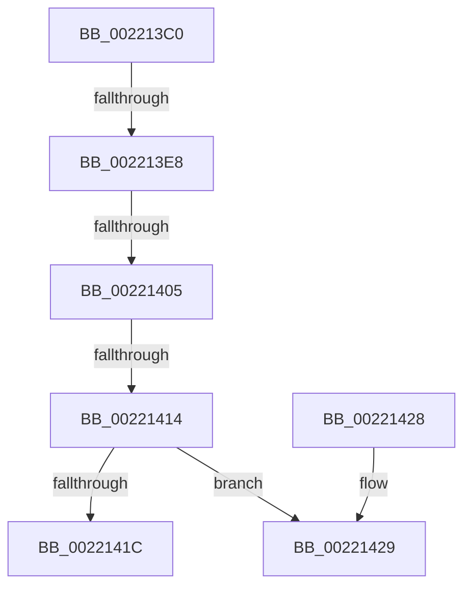

# KiAbEntryGetLockedHeadEntry

- RVA: `0x002213C0`–`0x00221431` (길이 `113` bytes)
- VA: `0x00000001402213C0`
- 실행 섹션: `.text`
- PDB 이름 있음: `예`; PDB Function 태그: `아니요`
- unwind 정보 RVA: `0x0005F4D4`
- 디코드: `36`개 명령, `113/113` bytes 표시
- 미해석 바이트: `0` (있으면 어셈블리에 `.byte`로 보존)

> 이 문서는 커널 이미지의 기계어와 PDB 기호를 분석해 생성했습니다. 4번과 5번은 함수 원형과 자료형을 바이너리 사용 방식에서 추정한 C 해석이며 원본 소스 복구 결과는 아닙니다.

## 1. Dependencies

- 직접 호출 지점: **1**; 고유 호출 대상: **1**
- 직접 호출자로 확인된 함수: **4**
- RIP 상대 이미지 참조: **1**

### Outgoing calls
- `0x0022142C` → [KeReleaseInStackQueuedSpinLockFromDpcLevel](../21/KeReleaseInStackQueuedSpinLockFromDpcLevel_function_002171B0.md) (function, `0x002171B0`)

### Direct callers
- [KiAbConvertWaiterToOwnerEntry](../21/KiAbConvertWaiterToOwnerEntry_function_00219430.md) at `0x00219624`
- [sub_00221FB6](Unknown_function_00221FB6.md) at `0x00222021`
- [sub_00221FB6](Unknown_function_00221FB6.md) at `0x00222182`
- [KiAbDeferredProcessingWorker](../30/KiAbDeferredProcessingWorker_function_0030DEB0.md) at `0x0030E214`
- [KiAbDeferredProcessingWorker](../30/KiAbDeferredProcessingWorker_function_0030DEB0.md) at `0x0030E30B`
- [KiAbForceProcessLockEntry](../41/KiAbForceProcessLockEntry_function_00419078.md) at `0x00419105`

### Static image references
- `0x002213F8` → RVA `0x00FC6B06` (`ALMOSTRO`; read)

## 2. Other-region calls and transfers

- 다른 실행 섹션으로 향하는 call: **0**
- call이 아닌 외부 분기/꼬리 이동: **3**
  - `0x002213E6` → [sub_00221431](Unknown_function_00221431.md) (`tail-transfer`)
  - `0x002213FF` → [sub_00221771](Unknown_function_00221771.md) (`tail-transfer`)
  - `0x0022140E` → [sub_002219D9](Unknown_function_002219D9.md) (`tail-transfer`)

## 3. Assembly (complete function range)

```asm
002213C0  40 56                           push rsi
002213C2  57                              push rdi
002213C3  41 56                           push r14
002213C5  48 83 EC 50                     sub rsp, 0x50
002213C9  33 C0                           xor eax, eax
002213CB  0F 57 C0                        xorps xmm0, xmm0
002213CE  48 89 44 24 30                  mov qword ptr [rsp + 0x30], rax
002213D3  4D 8B F0                        mov r14, r8
002213D6  0F B6 41 0B                     movzx eax, byte ptr [rcx + 0xb]
002213DA  8B FA                           mov edi, edx
002213DC  48 8B F1                        mov rsi, rcx
002213DF  0F 11 44 24 20                  movups xmmword ptr [rsp + 0x20], xmm0
002213E4  A8 01                           test al, 1
002213E6  74 49                           je 0x140221431
002213E8  49 C7 00 00 00 00 00            mov qword ptr [r8], 0
002213EF  48 8D 51 48                     lea rdx, [rcx + 0x48]
002213F3  49 89 50 08                     mov qword ptr [r8 + 8], rdx
002213F7  90                              nop
002213F8  F6 05 07 57 DA 00 21            test byte ptr [rip + 0xda5707], 0x21
002213FF  0F 85 6C 03 00 00               jne 0x140221771
00221405  49 8B C6                        mov rax, r14
00221408  48 87 02                        xchg qword ptr [rdx], rax
0022140B  48 85 C0                        test rax, rax
0022140E  0F 85 C5 05 00 00               jne 0x1402219d9
00221414  0F B6 46 0B                     movzx eax, byte ptr [rsi + 0xb]
00221418  A8 01                           test al, 1
0022141A  74 0D                           je 0x140221429
0022141C  48 8B C6                        mov rax, rsi
0022141F  48 83 C4 50                     add rsp, 0x50
00221423  41 5E                           pop r14
00221425  5F                              pop rdi
00221426  5E                              pop rsi
00221427  C3                              ret
00221428  CC                              int3
00221429  49 8B CE                        mov rcx, r14
0022142C  E8 7F 5D FF FF                  call 0x1402171b0
```

## 4. C-style interpretation (structured pseudocode)

```c
__int64 __fastcall KiAbEntryGetLockedHeadEntry(__int64 a1, int a2, __int64 a3)
{
    __int64 result;
    __int64 v_rsp;
    unsigned __int64 v_stack_m38;
    unsigned __int64 v_stack_m48;

    v_rsp = (v_rsp) - (80);
    result = 0;
    v_stack_m38 = 0;
    v_stack_m48 = v_xmm0;
    *(unsigned __int64 *)(a3) = 0;
    *(unsigned __int64 *)(a3 + 8) = a1 + 72;
    if ((((unsigned __int8)(*(unsigned __int8 *)(a1 + 11))) & (1)) == 0) goto loc_00221429;
    v_rsp = (v_rsp) + (80);
    return a1;
loc_00221429:
    result = KeReleaseInStackQueuedSpinLockFromDpcLevel(a3, a1 + 72, a3, a4);
    return result;
}
```

## 5. (Beta) C Style

```c
void *KiAbEntryGetLockedHeadEntry(void *Arg1, int32_t Arg2, void *Arg3)
{
    uint8_t *arg1 = (uint8_t *)Arg1;
    uint8_t *arg3 = (uint8_t *)Arg3;

    int64_t result;
    int64_t local_rsp;
    uint64_t v_stack_m38;
    uint64_t v_stack_m48;

    local_rsp = (local_rsp) - (80);
    result = 0;
    v_stack_m38 = 0;
    v_stack_m48 = v_xmm0;
    *(uint64_t *)(arg3) = 0;
    *(void **)(arg3 + 0x8) = Arg1 + 72;
    if ((((uint8_t)(*(uint8_t *)(arg1 + 0xB))) & (1)) == 0) goto loc_00221429;
    local_rsp = (local_rsp) + (80);
    return Arg1;
loc_00221429:
    result = KeReleaseInStackQueuedSpinLockFromDpcLevel(Arg3, Arg1 + 72, Arg3, a4);
    return result;
}
```

### 관측된 메모리 오프셋

구조체 형식이 확인되지 않은 접근은 인자 기준의 오프셋으로만 기록했습니다.

| 기준 인자 | 오프셋 표현 | 폭 (bit) | 접근 |
|---|---:|---:|---|
| `Arg1` | `+ 0x0` | `64` | `R/W` |
| `Arg1` | `+ 0xB` | `8` | `R` |
| `Arg1` | `+ 0x48` | `64` | `R` |
| `Arg3` | `+ 0x0` | `64` | `W` |
| `Arg3` | `+ 0x8` | `64` | `W` |

## 6. Execution-region graph

[열기: 2D/3D 그래프와 함수 탐색 컨트롤 패널](../../../control-panel.html?section=text&rva=0x002213C0&view=graph)

- 2D 그래프는 위에서 아래로 흐르고, 3D 그래프는 빈 공간을 드래그해 회전합니다. Shift+드래그는 이동, 휠은 확대·축소, 함수 노드 선택은 대상 보고서 이동입니다.

### Static fallback


