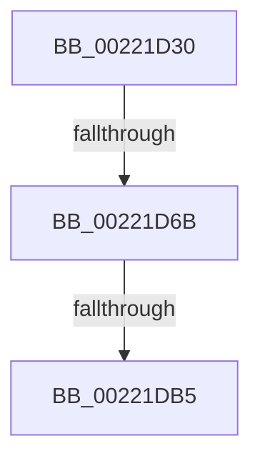

# KiAbProcessThreadLocks

- RVA: `0x00221D30`–`0x00221DC6` (길이 `150` bytes)
- VA: `0x0000000140221D30`
- 실행 섹션: `.text`
- PDB 이름 있음: `예`; PDB Function 태그: `아니요`
- unwind 정보 RVA: `0x0005F64C`
- 디코드: `37`개 명령, `150/150` bytes 표시
- 미해석 바이트: `0` (있으면 어셈블리에 `.byte`로 보존)

> 이 문서는 커널 이미지의 기계어와 PDB 기호를 분석해 생성했습니다. 4번과 5번은 함수 원형과 자료형을 바이너리 사용 방식에서 추정한 C 해석이며 원본 소스 복구 결과는 아닙니다.

## 1. Dependencies

- 직접 호출 지점: **0**; 고유 호출 대상: **0**
- 직접 호출자로 확인된 함수: **6**
- RIP 상대 이미지 참조: **0**

### Outgoing calls
- 직접 디코드된 call 명령이 없습니다.

### Direct callers
- [KiAbConvertWaiterToOwnerEntry](../21/KiAbConvertWaiterToOwnerEntry_function_00219430.md) at `0x00219990`
- [sub_0021D4DD](../21/Unknown_function_0021D4DD.md) at `0x0021D574`
- [sub_0021D6CE](../21/Unknown_function_0021D6CE.md) at `0x0021D718`
- [KiAbPropagateBoosts](KiAbPropagateBoosts_function_00222E60.md) at `0x00222ECD`
- [KiExecuteAllDpcs](../25/KiExecuteAllDpcs_function_0025B740.md) at `0x0025BC07`
- [KiAbDeferredProcessingWorker](../30/KiAbDeferredProcessingWorker_function_0030DEB0.md) at `0x0030E5A4`

### Static image references
- 디코드된 RIP-relative 메모리 참조가 없습니다.

## 2. Other-region calls and transfers

- 다른 실행 섹션으로 향하는 call: **0**
- call이 아닌 외부 분기/꼬리 이동: **2**
  - `0x00221D65` → [sub_00221FAE](Unknown_function_00221FAE.md) (`tail-transfer`)
  - `0x00221DAF` → [sub_00221F5D](Unknown_function_00221F5D.md) (`tail-transfer`)

## 3. Assembly (complete function range)

```asm
00221D30  4C 89 4C 24 20                  mov qword ptr [rsp + 0x20], r9
00221D35  4C 89 44 24 18                  mov qword ptr [rsp + 0x18], r8
00221D3A  48 89 4C 24 08                  mov qword ptr [rsp + 8], rcx
00221D3F  55                              push rbp
00221D40  56                              push rsi
00221D41  57                              push rdi
00221D42  41 55                           push r13
00221D44  48 8D 6C 24 C9                  lea rbp, [rsp - 0x37]
00221D49  48 81 EC C8 00 00 00            sub rsp, 0xc8
00221D50  48 8B 81 78 04 00 00            mov rax, qword ptr [rcx + 0x478]
00221D57  8B FA                           mov edi, edx
00221D59  48 8B F1                        mov rsi, rcx
00221D5C  41 BD 01 00 00 00               mov r13d, 1
00221D62  48 85 C0                        test rax, rax
00221D65  0F 84 43 02 00 00               je 0x140221fae
00221D6B  0F B7 50 08                     movzx edx, word ptr [rax + 8]
00221D6F  45 33 D2                        xor r10d, r10d
00221D72  0F B6 48 0C                     movzx ecx, byte ptr [rax + 0xc]
00221D76  45 8B CD                        mov r9d, r13d
00221D79  44 0F B7 40 0A                  movzx r8d, word ptr [rax + 0xa]
00221D7E  49 D3 E1                        shl r9, cl
00221D81  44 0B C2                        or r8d, edx
00221D84  41 FF C9                        dec r9d
00221D87  45 3B C8                        cmp r9d, r8d
00221D8A  41 0F 94 C2                     sete r10b
00221D8E  48 8B 86 70 04 00 00            mov rax, qword ptr [rsi + 0x470]
00221D95  4D 8B C5                        mov r8, r13
00221D98  0F B6 48 0C                     movzx ecx, byte ptr [rax + 0xc]
00221D9C  49 D3 E0                        shl r8, cl
00221D9F  0F B7 48 08                     movzx ecx, word ptr [rax + 8]
00221DA3  41 FF C8                        dec r8d
00221DA6  0F B7 50 0A                     movzx edx, word ptr [rax + 0xa]
00221DAA  0B D1                           or edx, ecx
00221DAC  44 3B C2                        cmp r8d, edx
00221DAF  0F 84 A8 01 00 00               je 0x140221f5d
00221DB5  4C 8B 86 70 04 00 00            mov r8, qword ptr [rsi + 0x470]
00221DBC  49 BB FC FF FF FF FF FF FF 7F   movabs r11, 0x7ffffffffffffffc
```

## 4. C-style interpretation (structured pseudocode)

```c
__int64 __fastcall KiAbProcessThreadLocks(__int64 a1, int a2, __int64 a3, __int64 a4)
{
    __int64 v_r10;
    __int64 v_rsp;
    unsigned __int64 v_stack_m57;
    unsigned __int64 v_stack_p18;
    unsigned __int64 v_stack_p20;
    unsigned __int64 v_stack_p8;

    v_stack_p20 = a4;
    v_stack_p18 = a3;
    v_stack_p8 = a1;
    v_rsp = (v_rsp) - (200);
    v_r10 = 0;
    a4 = (1) << ((unsigned __int8)(*(unsigned __int8 *)(*(unsigned __int64 *)(a1 + 1144) + 12)));
    a3 = (unsigned int)((*(unsigned __int16 *)(*(unsigned __int64 *)(a1 + 1144) + 10)) | ((unsigned int)(*(unsigned __int16 *)(*(unsigned __int64 *)(a1 + 1144) + 8))));
    a4 = (unsigned int)((a4) - 1);
    v_r10 = (((unsigned int)(a4)) == ((unsigned int)(a3))) ? 1 : 0;
    a3 = (1) << ((unsigned __int8)(*(unsigned __int8 *)(*(unsigned __int64 *)(a1 + 1136) + 12)));
    a3 = (unsigned int)((a3) - 1);
    a2 = (unsigned int)((*(unsigned __int16 *)(*(unsigned __int64 *)(a1 + 1136) + 10)) | ((unsigned int)(*(unsigned __int16 *)(*(unsigned __int64 *)(a1 + 1136) + 8))));
    return *(unsigned __int64 *)(a1 + 1136);
}
```

## 5. (Beta) C Style

```c
int64_t KiAbProcessThreadLocks(void *Arg1, int32_t Arg2, int64_t Arg3, int64_t Arg4)
{
    uint8_t *arg1 = (uint8_t *)Arg1;

    int64_t local_r10;
    int64_t local_rsp;
    uint64_t v_stack_m57;
    uint64_t v_stack_p18;
    uint64_t v_stack_p20;
    uint64_t v_stack_p8;

    v_stack_p20 = Arg4;
    v_stack_p18 = Arg3;
    v_stack_p8 = Arg1;
    local_rsp = (local_rsp) - (200);
    local_r10 = 0;
    Arg4 = (1) << ((uint8_t)(*(uint8_t *)(*(uint64_t *)(arg1 + 0x478) + 0xC)));
    Arg3 = (uint32_t)((*(uint16_t *)(*(uint64_t *)(arg1 + 0x478) + 0xA)) | ((uint32_t)(*(uint16_t *)(*(uint64_t *)(arg1 + 0x478) + 0x8))));
    Arg4 = (uint32_t)((Arg4) - 1);
    local_r10 = (((uint32_t)(Arg4)) == ((uint32_t)(Arg3))) ? 1 : 0;
    Arg3 = (1) << ((uint8_t)(*(uint8_t *)(*(uint64_t *)(arg1 + 0x470) + 0xC)));
    Arg3 = (uint32_t)((Arg3) - 1);
    Arg2 = (uint32_t)((*(uint16_t *)(*(uint64_t *)(arg1 + 0x470) + 0xA)) | ((uint32_t)(*(uint16_t *)(*(uint64_t *)(arg1 + 0x470) + 0x8))));
    return *(uint64_t *)(arg1 + 0x470);
}
```

### 관측된 메모리 오프셋

구조체 형식이 확인되지 않은 접근은 인자 기준의 오프셋으로만 기록했습니다.

| 기준 인자 | 오프셋 표현 | 폭 (bit) | 접근 |
|---|---:|---:|---|
| `Arg1` | `+ 0x470` | `64` | `R` |
| `Arg1` | `+ 0x478` | `64` | `R` |

## 6. Execution-region graph

[열기: 2D/3D 그래프와 함수 탐색 컨트롤 패널](../../../control-panel.html?section=text&rva=0x00221D30&view=graph)

- 2D 그래프는 위에서 아래로 흐르고, 3D 그래프는 빈 공간을 드래그해 회전합니다. Shift+드래그는 이동, 휠은 확대·축소, 함수 노드 선택은 대상 보고서 이동입니다.

### Static fallback


