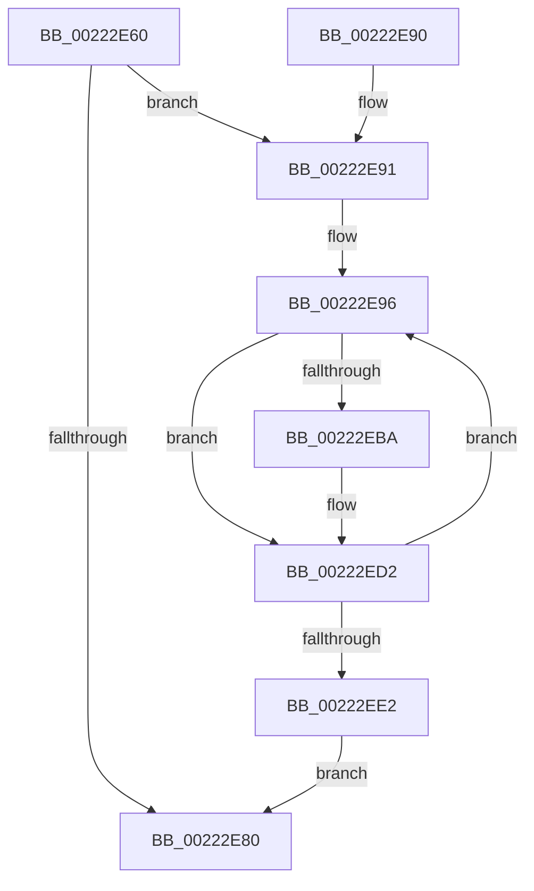

# KiAbPropagateBoosts

- RVA: `0x00222E60`–`0x00222EE9` (길이 `137` bytes)
- VA: `0x0000000140222E60`
- 실행 섹션: `.text`
- PDB 이름 있음: `예`; PDB Function 태그: `아니요`
- unwind 정보 RVA: `0x0005F6E0`
- 디코드: `37`개 명령, `137/137` bytes 표시
- 미해석 바이트: `0` (있으면 어셈블리에 `.byte`로 보존)

> 이 문서는 커널 이미지의 기계어와 PDB 기호를 분석해 생성했습니다. 4번과 5번은 함수 원형과 자료형을 바이너리 사용 방식에서 추정한 C 해석이며 원본 소스 복구 결과는 아닙니다.

## 1. Dependencies

- 직접 호출 지점: **1**; 고유 호출 대상: **1**
- 직접 호출자로 확인된 함수: **1**
- RIP 상대 이미지 참조: **0**

### Outgoing calls
- `0x00222ECD` → [KiAbProcessThreadLocks](KiAbProcessThreadLocks_function_00221D30.md) (function, `0x00221D30`)

### Direct callers
- [KiExecuteAllDpcs](../25/KiExecuteAllDpcs_function_0025B740.md) at `0x0025BC25`

### Static image references
- 디코드된 RIP-relative 메모리 참조가 없습니다.

## 2. Other-region calls and transfers

- 다른 실행 섹션으로 향하는 call: **0**
- 별도 외부 분기/꼬리 이동을 확인하지 못했습니다.

## 3. Assembly (complete function range)

```asm
00222E60  48 89 5C 24 10                  mov qword ptr [rsp + 0x10], rbx
00222E65  48 89 74 24 18                  mov qword ptr [rsp + 0x18], rsi
00222E6A  57                              push rdi
00222E6B  48 83 EC 30                     sub rsp, 0x30
00222E6F  48 8B 01                        mov rax, qword ptr [rcx]
00222E72  49 8B F8                        mov rdi, r8
00222E75  48 8B F2                        mov rsi, rdx
00222E78  48 8B D9                        mov rbx, rcx
00222E7B  48 85 C0                        test rax, rax
00222E7E  75 11                           jne 0x140222e91
00222E80  48 8B 5C 24 48                  mov rbx, qword ptr [rsp + 0x48]
00222E85  48 8B 74 24 50                  mov rsi, qword ptr [rsp + 0x50]
00222E8A  48 83 C4 30                     add rsp, 0x30
00222E8E  5F                              pop rdi
00222E8F  C3                              ret
00222E90  CC                              int3
00222E91  48 89 6C 24 40                  mov qword ptr [rsp + 0x40], rbp
00222E96  4C 8B 00                        mov r8, qword ptr [rax]
00222E99  48 8D A8 D8 FC FF FF            lea rbp, [rax - 0x328]
00222EA0  4C 89 03                        mov qword ptr [rbx], r8
00222EA3  48 C7 00 01 00 00 00            mov qword ptr [rax], 1
00222EAA  F0 83 0C 24 00                  lock or dword ptr [rsp], 0
00222EAF  0F B6 85 18 03 00 00            movzx eax, byte ptr [rbp + 0x318]
00222EB6  84 C0                           test al, al
00222EB8  74 18                           je 0x140222ed2
00222EBA  4C 8B CB                        mov r9, rbx
00222EBD  48 89 74 24 20                  mov qword ptr [rsp + 0x20], rsi
00222EC2  4C 8B C7                        mov r8, rdi
00222EC5  BA 04 00 00 00                  mov edx, 4
00222ECA  48 8B CD                        mov rcx, rbp
00222ECD  E8 5E EE FF FF                  call 0x140221d30
00222ED2  66 F0 FF 8D 64 03 00 00         lock dec word ptr [rbp + 0x364]
00222EDA  48 8B 03                        mov rax, qword ptr [rbx]
00222EDD  48 85 C0                        test rax, rax
00222EE0  75 B4                           jne 0x140222e96
00222EE2  48 8B 6C 24 40                  mov rbp, qword ptr [rsp + 0x40]
00222EE7  EB 97                           jmp 0x140222e80
```

## 4. C-style interpretation (structured pseudocode)

```c
__int64 __fastcall KiAbPropagateBoosts(__int64 a1, __int64 a2, __int64 a3)
{
    __int64 result;
    __int64 v_rsp;
    unsigned int v_stack_p0;
    unsigned __int64 v_stack_p10;
    unsigned __int64 v_stack_p18;
    unsigned __int64 v_stack_p20;
    unsigned __int64 v_stack_p40;

    v_stack_p10 = v_rbx;
    v_stack_p18 = v_rsi;
    v_rsp = (v_rsp) - (48);
    if (*(unsigned __int64 *)(a1) != 0) goto loc_00222E91;
loc_00222E80:
    v_rsp = (v_rsp) + (48);
    return *(unsigned __int64 *)(a1);
loc_00222E91:
    v_stack_p40 = v_rbp;
loc_00222E96:
    *(unsigned __int64 *)(v_stack_p10) = *(unsigned __int64 *)(*(unsigned __int64 *)(a1));
    *(unsigned __int64 *)(*(unsigned __int64 *)(a1)) = 1;
    result = *(unsigned __int8 *)(*(unsigned __int64 *)(a1) - 808 + 792);
    if ((unsigned __int8)(*(unsigned __int8 *)(*(unsigned __int64 *)(a1) - 808 + 792)) != 0) {
        a4 = v_stack_p10;
        v_stack_p20 = v_stack_p18;
        a3 = a3;
        a2 = 4;
        a1 = *(unsigned __int64 *)(a1) - 808;
        result = KiAbProcessThreadLocks(a1, a2, a3, a4);
    }
    if (*(unsigned __int64 *)(v_stack_p10) != 0) goto loc_00222E96;
    goto loc_00222E80;
}
```

## 5. (Beta) C Style

```c
int64_t KiAbPropagateBoosts(void *Arg1, int64_t Arg2, int64_t Arg3)
{
    uint8_t *arg1 = (uint8_t *)Arg1;

    int64_t result;
    int64_t local_rsp;
    uint32_t v_stack_p0;
    uint64_t v_stack_p10;
    uint64_t v_stack_p18;
    uint64_t v_stack_p20;
    uint64_t v_stack_p40;

    v_stack_p10 = local_rbx;
    v_stack_p18 = local_rsi;
    local_rsp = (local_rsp) - (48);
    if (*(uint64_t *)(arg1) != 0) goto loc_00222E91;
loc_00222E80:
    local_rsp = (local_rsp) + (48);
    return *(uint64_t *)(arg1);
loc_00222E91:
    v_stack_p40 = local_rbp;
loc_00222E96:
    *(uint64_t *)(v_stack_p10) = *(uint64_t *)(*(uint64_t *)(arg1));
    *(uint64_t *)(*(uint64_t *)(arg1)) = 1;
    result = *(uint8_t *)(*(uint64_t *)(arg1) - 0x328 + 0x318);
    if ((uint8_t)(*(uint8_t *)(*(uint64_t *)(arg1) - 0x328 + 0x318)) != 0) {
        a4 = v_stack_p10;
        v_stack_p20 = v_stack_p18;
        Arg3 = Arg3;
        Arg2 = 4;
        Arg1 = *(uint64_t *)(arg1) - 808;
        result = KiAbProcessThreadLocks(Arg1, Arg2, Arg3, a4);
    }
    if (*(uint64_t *)(v_stack_p10) != 0) goto loc_00222E96;
    goto loc_00222E80;
}
```

### 관측된 메모리 오프셋

구조체 형식이 확인되지 않은 접근은 인자 기준의 오프셋으로만 기록했습니다.

| 기준 인자 | 오프셋 표현 | 폭 (bit) | 접근 |
|---|---:|---:|---|
| `Arg1` | `+ 0x0` | `64` | `R` |
| `Arg1` | `+ 0x0` | `64` | `W` |

## 6. Execution-region graph

[열기: 2D/3D 그래프와 함수 탐색 컨트롤 패널](../../../control-panel.html?section=text&rva=0x00222E60&view=graph)

- 2D 그래프는 위에서 아래로 흐르고, 3D 그래프는 빈 공간을 드래그해 회전합니다. Shift+드래그는 이동, 휠은 확대·축소, 함수 노드 선택은 대상 보고서 이동입니다.

### Static fallback


