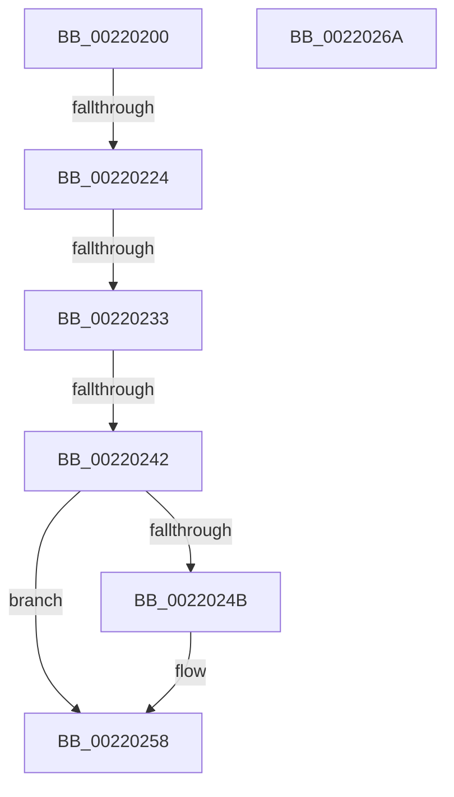

# KiExitThreadWait

- RVA: `0x00220200`–`0x0022026B` (길이 `107` bytes)
- VA: `0x0000000140220200`
- 실행 섹션: `.text`
- PDB 이름 있음: `예`; PDB Function 태그: `아니요`
- unwind 정보 RVA: `0x0005F310`
- 디코드: `32`개 명령, `107/107` bytes 표시
- 미해석 바이트: `0` (있으면 어셈블리에 `.byte`로 보존)

> 이 문서는 커널 이미지의 기계어와 PDB 기호를 분석해 생성했습니다. 4번과 5번은 함수 원형과 자료형을 바이너리 사용 방식에서 추정한 C 해석이며 원본 소스 복구 결과는 아닙니다.

## 1. Dependencies

- 직접 호출 지점: **1**; 고유 호출 대상: **1**
- 직접 호출자로 확인된 함수: **1**
- RIP 상대 이미지 참조: **1**

### Outgoing calls
- `0x00220253` → [KiLowerIrqlProcessIrqlFlags](../4F/KiLowerIrqlProcessIrqlFlags_function_004F5698.md) (function, `0x004F5698`)

### Direct callers
- [KiCommitThreadWait](../20/KiCommitThreadWait_function_0020DFE0.md) at `0x0020E2BE`

### Static image references
- `0x00220242` → RVA `0x00FC6D20` (`ALMOSTRO`; read)

## 2. Other-region calls and transfers

- 다른 실행 섹션으로 향하는 call: **0**
- call이 아닌 외부 분기/꼬리 이동: **3**
  - `0x00220222` → [sub_0022026B](Unknown_function_0022026B.md) (`tail-transfer`)
  - `0x0022022D` → [sub_002203EB + 0x20](Unknown_function_002203EB.md) (`tail-transfer`)
  - `0x0022023C` → [sub_002203EB](Unknown_function_002203EB.md) (`tail-transfer`)

## 3. Assembly (complete function range)

```asm
00220200  48 89 5C 24 10                  mov qword ptr [rsp + 0x10], rbx
00220205  56                              push rsi
00220206  57                              push rdi
00220207  41 56                           push r14
00220209  48 83 EC 30                     sub rsp, 0x30
0022020D  45 33 F6                        xor r14d, r14d
00220210  41 8B D8                        mov ebx, r8d
00220213  4C 89 74 24 68                  mov qword ptr [rsp + 0x68], r14
00220218  48 8B FA                        mov rdi, rdx
0022021B  48 8B F1                        mov rsi, rcx
0022021E  41 F6 C0 02                     test r8b, 2
00220222  75 47                           jne 0x14022026b
00220224  0F B6 47 70                     movzx eax, byte ptr [rdi + 0x70]
00220228  83 E3 01                        and ebx, 1
0022022B  A8 38                           test al, 0x38
0022022D  0F 85 D8 01 00 00               jne 0x14022040b
00220233  0F B6 BF 86 01 00 00            movzx edi, byte ptr [rdi + 0x186]
0022023A  85 DB                           test ebx, ebx
0022023C  0F 85 A9 01 00 00               jne 0x1402203eb
00220242  44 39 35 D7 6A DA 00            cmp dword ptr [rip + 0xda6ad7], r14d
00220249  74 0D                           je 0x140220258
0022024B  44 0F 20 C1                     mov rcx, cr8
0022024F  40 0F B6 D7                     movzx edx, dil
00220253  E8 40 54 2D 00                  call 0x1404f5698
00220258  44 0F 22 C7                     mov cr8, rdi
0022025C  48 8B 5C 24 58                  mov rbx, qword ptr [rsp + 0x58]
00220261  48 83 C4 30                     add rsp, 0x30
00220265  41 5E                           pop r14
00220267  5F                              pop rdi
00220268  5E                              pop rsi
00220269  C3                              ret
0022026A  CC                              int3
```

## 4. C-style interpretation (structured pseudocode)

```c
__int64 __fastcall KiExitThreadWait(__int64 a1, __int64 a2, int a3)
{
    __int64 result;
    __int64 v_r14;
    __int64 v_rbx;
    __int64 v_rsp;
    unsigned __int64 v_stack_p10;
    unsigned __int64 v_stack_p20;

    v_stack_p10 = v_rbx;
    v_rsp = (v_rsp) - (48);
    v_r14 = 0;
    v_stack_p20 = 0;
    v_rbx = (unsigned int)(((unsigned int)(a3)) & (1));
    result = *(unsigned __int8 *)(a2 + 112);
    if ((*(unsigned int *)(v_rip + 14314199)) != 0) {
        a1 = v_cr8;
        a2 = (unsigned __int8)(*(unsigned __int8 *)(a2 + 390));
        result = KiLowerIrqlProcessIrqlFlags(a1, a2, a3, a4);
    }
    v_rsp = (v_rsp) + (48);
    return result;
}
```

## 5. (Beta) C Style

```c
int64_t KiExitThreadWait(int64_t Arg1, void *Arg2, int32_t Arg3)
{
    uint8_t *arg2 = (uint8_t *)Arg2;

    int64_t result;
    int64_t local_r14;
    int64_t local_rbx;
    int64_t local_rsp;
    uint64_t v_stack_p10;
    uint64_t v_stack_p20;

    v_stack_p10 = local_rbx;
    local_rsp = (local_rsp) - (48);
    local_r14 = 0;
    v_stack_p20 = 0;
    local_rbx = (uint32_t)(((uint32_t)(Arg3)) & (1));
    result = *(uint8_t *)(arg2 + 0x70);
    if ((*(uint32_t *)(v_rip + 0xDA6AD7)) != 0) {
        Arg1 = v_cr8;
        Arg2 = (uint8_t)(*(uint8_t *)(arg2 + 0x186));
        result = KiLowerIrqlProcessIrqlFlags(Arg1, Arg2, Arg3, a4);
    }
    local_rsp = (local_rsp) + (48);
    return result;
}
```

### 관측된 메모리 오프셋

구조체 형식이 확인되지 않은 접근은 인자 기준의 오프셋으로만 기록했습니다.

| 기준 인자 | 오프셋 표현 | 폭 (bit) | 접근 |
|---|---:|---:|---|
| `Arg2` | `+ 0x70` | `8` | `R` |
| `Arg2` | `+ 0x186` | `8` | `R` |

## 6. Execution-region graph

[열기: 2D/3D 그래프와 함수 탐색 컨트롤 패널](../../../control-panel.html?section=text&rva=0x00220200&view=graph)

- 2D 그래프는 위에서 아래로 흐르고, 3D 그래프는 빈 공간을 드래그해 회전합니다. Shift+드래그는 이동, 휠은 확대·축소, 함수 노드 선택은 대상 보고서 이동입니다.

### Static fallback


