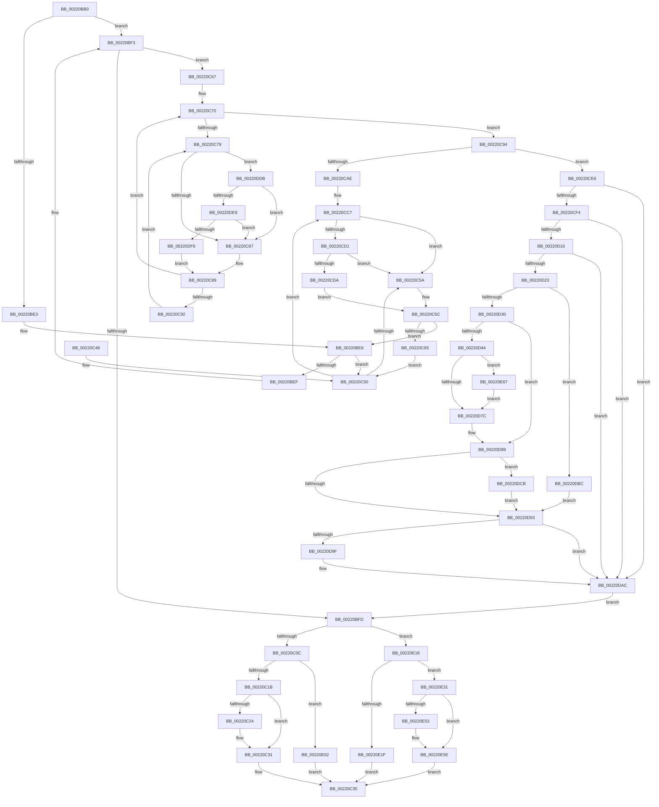

# KiFastExitThreadWait

- RVA: `0x00220BB0`–`0x00220E72` (길이 `706` bytes)
- VA: `0x0000000140220BB0`
- 실행 섹션: `.text`
- PDB 이름 있음: `예`; PDB Function 태그: `아니요`
- unwind 정보 RVA: `0x0005F490`
- 디코드: `184`개 명령, `706/706` bytes 표시
- 미해석 바이트: `0` (있으면 어셈블리에 `.byte`로 보존)

> 이 문서는 커널 이미지의 기계어와 PDB 기호를 분석해 생성했습니다. 4번과 5번은 함수 원형과 자료형을 바이너리 사용 방식에서 추정한 C 해석이며 원본 소스 복구 결과는 아닙니다.

## 1. Dependencies

- 직접 호출 지점: **14**; 고유 호출 대상: **10**
- 직접 호출자로 확인된 함수: **6**
- RIP 상대 이미지 참조: **3**

### Outgoing calls
- `0x00220C2C` → [KiLowerIrqlProcessIrqlFlags](../4F/KiLowerIrqlProcessIrqlFlags_function_004F5698.md) (function, `0x004F5698`)
- `0x00220CC1` → [KeBugCheckEx](../4F/KeBugCheckEx_function_004FD660.md) (function, `0x004FD660`)
- `0x00220CD1` → [KiCheckVpBackingLongSpinWaitHypercall](../30/KiCheckVpBackingLongSpinWaitHypercall_function_0030F490.md) (function, `0x0030F490`)
- `0x00220CDC` → [HvlNotifyLongSpinWait](../30/HvlNotifyLongSpinWait_function_0030F460.md) (function, `0x0030F460`)
- `0x00220D23` → [Feature_StackingDecayBoosts__private_IsEnabledNoReportingNoInline](../4E/Feature_StackingDecayBoosts__private_IsEnabledNoReportingNoInline_function_004EF7C0.md) (function, `0x004EF7C0`)
- `0x00220DA7` → [KiSetPriorityThread](KiSetPriorityThread_function_00220E78.md) (function, `0x00220E78`)
- `0x00220DC1` → [KiComputeThreadPriorityNonStacking](../5C/KiComputeThreadPriorityNonStacking_function_005CA81C.md) (function, `0x005CA81C`)
- `0x00220DE9` → [KiCheckVpBackingLongSpinWaitHypercall](../30/KiCheckVpBackingLongSpinWaitHypercall_function_0030F490.md) (function, `0x0030F490`)
- `0x00220DF8` → [HvlNotifyLongSpinWait](../30/HvlNotifyLongSpinWait_function_0030F460.md) (function, `0x0030F460`)
- `0x00220E0E` → [KiProcessDeferredReadyList](../25/KiProcessDeferredReadyList_function_00250800.md) (function, `0x00250800`)
- `0x00220E27` → [KiExitThreadWaitReschedule](../35/KiExitThreadWaitReschedule_function_00352EC8.md) (function, `0x00352EC8`)
- `0x00220E39` → [KiProcessDeferredReadyList](../25/KiProcessDeferredReadyList_function_00250800.md) (function, `0x00250800`)
- `0x00220E45` → [KiDeliverApc](../25/KiDeliverApc_function_00250F20.md) (function, `0x00250F20`)
- `0x00220E59` → [KiLowerIrqlProcessIrqlFlags](../4F/KiLowerIrqlProcessIrqlFlags_function_004F5698.md) (function, `0x004F5698`)

### Direct callers
- [sub_0020C2D4](../20/Unknown_function_0020C2D4.md) at `0x0020C82A`
- [KeWaitForSingleObject](../20/KeWaitForSingleObject_function_0020E6B0.md) at `0x0020F274`
- [KeWaitForGate](../2C/KeWaitForGate_function_002CA794.md) at `0x002CA8CA`
- [KeWaitForAlertByThreadId](../3C/KeWaitForAlertByThreadId_function_003C4B14.md) at `0x003C4E1B`
- [KeRemovePriQueue](../3C/KeRemovePriQueue_function_003C5090.md) at `0x003C561D`
- [KiWaitForAllObjects](../3C/KiWaitForAllObjects_function_003C5800.md) at `0x003C5B72`
- [KiWaitForAllObjects](../3C/KiWaitForAllObjects_function_003C5800.md) at `0x003C5C39`
- [KiWaitForAllObjects](../3C/KiWaitForAllObjects_function_003C5800.md) at `0x003C5F70`

### Static image references
- `0x00220C1B` → RVA `0x00FC6D20` (`ALMOSTRO`; read)
- `0x00220C52` → RVA `0x00FC52AC` (`ALMOSTRO`; reference)
- `0x00220CC7` → RVA `0x00FC6AB8` (`ALMOSTRO`; read)

## 2. Other-region calls and transfers

- 다른 실행 섹션으로 향하는 call: **0**
- 별도 외부 분기/꼬리 이동을 확인하지 못했습니다.

## 3. Assembly (complete function range)

```asm
00220BB0  48 89 5C 24 08                  mov qword ptr [rsp + 8], rbx
00220BB5  48 89 6C 24 10                  mov qword ptr [rsp + 0x10], rbp
00220BBA  56                              push rsi
00220BBB  57                              push rdi
00220BBC  41 56                           push r14
00220BBE  48 83 EC 40                     sub rsp, 0x40
00220BC2  41 8B D8                        mov ebx, r8d
00220BC5  C6 82 84 01 00 00 02            mov byte ptr [rdx + 0x184], 2
00220BCC  48 8B FA                        mov rdi, rdx
00220BCF  48 8B E9                        mov rbp, rcx
00220BD2  F0 83 0C 24 00                  lock or dword ptr [rsp], 0
00220BD7  48 8B 42 40                     mov rax, qword ptr [rdx + 0x40]
00220BDB  45 33 F6                        xor r14d, r14d
00220BDE  48 85 C0                        test rax, rax
00220BE1  74 10                           je 0x140220bf3
00220BE3  41 8B F6                        mov esi, r14d
00220BE6  F0 48 0F BA 6F 40 00            lock bts qword ptr [rdi + 0x40], 0
00220BED  72 61                           jb 0x140220c50
00220BEF  4C 89 77 40                     mov qword ptr [rdi + 0x40], r14
00220BF3  4C 89 74 24 30                  mov qword ptr [rsp + 0x30], r14
00220BF8  F6 C3 02                        test bl, 2
00220BFB  75 6A                           jne 0x140220c67
00220BFD  0F B6 47 70                     movzx eax, byte ptr [rdi + 0x70]
00220C01  83 E3 01                        and ebx, 1
00220C04  A8 38                           test al, 0x38
00220C06  0F 85 0C 02 00 00               jne 0x140220e18
00220C0C  0F B6 BF 86 01 00 00            movzx edi, byte ptr [rdi + 0x186]
00220C13  85 DB                           test ebx, ebx
00220C15  0F 85 E7 01 00 00               jne 0x140220e02
00220C1B  44 39 35 FE 60 DA 00            cmp dword ptr [rip + 0xda60fe], r14d
00220C22  74 0D                           je 0x140220c31
00220C24  44 0F 20 C1                     mov rcx, cr8
00220C28  40 0F B6 D7                     movzx edx, dil
00220C2C  E8 67 4A 2D 00                  call 0x1404f5698
00220C31  44 0F 22 C7                     mov cr8, rdi
00220C35  48 8B 5C 24 60                  mov rbx, qword ptr [rsp + 0x60]
00220C3A  48 8B 6C 24 68                  mov rbp, qword ptr [rsp + 0x68]
00220C3F  48 83 C4 40                     add rsp, 0x40
00220C43  41 5E                           pop r14
00220C45  5F                              pop rdi
00220C46  5E                              pop rsi
00220C47  C3                              ret
00220C48  CC                              int3
00220C49  0F 1F 80 00 00 00 00            nop dword ptr [rax]
00220C50  FF C6                           inc esi
00220C52  85 35 54 46 DA 00               test dword ptr [rip + 0xda4654], esi
00220C58  74 6D                           je 0x140220cc7
00220C5A  F3 90                           pause
00220C5C  48 8B 47 40                     mov rax, qword ptr [rdi + 0x40]
00220C60  48 85 C0                        test rax, rax
00220C63  74 81                           je 0x140220be6
00220C65  EB E9                           jmp 0x140220c50
00220C67  41 8B F6                        mov esi, r14d
00220C6A  66 0F 1F 44 00 00               nop word ptr [rax + rax]
00220C70  F0 48 0F BA 6F 40 00            lock bts qword ptr [rdi + 0x40], 0
00220C77  73 1B                           jae 0x140220c94
00220C79  FF C6                           inc esi
00220C7B  85 35 2B 46 DA 00               test dword ptr [rip + 0xda462b], esi
00220C81  0F 84 54 01 00 00               je 0x140220ddb
00220C87  F3 90                           pause
00220C89  48 8B 47 40                     mov rax, qword ptr [rdi + 0x40]
00220C8D  48 85 C0                        test rax, rax
00220C90  74 DE                           je 0x140220c70
00220C92  EB E5                           jmp 0x140220c79
00220C94  4C 0F BE 8F 1B 03 00 00         movsx r9, byte ptr [rdi + 0x31b]
00220C9C  4D 8B C1                        mov r8, r9
00220C9F  49 8D 0C 39                     lea rcx, [r9 + rdi]
00220CA3  0F B6 81 38 03 00 00            movzx eax, byte ptr [rcx + 0x338]
00220CAA  84 C0                           test al, al
00220CAC  75 38                           jne 0x140220ce6
00220CAE  41 B9 02 00 00 00               mov r9d, 2
00220CB4  4C 89 74 24 20                  mov qword ptr [rsp + 0x20], r14
00220CB9  48 8B D7                        mov rdx, rdi
00220CBC  B9 57 01 00 00                  mov ecx, 0x157
00220CC1  E8 9A C9 2D 00                  call 0x1404fd660
00220CC6  CC                              int3
00220CC7  8B 05 EB 5D DA 00               mov eax, dword ptr [rip + 0xda5deb]
00220CCD  A8 40                           test al, 0x40
00220CCF  74 89                           je 0x140220c5a
00220CD1  E8 BA E7 0E 00                  call 0x14030f490
00220CD6  84 C0                           test al, al
00220CD8  74 80                           je 0x140220c5a
00220CDA  8B CE                           mov ecx, esi
00220CDC  E8 7F E7 0E 00                  call 0x14030f460
00220CE1  E9 76 FF FF FF                  jmp 0x140220c5c
00220CE6  2C 01                           sub al, 1
00220CE8  88 81 38 03 00 00               mov byte ptr [rcx + 0x338], al
00220CEE  0F 85 B8 00 00 00               jne 0x140220dac
00220CF4  8B 97 58 03 00 00               mov edx, dword ptr [rdi + 0x358]
00220CFA  41 8B C9                        mov ecx, r9d
00220CFD  44 0F BB CA                     btc edx, r9d
00220D01  B8 01 00 00 00                  mov eax, 1
00220D06  D3 E0                           shl eax, cl
00220D08  89 97 58 03 00 00               mov dword ptr [rdi + 0x358], edx
00220D0E  3B D0                           cmp edx, eax
00220D10  0F 83 96 00 00 00               jae 0x140220dac
00220D16  80 BF C3 00 00 00 1F            cmp byte ptr [rdi + 0xc3], 0x1f
00220D1D  0F 8F 89 00 00 00               jg 0x140220dac
00220D23  E8 98 EA 2C 00                  call 0x1404ef7c0
00220D28  85 C0                           test eax, eax
00220D2A  0F 84 8C 00 00 00               je 0x140220dbc
00220D30  44 0F BE 87 33 02 00 00         movsx r8d, byte ptr [rdi + 0x233]
00220D38  45 8B D0                        mov r10d, r8d
00220D3B  45 8B C8                        mov r9d, r8d
00220D3E  41 83 F8 10                     cmp r8d, 0x10
00220D42  7D 45                           jge 0x140220d89
00220D44  0F B6 8F 66 03 00 00            movzx ecx, byte ptr [rdi + 0x366]
00220D4B  0F B7 97 06 02 00 00            movzx edx, word ptr [rdi + 0x206]
00220D52  8B C2                           mov eax, edx
00220D54  83 E0 0F                        and eax, 0xf
00220D57  41 03 C0                        add eax, r8d
00220D5A  41 3B C1                        cmp eax, r9d
00220D5D  44 8B C0                        mov r8d, eax
00220D60  41 8B C6                        mov eax, r14d
00220D63  45 0F 4E C1                     cmovle r8d, r9d
00220D67  84 C9                           test cl, cl
00220D69  0F 4F C1                        cmovg eax, ecx
00220D6C  0F BE C0                        movsx eax, al
00220D6F  44 03 C0                        add r8d, eax
00220D72  41 83 F8 10                     cmp r8d, 0x10
00220D76  0F 8D EB 00 00 00               jge 0x140220e67
00220D7C  C1 EA 04                        shr edx, 4
00220D7F  0F B6 C2                        movzx eax, dl
00220D82  41 3B C0                        cmp eax, r8d
00220D85  44 0F 4F C0                     cmovg r8d, eax
00220D89  8B 87 58 03 00 00               mov eax, dword ptr [rdi + 0x358]
00220D8F  85 C0                           test eax, eax
00220D91  75 38                           jne 0x140220dcb
00220D93  0F BE 87 C3 00 00 00            movsx eax, byte ptr [rdi + 0xc3]
00220D9A  44 3B C0                        cmp r8d, eax
00220D9D  7D 0D                           jge 0x140220dac
00220D9F  48 8D 54 24 30                  lea rdx, [rsp + 0x30]
00220DA4  48 8B CF                        mov rcx, rdi
00220DA7  E8 CC 00 00 00                  call 0x140220e78
00220DAC  C6 87 1B 03 00 00 20            mov byte ptr [rdi + 0x31b], 0x20
00220DB3  4C 89 77 40                     mov qword ptr [rdi + 0x40], r14
00220DB7  E9 41 FE FF FF                  jmp 0x140220bfd
00220DBC  33 D2                           xor edx, edx
00220DBE  48 8B CF                        mov rcx, rdi
00220DC1  E8 56 9A 3A 00                  call 0x1405ca81c
00220DC6  44 8B C0                        mov r8d, eax
00220DC9  EB C8                           jmp 0x140220d93
00220DCB  0F BD C0                        bsr eax, eax
00220DCE  44 3B C0                        cmp r8d, eax
00220DD1  89 44 24 78                     mov dword ptr [rsp + 0x78], eax
00220DD5  44 0F 4C C0                     cmovl r8d, eax
00220DD9  EB B8                           jmp 0x140220d93
00220DDB  8B 05 D7 5C DA 00               mov eax, dword ptr [rip + 0xda5cd7]
00220DE1  A8 40                           test al, 0x40
00220DE3  0F 84 9E FE FF FF               je 0x140220c87
00220DE9  E8 A2 E6 0E 00                  call 0x14030f490
00220DEE  84 C0                           test al, al
00220DF0  0F 84 91 FE FF FF               je 0x140220c87
00220DF6  8B CE                           mov ecx, esi
00220DF8  E8 63 E6 0E 00                  call 0x14030f460
00220DFD  E9 87 FE FF FF                  jmp 0x140220c89
00220E02  44 0F B6 C7                     movzx r8d, dil
00220E06  48 8D 54 24 30                  lea rdx, [rsp + 0x30]
00220E0B  48 8B CD                        mov rcx, rbp
00220E0E  E8 ED F9 02 00                  call 0x140250800
00220E13  E9 1D FE FF FF                  jmp 0x140220c35
00220E18  48 8B CD                        mov rcx, rbp
00220E1B  A8 18                           test al, 0x18
00220E1D  74 12                           je 0x140220e31
00220E1F  4C 8D 44 24 30                  lea r8, [rsp + 0x30]
00220E24  48 8B D7                        mov rdx, rdi
00220E27  E8 9C 20 13 00                  call 0x140352ec8
00220E2C  E9 04 FE FF FF                  jmp 0x140220c35
00220E31  41 B0 01                        mov r8b, 1
00220E34  48 8D 54 24 30                  lea rdx, [rsp + 0x30]
00220E39  E8 C2 F9 02 00                  call 0x140250800
00220E3E  45 33 C0                        xor r8d, r8d
00220E41  33 D2                           xor edx, edx
00220E43  33 C9                           xor ecx, ecx
00220E45  E8 D6 00 03 00                  call 0x140250f20
00220E4A  44 39 35 CF 5E DA 00            cmp dword ptr [rip + 0xda5ecf], r14d
00220E51  74 0B                           je 0x140220e5e
00220E53  44 0F 20 C1                     mov rcx, cr8
00220E57  33 D2                           xor edx, edx
00220E59  E8 3A 48 2D 00                  call 0x1404f5698
00220E5E  45 0F 22 C6                     mov cr8, r14
00220E62  E9 CE FD FF FF                  jmp 0x140220c35
00220E67  41 B8 0F 00 00 00               mov r8d, 0xf
00220E6D  E9 0A FF FF FF                  jmp 0x140220d7c
```

## 4. C-style interpretation (structured pseudocode)

```c
__int64 __fastcall KiFastExitThreadWait(__int64 a1, __int64 a2, int a3)
{
    __int64 result;
    __int64 v_r14;
    __int64 v_rbx;
    __int64 v_rsi;
    __int64 v_rsp;
    unsigned __int64 v_stack_m28;
    unsigned int v_stack_m58;
    unsigned __int64 v_stack_p10;
    unsigned __int64 v_stack_p20;
    unsigned __int64 v_stack_p30;
    unsigned int v_stack_p78;
    unsigned __int64 v_stack_p8;

    v_stack_p8 = v_rbx;
    v_stack_p10 = v_rbp;
    v_rsp = (v_rsp) - (64);
    *(unsigned __int8 *)(a2 + 388) = 2;
    v_r14 = 0;
    if (*(unsigned __int64 *)(a2 + 64) == 0) goto loc_00220BF3;
loc_00220BE6:
    if (condition_is_below) goto loc_00220C50;
    *(unsigned __int64 *)(a2 + 64) = 0;
loc_00220BF3:
    v_stack_m28 = 0;
    if ((((unsigned __int8)((unsigned int)(a3))) & (2)) != 0) goto loc_00220C67;
loc_00220BFD:
    v_rbx = (unsigned int)(((unsigned int)(a3)) & (1));
    if ((((unsigned __int8)(*(unsigned __int8 *)(a2 + 112))) & (56)) != 0) goto loc_00220E18;
    if ((unsigned int)(v_rbx) != 0) goto loc_00220E02;
    result = *(unsigned __int8 *)(a2 + 112);
    if ((*(unsigned int *)(v_rip + 14311678)) != 0) {
        a1 = v_cr8;
        a2 = (unsigned __int8)(*(unsigned __int8 *)(a2 + 390));
        result = KiLowerIrqlProcessIrqlFlags(a1, a2, a3, a4);
    }
loc_00220C35:
    v_rsp = (v_rsp) + (64);
    return result;
loc_00220C50:
    v_rsi = (unsigned int)((0) + 1);
    if (((*(unsigned int *)(v_rip + 14304852)) & ((unsigned int)(v_rsi))) == 0) goto loc_00220CC7;
loc_00220C5A:
loc_00220C5C:
    if (*(unsigned __int64 *)(*(unsigned __int8 *)(a2 + 390) + 64) == 0) goto loc_00220BE6;
    goto loc_00220C50;
loc_00220C67:
loc_00220C70:
    if (condition_is_above_or_equal) goto loc_00220C94;
loc_00220C79:
    v_rsi = (unsigned int)((0) + 1);
    if (((*(unsigned int *)(v_rip + 14304811)) & ((unsigned int)(v_rsi))) == 0) goto loc_00220DDB;
loc_00220C87:
loc_00220C89:
    if (*(unsigned __int64 *)(*(unsigned __int8 *)(a2 + 390) + 64) == 0) goto loc_00220C70;
    goto loc_00220C79;
loc_00220C94:
    if ((unsigned __int8)(*(unsigned __int8 *)((__int8)(*(unsigned __int8 *)(*(unsigned __int8 *)(a2 + 390) + 795)) + *(unsigned __int8 *)(a2 + 390) * 1 + 824)) != 0) goto loc_00220CE6;
    v_stack_p20 = 0;
    result = KeBugCheckEx(343, *(unsigned __int8 *)(a2 + 390), (__int8)(*(unsigned __int8 *)(*(unsigned __int8 *)(a2 + 390) + 795)), 2);
loc_00220CC7:
    if ((((unsigned __int8)((unsigned int)(*(unsigned int *)(v_rip + 14310891)))) & (64)) == 0) goto loc_00220C5A;
    result = KiCheckVpBackingLongSpinWaitHypercall(343, *(unsigned __int8 *)(a2 + 390), (__int8)(*(unsigned __int8 *)(*(unsigned __int8 *)(a2 + 390) + 795)), 2);
    if ((unsigned __int8)(result) == 0) goto loc_00220C5A;
    result = HvlNotifyLongSpinWait((unsigned int)((unsigned int)(v_rsi)), *(unsigned __int8 *)(a2 + 390), (__int8)(*(unsigned __int8 *)(*(unsigned __int8 *)(a2 + 390) + 795)), 2);
    goto loc_00220C5C;
loc_00220CE6:
    result = (unsigned __int8)((result) - (1));
    *(unsigned __int8 *)((unsigned int)((unsigned int)(v_rsi)) + 824) = (unsigned __int8)(result);
    if (condition_is_not_equal) goto loc_00220DAC;
    result = (unsigned int)((1) << (2));
    *(unsigned int *)(*(unsigned __int8 *)(a2 + 390) + 856) = (unsigned int)((unsigned int)(*(unsigned int *)(*(unsigned __int8 *)(a2 + 390) + 856)));
    if (((unsigned int)((unsigned int)(*(unsigned int *)(*(unsigned __int8 *)(a2 + 390) + 856)))) >= ((unsigned int)(result))) goto loc_00220DAC;
    if ((*(unsigned __int8 *)(*(unsigned __int8 *)(a2 + 390) + 195)) > 31) goto loc_00220DAC;
    result = Feature_StackingDecayBoosts__private_IsEnabledNoReportingNoInline(2, (unsigned int)(*(unsigned int *)(*(unsigned __int8 *)(a2 + 390) + 856)), (__int8)(*(unsigned __int8 *)(*(unsigned __int8 *)(a2 + 390) + 795)), 2);
    if ((unsigned int)(result) == 0) goto loc_00220DBC;
    if (((unsigned int)((__int8)(*(unsigned __int8 *)(*(unsigned __int8 *)(a2 + 390) + 563)))) >= 16) goto loc_00220D89;
    result = (unsigned int)(((unsigned int)((unsigned int)(*(unsigned __int16 *)(*(unsigned __int8 *)(a2 + 390) + 518)))) & (15));
    result = (unsigned int)((result) + ((unsigned int)((__int8)(*(unsigned __int8 *)(*(unsigned __int8 *)(a2 + 390) + 563)))));
    a3 = (unsigned int)((unsigned int)(result));
    if (((unsigned int)(result)) <= ((unsigned int)((unsigned int)((unsigned int)((__int8)(*(unsigned __int8 *)(*(unsigned __int8 *)(a2 + 390) + 563))))))) { a3 = (unsigned int)((unsigned int)((unsigned int)((__int8)(*(unsigned __int8 *)(*(unsigned __int8 *)(a2 + 390) + 563))))); }
    result = 0;
    if (condition_is_greater) { result = (unsigned int)(*(unsigned __int8 *)(*(unsigned __int8 *)(a2 + 390) + 870)); }
    a3 = (unsigned int)((a3) + ((unsigned int)((__int8)((unsigned __int8)(result)))));
    if (a3 >= 16) goto loc_00220E67;
loc_00220D7C:
    a2 = (unsigned int)((*(unsigned __int16 *)(*(unsigned __int8 *)(a2 + 390) + 518)) >> (4));
    if (((unsigned int)((unsigned __int8)(a2))) > a3) { a3 = (unsigned int)((unsigned __int8)(a2)); }
loc_00220D89:
    if ((unsigned int)((unsigned int)(*(unsigned int *)(*(unsigned __int8 *)(a2 + 390) + 856))) != 0) goto loc_00220DCB;
loc_00220D93:
    result = (__int8)(*(unsigned __int8 *)(*(unsigned __int8 *)(a2 + 390) + 195));
    if (a3 < ((unsigned int)((__int8)(*(unsigned __int8 *)(*(unsigned __int8 *)(a2 + 390) + 195))))) {
        a2 = v_stack_p30;
        a1 = *(unsigned __int8 *)(a2 + 390);
        result = KiSetPriorityThread(a1, a2, a3, (unsigned int)((unsigned int)((__int8)(*(unsigned __int8 *)(*(unsigned __int8 *)(a2 + 390) + 563)))));
    }
    *(unsigned __int8 *)(*(unsigned __int8 *)(a2 + 390) + 795) = 32;
    *(unsigned __int64 *)(*(unsigned __int8 *)(a2 + 390) + 64) = 0;
    goto loc_00220BFD;
loc_00220DBC:
    a2 = 0;
    result = KiComputeThreadPriorityNonStacking(*(unsigned __int8 *)(a2 + 390), a2, a3, (unsigned int)((unsigned int)((__int8)(*(unsigned __int8 *)(*(unsigned __int8 *)(a2 + 390) + 563)))));
    goto loc_00220D93;
loc_00220DCB:
    v_stack_p78 = (unsigned int)(result);
    a3 = (unsigned int)((unsigned int)(result));
    if (((unsigned int)((unsigned int)((unsigned int)(result)))) < ((unsigned int)(result))) { a3 = (unsigned int)(result); }
    goto loc_00220D93;
loc_00220DDB:
    if ((((unsigned __int8)((unsigned int)(*(unsigned int *)(v_rip + 14310615)))) & (64)) == 0) goto loc_00220C87;
    result = KiCheckVpBackingLongSpinWaitHypercall(*(unsigned __int8 *)(a2 + 390), a2, a3, (unsigned int)((unsigned int)((__int8)(*(unsigned __int8 *)(*(unsigned __int8 *)(a2 + 390) + 563)))));
    if ((unsigned __int8)(result) == 0) goto loc_00220C87;
    result = HvlNotifyLongSpinWait((unsigned int)((unsigned int)(v_rsi)), a2, a3, (unsigned int)((unsigned int)((__int8)(*(unsigned __int8 *)(*(unsigned __int8 *)(a2 + 390) + 563)))));
    goto loc_00220C89;
loc_00220E02:
    result = KiProcessDeferredReadyList(v_stack_p10, v_stack_p30, (unsigned __int8)(*(unsigned __int8 *)(a2 + 390)), (unsigned int)((unsigned int)((__int8)(*(unsigned __int8 *)(*(unsigned __int8 *)(a2 + 390) + 563)))));
    goto loc_00220C35;
loc_00220E18:
    if ((((unsigned __int8)(result)) & (24)) == 0) goto loc_00220E31;
    result = KiExitThreadWaitReschedule(v_stack_p10, *(unsigned __int8 *)(a2 + 390), v_stack_p30, (unsigned int)((unsigned int)((__int8)(*(unsigned __int8 *)(*(unsigned __int8 *)(a2 + 390) + 563)))));
    goto loc_00220C35;
loc_00220E31:
    result = KiProcessDeferredReadyList(v_stack_p10, v_stack_p30, 1, (unsigned int)((unsigned int)((__int8)(*(unsigned __int8 *)(*(unsigned __int8 *)(a2 + 390) + 563)))));
    a3 = 0;
    a2 = 0;
    a1 = 0;
    result = KiDeliverApc(a1, a2, a3, (unsigned int)((unsigned int)((__int8)(*(unsigned __int8 *)(*(unsigned __int8 *)(a2 + 390) + 563)))));
    if ((*(unsigned int *)(v_rip + 14311119)) != 0) {
        a1 = *(unsigned __int8 *)(a2 + 390);
        a2 = 0;
        result = KiLowerIrqlProcessIrqlFlags(a1, a2, a3, (unsigned int)((unsigned int)((__int8)(*(unsigned __int8 *)(*(unsigned __int8 *)(a2 + 390) + 563)))));
    }
    goto loc_00220C35;
loc_00220E67:
    goto loc_00220D7C;
}
```

## 5. (Beta) C Style

```c
int64_t KiFastExitThreadWait(int64_t Arg1, void *Arg2, int32_t Arg3)
{
    uint8_t *arg2 = (uint8_t *)Arg2;

    int64_t result;
    int64_t local_r14;
    int64_t local_rbx;
    int64_t local_rsi;
    int64_t local_rsp;
    uint64_t v_stack_m28;
    uint32_t v_stack_m58;
    uint64_t v_stack_p10;
    uint64_t v_stack_p20;
    uint64_t v_stack_p30;
    uint32_t v_stack_p78;
    uint64_t v_stack_p8;

    v_stack_p8 = local_rbx;
    v_stack_p10 = local_rbp;
    local_rsp = (local_rsp) - (64);
    *(uint8_t *)(arg2 + 0x184) = 2;
    local_r14 = 0;
    if (*(uint64_t *)(arg2 + 0x40) == 0) goto loc_00220BF3;
loc_00220BE6:
    if (condition_is_below) goto loc_00220C50;
    *(uint64_t *)(arg2 + 0x40) = 0;
loc_00220BF3:
    v_stack_m28 = 0;
    if ((((uint8_t)((uint32_t)(Arg3))) & (2)) != 0) goto loc_00220C67;
loc_00220BFD:
    local_rbx = (uint32_t)(((uint32_t)(Arg3)) & (1));
    if ((((uint8_t)(*(uint8_t *)(arg2 + 0x70))) & (56)) != 0) goto loc_00220E18;
    if ((uint32_t)(local_rbx) != 0) goto loc_00220E02;
    result = *(uint8_t *)(arg2 + 0x70);
    if ((*(uint32_t *)(v_rip + 0xDA60FE)) != 0) {
        Arg1 = v_cr8;
        Arg2 = (uint8_t)(*(uint8_t *)(arg2 + 0x186));
        result = KiLowerIrqlProcessIrqlFlags(Arg1, Arg2, Arg3, a4);
    }
loc_00220C35:
    local_rsp = (local_rsp) + (64);
    return result;
loc_00220C50:
    local_rsi = (uint32_t)((0) + 1);
    if (((*(uint32_t *)(v_rip + 0xDA4654)) & ((uint32_t)(local_rsi))) == 0) goto loc_00220CC7;
loc_00220C5A:
loc_00220C5C:
    if (*(uint64_t *)(*(uint8_t *)(arg2 + 0x186) + 0x40) == 0) goto loc_00220BE6;
    goto loc_00220C50;
loc_00220C67:
loc_00220C70:
    if (condition_is_above_or_equal) goto loc_00220C94;
loc_00220C79:
    local_rsi = (uint32_t)((0) + 1);
    if (((*(uint32_t *)(v_rip + 0xDA462B)) & ((uint32_t)(local_rsi))) == 0) goto loc_00220DDB;
loc_00220C87:
loc_00220C89:
    if (*(uint64_t *)(*(uint8_t *)(arg2 + 0x186) + 0x40) == 0) goto loc_00220C70;
    goto loc_00220C79;
loc_00220C94:
    if ((uint8_t)(*(uint8_t *)((int8_t)(*(uint8_t *)(*(uint8_t *)(arg2 + 0x186) + 0x31B)) + *(uint8_t *)(arg2 + 0x186) * 1 + 0x338)) != 0) goto loc_00220CE6;
    v_stack_p20 = 0;
    result = KeBugCheckEx(343, *(uint8_t *)(arg2 + 0x186), (int8_t)(*(uint8_t *)(*(uint8_t *)(arg2 + 0x186) + 0x31B)), 2);
loc_00220CC7:
    if ((((uint8_t)((uint32_t)(*(uint32_t *)(v_rip + 0xDA5DEB)))) & (64)) == 0) goto loc_00220C5A;
    result = KiCheckVpBackingLongSpinWaitHypercall(343, *(uint8_t *)(arg2 + 0x186), (int8_t)(*(uint8_t *)(*(uint8_t *)(arg2 + 0x186) + 0x31B)), 2);
    if ((uint8_t)(result) == 0) goto loc_00220C5A;
    result = HvlNotifyLongSpinWait((uint32_t)((uint32_t)(local_rsi)), *(uint8_t *)(arg2 + 0x186), (int8_t)(*(uint8_t *)(*(uint8_t *)(arg2 + 0x186) + 0x31B)), 2);
    goto loc_00220C5C;
loc_00220CE6:
    result = (uint8_t)((result) - (1));
    *(uint8_t *)((uint32_t)((uint32_t)(local_rsi)) + 0x338) = (uint8_t)(result);
    if (condition_is_not_equal) goto loc_00220DAC;
    result = (uint32_t)((1) << (2));
    *(uint32_t *)(*(uint8_t *)(arg2 + 0x186) + 0x358) = (uint32_t)((uint32_t)(*(uint32_t *)(*(uint8_t *)(arg2 + 0x186) + 0x358)));
    if (((uint32_t)((uint32_t)(*(uint32_t *)(*(uint8_t *)(arg2 + 0x186) + 0x358)))) >= ((uint32_t)(result))) goto loc_00220DAC;
    if ((*(uint8_t *)(*(uint8_t *)(arg2 + 0x186) + 0xC3)) > 31) goto loc_00220DAC;
    result = Feature_StackingDecayBoosts__private_IsEnabledNoReportingNoInline(2, (uint32_t)(*(uint32_t *)(*(uint8_t *)(arg2 + 0x186) + 0x358)), (int8_t)(*(uint8_t *)(*(uint8_t *)(arg2 + 0x186) + 0x31B)), 2);
    if ((uint32_t)(result) == 0) goto loc_00220DBC;
    if (((uint32_t)((int8_t)(*(uint8_t *)(*(uint8_t *)(arg2 + 0x186) + 0x233)))) >= 16) goto loc_00220D89;
    result = (uint32_t)(((uint32_t)((uint32_t)(*(uint16_t *)(*(uint8_t *)(arg2 + 0x186) + 0x206)))) & (15));
    result = (uint32_t)((result) + ((uint32_t)((int8_t)(*(uint8_t *)(*(uint8_t *)(arg2 + 0x186) + 0x233)))));
    Arg3 = (uint32_t)((uint32_t)(result));
    if (((uint32_t)(result)) <= ((uint32_t)((uint32_t)((uint32_t)((int8_t)(*(uint8_t *)(*(uint8_t *)(arg2 + 0x186) + 0x233))))))) { Arg3 = (uint32_t)((uint32_t)((uint32_t)((int8_t)(*(uint8_t *)(*(uint8_t *)(arg2 + 0x186) + 0x233))))); }
    result = 0;
    if (condition_is_greater) { result = (uint32_t)(*(uint8_t *)(*(uint8_t *)(arg2 + 0x186) + 0x366)); }
    Arg3 = (uint32_t)((Arg3) + ((uint32_t)((int8_t)((uint8_t)(result)))));
    if (Arg3 >= 16) goto loc_00220E67;
loc_00220D7C:
    Arg2 = (uint32_t)((*(uint16_t *)(*(uint8_t *)(arg2 + 0x186) + 0x206)) >> (4));
    if (((uint32_t)((uint8_t)(Arg2))) > Arg3) { Arg3 = (uint32_t)((uint8_t)(Arg2)); }
loc_00220D89:
    if ((uint32_t)((uint32_t)(*(uint32_t *)(*(uint8_t *)(arg2 + 0x186) + 0x358))) != 0) goto loc_00220DCB;
loc_00220D93:
    result = (int8_t)(*(uint8_t *)(*(uint8_t *)(arg2 + 0x186) + 0xC3));
    if (Arg3 < ((uint32_t)((int8_t)(*(uint8_t *)(*(uint8_t *)(arg2 + 0x186) + 0xC3))))) {
        Arg2 = v_stack_p30;
        Arg1 = *(uint8_t *)(arg2 + 0x186);
        result = KiSetPriorityThread(Arg1, Arg2, Arg3, (uint32_t)((uint32_t)((int8_t)(*(uint8_t *)(*(uint8_t *)(arg2 + 0x186) + 0x233)))));
    }
    *(uint8_t *)(*(uint8_t *)(arg2 + 0x186) + 0x31B) = 32;
    *(uint64_t *)(*(uint8_t *)(arg2 + 0x186) + 0x40) = 0;
    goto loc_00220BFD;
loc_00220DBC:
    Arg2 = 0;
    result = KiComputeThreadPriorityNonStacking(*(uint8_t *)(arg2 + 0x186), Arg2, Arg3, (uint32_t)((uint32_t)((int8_t)(*(uint8_t *)(*(uint8_t *)(arg2 + 0x186) + 0x233)))));
    goto loc_00220D93;
loc_00220DCB:
    v_stack_p78 = (uint32_t)(result);
    Arg3 = (uint32_t)((uint32_t)(result));
    if (((uint32_t)((uint32_t)((uint32_t)(result)))) < ((uint32_t)(result))) { Arg3 = (uint32_t)(result); }
    goto loc_00220D93;
loc_00220DDB:
    if ((((uint8_t)((uint32_t)(*(uint32_t *)(v_rip + 0xDA5CD7)))) & (64)) == 0) goto loc_00220C87;
    result = KiCheckVpBackingLongSpinWaitHypercall(*(uint8_t *)(arg2 + 0x186), Arg2, Arg3, (uint32_t)((uint32_t)((int8_t)(*(uint8_t *)(*(uint8_t *)(arg2 + 0x186) + 0x233)))));
    if ((uint8_t)(result) == 0) goto loc_00220C87;
    result = HvlNotifyLongSpinWait((uint32_t)((uint32_t)(local_rsi)), Arg2, Arg3, (uint32_t)((uint32_t)((int8_t)(*(uint8_t *)(*(uint8_t *)(arg2 + 0x186) + 0x233)))));
    goto loc_00220C89;
loc_00220E02:
    result = KiProcessDeferredReadyList(v_stack_p10, v_stack_p30, (uint8_t)(*(uint8_t *)(arg2 + 0x186)), (uint32_t)((uint32_t)((int8_t)(*(uint8_t *)(*(uint8_t *)(arg2 + 0x186) + 0x233)))));
    goto loc_00220C35;
loc_00220E18:
    if ((((uint8_t)(result)) & (24)) == 0) goto loc_00220E31;
    result = KiExitThreadWaitReschedule(v_stack_p10, *(uint8_t *)(arg2 + 0x186), v_stack_p30, (uint32_t)((uint32_t)((int8_t)(*(uint8_t *)(*(uint8_t *)(arg2 + 0x186) + 0x233)))));
    goto loc_00220C35;
loc_00220E31:
    result = KiProcessDeferredReadyList(v_stack_p10, v_stack_p30, 1, (uint32_t)((uint32_t)((int8_t)(*(uint8_t *)(*(uint8_t *)(arg2 + 0x186) + 0x233)))));
    Arg3 = 0;
    Arg2 = 0;
    Arg1 = 0;
    result = KiDeliverApc(Arg1, Arg2, Arg3, (uint32_t)((uint32_t)((int8_t)(*(uint8_t *)(*(uint8_t *)(arg2 + 0x186) + 0x233)))));
    if ((*(uint32_t *)(v_rip + 0xDA5ECF)) != 0) {
        Arg1 = *(uint8_t *)(arg2 + 0x186);
        Arg2 = 0;
        result = KiLowerIrqlProcessIrqlFlags(Arg1, Arg2, Arg3, (uint32_t)((uint32_t)((int8_t)(*(uint8_t *)(*(uint8_t *)(arg2 + 0x186) + 0x233)))));
    }
    goto loc_00220C35;
loc_00220E67:
    goto loc_00220D7C;
}
```

### 관측된 메모리 오프셋

구조체 형식이 확인되지 않은 접근은 인자 기준의 오프셋으로만 기록했습니다.

| 기준 인자 | 오프셋 표현 | 폭 (bit) | 접근 |
|---|---:|---:|---|
| `Arg2` | `+ 0x40` | `64` | `R` |
| `Arg2` | `+ 0x40` | `64` | `R/W` |
| `Arg2` | `+ 0x40` | `64` | `W` |
| `Arg2` | `+ 0x70` | `8` | `R` |
| `Arg2` | `+ 0xC3` | `8` | `R` |
| `Arg2` | `+ 0x184` | `8` | `W` |
| `Arg2` | `+ 0x186` | `8` | `R` |
| `Arg2` | `+ 0x206` | `16` | `R` |
| `Arg2` | `+ 0x233` | `8` | `R` |
| `Arg2` | `+ 0x31B` | `8` | `R` |
| `Arg2` | `+ 0x31B` | `8` | `W` |
| `Arg2` | `+ 0x358` | `32` | `R` |
| `Arg2` | `+ 0x358` | `32` | `W` |
| `Arg2` | `+ 0x366` | `8` | `R` |

## 6. Execution-region graph

[열기: 2D/3D 그래프와 함수 탐색 컨트롤 패널](../../../control-panel.html?section=text&rva=0x00220BB0&view=graph)

- 2D 그래프는 위에서 아래로 흐르고, 3D 그래프는 빈 공간을 드래그해 회전합니다. Shift+드래그는 이동, 휠은 확대·축소, 함수 노드 선택은 대상 보고서 이동입니다.

### Static fallback


