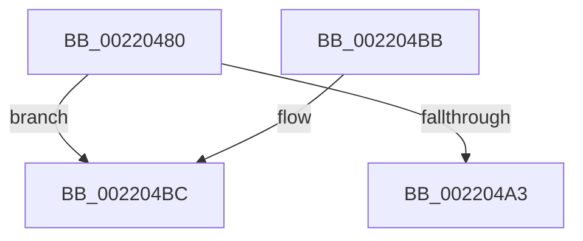

# KiPerformWaitDeferredWork

- RVA: `0x00220480`–`0x002204C4` (길이 `68` bytes)
- VA: `0x0000000140220480`
- 실행 섹션: `.text`
- PDB 이름 있음: `예`; PDB Function 태그: `아니요`
- unwind 정보 RVA: `0x0005F374`
- 디코드: `25`개 명령, `68/68` bytes 표시
- 미해석 바이트: `0` (있으면 어셈블리에 `.byte`로 보존)

> 이 문서는 커널 이미지의 기계어와 PDB 기호를 분석해 생성했습니다. 4번과 5번은 함수 원형과 자료형을 바이너리 사용 방식에서 추정한 C 해석이며 원본 소스 복구 결과는 아닙니다.

## 1. Dependencies

- 직접 호출 지점: **0**; 고유 호출 대상: **0**
- 직접 호출자로 확인된 함수: **9**
- RIP 상대 이미지 참조: **0**

### Outgoing calls
- 직접 디코드된 call 명령이 없습니다.

### Direct callers
- [sub_0020959D](../20/Unknown_function_0020959D.md) at `0x002096EF`
- [sub_0020BDAA](../20/Unknown_function_0020BDAA.md) at `0x0020BF08`
- [sub_0020D1EC](../20/Unknown_function_0020D1EC.md) at `0x0020D37C`
- [KiCommitThreadWait](../20/KiCommitThreadWait_function_0020DFE0.md) at `0x0020E0A2`
- [KeWaitForSingleObject](../20/KeWaitForSingleObject_function_0020E6B0.md) at `0x0020F0F1`
- [KiBeginThreadWait](../2C/KiBeginThreadWait_function_002CA8E0.md) at `0x002CA9A4`
- [KeWaitForAlertByThreadId](../3C/KeWaitForAlertByThreadId_function_003C4B14.md) at `0x003C4EFF`
- [KeRemovePriQueue](../3C/KeRemovePriQueue_function_003C5090.md) at `0x003C5190`
- [KiWaitForAllObjects](../3C/KiWaitForAllObjects_function_003C5800.md) at `0x003C598C`

### Static image references
- 디코드된 RIP-relative 메모리 참조가 없습니다.

## 2. Other-region calls and transfers

- 다른 실행 섹션으로 향하는 call: **0**
- call이 아닌 외부 분기/꼬리 이동: **1**
  - `0x002204C2` → [sub_002204DE](Unknown_function_002204DE.md) (`tail-transfer`)

## 3. Assembly (complete function range)

```asm
00220480  48 89 5C 24 18                  mov qword ptr [rsp + 0x18], rbx
00220485  48 89 6C 24 20                  mov qword ptr [rsp + 0x20], rbp
0022048A  56                              push rsi
0022048B  57                              push rdi
0022048C  41 57                           push r15
0022048E  48 83 EC 30                     sub rsp, 0x30
00220492  49 8B E9                        mov rbp, r9
00220495  41 0F B6 F0                     movzx esi, r8b
00220499  8B DA                           mov ebx, edx
0022049B  48 8B F9                        mov rdi, rcx
0022049E  F6 C2 02                        test dl, 2
002204A1  75 19                           jne 0x1402204bc
002204A3  48 8B 6C 24 68                  mov rbp, qword ptr [rsp + 0x68]
002204A8  83 E3 01                        and ebx, 1
002204AB  8B C3                           mov eax, ebx
002204AD  48 8B 5C 24 60                  mov rbx, qword ptr [rsp + 0x60]
002204B2  48 83 C4 30                     add rsp, 0x30
002204B6  41 5F                           pop r15
002204B8  5F                              pop rdi
002204B9  5E                              pop rsi
002204BA  C3                              ret
002204BB  CC                              int3
002204BC  45 33 FF                        xor r15d, r15d
002204BF  40 84 F6                        test sil, sil
002204C2  75 1A                           jne 0x1402204de
```

## 4. C-style interpretation (structured pseudocode)

```c
__int64 __fastcall KiPerformWaitDeferredWork(__int64 a1, int a2, unsigned __int8 a3, __int64 a4)
{
    __int64 v_r15;
    __int64 v_rbx;
    __int64 v_rsp;
    unsigned __int64 v_stack_p18;
    unsigned __int64 v_stack_p20;

    v_stack_p18 = v_rbx;
    v_stack_p20 = v_rbp;
    v_rsp = (v_rsp) - (48);
    if ((((unsigned __int8)(a2)) & (2)) != 0) goto loc_002204BC;
    v_rbx = (unsigned int)(((unsigned int)(a2)) & (1));
    v_rsp = (v_rsp) + (48);
    return (unsigned int)((unsigned int)(v_rbx));
loc_002204BC:
    v_r15 = 0;
}
```

## 5. (Beta) C Style

```c
int64_t KiPerformWaitDeferredWork(int64_t Arg1, int32_t Arg2, uint8_t Arg3, int64_t Arg4)
{
    int64_t local_r15;
    int64_t local_rbx;
    int64_t local_rsp;
    uint64_t v_stack_p18;
    uint64_t v_stack_p20;

    v_stack_p18 = local_rbx;
    v_stack_p20 = local_rbp;
    local_rsp = (local_rsp) - (48);
    if ((((uint8_t)(Arg2)) & (2)) != 0) goto loc_002204BC;
    local_rbx = (uint32_t)(((uint32_t)(Arg2)) & (1));
    local_rsp = (local_rsp) + (48);
    return (uint32_t)((uint32_t)(local_rbx));
loc_002204BC:
    local_r15 = 0;
}
```

## 6. Execution-region graph

[열기: 2D/3D 그래프와 함수 탐색 컨트롤 패널](../../../control-panel.html?section=text&rva=0x00220480&view=graph)

- 2D 그래프는 위에서 아래로 흐르고, 3D 그래프는 빈 공간을 드래그해 회전합니다. Shift+드래그는 이동, 휠은 확대·축소, 함수 노드 선택은 대상 보고서 이동입니다.

### Static fallback


