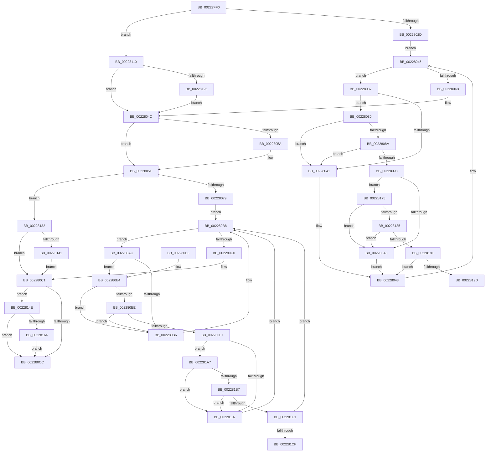

# KiSwapDirectoryTableBaseTarget

- RVA: `0x00227FF0`–`0x002281D9` (길이 `489` bytes)
- VA: `0x0000000140227FF0`
- 실행 섹션: `.text`
- PDB 이름 있음: `예`; PDB Function 태그: `예`
- unwind 정보 RVA: `0x0005FBE8`
- 디코드: `146`개 명령, `489/489` bytes 표시
- 미해석 바이트: `0` (있으면 어셈블리에 `.byte`로 보존)

> 이 문서는 커널 이미지의 기계어와 PDB 기호를 분석해 생성했습니다. 4번과 5번은 함수 원형과 자료형을 바이너리 사용 방식에서 추정한 C 해석이며 원본 소스 복구 결과는 아닙니다.

## 1. Dependencies

- 직접 호출 지점: **10**; 고유 호출 대상: **6**
- 직접 호출자로 확인된 함수: **1**
- RIP 상대 이미지 참조: **3**

### Outgoing calls
- `0x00228051` → [MmStealTopLevelPage](MmStealTopLevelPage_function_002281E0.md) (function, `0x002281E0`)
- `0x0022808A` → [KiCheckVpBackingLongSpinWaitHypercall](../30/KiCheckVpBackingLongSpinWaitHypercall_function_0030F490.md) (function, `0x0030F490`)
- `0x00228096` → [KeCanUseHaltOnAddress](../4F/KeCanUseHaltOnAddress_function_004FC22C.md) (function, `0x004FC22C`)
- `0x002280A5` → [HvlNotifyLongSpinWait](../30/HvlNotifyLongSpinWait_function_0030F460.md) (function, `0x0030F460`)
- `0x002280EE` → [KiCheckVpBackingLongSpinWaitHypercall](../30/KiCheckVpBackingLongSpinWaitHypercall_function_0030F490.md) (function, `0x0030F490`)
- `0x002280FA` → [KeCanUseHaltOnAddress](../4F/KeCanUseHaltOnAddress_function_004FC22C.md) (function, `0x004FC22C`)
- `0x00228109` → [HvlNotifyLongSpinWait](../30/HvlNotifyLongSpinWait_function_0030F460.md) (function, `0x0030F460`)
- `0x00228128` → [KeWakeAddressAll](../21/KeWakeAddressAll_function_00217C20.md) (function, `0x00217C20`)
- `0x00228144` → [KeWakeAddressAll](../21/KeWakeAddressAll_function_00217C20.md) (function, `0x00217C20`)
- `0x0022816B` → [KiLoadDirectoryTableBase](../21/KiLoadDirectoryTableBase_function_00217800.md) (function, `0x00217800`)

### Direct callers
- [KiExecuteAllDpcs](../25/KiExecuteAllDpcs_function_0025B740.md) at `0x0025BDB0`

### Static image references
- `0x00228039` → RVA `0x00FC52AC` (`ALMOSTRO`; reference)
- `0x00228080` → RVA `0x00FC6AB8` (`ALMOSTRO`; read)
- `0x00228175` → RVA `0x00FC6B38` (`ALMOSTRO`; read)

## 2. Other-region calls and transfers

- 다른 실행 섹션으로 향하는 call: **0**
- call이 아닌 외부 분기/꼬리 이동: **2**
  - `0x002281A2` → [sub_006D6E06](../6D/Unknown_function_006D6E06.md) (`tail-transfer`)
  - `0x002281D4` → [sub_006D6E06 + 0x47](../6D/Unknown_function_006D6E06.md) (`tail-transfer`)

## 3. Assembly (complete function range)

```asm
00227FF0  4C 89 44 24 18                  mov qword ptr [rsp + 0x18], r8
00227FF5  53                              push rbx
00227FF6  55                              push rbp
00227FF7  56                              push rsi
00227FF8  57                              push rdi
00227FF9  41 54                           push r12
00227FFB  41 56                           push r14
00227FFD  41 57                           push r15
00227FFF  48 83 EC 20                     sub rsp, 0x20
00228003  4C 8B 7A 08                     mov r15, qword ptr [rdx + 8]
00228007  49 8B D9                        mov rbx, r9
0022800A  4C 8B E2                        mov r12, rdx
0022800D  83 C8 FF                        or eax, 0xffffffff
00228010  F0 41 0F C1 01                  lock xadd dword ptr [r9], eax
00228015  FF C8                           dec eax
00228017  BE 00 00 00 80                  mov esi, 0x80000000
0022801C  8B F8                           mov edi, eax
0022801E  F7 D7                           not edi
00228020  23 FE                           and edi, esi
00228022  A9 FF FF FF 3F                  test eax, 0x3fffffff
00228027  0F 84 E3 00 00 00               je 0x140228110
0022802D  41 8B 01                        mov eax, dword ptr [r9]
00228030  33 ED                           xor ebp, ebp
00228032  45 33 F6                        xor r14d, r14d
00228035  EB 0E                           jmp 0x140228045
00228037  FF C5                           inc ebp
00228039  85 2D 6D D2 D9 00               test dword ptr [rip + 0xd9d26d], ebp
0022803F  74 3F                           je 0x140228080
00228041  F3 90                           pause
00228043  8B 03                           mov eax, dword ptr [rbx]
00228045  23 C6                           and eax, esi
00228047  3B C7                           cmp eax, edi
00228049  75 EC                           jne 0x140228037
0022804B  90                              nop
0022804C  49 8B 4C 24 10                  mov rcx, qword ptr [r12 + 0x10]
00228051  E8 8A 01 00 00                  call 0x1402281e0
00228056  85 C0                           test eax, eax
00228058  74 05                           je 0x14022805f
0022805A  41 C6 04 24 01                  mov byte ptr [r12], 1
0022805F  83 C8 FF                        or eax, 0xffffffff
00228062  F0 0F C1 03                     lock xadd dword ptr [rbx], eax
00228066  FF C8                           dec eax
00228068  8B F8                           mov edi, eax
0022806A  F7 D7                           not edi
0022806C  23 FE                           and edi, esi
0022806E  A9 FF FF FF 3F                  test eax, 0x3fffffff
00228073  0F 84 B9 00 00 00               je 0x140228132
00228079  33 ED                           xor ebp, ebp
0022807B  45 33 F6                        xor r14d, r14d
0022807E  EB 38                           jmp 0x1402280b8
00228080  8B 05 32 EA D9 00               mov eax, dword ptr [rip + 0xd9ea32]
00228086  A8 40                           test al, 0x40
00228088  74 B7                           je 0x140228041
0022808A  E8 01 74 0E 00                  call 0x14030f490
0022808F  84 C0                           test al, al
00228091  74 AE                           je 0x140228041
00228093  41 FF C6                        inc r14d
00228096  E8 91 41 2D 00                  call 0x1404fc22c
0022809B  84 C0                           test al, al
0022809D  0F 85 D2 00 00 00               jne 0x140228175
002280A3  8B CD                           mov ecx, ebp
002280A5  E8 B6 73 0E 00                  call 0x14030f460
002280AA  EB 97                           jmp 0x140228043
002280AC  FF C5                           inc ebp
002280AE  85 2D F8 D1 D9 00               test dword ptr [rip + 0xd9d1f8], ebp
002280B4  74 2E                           je 0x1402280e4
002280B6  F3 90                           pause
002280B8  8B 03                           mov eax, dword ptr [rbx]
002280BA  23 C6                           and eax, esi
002280BC  3B C7                           cmp eax, edi
002280BE  75 EC                           jne 0x1402280ac
002280C0  90                              nop
002280C1  41 80 3C 24 00                  cmp byte ptr [r12], 0
002280C6  0F 85 82 00 00 00               jne 0x14022814e
002280CC  48 8B 44 24 70                  mov rax, qword ptr [rsp + 0x70]
002280D1  F0 FF 08                        lock dec dword ptr [rax]
002280D4  48 83 C4 20                     add rsp, 0x20
002280D8  41 5F                           pop r15
002280DA  41 5E                           pop r14
002280DC  41 5C                           pop r12
002280DE  5F                              pop rdi
002280DF  5E                              pop rsi
002280E0  5D                              pop rbp
002280E1  5B                              pop rbx
002280E2  C3                              ret
002280E3  CC                              int3
002280E4  8B 05 CE E9 D9 00               mov eax, dword ptr [rip + 0xd9e9ce]
002280EA  A8 40                           test al, 0x40
002280EC  74 C8                           je 0x1402280b6
002280EE  E8 9D 73 0E 00                  call 0x14030f490
002280F3  84 C0                           test al, al
002280F5  74 BF                           je 0x1402280b6
002280F7  41 FF C6                        inc r14d
002280FA  E8 2D 41 2D 00                  call 0x1404fc22c
002280FF  84 C0                           test al, al
00228101  0F 85 A0 00 00 00               jne 0x1402281a7
00228107  8B CD                           mov ecx, ebp
00228109  E8 52 73 0E 00                  call 0x14030f460
0022810E  EB A8                           jmp 0x1402280b8
00228110  41 0B 79 04                     or edi, dword ptr [r9 + 4]
00228114  41 87 39                        xchg dword ptr [r9], edi
00228117  89 7C 24 68                     mov dword ptr [rsp + 0x68], edi
0022811B  0F BA E7 1E                     bt edi, 0x1e
0022811F  0F 83 27 FF FF FF               jae 0x14022804c
00228125  48 8B CB                        mov rcx, rbx
00228128  E8 F3 FA FE FF                  call 0x140217c20
0022812D  E9 1A FF FF FF                  jmp 0x14022804c
00228132  0B 7B 04                        or edi, dword ptr [rbx + 4]
00228135  87 3B                           xchg dword ptr [rbx], edi
00228137  89 7C 24 78                     mov dword ptr [rsp + 0x78], edi
0022813B  0F BA E7 1E                     bt edi, 0x1e
0022813F  73 80                           jae 0x1402280c1
00228141  48 8B CB                        mov rcx, rbx
00228144  E8 D7 FA FE FF                  call 0x140217c20
00228149  E9 73 FF FF FF                  jmp 0x1402280c1
0022814E  65 48 8B 04 25 88 01 00 00      mov rax, qword ptr gs:[0x188]
00228157  4C 39 B8 B8 00 00 00            cmp qword ptr [rax + 0xb8], r15
0022815E  0F 85 68 FF FF FF               jne 0x1402280cc
00228164  49 8B 57 28                     mov rdx, qword ptr [r15 + 0x28]
00228168  49 8B CF                        mov rcx, r15
0022816B  E8 90 F6 FE FF                  call 0x140217800
00228170  E9 57 FF FF FF                  jmp 0x1402280cc
00228175  F7 05 B9 E9 D9 00 00 00 02 00   test dword ptr [rip + 0xd9e9b9], 0x20000
0022817F  0F 84 1E FF FF FF               je 0x1402280a3
00228185  41 F6 C6 07                     test r14b, 7
00228189  0F 85 14 FF FF FF               jne 0x1402280a3
0022818F  8B 0B                           mov ecx, dword ptr [rbx]
00228191  8B C1                           mov eax, ecx
00228193  23 C6                           and eax, esi
00228195  3B C7                           cmp eax, edi
00228197  0F 84 A6 FE FF FF               je 0x140228043
0022819D  8B D1                           mov edx, ecx
0022819F  44 8B C1                        mov r8d, ecx
002281A2  E9 5F EC 4A 00                  jmp 0x1406d6e06
002281A7  F7 05 87 E9 D9 00 00 00 02 00   test dword ptr [rip + 0xd9e987], 0x20000
002281B1  0F 84 50 FF FF FF               je 0x140228107
002281B7  41 F6 C6 07                     test r14b, 7
002281BB  0F 85 46 FF FF FF               jne 0x140228107
002281C1  8B 0B                           mov ecx, dword ptr [rbx]
002281C3  8B C1                           mov eax, ecx
002281C5  23 C6                           and eax, esi
002281C7  3B C7                           cmp eax, edi
002281C9  0F 84 E9 FE FF FF               je 0x1402280b8
002281CF  8B D1                           mov edx, ecx
002281D1  44 8B C1                        mov r8d, ecx
002281D4  E9 74 EC 4A 00                  jmp 0x1406d6e4d
```

## 4. C-style interpretation (structured pseudocode)

```c
__int64 __fastcall KiSwapDirectoryTableBaseTarget(__int64 a1, __int64 a2, __int64 a3, __int64 a4)
{
    __int64 result;
    __int64 v_r14;
    __int64 v_rbp;
    __int64 v_rdi;
    __int64 v_rsp;
    unsigned __int64 v_stack_p18;
    unsigned int v_stack_p68;
    unsigned int v_stack_p78;

    v_stack_p18 = a3;
    v_rsp = (v_rsp) - (32);
    result = (unsigned int)((result) | (0xFFFFFFFFULL));
    result = (unsigned int)((result) - 1);
    v_rdi = (unsigned int)(~((unsigned int)((unsigned int)(result))));
    v_rdi = (unsigned int)((v_rdi) & ((unsigned int)((unsigned int)(0x80000000ULL))));
    if ((((unsigned int)(result)) & (0x3FFFFFFFULL)) == 0) goto loc_00228110;
    v_rbp = 0;
    v_r14 = 0;
    goto loc_00228045;
loc_00228037:
    v_rbp = (unsigned int)((v_rbp) + 1);
    if (((*(unsigned int *)(v_rip + 14275181)) & ((unsigned int)(v_rbp))) == 0) goto loc_00228080;
loc_00228041:
loc_00228043:
loc_00228045:
    result = (unsigned int)(((unsigned int)(*(unsigned int *)(a4))) & ((unsigned int)((unsigned int)(0x80000000ULL))));
    if (((unsigned int)(result)) != ((unsigned int)(v_rdi))) goto loc_00228037;
loc_0022804C:
    result = MmStealTopLevelPage(*(unsigned __int64 *)(a2 + 16), a2, a3, a4);
    if ((unsigned int)(result) != 0) {
        *(unsigned __int8 *)(a2) = 1;
    }
    result = (unsigned int)((result) | (0xFFFFFFFFULL));
    result = (unsigned int)((result) - 1);
    v_rdi = (unsigned int)(~((unsigned int)((unsigned int)(result))));
    v_rdi = (unsigned int)((v_rdi) & ((unsigned int)((unsigned int)(0x80000000ULL))));
    if ((((unsigned int)(result)) & (0x3FFFFFFFULL)) == 0) goto loc_00228132;
    v_rbp = 0;
    v_r14 = 0;
    goto loc_002280B8;
loc_00228080:
    if ((((unsigned __int8)((unsigned int)(*(unsigned int *)(v_rip + 14281266)))) & (64)) == 0) goto loc_00228041;
    result = KiCheckVpBackingLongSpinWaitHypercall(*(unsigned __int64 *)(a2 + 16), a2, a3, a4);
    if ((unsigned __int8)(result) == 0) goto loc_00228041;
    v_r14 = (unsigned int)((v_r14) + 1);
    result = KeCanUseHaltOnAddress(*(unsigned __int64 *)(a2 + 16), a2, a3, a4);
    if ((unsigned __int8)(result) != 0) goto loc_00228175;
loc_002280A3:
    result = HvlNotifyLongSpinWait(0, a2, a3, a4);
    goto loc_00228043;
loc_002280AC:
    v_rbp = (unsigned int)((v_rbp) + 1);
    if (((*(unsigned int *)(v_rip + 14275064)) & ((unsigned int)(v_rbp))) == 0) goto loc_002280E4;
loc_002280B6:
loc_002280B8:
    result = (unsigned int)(((unsigned int)(*(unsigned int *)(a4))) & ((unsigned int)((unsigned int)(0x80000000ULL))));
    if (((unsigned int)(result)) != ((unsigned int)(v_rdi))) goto loc_002280AC;
loc_002280C1:
    if ((*(unsigned __int8 *)(a2)) != 0) goto loc_0022814E;
loc_002280CC:
    v_rsp = (v_rsp) + (32);
    return v_stack_p18;
loc_002280E4:
    if ((((unsigned __int8)((unsigned int)(*(unsigned int *)(v_rip + 14281166)))) & (64)) == 0) goto loc_002280B6;
    result = KiCheckVpBackingLongSpinWaitHypercall(0, a2, a3, a4);
    if ((unsigned __int8)(result) == 0) goto loc_002280B6;
    v_r14 = (unsigned int)((v_r14) + 1);
    result = KeCanUseHaltOnAddress(0, a2, a3, a4);
    if ((unsigned __int8)(result) != 0) goto loc_002281A7;
loc_00228107:
    result = HvlNotifyLongSpinWait((unsigned int)((unsigned int)(v_rbp)), a2, a3, a4);
    goto loc_002280B8;
loc_00228110:
    v_rdi = (unsigned int)((v_rdi) | (*(unsigned int *)(a4 + 4)));
    v_stack_p68 = (unsigned int)(v_rdi);
    if (condition_is_above_or_equal) goto loc_0022804C;
    result = KeWakeAddressAll(a4, a2, a3, a4);
    goto loc_0022804C;
loc_00228132:
    v_rdi = (unsigned int)((v_rdi) | (*(unsigned int *)(a4 + 4)));
    v_stack_p78 = (unsigned int)(v_rdi);
    if (condition_is_above_or_equal) goto loc_002280C1;
    result = KeWakeAddressAll(a4, a2, a3, a4);
    goto loc_002280C1;
loc_0022814E:
    if ((*(unsigned __int64 *)(*(unsigned __int64 *)(gs_base + (0 + 392)) + 184)) != (*(unsigned __int64 *)(a2 + 8))) goto loc_002280CC;
    result = KiLoadDirectoryTableBase(*(unsigned __int64 *)(a2 + 8), *(unsigned __int64 *)(*(unsigned __int64 *)(a2 + 8) + 40), a3, a4);
    goto loc_002280CC;
loc_00228175:
    if (((*(unsigned int *)(v_rip + 14281145)) & (0x20000ULL)) == 0) goto loc_002280A3;
    if ((((unsigned __int8)(v_r14)) & (7)) != 0) goto loc_002280A3;
    result = (unsigned int)(((unsigned int)((unsigned int)((unsigned int)(*(unsigned int *)(a4))))) & ((unsigned int)((unsigned int)(0x80000000ULL))));
    if (((unsigned int)(result)) == ((unsigned int)(v_rdi))) goto loc_00228043;
loc_002281A7:
    if (((*(unsigned int *)(v_rip + 14281095)) & (0x20000ULL)) == 0) goto loc_00228107;
    if ((((unsigned __int8)(v_r14)) & (7)) != 0) goto loc_00228107;
    result = (unsigned int)(((unsigned int)((unsigned int)((unsigned int)(*(unsigned int *)(a4))))) & ((unsigned int)((unsigned int)(0x80000000ULL))));
    if (((unsigned int)(result)) == ((unsigned int)(v_rdi))) goto loc_002280B8;
}
```

## 5. (Beta) C Style

```c
int64_t KiSwapDirectoryTableBaseTarget(int64_t Arg1, void *Arg2, int64_t Arg3, void *Arg4)
{
    uint8_t *arg2 = (uint8_t *)Arg2;
    uint8_t *arg4 = (uint8_t *)Arg4;

    int64_t result;
    int64_t local_r14;
    int64_t local_rbp;
    int64_t local_rdi;
    int64_t local_rsp;
    uint64_t v_stack_p18;
    uint32_t v_stack_p68;
    uint32_t v_stack_p78;

    v_stack_p18 = Arg3;
    local_rsp = (local_rsp) - (32);
    result = (uint32_t)((result) | (0xFFFFFFFFULL));
    result = (uint32_t)((result) - 1);
    local_rdi = (uint32_t)(~((uint32_t)((uint32_t)(result))));
    local_rdi = (uint32_t)((local_rdi) & ((uint32_t)((uint32_t)(0x80000000ULL))));
    if ((((uint32_t)(result)) & (0x3FFFFFFFULL)) == 0) goto loc_00228110;
    local_rbp = 0;
    local_r14 = 0;
    goto loc_00228045;
loc_00228037:
    local_rbp = (uint32_t)((local_rbp) + 1);
    if (((*(uint32_t *)(v_rip + 0xD9D26D)) & ((uint32_t)(local_rbp))) == 0) goto loc_00228080;
loc_00228041:
loc_00228043:
loc_00228045:
    result = (uint32_t)(((uint32_t)(*(uint32_t *)(arg4))) & ((uint32_t)((uint32_t)(0x80000000ULL))));
    if (((uint32_t)(result)) != ((uint32_t)(local_rdi))) goto loc_00228037;
loc_0022804C:
    result = MmStealTopLevelPage(*(uint64_t *)(arg2 + 0x10), Arg2, Arg3, Arg4);
    if ((uint32_t)(result) != 0) {
        *(uint8_t *)(arg2) = 1;
    }
    result = (uint32_t)((result) | (0xFFFFFFFFULL));
    result = (uint32_t)((result) - 1);
    local_rdi = (uint32_t)(~((uint32_t)((uint32_t)(result))));
    local_rdi = (uint32_t)((local_rdi) & ((uint32_t)((uint32_t)(0x80000000ULL))));
    if ((((uint32_t)(result)) & (0x3FFFFFFFULL)) == 0) goto loc_00228132;
    local_rbp = 0;
    local_r14 = 0;
    goto loc_002280B8;
loc_00228080:
    if ((((uint8_t)((uint32_t)(*(uint32_t *)(v_rip + 0xD9EA32)))) & (64)) == 0) goto loc_00228041;
    result = KiCheckVpBackingLongSpinWaitHypercall(*(uint64_t *)(arg2 + 0x10), Arg2, Arg3, Arg4);
    if ((uint8_t)(result) == 0) goto loc_00228041;
    local_r14 = (uint32_t)((local_r14) + 1);
    result = KeCanUseHaltOnAddress(*(uint64_t *)(arg2 + 0x10), Arg2, Arg3, Arg4);
    if ((uint8_t)(result) != 0) goto loc_00228175;
loc_002280A3:
    result = HvlNotifyLongSpinWait(0, Arg2, Arg3, Arg4);
    goto loc_00228043;
loc_002280AC:
    local_rbp = (uint32_t)((local_rbp) + 1);
    if (((*(uint32_t *)(v_rip + 0xD9D1F8)) & ((uint32_t)(local_rbp))) == 0) goto loc_002280E4;
loc_002280B6:
loc_002280B8:
    result = (uint32_t)(((uint32_t)(*(uint32_t *)(arg4))) & ((uint32_t)((uint32_t)(0x80000000ULL))));
    if (((uint32_t)(result)) != ((uint32_t)(local_rdi))) goto loc_002280AC;
loc_002280C1:
    if ((*(uint8_t *)(arg2)) != 0) goto loc_0022814E;
loc_002280CC:
    local_rsp = (local_rsp) + (32);
    return v_stack_p18;
loc_002280E4:
    if ((((uint8_t)((uint32_t)(*(uint32_t *)(v_rip + 0xD9E9CE)))) & (64)) == 0) goto loc_002280B6;
    result = KiCheckVpBackingLongSpinWaitHypercall(0, Arg2, Arg3, Arg4);
    if ((uint8_t)(result) == 0) goto loc_002280B6;
    local_r14 = (uint32_t)((local_r14) + 1);
    result = KeCanUseHaltOnAddress(0, Arg2, Arg3, Arg4);
    if ((uint8_t)(result) != 0) goto loc_002281A7;
loc_00228107:
    result = HvlNotifyLongSpinWait((uint32_t)((uint32_t)(local_rbp)), Arg2, Arg3, Arg4);
    goto loc_002280B8;
loc_00228110:
    local_rdi = (uint32_t)((local_rdi) | (*(uint32_t *)(arg4 + 0x4)));
    v_stack_p68 = (uint32_t)(local_rdi);
    if (condition_is_above_or_equal) goto loc_0022804C;
    result = KeWakeAddressAll(Arg4, Arg2, Arg3, Arg4);
    goto loc_0022804C;
loc_00228132:
    local_rdi = (uint32_t)((local_rdi) | (*(uint32_t *)(arg4 + 0x4)));
    v_stack_p78 = (uint32_t)(local_rdi);
    if (condition_is_above_or_equal) goto loc_002280C1;
    result = KeWakeAddressAll(Arg4, Arg2, Arg3, Arg4);
    goto loc_002280C1;
loc_0022814E:
    if ((*(uint64_t *)(*(uint64_t *)(gs_base + (0 + 0x188)) + 0xB8)) != (*(uint64_t *)(arg2 + 0x8))) goto loc_002280CC;
    result = KiLoadDirectoryTableBase(*(uint64_t *)(arg2 + 0x8), *(uint64_t *)(*(uint64_t *)(arg2 + 0x8) + 0x28), Arg3, Arg4);
    goto loc_002280CC;
loc_00228175:
    if (((*(uint32_t *)(v_rip + 0xD9E9B9)) & (0x20000ULL)) == 0) goto loc_002280A3;
    if ((((uint8_t)(local_r14)) & (7)) != 0) goto loc_002280A3;
    result = (uint32_t)(((uint32_t)((uint32_t)((uint32_t)(*(uint32_t *)(arg4))))) & ((uint32_t)((uint32_t)(0x80000000ULL))));
    if (((uint32_t)(result)) == ((uint32_t)(local_rdi))) goto loc_00228043;
loc_002281A7:
    if (((*(uint32_t *)(v_rip + 0xD9E987)) & (0x20000ULL)) == 0) goto loc_00228107;
    if ((((uint8_t)(local_r14)) & (7)) != 0) goto loc_00228107;
    result = (uint32_t)(((uint32_t)((uint32_t)((uint32_t)(*(uint32_t *)(arg4))))) & ((uint32_t)((uint32_t)(0x80000000ULL))));
    if (((uint32_t)(result)) == ((uint32_t)(local_rdi))) goto loc_002280B8;
}
```

### 관측된 메모리 오프셋

구조체 형식이 확인되지 않은 접근은 인자 기준의 오프셋으로만 기록했습니다.

| 기준 인자 | 오프셋 표현 | 폭 (bit) | 접근 |
|---|---:|---:|---|
| `Arg2` | `+ 0x0` | `8` | `R` |
| `Arg2` | `+ 0x0` | `8` | `W` |
| `Arg2` | `+ 0x8` | `64` | `R` |
| `Arg2` | `+ 0x10` | `64` | `R` |
| `Arg4` | `+ 0x0` | `32` | `R` |
| `Arg4` | `+ 0x0` | `32` | `R/W` |
| `Arg4` | `+ 0x4` | `32` | `R` |

## 6. Execution-region graph

[열기: 2D/3D 그래프와 함수 탐색 컨트롤 패널](../../../control-panel.html?section=text&rva=0x00227FF0&view=graph)

- 2D 그래프는 위에서 아래로 흐르고, 3D 그래프는 빈 공간을 드래그해 회전합니다. Shift+드래그는 이동, 휠은 확대·축소, 함수 노드 선택은 대상 보고서 이동입니다.

### Static fallback


