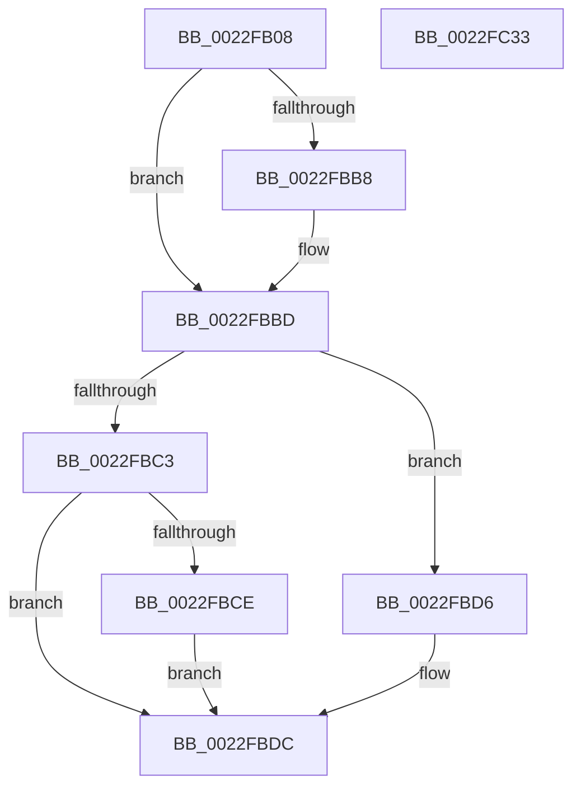

# KiTraceSetTimer

- RVA: `0x0022FB08`–`0x0022FC34` (길이 `300` bytes)
- VA: `0x000000014022FB08`
- 실행 섹션: `.text`
- PDB 이름 있음: `예`; PDB Function 태그: `아니요`
- unwind 정보 RVA: `0x000601BC`
- 디코드: `75`개 명령, `300/300` bytes 표시
- 미해석 바이트: `0` (있으면 어셈블리에 `.byte`로 보존)

> 이 문서는 커널 이미지의 기계어와 PDB 기호를 분석해 생성했습니다. 4번과 5번은 함수 원형과 자료형을 바이너리 사용 방식에서 추정한 C 해석이며 원본 소스 복구 결과는 아닙니다.

## 1. Dependencies

- 직접 호출 지점: **3**; 고유 호출 대상: **3**
- 직접 호출자로 확인된 함수: **6**
- RIP 상대 이미지 참조: **1**

### Outgoing calls
- `0x0022FB60` → [KeGetPrcb](../2D/KeGetPrcb_function_002D85D0.md) (function, `0x002D85D0`)
- `0x0022FC0C` → [EtwTraceKernelEvent](../23/EtwTraceKernelEvent_function_00235350.md) (function, `0x00235350`)
- `0x0022FC18` → [_security_check_cookie](../6A/_security_check_cookie_function_006AC640.md) (function, `0x006AC640`)

### Direct callers
- [KiResumeThread](../20/KiResumeThread_function_00203644.md) at `0x00203A37`
- [KiCommitThreadWait](../20/KiCommitThreadWait_function_0020DFE0.md) at `0x0020E44C`
- [ExpSetTimerObject](../23/ExpSetTimerObject_function_00231730.md) at `0x002323FB`
- [KiSetTimerEx](../23/KiSetTimerEx_function_00232CB0.md) at `0x002332C7`
- [KeSetTimer](../23/KeSetTimer_function_00233BE0.md) at `0x002341D7`
- [KiAdjustTimerDueTimes](../4E/KiAdjustTimerDueTimes_function_004E8CD4.md) at `0x004E8F3D`

### Static image references
- `0x0022FB1F` → RVA `0x00E0A740` (`.data`; read)

## 2. Other-region calls and transfers

- 다른 실행 섹션으로 향하는 call: **0**
- 별도 외부 분기/꼬리 이동을 확인하지 못했습니다.

## 3. Assembly (complete function range)

```asm
0022FB08  48 89 5C 24 10                  mov qword ptr [rsp + 0x10], rbx
0022FB0D  48 89 74 24 18                  mov qword ptr [rsp + 0x18], rsi
0022FB12  48 89 7C 24 20                  mov qword ptr [rsp + 0x20], rdi
0022FB17  55                              push rbp
0022FB18  48 8B EC                        mov rbp, rsp
0022FB1B  48 83 EC 70                     sub rsp, 0x70
0022FB1F  48 8B 05 1A AC BD 00            mov rax, qword ptr [rip + 0xbdac1a]
0022FB26  48 33 C4                        xor rax, rsp
0022FB29  48 89 45 F0                     mov qword ptr [rbp - 0x10], rax
0022FB2D  83 65 DC 00                     and dword ptr [rbp - 0x24], 0
0022FB31  48 8B F1                        mov rsi, rcx
0022FB34  0F B7 49 38                     movzx ecx, word ptr [rcx + 0x38]
0022FB38  41 8A F8                        mov dil, r8b
0022FB3B  48 8B DA                        mov rbx, rdx
0022FB3E  C6 45 D3 00                     mov byte ptr [rbp - 0x2d], 0
0022FB42  48 8B 46 18                     mov rax, qword ptr [rsi + 0x18]
0022FB46  48 89 45 C0                     mov qword ptr [rbp - 0x40], rax
0022FB4A  8B 46 3C                        mov eax, dword ptr [rsi + 0x3c]
0022FB4D  89 45 D4                        mov dword ptr [rbp - 0x2c], eax
0022FB50  8A 46 01                        mov al, byte ptr [rsi + 1]
0022FB53  C0 E8 02                        shr al, 2
0022FB56  88 45 D8                        mov byte ptr [rbp - 0x28], al
0022FB59  F0 81 26 7F FF FF FF            lock and dword ptr [rsi], 0xffffff7f
0022FB60  E8 6B 8A 0A 00                  call 0x1402d85d0
0022FB65  48 89 75 C8                     mov qword ptr [rbp - 0x38], rsi
0022FB69  BA 01 00 00 00                  mov edx, 1
0022FB6E  0F B6 88 D0 00 00 00            movzx ecx, byte ptr [rax + 0xd0]
0022FB75  66 89 4D D0                     mov word ptr [rbp - 0x30], cx
0022FB79  8A 80 D1 00 00 00               mov al, byte ptr [rax + 0xd1]
0022FB7F  88 45 D2                        mov byte ptr [rbp - 0x2e], al
0022FB82  C6 45 D3 00                     mov byte ptr [rbp - 0x2d], 0
0022FB86  C6 45 D9 00                     mov byte ptr [rbp - 0x27], 0
0022FB8A  65 48 8B 04 25 88 01 00 00      mov rax, qword ptr gs:[0x188]
0022FB93  80 7D D8 00                     cmp byte ptr [rbp - 0x28], 0
0022FB97  48 8B 88 B8 00 00 00            mov rcx, qword ptr [rax + 0xb8]
0022FB9E  0F B7 81 D0 01 00 00            movzx eax, word ptr [rcx + 0x1d0]
0022FBA5  66 89 45 DA                     mov word ptr [rbp - 0x26], ax
0022FBA9  0F B6 45 D3                     movzx eax, byte ptr [rbp - 0x2d]
0022FBAD  0F 45 C2                        cmovne eax, edx
0022FBB0  88 45 D3                        mov byte ptr [rbp - 0x2d], al
0022FBB3  48 85 DB                        test rbx, rbx
0022FBB6  74 05                           je 0x14022fbbd
0022FBB8  0C 02                           or al, 2
0022FBBA  88 45 D3                        mov byte ptr [rbp - 0x2d], al
0022FBBD  83 7E 3C 00                     cmp dword ptr [rsi + 0x3c], 0
0022FBC1  75 13                           jne 0x14022fbd6
0022FBC3  41 B9 54 0F 00 00               mov r9d, 0xf54
0022FBC9  40 84 FF                        test dil, dil
0022FBCC  75 0E                           jne 0x14022fbdc
0022FBCE  41 B9 53 0F 00 00               mov r9d, 0xf53
0022FBD4  EB 06                           jmp 0x14022fbdc
0022FBD6  41 B9 52 0F 00 00               mov r9d, 0xf52
0022FBDC  83 65 EC 00                     and dword ptr [rbp - 0x14], 0
0022FBE0  48 8D 45 C0                     lea rax, [rbp - 0x40]
0022FBE4  48 89 45 E0                     mov qword ptr [rbp - 0x20], rax
0022FBE8  48 8D 4D E0                     lea rcx, [rbp - 0x20]
0022FBEC  40 F6 DF                        neg dil
0022FBEF  C7 45 E8 20 00 00 00            mov dword ptr [rbp - 0x18], 0x20
0022FBF6  41 B8 00 00 02 40               mov r8d, 0x40020000
0022FBFC  1B C0                           sbb eax, eax
0022FBFE  25 00 EB 9F FF                  and eax, 0xff9feb00
0022FC03  05 02 1B 60 00                  add eax, 0x601b02
0022FC08  89 44 24 20                     mov dword ptr [rsp + 0x20], eax
0022FC0C  E8 3F 57 00 00                  call 0x140235350
0022FC11  48 8B 4D F0                     mov rcx, qword ptr [rbp - 0x10]
0022FC15  48 33 CC                        xor rcx, rsp
0022FC18  E8 23 CA 47 00                  call 0x1406ac640
0022FC1D  4C 8D 5C 24 70                  lea r11, [rsp + 0x70]
0022FC22  49 8B 5B 18                     mov rbx, qword ptr [r11 + 0x18]
0022FC26  49 8B 73 20                     mov rsi, qword ptr [r11 + 0x20]
0022FC2A  49 8B 7B 28                     mov rdi, qword ptr [r11 + 0x28]
0022FC2E  49 8B E3                        mov rsp, r11
0022FC31  5D                              pop rbp
0022FC32  C3                              ret
0022FC33  CC                              int3
```

## 4. C-style interpretation (structured pseudocode)

```c
__int64 __fastcall KiTraceSetTimer(__int64 a1, __int64 a2, unsigned __int8 a3)
{
    __int64 result;
    __int64 v_rdi;
    __int64 v_rsp;
    unsigned __int64 v_stack_m18;
    unsigned int v_stack_m1C;
    unsigned int v_stack_m20;
    unsigned __int64 v_stack_m28;
    unsigned int v_stack_m2C;
    unsigned __int16 v_stack_m2E;
    unsigned __int8 v_stack_m2F;
    unsigned __int8 v_stack_m30;
    unsigned int v_stack_m34;
    unsigned __int8 v_stack_m35;
    unsigned __int8 v_stack_m36;
    unsigned __int16 v_stack_m38;
    unsigned __int64 v_stack_m40;
    unsigned __int64 v_stack_m48;
    unsigned int v_stack_m58;
    unsigned __int64 v_stack_m8;
    unsigned __int64 v_stack_p10;
    unsigned __int64 v_stack_p18;
    unsigned __int64 v_stack_p20;

    v_stack_p10 = v_rbx;
    v_stack_p18 = v_rsi;
    v_stack_p20 = v_rdi;
    v_rsp = (v_rsp) - (112);
    result = (*(unsigned __int64 *)(v_rip + 12430362)) ^ (v_rsp);
    v_stack_m18 = result;
    v_stack_m35 = 0;
    v_stack_m48 = *(unsigned __int64 *)(a1 + 24);
    v_stack_m34 = (unsigned int)((unsigned int)(*(unsigned int *)(a1 + 60)));
    result = (unsigned __int8)((*(unsigned __int8 *)(a1 + 1)) >> (2));
    v_stack_m30 = (unsigned __int8)(result);
    result = KeGetPrcb(*(unsigned __int16 *)(a1 + 56), a2, a3, a4);
    v_stack_m40 = a1;
    v_stack_m38 = (unsigned __int16)(*(unsigned __int8 *)(result + 208));
    v_stack_m36 = (unsigned __int8)(*(unsigned __int8 *)(result + 209));
    v_stack_m35 = 0;
    v_stack_m2F = 0;
    v_stack_m2E = (unsigned __int16)(*(unsigned __int16 *)(*(unsigned __int64 *)(*(unsigned __int64 *)(gs_base + (0 + 392)) + 184) + 464));
    result = v_stack_m35;
    if (v_stack_m30 != 0) { result = 1; }
    v_stack_m35 = (unsigned __int8)(result);
    if (a2 != 0) {
        result = (unsigned __int8)((result) | (2));
        v_stack_m35 = (unsigned __int8)(result);
    }
    if ((*(unsigned int *)(a1 + 60)) != 0) goto loc_0022FBD6;
    if (a3 != 0) goto loc_0022FBDC;
    goto loc_0022FBDC;
loc_0022FBD6:
loc_0022FBDC:
    v_stack_m28 = v_stack_m48;
    v_rdi = (unsigned __int8)(-(a3));
    v_stack_m20 = 32;
    result = (unsigned int)((v_stack_m48) & (0xFF9FEB00ULL));
    result = (unsigned int)((result) + (0x601B02ULL));
    v_stack_m58 = (unsigned int)(result);
    result = EtwTraceKernelEvent(v_stack_m28, 1, (unsigned int)(0x40020000ULL), (unsigned int)(0xF52ULL));
    a1 = (v_stack_m18) ^ (v_rsp);
    result = _security_check_cookie(a1, 1, (unsigned int)(0x40020000ULL), (unsigned int)(0xF52ULL));
    return result;
}
```

## 5. (Beta) C Style

```c
int64_t KiTraceSetTimer(void *Arg1, int64_t Arg2, uint8_t Arg3)
{
    uint8_t *arg1 = (uint8_t *)Arg1;

    int64_t result;
    int64_t local_rdi;
    int64_t local_rsp;
    uint64_t v_stack_m18;
    uint32_t v_stack_m1C;
    uint32_t v_stack_m20;
    uint64_t v_stack_m28;
    uint32_t v_stack_m2C;
    uint16_t v_stack_m2E;
    uint8_t v_stack_m2F;
    uint8_t v_stack_m30;
    uint32_t v_stack_m34;
    uint8_t v_stack_m35;
    uint8_t v_stack_m36;
    uint16_t v_stack_m38;
    uint64_t v_stack_m40;
    uint64_t v_stack_m48;
    uint32_t v_stack_m58;
    uint64_t v_stack_m8;
    uint64_t v_stack_p10;
    uint64_t v_stack_p18;
    uint64_t v_stack_p20;

    v_stack_p10 = local_rbx;
    v_stack_p18 = local_rsi;
    v_stack_p20 = local_rdi;
    local_rsp = (local_rsp) - (112);
    result = (*(uint64_t *)(v_rip + 0xBDAC1A)) ^ (local_rsp);
    v_stack_m18 = result;
    v_stack_m35 = 0;
    v_stack_m48 = *(uint64_t *)(arg1 + 0x18);
    v_stack_m34 = (uint32_t)((uint32_t)(*(uint32_t *)(arg1 + 0x3C)));
    result = (uint8_t)((*(uint8_t *)(arg1 + 0x1)) >> (2));
    v_stack_m30 = (uint8_t)(result);
    result = KeGetPrcb(*(uint16_t *)(arg1 + 0x38), Arg2, Arg3, a4);
    v_stack_m40 = Arg1;
    v_stack_m38 = (uint16_t)(*(uint8_t *)(result + 0xD0));
    v_stack_m36 = (uint8_t)(*(uint8_t *)(result + 0xD1));
    v_stack_m35 = 0;
    v_stack_m2F = 0;
    v_stack_m2E = (uint16_t)(*(uint16_t *)(*(uint64_t *)(*(uint64_t *)(gs_base + (0 + 0x188)) + 0xB8) + 0x1D0));
    result = v_stack_m35;
    if (v_stack_m30 != 0) { result = 1; }
    v_stack_m35 = (uint8_t)(result);
    if (Arg2 != 0) {
        result = (uint8_t)((result) | (2));
        v_stack_m35 = (uint8_t)(result);
    }
    if ((*(uint32_t *)(arg1 + 0x3C)) != 0) goto loc_0022FBD6;
    if (Arg3 != 0) goto loc_0022FBDC;
    goto loc_0022FBDC;
loc_0022FBD6:
loc_0022FBDC:
    v_stack_m28 = v_stack_m48;
    local_rdi = (uint8_t)(-(Arg3));
    v_stack_m20 = 32;
    result = (uint32_t)((v_stack_m48) & (0xFF9FEB00ULL));
    result = (uint32_t)((result) + (0x601B02ULL));
    v_stack_m58 = (uint32_t)(result);
    result = EtwTraceKernelEvent(v_stack_m28, 1, (uint32_t)(0x40020000ULL), (uint32_t)(0xF52ULL));
    Arg1 = (v_stack_m18) ^ (local_rsp);
    result = _security_check_cookie(Arg1, 1, (uint32_t)(0x40020000ULL), (uint32_t)(0xF52ULL));
    return result;
}
```

### 관측된 메모리 오프셋

구조체 형식이 확인되지 않은 접근은 인자 기준의 오프셋으로만 기록했습니다.

| 기준 인자 | 오프셋 표현 | 폭 (bit) | 접근 |
|---|---:|---:|---|
| `Arg1` | `+ 0x0` | `32` | `R/W` |
| `Arg1` | `+ 0x1` | `8` | `R` |
| `Arg1` | `+ 0x18` | `64` | `R` |
| `Arg1` | `+ 0x38` | `16` | `R` |
| `Arg1` | `+ 0x3C` | `32` | `R` |

## 6. Execution-region graph

[열기: 2D/3D 그래프와 함수 탐색 컨트롤 패널](../../../control-panel.html?section=text&rva=0x0022FB08&view=graph)

- 2D 그래프는 위에서 아래로 흐르고, 3D 그래프는 빈 공간을 드래그해 회전합니다. Shift+드래그는 이동, 휠은 확대·축소, 함수 노드 선택은 대상 보고서 이동입니다.

### Static fallback


