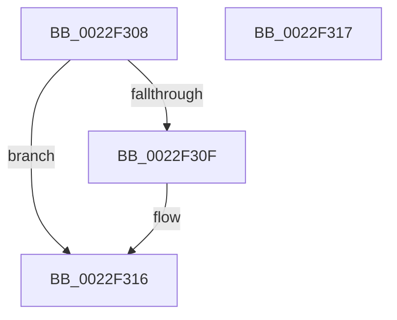

# MI_MAKE_PROTECT_WRITE_COPY

- RVA: `0x0022F308`–`0x0022F318` (길이 `16` bytes)
- VA: `0x000000014022F308`
- 실행 섹션: `.text`
- PDB 이름 있음: `예`; PDB Function 태그: `아니요`
- unwind 정보 RVA: `0x000DB714`
- 디코드: `7`개 명령, `16/16` bytes 표시
- 미해석 바이트: `0` (있으면 어셈블리에 `.byte`로 보존)

> 이 문서는 커널 이미지의 기계어와 PDB 기호를 분석해 생성했습니다. 4번과 5번은 함수 원형과 자료형을 바이너리 사용 방식에서 추정한 C 해석이며 원본 소스 복구 결과는 아닙니다.

## 1. Dependencies

- 직접 호출 지점: **0**; 고유 호출 대상: **0**
- 직접 호출자로 확인된 함수: **3**
- RIP 상대 이미지 참조: **0**

### Outgoing calls
- 직접 디코드된 call 명령이 없습니다.

### Direct callers
- [MiCombineInitialInstance](MiCombineInitialInstance_function_0022BC0C.md) at `0x0022C1C8`
- [MiHandleForkTransitionPte](MiHandleForkTransitionPte_function_0022D34C.md) at `0x0022D595`
- [MiHandleForkTransitionPte](MiHandleForkTransitionPte_function_0022D34C.md) at `0x0022D62D`
- [MiBuildForkPte](MiBuildForkPte_function_0022E32C.md) at `0x0022E63E`

### Static image references
- 디코드된 RIP-relative 메모리 참조가 없습니다.

## 2. Other-region calls and transfers

- 다른 실행 섹션으로 향하는 call: **0**
- 별도 외부 분기/꼬리 이동을 확인하지 못했습니다.

## 3. Assembly (complete function range)

```asm
0022F308  48 8B 01                        mov rax, qword ptr [rcx]
0022F30B  84 C0                           test al, al
0022F30D  79 07                           jns 0x14022f316
0022F30F  48 83 C8 20                     or rax, 0x20
0022F313  48 89 01                        mov qword ptr [rcx], rax
0022F316  C3                              ret
0022F317  CC                              int3
```

## 4. C-style interpretation (structured pseudocode)

```c
__int64 __fastcall MI_MAKE_PROTECT_WRITE_COPY(__int64 a1)
{
    __int64 result;

    result = *(unsigned __int64 *)(a1);
    if (sign_flag) {
        result = (*(unsigned __int64 *)(a1)) | (32);
        *(unsigned __int64 *)(a1) = result;
    }
    return result;
}
```

## 5. (Beta) C Style

```c
int64_t MI_MAKE_PROTECT_WRITE_COPY(void *Arg1)
{
    uint8_t *arg1 = (uint8_t *)Arg1;

    int64_t result;

    result = *(uint64_t *)(arg1);
    if (sign_flag) {
        result = (*(uint64_t *)(arg1)) | (32);
        *(uint64_t *)(arg1) = result;
    }
    return result;
}
```

### 관측된 메모리 오프셋

구조체 형식이 확인되지 않은 접근은 인자 기준의 오프셋으로만 기록했습니다.

| 기준 인자 | 오프셋 표현 | 폭 (bit) | 접근 |
|---|---:|---:|---|
| `Arg1` | `+ 0x0` | `64` | `R` |
| `Arg1` | `+ 0x0` | `64` | `W` |

## 6. Execution-region graph

[열기: 2D/3D 그래프와 함수 탐색 컨트롤 패널](../../../control-panel.html?section=text&rva=0x0022F308&view=graph)

- 2D 그래프는 위에서 아래로 흐르고, 3D 그래프는 빈 공간을 드래그해 회전합니다. Shift+드래그는 이동, 휠은 확대·축소, 함수 노드 선택은 대상 보고서 이동입니다.

### Static fallback


