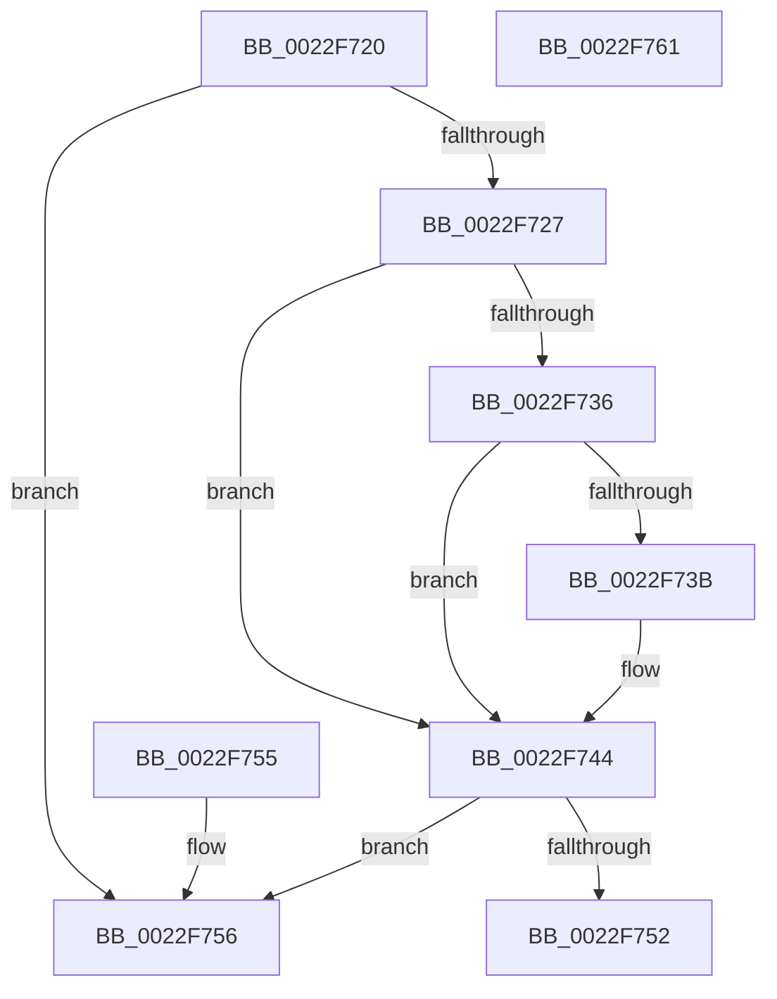

# MI_PROTO_FORMAT_COMBINED

- RVA: `0x0022F720`–`0x0022F762` (길이 `66` bytes)
- VA: `0x000000014022F720`
- 실행 섹션: `.text`
- PDB 이름 있음: `예`; PDB Function 태그: `아니요`
- unwind 정보 RVA: `0x000DB714`
- 디코드: `23`개 명령, `66/66` bytes 표시
- 미해석 바이트: `0` (있으면 어셈블리에 `.byte`로 보존)

> 이 문서는 커널 이미지의 기계어와 PDB 기호를 분석해 생성했습니다. 4번과 5번은 함수 원형과 자료형을 바이너리 사용 방식에서 추정한 C 해석이며 원본 소스 복구 결과는 아닙니다.

## 1. Dependencies

- 직접 호출 지점: **0**; 고유 호출 대상: **0**
- 직접 호출자로 확인된 함수: **7**
- RIP 상대 이미지 참조: **1**

### Outgoing calls
- 직접 디코드된 call 명령이 없습니다.

### Direct callers
- [MiBuildForkPte](MiBuildForkPte_function_0022E32C.md) at `0x0022EC46`
- [MiDecommitHandleProtoFormatPte](../24/MiDecommitHandleProtoFormatPte_function_00242D54.md) at `0x00242DC7`
- [MiWalkVaRange](../24/MiWalkVaRange_function_00243BF0.md) at `0x00244594`
- [MiWalkVaRange](../24/MiWalkVaRange_function_00243BF0.md) at `0x00244A6D`
- [sub_0032BD21](../32/Unknown_function_0032BD21.md) at `0x0032BD5A`
- [MiResolvePageFileFault](../36/MiResolvePageFileFault_function_0036D968.md) at `0x0036E772`
- [MiCheckCommitReleaseFromVad](../66/MiCheckCommitReleaseFromVad_function_0066EB90.md) at `0x0066EDE0`
- [sub_006DC6C6](../6D/Unknown_function_006DC6C6.md) at `0x006DC716`

### Static image references
- `0x0022F727` → RVA `0x00E2DC80` (`.data`; read)

## 2. Other-region calls and transfers

- 다른 실행 섹션으로 향하는 call: **0**
- 별도 외부 분기/꼬리 이동을 확인하지 못했습니다.

## 3. Assembly (complete function range)

```asm
0022F720  48 0F BA E1 0A                  bt rcx, 0xa
0022F725  73 2F                           jae 0x14022f756
0022F727  48 8B 15 52 E5 BF 00            mov rdx, qword ptr [rip + 0xbfe552]
0022F72E  48 8B C1                        mov rax, rcx
0022F731  48 85 D2                        test rdx, rdx
0022F734  74 0E                           je 0x14022f744
0022F736  F6 C1 10                        test cl, 0x10
0022F739  75 09                           jne 0x14022f744
0022F73B  48 8B C2                        mov rax, rdx
0022F73E  48 F7 D0                        not rax
0022F741  48 23 C1                        and rax, rcx
0022F744  48 C1 E8 20                     shr rax, 0x20
0022F748  BA FF FF FF FF                  mov edx, 0xffffffff
0022F74D  48 3B C2                        cmp rax, rdx
0022F750  75 04                           jne 0x14022f756
0022F752  32 C0                           xor al, al
0022F754  C3                              ret
0022F755  CC                              int3
0022F756  48 C1 E9 0B                     shr rcx, 0xb
0022F75A  80 E1 01                        and cl, 1
0022F75D  0F B6 C1                        movzx eax, cl
0022F760  C3                              ret
0022F761  CC                              int3
```

## 4. C-style interpretation (structured pseudocode)

```c
__int64 __fastcall MI_PROTO_FORMAT_COMBINED(__int64 a1)
{
    __int64 result;

    if (condition_is_above_or_equal) goto loc_0022F756;
    if (*(unsigned __int64 *)(v_rip + 12576082) == 0) goto loc_0022F744;
    result = a1;
    if ((((unsigned __int8)(a1)) & (16)) == 0) {
        result = *(unsigned __int64 *)(v_rip + 12576082);
        result = ~(result);
        result = (result) & (a1);
    }
    result = (result) >> (32);
    if (result != ((unsigned int)(0xFFFFFFFFULL))) goto loc_0022F756;
    result = 0;
    return result;
loc_0022F756:
    a1 = (a1) >> (11);
    a1 = (unsigned __int8)((a1) & (1));
    return (unsigned __int8)(a1);
}
```

## 5. (Beta) C Style

```c
int64_t MI_PROTO_FORMAT_COMBINED(int64_t Arg1)
{
    int64_t result;

    if (condition_is_above_or_equal) goto loc_0022F756;
    if (*(uint64_t *)(v_rip + 0xBFE552) == 0) goto loc_0022F744;
    result = Arg1;
    if ((((uint8_t)(Arg1)) & (16)) == 0) {
        result = *(uint64_t *)(v_rip + 0xBFE552);
        result = ~(result);
        result = (result) & (Arg1);
    }
    result = (result) >> (32);
    if (result != ((uint32_t)(0xFFFFFFFFULL))) goto loc_0022F756;
    result = 0;
    return result;
loc_0022F756:
    Arg1 = (Arg1) >> (11);
    Arg1 = (uint8_t)((Arg1) & (1));
    return (uint8_t)(Arg1);
}
```

## 6. Execution-region graph

[열기: 2D/3D 그래프와 함수 탐색 컨트롤 패널](../../../control-panel.html?section=text&rva=0x0022F720&view=graph)

- 2D 그래프는 위에서 아래로 흐르고, 3D 그래프는 빈 공간을 드래그해 회전합니다. Shift+드래그는 이동, 휠은 확대·축소, 함수 노드 선택은 대상 보고서 이동입니다.

### Static fallback


