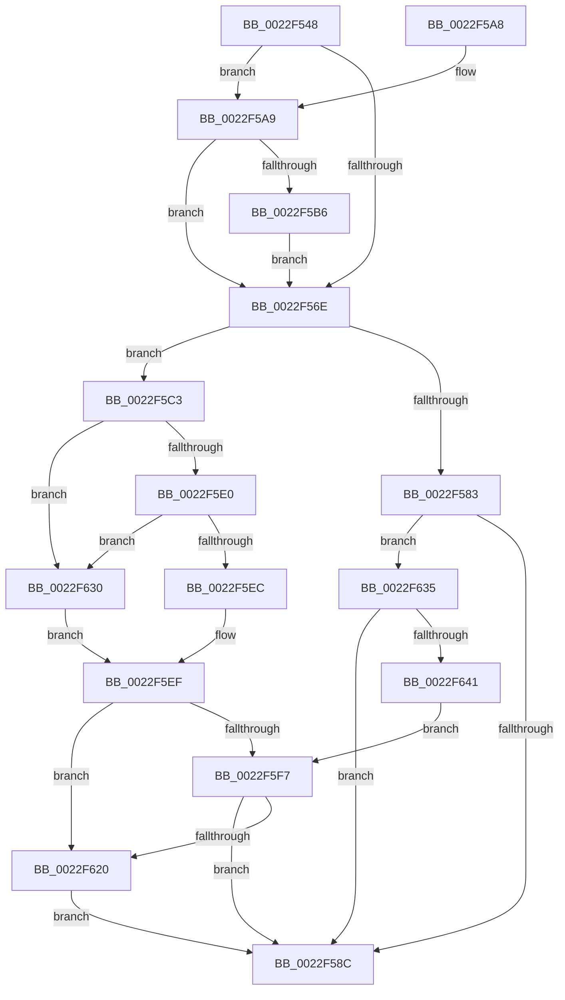

# MiAbandonPrivatePfn

- RVA: `0x0022F548`–`0x0022F643` (길이 `251` bytes)
- VA: `0x000000014022F548`
- 실행 섹션: `.text`
- PDB 이름 있음: `예`; PDB Function 태그: `아니요`
- unwind 정보 RVA: `0x00060104`
- 디코드: `75`개 명령, `251/251` bytes 표시
- 미해석 바이트: `0` (있으면 어셈블리에 `.byte`로 보존)

> 이 문서는 커널 이미지의 기계어와 PDB 기호를 분석해 생성했습니다. 4번과 5번은 함수 원형과 자료형을 바이너리 사용 방식에서 추정한 C 해석이며 원본 소스 복구 결과는 아닙니다.

## 1. Dependencies

- 직접 호출 지점: **5**; 고유 호출 대상: **4**
- 직접 호출자로 확인된 함수: **1**
- RIP 상대 이미지 참조: **1**

### Outgoing calls
- `0x0022F5AD` → [IS_PTE_NOT_DEMAND_ZERO](IS_PTE_NOT_DEMAND_ZERO_function_0022F4D0.md) (function, `0x0022F4D0`)
- `0x0022F5BC` → [MiSetPfnModified](../36/MiSetPfnModified_function_00362960.md) (function, `0x00362960`)
- `0x0022F5E3` → [MI_IS_PTE_IN_WS_SWAP_SET](../38/MI_IS_PTE_IN_WS_SWAP_SET_function_00385DD8.md) (function, `0x00385DD8`)
- `0x0022F602` → [MiCapturePfnPageFileInfoInline](MiCapturePfnPageFileInfoInline_function_0022F650.md) (function, `0x0022F650`)
- `0x0022F612` → [MiSetPfnModified](../36/MiSetPfnModified_function_00362960.md) (function, `0x00362960`)

### Direct callers
- [MiCombineInitialInstance](MiCombineInitialInstance_function_0022BC0C.md) at `0x0022C104`

### Static image references
- `0x0022F5C7` → RVA `0x00E30088` (`.data`; read)

## 2. Other-region calls and transfers

- 다른 실행 섹션으로 향하는 call: **0**
- 별도 외부 분기/꼬리 이동을 확인하지 못했습니다.

## 3. Assembly (complete function range)

```asm
0022F548  48 89 5C 24 08                  mov qword ptr [rsp + 8], rbx
0022F54D  48 89 6C 24 10                  mov qword ptr [rsp + 0x10], rbp
0022F552  48 89 74 24 18                  mov qword ptr [rsp + 0x18], rsi
0022F557  57                              push rdi
0022F558  41 56                           push r14
0022F55A  41 57                           push r15
0022F55C  48 83 EC 20                     sub rsp, 0x20
0022F560  33 DB                           xor ebx, ebx
0022F562  44 8B F2                        mov r14d, edx
0022F565  F6 41 22 10                     test byte ptr [rcx + 0x22], 0x10
0022F569  48 8B F9                        mov rdi, rcx
0022F56C  74 3B                           je 0x14022f5a9
0022F56E  48 8D 77 10                     lea rsi, [rdi + 0x10]
0022F572  40 32 ED                        xor bpl, bpl
0022F575  48 8B 0E                        mov rcx, qword ptr [rsi]
0022F578  45 32 FF                        xor r15b, r15b
0022F57B  8A C1                           mov al, cl
0022F57D  D0 E8                           shr al, 1
0022F57F  A8 01                           test al, 1
0022F581  75 40                           jne 0x14022f5c3
0022F583  45 85 F6                        test r14d, r14d
0022F586  0F 85 A9 00 00 00               jne 0x14022f635
0022F58C  48 8B 6C 24 48                  mov rbp, qword ptr [rsp + 0x48]
0022F591  48 8B C3                        mov rax, rbx
0022F594  48 8B 5C 24 40                  mov rbx, qword ptr [rsp + 0x40]
0022F599  48 8B 74 24 50                  mov rsi, qword ptr [rsp + 0x50]
0022F59E  48 83 C4 20                     add rsp, 0x20
0022F5A2  41 5F                           pop r15
0022F5A4  41 5E                           pop r14
0022F5A6  5F                              pop rdi
0022F5A7  C3                              ret
0022F5A8  CC                              int3
0022F5A9  48 8B 49 10                     mov rcx, qword ptr [rcx + 0x10]
0022F5AD  E8 1E FF FF FF                  call 0x14022f4d0
0022F5B2  85 C0                           test eax, eax
0022F5B4  75 B8                           jne 0x14022f56e
0022F5B6  8D 50 01                        lea edx, [rax + 1]
0022F5B9  48 8B CF                        mov rcx, rdi
0022F5BC  E8 9F 33 13 00                  call 0x140362960
0022F5C1  EB AB                           jmp 0x14022f56e
0022F5C3  48 8B 47 28                     mov rax, qword ptr [rdi + 0x28]
0022F5C7  48 8B 0D BA 0A C0 00            mov rcx, qword ptr [rip + 0xc00aba]
0022F5CE  48 C1 E8 2B                     shr rax, 0x2b
0022F5D2  25 FF 03 00 00                  and eax, 0x3ff
0022F5D7  48 8B 0C C1                     mov rcx, qword ptr [rcx + rax*8]
0022F5DB  45 85 F6                        test r14d, r14d
0022F5DE  75 50                           jne 0x14022f630
0022F5E0  48 8B D6                        mov rdx, rsi
0022F5E3  E8 F0 67 15 00                  call 0x140385dd8
0022F5E8  85 C0                           test eax, eax
0022F5EA  75 44                           jne 0x14022f630
0022F5EC  48 8B 1E                        mov rbx, qword ptr [rsi]
0022F5EF  41 B7 01                        mov r15b, 1
0022F5F2  40 84 ED                        test bpl, bpl
0022F5F5  74 29                           je 0x14022f620
0022F5F7  BA 01 00 00 00                  mov edx, 1
0022F5FC  48 8B CF                        mov rcx, rdi
0022F5FF  44 8B C2                        mov r8d, edx
0022F602  E8 49 00 00 00                  call 0x14022f650
0022F607  BA 01 00 00 00                  mov edx, 1
0022F60C  48 8B CF                        mov rcx, rdi
0022F60F  48 8B D8                        mov rbx, rax
0022F612  E8 49 33 13 00                  call 0x140362960
0022F617  45 84 FF                        test r15b, r15b
0022F61A  0F 84 6C FF FF FF               je 0x14022f58c
0022F620  48 8B 0E                        mov rcx, qword ptr [rsi]
0022F623  48 83 E1 FD                     and rcx, 0xfffffffffffffffd
0022F627  48 89 4F 10                     mov qword ptr [rdi + 0x10], rcx
0022F62B  E9 5C FF FF FF                  jmp 0x14022f58c
0022F630  40 B5 01                        mov bpl, 1
0022F633  EB BA                           jmp 0x14022f5ef
0022F635  C0 E9 02                        shr cl, 2
0022F638  F6 C1 01                        test cl, 1
0022F63B  0F 84 4B FF FF FF               je 0x14022f58c
0022F641  EB B4                           jmp 0x14022f5f7
```

## 4. C-style interpretation (structured pseudocode)

```c
__int64 __fastcall MiAbandonPrivatePfn(__int64 a1, int a2)
{
    __int64 result;
    __int64 v_r15;
    __int64 v_rbp;
    __int64 v_rbx;
    __int64 v_rsp;
    unsigned __int64 v_stack_p10;
    unsigned __int64 v_stack_p18;
    unsigned __int64 v_stack_p8;

    v_stack_p8 = v_rbx;
    v_stack_p10 = v_rbp;
    v_stack_p18 = v_rsi;
    v_rsp = (v_rsp) - (32);
    v_rbx = 0;
    if (((*(unsigned __int8 *)(a1 + 34)) & (16)) == 0) goto loc_0022F5A9;
loc_0022F56E:
    v_rbp = 0;
    v_r15 = 0;
    result = (unsigned __int8)(((unsigned __int8)(*(unsigned __int64 *)(a1 + 16))) >> (1));
    if ((((unsigned __int8)(result)) & (1)) != 0) goto loc_0022F5C3;
    if ((unsigned int)((unsigned int)(a2)) != 0) goto loc_0022F635;
loc_0022F58C:
    v_rsp = (v_rsp) + (32);
    return 0;
loc_0022F5A9:
    result = IS_PTE_NOT_DEMAND_ZERO(*(unsigned __int64 *)(*(unsigned __int64 *)(a1 + 16) + 16), a2, a3, a4);
    if ((unsigned int)(result) != 0) goto loc_0022F56E;
    result = MiSetPfnModified(a1, result + 1, a3, a4);
    goto loc_0022F56E;
loc_0022F5C3:
    result = (*(unsigned __int64 *)(a1 + 40)) >> (43);
    result = (unsigned int)((result) & (0x3FFULL));
    if ((unsigned int)((unsigned int)(a2)) != 0) goto loc_0022F630;
    result = MI_IS_PTE_IN_WS_SWAP_SET(*(unsigned __int64 *)(*(unsigned __int64 *)(v_rip + 12585658) + result * 8), v_stack_p18, a3, a4);
    if ((unsigned int)(result) != 0) goto loc_0022F630;
loc_0022F5EF:
    if ((unsigned __int8)(v_stack_p10) == 0) goto loc_0022F620;
loc_0022F5F7:
    result = MiCapturePfnPageFileInfoInline(a1, 1, 1, a4);
    result = MiSetPfnModified(a1, 1, 1, a4);
    if (1 == 0) goto loc_0022F58C;
loc_0022F620:
    a1 = (*(unsigned __int64 *)(v_stack_p18)) & (-3);
    *(unsigned __int64 *)(a1 + 16) = a1;
    goto loc_0022F58C;
loc_0022F630:
    goto loc_0022F5EF;
loc_0022F635:
    a1 = (unsigned __int8)((a1) >> (2));
    if ((((unsigned __int8)(a1)) & (1)) == 0) goto loc_0022F58C;
    goto loc_0022F5F7;
}
```

## 5. (Beta) C Style

```c
int64_t MiAbandonPrivatePfn(void *Arg1, int32_t Arg2)
{
    uint8_t *arg1 = (uint8_t *)Arg1;

    int64_t result;
    int64_t local_r15;
    int64_t local_rbp;
    int64_t local_rbx;
    int64_t local_rsp;
    uint64_t v_stack_p10;
    uint64_t v_stack_p18;
    uint64_t v_stack_p8;

    v_stack_p8 = local_rbx;
    v_stack_p10 = local_rbp;
    v_stack_p18 = local_rsi;
    local_rsp = (local_rsp) - (32);
    local_rbx = 0;
    if (((*(uint8_t *)(arg1 + 0x22)) & (16)) == 0) goto loc_0022F5A9;
loc_0022F56E:
    local_rbp = 0;
    local_r15 = 0;
    result = (uint8_t)(((uint8_t)(*(uint64_t *)(arg1 + 0x10))) >> (1));
    if ((((uint8_t)(result)) & (1)) != 0) goto loc_0022F5C3;
    if ((uint32_t)((uint32_t)(Arg2)) != 0) goto loc_0022F635;
loc_0022F58C:
    local_rsp = (local_rsp) + (32);
    return 0;
loc_0022F5A9:
    result = IS_PTE_NOT_DEMAND_ZERO(*(uint64_t *)(*(uint64_t *)(arg1 + 0x10) + 0x10), Arg2, a3, a4);
    if ((uint32_t)(result) != 0) goto loc_0022F56E;
    result = MiSetPfnModified(Arg1, result + 1, a3, a4);
    goto loc_0022F56E;
loc_0022F5C3:
    result = (*(uint64_t *)(arg1 + 0x28)) >> (43);
    result = (uint32_t)((result) & (0x3FFULL));
    if ((uint32_t)((uint32_t)(Arg2)) != 0) goto loc_0022F630;
    result = MI_IS_PTE_IN_WS_SWAP_SET(*(uint64_t *)(*(uint64_t *)(v_rip + 0xC00ABA) + result * 8), v_stack_p18, a3, a4);
    if ((uint32_t)(result) != 0) goto loc_0022F630;
loc_0022F5EF:
    if ((uint8_t)(v_stack_p10) == 0) goto loc_0022F620;
loc_0022F5F7:
    result = MiCapturePfnPageFileInfoInline(Arg1, 1, 1, a4);
    result = MiSetPfnModified(Arg1, 1, 1, a4);
    if (1 == 0) goto loc_0022F58C;
loc_0022F620:
    Arg1 = (*(uint64_t *)(v_stack_p18)) & (-3);
    *(void **)(arg1 + 0x10) = Arg1;
    goto loc_0022F58C;
loc_0022F630:
    goto loc_0022F5EF;
loc_0022F635:
    Arg1 = (uint8_t)((Arg1) >> (2));
    if ((((uint8_t)(Arg1)) & (1)) == 0) goto loc_0022F58C;
    goto loc_0022F5F7;
}
```

### 관측된 메모리 오프셋

구조체 형식이 확인되지 않은 접근은 인자 기준의 오프셋으로만 기록했습니다.

| 기준 인자 | 오프셋 표현 | 폭 (bit) | 접근 |
|---|---:|---:|---|
| `Arg1` | `+ 0x0` | `64` | `R` |
| `Arg1` | `+ 0x10` | `64` | `R` |
| `Arg1` | `+ 0x10` | `64` | `W` |
| `Arg1` | `+ 0x22` | `8` | `R` |
| `Arg1` | `+ 0x28` | `64` | `R` |

## 6. Execution-region graph

[열기: 2D/3D 그래프와 함수 탐색 컨트롤 패널](../../../control-panel.html?section=text&rva=0x0022F548&view=graph)

- 2D 그래프는 위에서 아래로 흐르고, 3D 그래프는 빈 공간을 드래그해 회전합니다. Shift+드래그는 이동, 휠은 확대·축소, 함수 노드 선택은 대상 보고서 이동입니다.

### Static fallback


