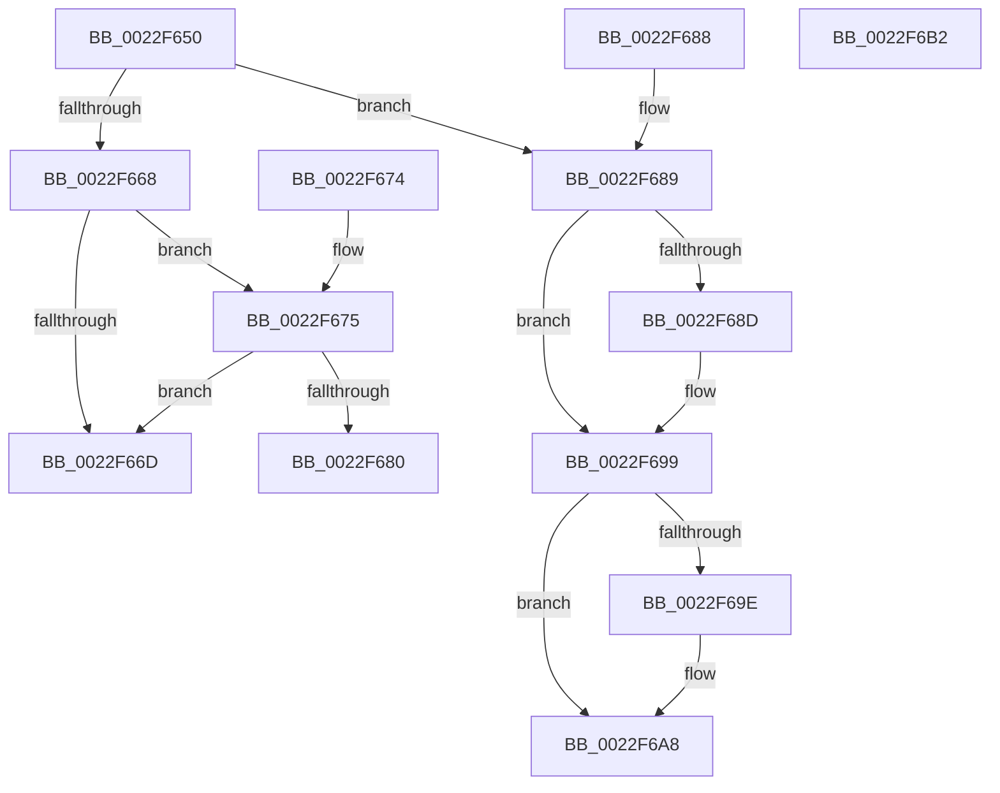

# MiCapturePfnPageFileInfoInline

- RVA: `0x0022F650`–`0x0022F6B3` (길이 `99` bytes)
- VA: `0x000000014022F650`
- 실행 섹션: `.text`
- PDB 이름 있음: `예`; PDB Function 태그: `아니요`
- unwind 정보 RVA: `0x00060120`
- 디코드: `34`개 명령, `99/99` bytes 표시
- 미해석 바이트: `0` (있으면 어셈블리에 `.byte`로 보존)

> 이 문서는 커널 이미지의 기계어와 PDB 기호를 분석해 생성했습니다. 4번과 5번은 함수 원형과 자료형을 바이너리 사용 방식에서 추정한 C 해석이며 원본 소스 복구 결과는 아닙니다.

## 1. Dependencies

- 직접 호출 지점: **1**; 고유 호출 대상: **1**
- 직접 호출자로 확인된 함수: **3**
- RIP 상대 이미지 참조: **0**

### Outgoing calls
- `0x0022F6A3` → [MiClearPageFileReservation](../32/MiClearPageFileReservation_function_0032B68C.md) (function, `0x0032B68C`)

### Direct callers
- [MiAbandonPrivatePfn](MiAbandonPrivatePfn_function_0022F548.md) at `0x0022F602`
- [MiMigratePfn](../28/MiMigratePfn_function_0028DBB0.md) at `0x0028E0B3`
- [MiSetPagesModified](../49/MiSetPagesModified_function_0049DC2C.md) at `0x0049E0D0`

### Static image references
- 디코드된 RIP-relative 메모리 참조가 없습니다.

## 2. Other-region calls and transfers

- 다른 실행 섹션으로 향하는 call: **0**
- 별도 외부 분기/꼬리 이동을 확인하지 못했습니다.

## 3. Assembly (complete function range)

```asm
0022F650  48 83 EC 28                     sub rsp, 0x28
0022F654  4C 8B 49 10                     mov r9, qword ptr [rcx + 0x10]
0022F658  41 0F B6 C1                     movzx eax, r9b
0022F65C  4C 89 4C 24 30                  mov qword ptr [rsp + 0x30], r9
0022F661  C0 E8 02                        shr al, 2
0022F664  A8 01                           test al, 1
0022F666  75 21                           jne 0x14022f689
0022F668  45 85 C0                        test r8d, r8d
0022F66B  75 08                           jne 0x14022f675
0022F66D  33 C0                           xor eax, eax
0022F66F  48 83 C4 28                     add rsp, 0x28
0022F673  C3                              ret
0022F674  CC                              int3
0022F675  41 0F B6 C9                     movzx ecx, r9b
0022F679  D0 E9                           shr cl, 1
0022F67B  F6 C1 01                        test cl, 1
0022F67E  74 ED                           je 0x14022f66d
0022F680  49 8B C1                        mov rax, r9
0022F683  48 83 C4 28                     add rsp, 0x28
0022F687  C3                              ret
0022F688  CC                              int3
0022F689  85 D2                           test edx, edx
0022F68B  74 0C                           je 0x14022f699
0022F68D  48 8B 41 10                     mov rax, qword ptr [rcx + 0x10]
0022F691  48 83 E0 FB                     and rax, 0xfffffffffffffffb
0022F695  48 89 41 10                     mov qword ptr [rcx + 0x10], rax
0022F699  45 85 C0                        test r8d, r8d
0022F69C  75 0A                           jne 0x14022f6a8
0022F69E  48 8D 4C 24 30                  lea rcx, [rsp + 0x30]
0022F6A3  E8 E4 BF 0F 00                  call 0x14032b68c
0022F6A8  48 8B 44 24 30                  mov rax, qword ptr [rsp + 0x30]
0022F6AD  48 83 C4 28                     add rsp, 0x28
0022F6B1  C3                              ret
0022F6B2  CC                              int3
```

## 4. C-style interpretation (structured pseudocode)

```c
__int64 __fastcall MiCapturePfnPageFileInfoInline(__int64 a1, int a2, int a3)
{
    __int64 result;
    __int64 v_rsp;
    unsigned __int64 v_stack_p58;
    unsigned __int64 v_stack_p8;

    v_rsp = (v_rsp) - (40);
    v_stack_p8 = *(unsigned __int64 *)(a1 + 16);
    result = (unsigned __int8)(((unsigned __int8)(*(unsigned __int64 *)(a1 + 16))) >> (2));
    if ((((unsigned __int8)(result)) & (1)) != 0) goto loc_0022F689;
    if (a3 != 0) goto loc_0022F675;
loc_0022F66D:
    result = 0;
    v_rsp = (v_rsp) + (40);
    return result;
loc_0022F675:
    a1 = (unsigned __int8)(((unsigned __int8)(*(unsigned __int64 *)(a1 + 16))) >> (1));
    if ((((unsigned __int8)(a1)) & (1)) == 0) goto loc_0022F66D;
    v_rsp = (v_rsp) + (40);
    return *(unsigned __int64 *)(a1 + 16);
loc_0022F689:
    result = *(unsigned __int64 *)(a1 + 16);
    if (a2 != 0) {
        result = *(unsigned __int64 *)(a1 + 16);
        result = (result) & (-5);
        *(unsigned __int64 *)(a1 + 16) = result;
    }
    if (a3 == 0) {
        a1 = v_stack_p58;
        result = MiClearPageFileReservation(a1, a2, a3, *(unsigned __int64 *)(a1 + 16));
    }
    v_rsp = (v_rsp) + (40);
    return v_stack_p58;
}
```

## 5. (Beta) C Style

```c
int64_t MiCapturePfnPageFileInfoInline(void *Arg1, int32_t Arg2, int32_t Arg3)
{
    uint8_t *arg1 = (uint8_t *)Arg1;

    int64_t result;
    int64_t local_rsp;
    uint64_t v_stack_p58;
    uint64_t v_stack_p8;

    local_rsp = (local_rsp) - (40);
    v_stack_p8 = *(uint64_t *)(arg1 + 0x10);
    result = (uint8_t)(((uint8_t)(*(uint64_t *)(arg1 + 0x10))) >> (2));
    if ((((uint8_t)(result)) & (1)) != 0) goto loc_0022F689;
    if (Arg3 != 0) goto loc_0022F675;
loc_0022F66D:
    result = 0;
    local_rsp = (local_rsp) + (40);
    return result;
loc_0022F675:
    Arg1 = (uint8_t)(((uint8_t)(*(uint64_t *)(arg1 + 0x10))) >> (1));
    if ((((uint8_t)(Arg1)) & (1)) == 0) goto loc_0022F66D;
    local_rsp = (local_rsp) + (40);
    return *(uint64_t *)(arg1 + 0x10);
loc_0022F689:
    result = *(uint64_t *)(arg1 + 0x10);
    if (Arg2 != 0) {
        result = *(uint64_t *)(arg1 + 0x10);
        result = (result) & (-5);
        *(uint64_t *)(arg1 + 0x10) = result;
    }
    if (Arg3 == 0) {
        Arg1 = v_stack_p58;
        result = MiClearPageFileReservation(Arg1, Arg2, Arg3, *(uint64_t *)(arg1 + 0x10));
    }
    local_rsp = (local_rsp) + (40);
    return v_stack_p58;
}
```

### 관측된 메모리 오프셋

구조체 형식이 확인되지 않은 접근은 인자 기준의 오프셋으로만 기록했습니다.

| 기준 인자 | 오프셋 표현 | 폭 (bit) | 접근 |
|---|---:|---:|---|
| `Arg1` | `+ 0x10` | `64` | `R` |
| `Arg1` | `+ 0x10` | `64` | `W` |

## 6. Execution-region graph

[열기: 2D/3D 그래프와 함수 탐색 컨트롤 패널](../../../control-panel.html?section=text&rva=0x0022F650&view=graph)

- 2D 그래프는 위에서 아래로 흐르고, 3D 그래프는 빈 공간을 드래그해 회전합니다. Shift+드래그는 이동, 휠은 확대·축소, 함수 노드 선택은 대상 보고서 이동입니다.

### Static fallback


