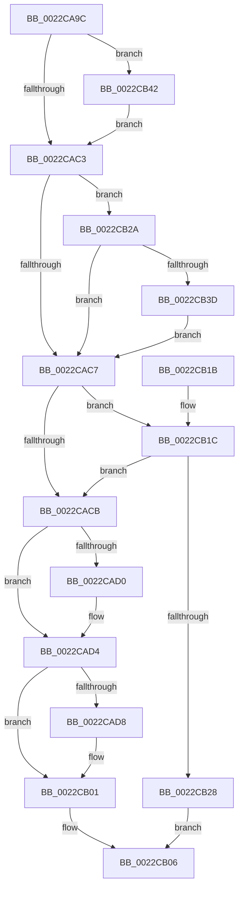

# MiChargeCrossPartitionSharedPage

- RVA: `0x0022CA9C`–`0x0022CB53` (길이 `183` bytes)
- VA: `0x000000014022CA9C`
- 실행 섹션: `.text`
- PDB 이름 있음: `예`; PDB Function 태그: `아니요`
- unwind 정보 RVA: `0x0005FFCC`
- 디코드: `54`개 명령, `183/183` bytes 표시
- 미해석 바이트: `0` (있으면 어셈블리에 `.byte`로 보존)

> 이 문서는 커널 이미지의 기계어와 PDB 기호를 분석해 생성했습니다. 4번과 5번은 함수 원형과 자료형을 바이너리 사용 방식에서 추정한 C 해석이며 원본 소스 복구 결과는 아닙니다.

## 1. Dependencies

- 직접 호출 지점: **1**; 고유 호출 대상: **1**
- 직접 호출자로 확인된 함수: **1**
- RIP 상대 이미지 참조: **0**

### Outgoing calls
- `0x0022CB1F` → [MiGetCloneCharges](MiGetCloneCharges_function_0022CB5C.md) (function, `0x0022CB5C`)

### Direct callers
- [MiReferenceCloneProto](MiReferenceCloneProto_function_0022B2F8.md) at `0x0022B351`

### Static image references
- 디코드된 RIP-relative 메모리 참조가 없습니다.

## 2. Other-region calls and transfers

- 다른 실행 섹션으로 향하는 call: **0**
- 별도 외부 분기/꼬리 이동을 확인하지 못했습니다.

## 3. Assembly (complete function range)

```asm
0022CA9C  48 89 5C 24 08                  mov qword ptr [rsp + 8], rbx
0022CAA1  48 89 6C 24 10                  mov qword ptr [rsp + 0x10], rbp
0022CAA6  48 89 74 24 18                  mov qword ptr [rsp + 0x18], rsi
0022CAAB  57                              push rdi
0022CAAC  48 83 EC 20                     sub rsp, 0x20
0022CAB0  48 8B EA                        mov rbp, rdx
0022CAB3  41 8B F1                        mov esi, r9d
0022CAB6  33 D2                           xor edx, edx
0022CAB8  49 8B D8                        mov rbx, r8
0022CABB  48 8B F9                        mov rdi, rcx
0022CABE  48 3B E9                        cmp rbp, rcx
0022CAC1  75 7F                           jne 0x14022cb42
0022CAC3  85 F6                           test esi, esi
0022CAC5  75 63                           jne 0x14022cb2a
0022CAC7  85 D2                           test edx, edx
0022CAC9  75 51                           jne 0x14022cb1c
0022CACB  48 3B EF                        cmp rbp, rdi
0022CACE  74 04                           je 0x14022cad4
0022CAD0  48 FF 43 08                     inc qword ptr [rbx + 8]
0022CAD4  85 F6                           test esi, esi
0022CAD6  74 29                           je 0x14022cb01
0022CAD8  48 8B 4B 10                     mov rcx, qword ptr [rbx + 0x10]
0022CADC  4C 8B C1                        mov r8, rcx
0022CADF  49 83 E0 E0                     and r8, 0xffffffffffffffe0
0022CAE3  49 83 C0 20                     add r8, 0x20
0022CAE7  49 8B D0                        mov rdx, r8
0022CAEA  48 33 D1                        xor rdx, rcx
0022CAED  48 B9 1F 00 00 00 00 00 00 F0   movabs rcx, 0xf00000000000001f
0022CAF7  48 23 D1                        and rdx, rcx
0022CAFA  49 33 D0                        xor rdx, r8
0022CAFD  48 89 53 10                     mov qword ptr [rbx + 0x10], rdx
0022CB01  B8 01 00 00 00                  mov eax, 1
0022CB06  48 8B 5C 24 30                  mov rbx, qword ptr [rsp + 0x30]
0022CB0B  48 8B 6C 24 38                  mov rbp, qword ptr [rsp + 0x38]
0022CB10  48 8B 74 24 40                  mov rsi, qword ptr [rsp + 0x40]
0022CB15  48 83 C4 20                     add rsp, 0x20
0022CB19  5F                              pop rdi
0022CB1A  C3                              ret
0022CB1B  CC                              int3
0022CB1C  48 8B CF                        mov rcx, rdi
0022CB1F  E8 38 00 00 00                  call 0x14022cb5c
0022CB24  85 C0                           test eax, eax
0022CB26  75 A3                           jne 0x14022cacb
0022CB28  EB DC                           jmp 0x14022cb06
0022CB2A  49 8B 40 10                     mov rax, qword ptr [r8 + 0x10]
0022CB2E  48 B9 E0 FF FF FF FF FF FF 0F   movabs rcx, 0xfffffffffffffe0
0022CB38  48 85 C1                        test rcx, rax
0022CB3B  75 8A                           jne 0x14022cac7
0022CB3D  83 CA 02                        or edx, 2
0022CB40  EB 85                           jmp 0x14022cac7
0022CB42  49 39 50 08                     cmp qword ptr [r8 + 8], rdx
0022CB46  B8 05 00 00 00                  mov eax, 5
0022CB4B  0F 44 D0                        cmove edx, eax
0022CB4E  E9 70 FF FF FF                  jmp 0x14022cac3
```

## 4. C-style interpretation (structured pseudocode)

```c
__int64 __fastcall MiChargeCrossPartitionSharedPage(__int64 a1, __int64 a2, __int64 a3, int a4)
{
    __int64 result;
    __int64 v_rsp;
    unsigned __int64 v_stack_p10;
    unsigned __int64 v_stack_p18;
    unsigned __int64 v_stack_p8;

    v_stack_p8 = v_rbx;
    v_stack_p10 = v_rbp;
    v_stack_p18 = v_rsi;
    v_rsp = (v_rsp) - (32);
    a2 = 0;
    if (0 != a1) goto loc_0022CB42;
loc_0022CAC3:
    if ((unsigned int)((unsigned int)(a4)) != 0) goto loc_0022CB2A;
loc_0022CAC7:
    if (0 != 0) goto loc_0022CB1C;
loc_0022CACB:
    if (0 != a1) {
    }
    if ((unsigned int)((unsigned int)(a4)) != 0) {
        a1 = *(unsigned __int64 *)(a3 + 16);
        a3 = a1;
        a3 = (a3) & (-32);
        a3 = (a3) + (32);
        a2 = a3;
        a2 = (a2) ^ (a1);
        a2 = (a2) & (a1);
        a2 = (a2) ^ (a3);
        *(unsigned __int64 *)(a3 + 16) = a2;
    }
loc_0022CB06:
    v_rsp = (v_rsp) + (32);
    return 1;
loc_0022CB1C:
    result = MiGetCloneCharges(a1, a2, a3, a4);
    if ((unsigned int)(result) != 0) goto loc_0022CACB;
    goto loc_0022CB06;
loc_0022CB2A:
    if (((a1) & (*(unsigned __int64 *)(a3 + 16))) != 0) goto loc_0022CAC7;
    a2 = (unsigned int)((a2) | (2));
    goto loc_0022CAC7;
loc_0022CB42:
    if ((*(unsigned __int64 *)(a3 + 8)) == a2) { a2 = 5; }
    goto loc_0022CAC3;
}
```

## 5. (Beta) C Style

```c
int64_t MiChargeCrossPartitionSharedPage(int64_t Arg1, int64_t Arg2, void *Arg3, int32_t Arg4)
{
    uint8_t *arg3 = (uint8_t *)Arg3;

    int64_t result;
    int64_t local_rsp;
    uint64_t v_stack_p10;
    uint64_t v_stack_p18;
    uint64_t v_stack_p8;

    v_stack_p8 = local_rbx;
    v_stack_p10 = local_rbp;
    v_stack_p18 = local_rsi;
    local_rsp = (local_rsp) - (32);
    Arg2 = 0;
    if (0 != Arg1) goto loc_0022CB42;
loc_0022CAC3:
    if ((uint32_t)((uint32_t)(Arg4)) != 0) goto loc_0022CB2A;
loc_0022CAC7:
    if (0 != 0) goto loc_0022CB1C;
loc_0022CACB:
    if (0 != Arg1) {
    }
    if ((uint32_t)((uint32_t)(Arg4)) != 0) {
        Arg1 = *(uint64_t *)(arg3 + 0x10);
        Arg3 = Arg1;
        Arg3 = (Arg3) & (-32);
        Arg3 = (Arg3) + (32);
        Arg2 = Arg3;
        Arg2 = (Arg2) ^ (Arg1);
        Arg2 = (Arg2) & (Arg1);
        Arg2 = (Arg2) ^ (Arg3);
        *(uint64_t *)(arg3 + 0x10) = Arg2;
    }
loc_0022CB06:
    local_rsp = (local_rsp) + (32);
    return 1;
loc_0022CB1C:
    result = MiGetCloneCharges(Arg1, Arg2, Arg3, Arg4);
    if ((uint32_t)(result) != 0) goto loc_0022CACB;
    goto loc_0022CB06;
loc_0022CB2A:
    if (((Arg1) & (*(uint64_t *)(arg3 + 0x10))) != 0) goto loc_0022CAC7;
    Arg2 = (uint32_t)((Arg2) | (2));
    goto loc_0022CAC7;
loc_0022CB42:
    if ((*(uint64_t *)(arg3 + 0x8)) == Arg2) { Arg2 = 5; }
    goto loc_0022CAC3;
}
```

### 관측된 메모리 오프셋

구조체 형식이 확인되지 않은 접근은 인자 기준의 오프셋으로만 기록했습니다.

| 기준 인자 | 오프셋 표현 | 폭 (bit) | 접근 |
|---|---:|---:|---|
| `Arg3` | `+ 0x8` | `64` | `R` |
| `Arg3` | `+ 0x8` | `64` | `R/W` |
| `Arg3` | `+ 0x10` | `64` | `R` |
| `Arg3` | `+ 0x10` | `64` | `W` |

## 6. Execution-region graph

[열기: 2D/3D 그래프와 함수 탐색 컨트롤 패널](../../../control-panel.html?section=text&rva=0x0022CA9C&view=graph)

- 2D 그래프는 위에서 아래로 흐르고, 3D 그래프는 빈 공간을 드래그해 회전합니다. Shift+드래그는 이동, 휠은 확대·축소, 함수 노드 선택은 대상 보고서 이동입니다.

### Static fallback


