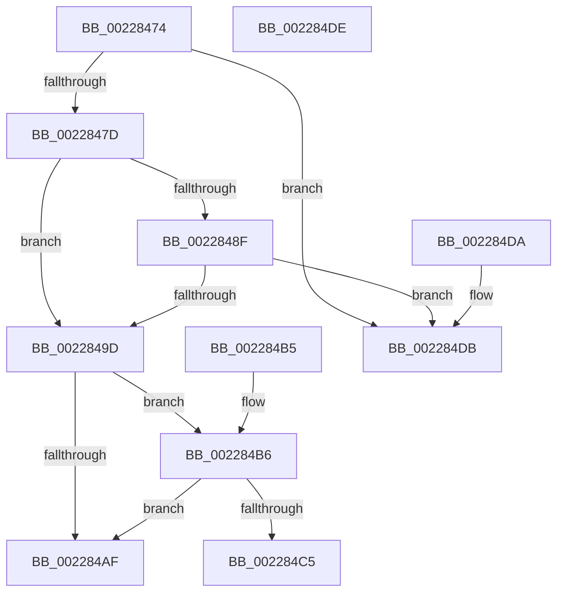

# MiCheckPhysicalAddressRange

- RVA: `0x00228474`–`0x002284DF` (길이 `107` bytes)
- VA: `0x0000000140228474`
- 실행 섹션: `.text`
- PDB 이름 있음: `예`; PDB Function 태그: `아니요`
- unwind 정보 RVA: `0x000DB714`
- 디코드: `30`개 명령, `107/107` bytes 표시
- 미해석 바이트: `0` (있으면 어셈블리에 `.byte`로 보존)

> 이 문서는 커널 이미지의 기계어와 PDB 기호를 분석해 생성했습니다. 4번과 5번은 함수 원형과 자료형을 바이너리 사용 방식에서 추정한 C 해석이며 원본 소스 복구 결과는 아닙니다.

## 1. Dependencies

- 직접 호출 지점: **0**; 고유 호출 대상: **0**
- 직접 호출자로 확인된 함수: **2**
- RIP 상대 이미지 참조: **1**

### Outgoing calls
- 직접 디코드된 call 명령이 없습니다.

### Direct callers
- [MmCopyMemory](MmCopyMemory_function_002285B0.md) at `0x00228856`
- [MiDbgTranslatePhysicalAddress](../68/MiDbgTranslatePhysicalAddress_function_00685760.md) at `0x006857A3`

### Static image references
- `0x0022847D` → RVA `0x00E0B0F8` (`.data`; read)

## 2. Other-region calls and transfers

- 다른 실행 섹션으로 향하는 call: **0**
- 별도 외부 분기/꼬리 이동을 확인하지 못했습니다.

## 3. Assembly (complete function range)

```asm
00228474  4C 8D 04 11                     lea r8, [rcx + rdx]
00228478  4C 3B C1                        cmp r8, rcx
0022847B  76 5E                           jbe 0x1402284db
0022847D  48 8B 15 74 2C BE 00            mov rdx, qword ptr [rip + 0xbe2c74]
00228484  49 FF C8                        dec r8
00228487  45 33 C9                        xor r9d, r9d
0022848A  48 85 D2                        test rdx, rdx
0022848D  74 0E                           je 0x14022849d
0022848F  49 8B C0                        mov rax, r8
00228492  48 25 00 F0 FF FF               and rax, 0xfffffffffffff000
00228498  48 3B C2                        cmp rax, rdx
0022849B  77 3E                           ja 0x1402284db
0022849D  65 48 8B 14 25 20 00 00 00      mov rdx, qword ptr gs:[0x20]
002284A6  80 BA 8D 00 00 00 01            cmp byte ptr [rdx + 0x8d], 1
002284AD  74 07                           je 0x1402284b6
002284AF  B8 01 00 00 00                  mov eax, 1
002284B4  C3                              ret
002284B5  CC                              int3
002284B6  48 B8 00 00 00 00 FD 00 00 00   movabs rax, 0xfd00000000
002284C0  4C 3B C0                        cmp r8, rax
002284C3  72 EA                           jb 0x1402284af
002284C5  48 B8 FF FF FF FF FF 00 00 00   movabs rax, 0xffffffffff
002284CF  48 3B C8                        cmp rcx, rax
002284D2  41 0F 97 C1                     seta r9b
002284D6  41 8B C1                        mov eax, r9d
002284D9  C3                              ret
002284DA  CC                              int3
002284DB  33 C0                           xor eax, eax
002284DD  C3                              ret
002284DE  CC                              int3
```

## 4. C-style interpretation (structured pseudocode)

```c
__int64 __fastcall MiCheckPhysicalAddressRange(__int64 a1, __int64 a2, __int64 a3, int a4)
{
    __int64 result;

    if ((a1 + a2 * 1) <= a1) goto loc_002284DB;
    a3 = (a1 + a2 * 1) - 1;
    a4 = 0;
    if (*(unsigned __int64 *)(v_rip + 12463220) == 0) goto loc_0022849D;
    result = (a3) & (0xFFFFFFFFFFFFF000ULL);
    if (result > (*(unsigned __int64 *)(v_rip + 12463220))) goto loc_002284DB;
loc_0022849D:
    if ((*(unsigned __int8 *)(*(unsigned __int64 *)(gs_base + (0 + 32)) + 141)) == 1) goto loc_002284B6;
loc_002284AF:
    return 1;
loc_002284B6:
    if (a3 < 1) goto loc_002284AF;
    a4 = (a1 > 1) ? 1 : 0;
    return (unsigned int)(a4);
loc_002284DB:
    result = 0;
    return result;
}
```

## 5. (Beta) C Style

```c
int64_t MiCheckPhysicalAddressRange(void *Arg1, int64_t Arg2, int64_t Arg3, int32_t Arg4)
{
    uint8_t *arg1 = (uint8_t *)Arg1;

    int64_t result;

    if ((Arg1 + Arg2 * 1) <= Arg1) goto loc_002284DB;
    Arg3 = (Arg1 + Arg2 * 1) - 1;
    Arg4 = 0;
    if (*(uint64_t *)(v_rip + 0xBE2C74) == 0) goto loc_0022849D;
    result = (Arg3) & (0xFFFFFFFFFFFFF000ULL);
    if (result > (*(uint64_t *)(v_rip + 0xBE2C74))) goto loc_002284DB;
loc_0022849D:
    if ((*(uint8_t *)(*(uint64_t *)(gs_base + (0 + 0x20)) + 0x8D)) == 1) goto loc_002284B6;
loc_002284AF:
    return 1;
loc_002284B6:
    if (Arg3 < 1) goto loc_002284AF;
    Arg4 = (Arg1 > 1) ? 1 : 0;
    return (uint32_t)(Arg4);
loc_002284DB:
    result = 0;
    return result;
}
```

### 관측된 메모리 오프셋

구조체 형식이 확인되지 않은 접근은 인자 기준의 오프셋으로만 기록했습니다.

| 기준 인자 | 오프셋 표현 | 폭 (bit) | 접근 |
|---|---:|---:|---|
| `Arg1` | `+ 0x0 + rdx*1` | `64` | `R` |

## 6. Execution-region graph

[열기: 2D/3D 그래프와 함수 탐색 컨트롤 패널](../../../control-panel.html?section=text&rva=0x00228474&view=graph)

- 2D 그래프는 위에서 아래로 흐르고, 3D 그래프는 빈 공간을 드래그해 회전합니다. Shift+드래그는 이동, 휠은 확대·축소, 함수 노드 선택은 대상 보고서 이동입니다.

### Static fallback


