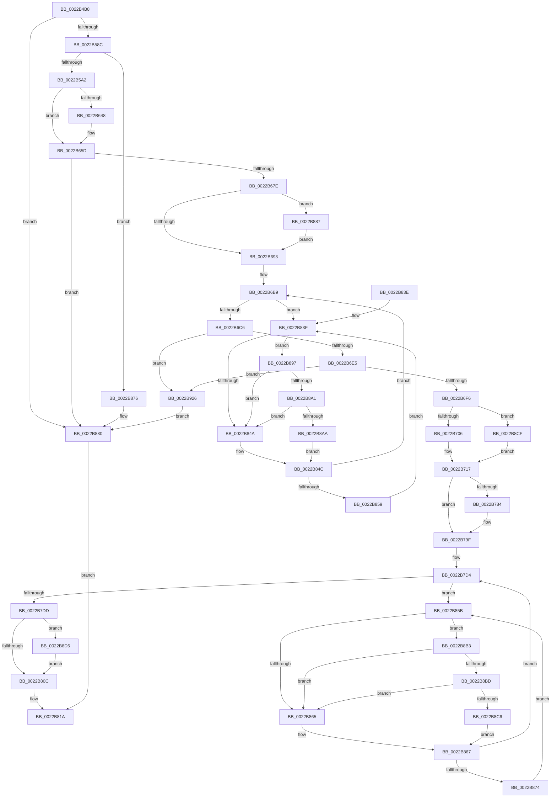

# MiCombineWithExisting

- RVA: `0x0022B4B8`–`0x0022B93A` (길이 `1,154` bytes)
- VA: `0x000000014022B4B8`
- 실행 섹션: `.text`
- PDB 이름 있음: `예`; PDB Function 태그: `아니요`
- unwind 정보 RVA: `0x0005FF18`
- 디코드: `277`개 명령, `1,154/1,154` bytes 표시
- 미해석 바이트: `0` (있으면 어셈블리에 `.byte`로 보존)

> 이 문서는 커널 이미지의 기계어와 PDB 기호를 분석해 생성했습니다. 4번과 5번은 함수 원형과 자료형을 바이너리 사용 방식에서 추정한 C 해석이며 원본 소스 복구 결과는 아닙니다.

## 1. Dependencies

- 직접 호출 지점: **25**; 고유 호출 대상: **21**
- 직접 호출자로 확인된 함수: **1**
- RIP 상대 이미지 참조: **5**

### Outgoing calls
- `0x0022B57B` → [MiLockProtoPoolPage](../2B/MiLockProtoPoolPage_function_002B8B80.md) (function, `0x002B8B80`)
- `0x0022B591` → [MiLockLeafPage](../36/MiLockLeafPage_function_003658C0.md) (function, `0x003658C0`)
- `0x0022B5D4` → [MiMapSinglePage](MiMapSinglePage_function_00229D00.md) (function, `0x00229D00`)
- `0x0022B5EF` → [MiMapSinglePage](MiMapSinglePage_function_00229D00.md) (function, `0x00229D00`)
- `0x0022B604` → [MiConfirmCombinePageContents](../2A/MiConfirmCombinePageContents_function_002AF394.md) (function, `0x002AF394`)
- `0x0022B64B` → [MiGetPfnPriority](../32/MiGetPfnPriority_function_003226F0.md) (function, `0x003226F0`)
- `0x0022B658` → [MiUpdatePfnPriority](../2B/MiUpdatePfnPriority_function_002B8570.md) (function, `0x002B8570`)
- `0x0022B671` → [MiUnlockProtoPoolPage](../24/MiUnlockProtoPoolPage_function_00246090.md) (function, `0x00246090`)
- `0x0022B686` → [MiVmAccessLoggingEnabled](../36/MiVmAccessLoggingEnabled_function_003629D4.md) (function, `0x003629D4`)
- `0x0022B696` → [MiMakePrototypePteDirect](../29/MiMakePrototypePteDirect_function_00294DE0.md) (function, `0x00294DE0`)
- `0x0022B6AB` → [MiGetWsleContents](../31/MiGetWsleContents_function_00316540.md) (function, `0x00316540`)
- `0x0022B712` → [MiIdentifyPfn](../31/MiIdentifyPfn_function_0031CAC0.md) (function, `0x0031CAC0`)
- `0x0022B723` → [MI_WRITE_INVALID_PTE_TB_FLUSH_NEEDED](../24/MI_WRITE_INVALID_PTE_TB_FLUSH_NEEDED_function_002400C0.md) (function, `0x002400C0`)
- `0x0022B796` → [MiInsertTbFlushEntry](../29/MiInsertTbFlushEntry_function_00293670.md) (function, `0x00293670`)
- `0x0022B7B5` → [MiRemoveWsle](MiRemoveWsle_function_0022D0C4.md) (function, `0x0022D0C4`)
- `0x0022B7E2` → [MiDecrementShareCountEx](../33/MiDecrementShareCountEx_function_00333F70.md) (function, `0x00333F70`)
- `0x0022B7FF` → [MiResolveProtoCombine](MiResolveProtoCombine_function_0022CD00.md) (function, `0x0022CD00`)
- `0x0022B825` → [_security_check_cookie](../6A/_security_check_cookie_function_006AC640.md) (function, `0x006AC640`)
- `0x0022B87B` → [MiUnlockProtoPoolPage](../24/MiUnlockProtoPoolPage_function_00246090.md) (function, `0x00246090`)
- `0x0022B88D` → [MI_WSLE_LOG_ACCESS](../29/MI_WSLE_LOG_ACCESS_function_00294400.md) (function, `0x00294400`)
- `0x0022B8A1` → [KiCheckVpBackingLongSpinWaitHypercall](../30/KiCheckVpBackingLongSpinWaitHypercall_function_0030F490.md) (function, `0x0030F490`)
- `0x0022B8AC` → [HvlNotifyLongSpinWait](../30/HvlNotifyLongSpinWait_function_0030F460.md) (function, `0x0030F460`)
- `0x0022B8BD` → [KiCheckVpBackingLongSpinWaitHypercall](../30/KiCheckVpBackingLongSpinWaitHypercall_function_0030F490.md) (function, `0x0030F490`)
- `0x0022B8C8` → [HvlNotifyLongSpinWait](../30/HvlNotifyLongSpinWait_function_0030F460.md) (function, `0x0030F460`)
- `0x0022B91C` → [EtwTraceKernelEvent](../23/EtwTraceKernelEvent_function_00235350.md) (function, `0x00235350`)

### Direct callers
- [MiConvertPrivateToProto](MiConvertPrivateToProto_function_0022B0E4.md) at `0x0022B130`

### Static image references
- `0x0022B4CC` → RVA `0x00E0A740` (`.data`; read)
- `0x0022B630` → RVA `0x00010880` (`.rdata`; read)
- `0x0022B6F6` → RVA `0x00FC6B04` (`ALMOSTRO`; read)
- `0x0022B842` → RVA `0x00FC52AC` (`ALMOSTRO`; reference)
- `0x0022B897` → RVA `0x00FC6AB8` (`ALMOSTRO`; read)

## 2. Other-region calls and transfers

- 다른 실행 섹션으로 향하는 call: **0**
- 별도 외부 분기/꼬리 이동을 확인하지 못했습니다.

## 3. Assembly (complete function range)

```asm
0022B4B8  40 53                           push rbx
0022B4BA  55                              push rbp
0022B4BB  56                              push rsi
0022B4BC  57                              push rdi
0022B4BD  41 54                           push r12
0022B4BF  41 55                           push r13
0022B4C1  41 56                           push r14
0022B4C3  41 57                           push r15
0022B4C5  48 81 EC B8 00 00 00            sub rsp, 0xb8
0022B4CC  48 8B 05 6D F2 BD 00            mov rax, qword ptr [rip + 0xbdf26d]
0022B4D3  48 33 C4                        xor rax, rsp
0022B4D6  48 89 84 24 A0 00 00 00         mov qword ptr [rsp + 0xa0], rax
0022B4DE  48 8B 41 70                     mov rax, qword ptr [rcx + 0x70]
0022B4E2  0F 57 C0                        xorps xmm0, xmm0
0022B4E5  48 89 44 24 30                  mov qword ptr [rsp + 0x30], rax
0022B4EA  48 8B F9                        mov rdi, rcx
0022B4ED  48 8B 42 10                     mov rax, qword ptr [rdx + 0x10]
0022B4F1  48 25 00 F0 FF FF               and rax, 0xfffffffffffff000
0022B4F7  4C 89 4C 24 60                  mov qword ptr [rsp + 0x60], r9
0022B4FC  4C 8B F8                        mov r15, rax
0022B4FF  48 89 44 24 48                  mov qword ptr [rsp + 0x48], rax
0022B504  48 B8 F8 FF FF FF 7F 00 00 00   movabs rax, 0x7ffffffff8
0022B50E  49 C1 EF 09                     shr r15, 9
0022B512  4C 23 F8                        and r15, rax
0022B515  48 89 54 24 58                  mov qword ptr [rsp + 0x58], rdx
0022B51A  48 B8 00 00 00 00 80 F6 FF FF   movabs rax, 0xfffff68000000000
0022B524  48 89 4C 24 38                  mov qword ptr [rsp + 0x38], rcx
0022B529  0F 11 44 24 68                  movups xmmword ptr [rsp + 0x68], xmm0
0022B52E  0F 11 44 24 78                  movups xmmword ptr [rsp + 0x78], xmm0
0022B533  48 8B C0                        mov rax, rax
0022B536  4C 03 F8                        add r15, rax
0022B539  48 BB 00 00 00 00 00 DE FF FF   movabs rbx, 0xffffde0000000000
0022B543  48 B8 FF FF FF FF FF 00 00 00   movabs rax, 0xffffffffff
0022B54D  49 8B 37                        mov rsi, qword ptr [r15]
0022B550  48 C1 EE 0C                     shr rsi, 0xc
0022B554  48 23 F0                        and rsi, rax
0022B557  48 89 74 24 50                  mov qword ptr [rsp + 0x50], rsi
0022B55C  48 8D 2C 76                     lea rbp, [rsi + rsi*2]
0022B560  48 C1 E5 04                     shl rbp, 4
0022B564  48 8B C3                        mov rax, rbx
0022B567  48 03 E8                        add rbp, rax
0022B56A  4D 8D 68 20                     lea r13, [r8 + 0x20]
0022B56E  48 8B 01                        mov rax, qword ptr [rcx]
0022B571  33 D2                           xor edx, edx
0022B573  49 8B CD                        mov rcx, r13
0022B576  48 89 44 24 40                  mov qword ptr [rsp + 0x40], rax
0022B57B  E8 00 D6 08 00                  call 0x1402b8b80
0022B580  4C 8B E0                        mov r12, rax
0022B583  48 85 C0                        test rax, rax
0022B586  0F 84 F4 02 00 00               je 0x14022b880
0022B58C  33 D2                           xor edx, edx
0022B58E  49 8B CD                        mov rcx, r13
0022B591  E8 2A A3 13 00                  call 0x1403658c0
0022B596  4C 8B F0                        mov r14, rax
0022B599  48 85 C0                        test rax, rax
0022B59C  0F 84 D4 02 00 00               je 0x14022b876
0022B5A2  48 8B C3                        mov rax, rbx
0022B5A5  49 8B DE                        mov rbx, r14
0022B5A8  45 33 C9                        xor r9d, r9d
0022B5AB  48 2B D8                        sub rbx, rax
0022B5AE  41 B8 10 00 00 C0               mov r8d, 0xc0000010
0022B5B4  48 B8 AB AA AA AA AA AA AA AA   movabs rax, 0xaaaaaaaaaaaaaaab
0022B5BE  48 C1 FB 04                     sar rbx, 4
0022B5C2  48 0F AF D8                     imul rbx, rax
0022B5C6  49 8B 46 28                     mov rax, qword ptr [r14 + 0x28]
0022B5CA  48 8B D6                        mov rdx, rsi
0022B5CD  48 8B 7F 60                     mov rdi, qword ptr [rdi + 0x60]
0022B5D1  48 8B CF                        mov rcx, rdi
0022B5D4  E8 27 E7 FF FF                  call 0x140229d00
0022B5D9  48 8D B7 00 10 00 00            lea rsi, [rdi + 0x1000]
0022B5E0  45 33 C9                        xor r9d, r9d
0022B5E3  48 8B CE                        mov rcx, rsi
0022B5E6  41 B8 10 00 00 C0               mov r8d, 0xc0000010
0022B5EC  48 8B D3                        mov rdx, rbx
0022B5EF  E8 0C E7 FF FF                  call 0x140229d00
0022B5F4  4C 8B 44 24 40                  mov r8, qword ptr [rsp + 0x40]
0022B5F9  48 8B D3                        mov rdx, rbx
0022B5FC  48 8B 4C 24 38                  mov rcx, qword ptr [rsp + 0x38]
0022B601  4D 8B 00                        mov r8, qword ptr [r8]
0022B604  E8 8B 3D 08 00                  call 0x1402af394
0022B609  48 BA F8 FF FF FF 7F 00 00 00   movabs rdx, 0x7ffffffff8
0022B613  48 C1 EF 09                     shr rdi, 9
0022B617  8B D8                           mov ebx, eax
0022B619  48 23 FA                        and rdi, rdx
0022B61C  48 B8 00 00 00 00 80 F6 FF FF   movabs rax, 0xfffff68000000000
0022B626  48 8B C8                        mov rcx, rax
0022B629  48 03 F9                        add rdi, rcx
0022B62C  48 C1 EE 09                     shr rsi, 9
0022B630  48 8B 0D 49 52 DE FF            mov rcx, qword ptr [rip - 0x21adb7]
0022B637  48 23 F2                        and rsi, rdx
0022B63A  48 89 0F                        mov qword ptr [rdi], rcx
0022B63D  48 8B C0                        mov rax, rax
0022B640  48 89 0C 06                     mov qword ptr [rsi + rax], rcx
0022B644  85 DB                           test ebx, ebx
0022B646  74 15                           je 0x14022b65d
0022B648  48 8B CD                        mov rcx, rbp
0022B64B  E8 A0 70 0F 00                  call 0x1403226f0
0022B650  45 33 C0                        xor r8d, r8d
0022B653  8B D0                           mov edx, eax
0022B655  49 8B CE                        mov rcx, r14
0022B658  E8 13 CF 08 00                  call 0x1402b8570
0022B65D  48 B8 FF FF FF FF FF FF FF 7F   movabs rax, 0x7fffffffffffffff
0022B667  F0 49 21 46 18                  lock and qword ptr [r14 + 0x18], rax
0022B66C  B2 11                           mov dl, 0x11
0022B66E  49 8B CC                        mov rcx, r12
0022B671  E8 1A AA 01 00                  call 0x140246090
0022B676  85 DB                           test ebx, ebx
0022B678  0F 84 02 02 00 00               je 0x14022b880
0022B67E  4C 8B 64 24 30                  mov r12, qword ptr [rsp + 0x30]
0022B683  49 8B CC                        mov rcx, r12
0022B686  E8 49 73 13 00                  call 0x1403629d4
0022B68B  85 C0                           test eax, eax
0022B68D  0F 85 F4 01 00 00               jne 0x14022b887
0022B693  49 8B CD                        mov rcx, r13
0022B696  E8 45 97 06 00                  call 0x140294de0
0022B69B  4C 8B 74 24 48                  mov r14, qword ptr [rsp + 0x48]
0022B6A0  48 8B D8                        mov rbx, rax
0022B6A3  49 8B D6                        mov rdx, r14
0022B6A6  48 0F BA EB 0B                  bts rbx, 0xb
0022B6AB  E8 90 AE 0E 00                  call 0x140316540
0022B6B0  33 F6                           xor esi, esi
0022B6B2  40 8A F8                        mov dil, al
0022B6B5  44 8D 66 01                     lea r12d, [rsi + 1]
0022B6B9  F0 48 0F BA 6D 18 3F            lock bts qword ptr [rbp + 0x18], 0x3f
0022B6C0  0F 82 79 01 00 00               jb 0x14022b83f
0022B6C6  48 8B 45 18                     mov rax, qword ptr [rbp + 0x18]
0022B6CA  48 B9 FF FF FF FF FF FF FF 3F   movabs rcx, 0x3fffffffffffffff
0022B6D4  48 23 C1                        and rax, rcx
0022B6D7  49 3B C4                        cmp rax, r12
0022B6DA  4C 8B 64 24 30                  mov r12, qword ptr [rsp + 0x30]
0022B6DF  0F 85 41 02 00 00               jne 0x14022b926
0022B6E5  8B 45 20                        mov eax, dword ptr [rbp + 0x20]
0022B6E8  B9 01 00 00 00                  mov ecx, 1
0022B6ED  66 3B C1                        cmp ax, cx
0022B6F0  0F 85 30 02 00 00               jne 0x14022b926
0022B6F6  F7 05 04 B4 D9 00 01 00 00 08   test dword ptr [rip + 0xd9b404], 0x8000001
0022B700  0F 84 C9 01 00 00               je 0x14022b8cf
0022B706  8B F1                           mov esi, ecx
0022B708  48 8D 54 24 68                  lea rdx, [rsp + 0x68]
0022B70D  48 8B 4C 24 50                  mov rcx, qword ptr [rsp + 0x50]
0022B712  E8 A9 13 0F 00                  call 0x14031cac0
0022B717  41 B8 42 00 00 00               mov r8d, 0x42
0022B71D  48 8B D3                        mov rdx, rbx
0022B720  49 8B CF                        mov rcx, r15
0022B723  E8 98 49 01 00                  call 0x1402400c0
0022B728  48 8B 4D 18                     mov rcx, qword ptr [rbp + 0x18]
0022B72C  8B D0                           mov edx, eax
0022B72E  48 B8 00 00 00 00 00 00 00 40   movabs rax, 0x4000000000000000
0022B738  48 0B C8                        or rcx, rax
0022B73B  48 89 4D 18                     mov qword ptr [rbp + 0x18], rcx
0022B73F  8B 4D 20                        mov ecx, dword ptr [rbp + 0x20]
0022B742  89 4C 24 30                     mov dword ptr [rsp + 0x30], ecx
0022B746  C1 E9 10                        shr ecx, 0x10
0022B749  80 C9 07                        or cl, 7
0022B74C  88 4C 24 32                     mov byte ptr [rsp + 0x32], cl
0022B750  8B 44 24 30                     mov eax, dword ptr [rsp + 0x30]
0022B754  89 45 20                        mov dword ptr [rbp + 0x20], eax
0022B757  48 B8 FF FF FF FF FF 00 00 00   movabs rax, 0xffffffffff
0022B761  48 8B 5D 28                     mov rbx, qword ptr [rbp + 0x28]
0022B765  48 23 D8                        and rbx, rax
0022B768  48 B8 FF FF FF FF FF FF FF 7F   movabs rax, 0x7fffffffffffffff
0022B772  F0 48 21 45 18                  lock and qword ptr [rbp + 0x18], rax
0022B777  48 8B 44 24 58                  mov rax, qword ptr [rsp + 0x58]
0022B77C  48 89 68 10                     mov qword ptr [rax + 0x10], rbp
0022B780  85 D2                           test edx, edx
0022B782  74 1B                           je 0x14022b79f
0022B784  48 8B 6C 24 60                  mov rbp, qword ptr [rsp + 0x60]
0022B789  45 33 C9                        xor r9d, r9d
0022B78C  49 8B D6                        mov rdx, r14
0022B78F  48 8B CD                        mov rcx, rbp
0022B792  45 8D 41 01                     lea r8d, [r9 + 1]
0022B796  E8 D5 7E 06 00                  call 0x140293670
0022B79B  83 4D 14 01                     or dword ptr [rbp + 0x14], 1
0022B79F  BD 01 00 00 00                  mov ebp, 1
0022B7A4  44 8A C7                        mov r8b, dil
0022B7A7  49 8B D6                        mov rdx, r14
0022B7AA  89 6C 24 20                     mov dword ptr [rsp + 0x20], ebp
0022B7AE  49 8B CC                        mov rcx, r12
0022B7B1  44 8D 4D 09                     lea r9d, [rbp + 9]
0022B7B5  E8 0A 19 00 00                  call 0x14022d0c4
0022B7BA  48 8D 1C 5B                     lea rbx, [rbx + rbx*2]
0022B7BE  48 B8 00 00 00 00 00 DE FF FF   movabs rax, 0xffffde0000000000
0022B7C8  48 C1 E3 04                     shl rbx, 4
0022B7CC  48 8B C0                        mov rax, rax
0022B7CF  48 03 D8                        add rbx, rax
0022B7D2  33 FF                           xor edi, edi
0022B7D4  F0 48 0F BA 6B 18 3F            lock bts qword ptr [rbx + 0x18], 0x3f
0022B7DB  72 7E                           jb 0x14022b85b
0022B7DD  33 D2                           xor edx, edx
0022B7DF  48 8B CB                        mov rcx, rbx
0022B7E2  E8 89 87 10 00                  call 0x140333f70
0022B7E7  48 B8 FF FF FF FF FF FF FF 7F   movabs rax, 0x7fffffffffffffff
0022B7F1  F0 48 21 43 18                  lock and qword ptr [rbx + 0x18], rax
0022B7F6  4D 8B C5                        mov r8, r13
0022B7F9  49 8B D4                        mov rdx, r12
0022B7FC  49 8B CF                        mov rcx, r15
0022B7FF  E8 FC 14 00 00                  call 0x14022cd00
0022B804  85 F6                           test esi, esi
0022B806  0F 85 CA 00 00 00               jne 0x14022b8d6
0022B80C  48 8B 44 24 38                  mov rax, qword ptr [rsp + 0x38]
0022B811  48 8B 40 68                     mov rax, qword ptr [rax + 0x68]
0022B815  48 01 28                        add qword ptr [rax], rbp
0022B818  33 C0                           xor eax, eax
0022B81A  48 8B 8C 24 A0 00 00 00         mov rcx, qword ptr [rsp + 0xa0]
0022B822  48 33 CC                        xor rcx, rsp
0022B825  E8 16 0E 48 00                  call 0x1406ac640
0022B82A  48 81 C4 B8 00 00 00            add rsp, 0xb8
0022B831  41 5F                           pop r15
0022B833  41 5E                           pop r14
0022B835  41 5D                           pop r13
0022B837  41 5C                           pop r12
0022B839  5F                              pop rdi
0022B83A  5E                              pop rsi
0022B83B  5D                              pop rbp
0022B83C  5B                              pop rbx
0022B83D  C3                              ret
0022B83E  CC                              int3
0022B83F  41 03 F4                        add esi, r12d
0022B842  85 35 64 9A D9 00               test dword ptr [rip + 0xd99a64], esi
0022B848  74 4D                           je 0x14022b897
0022B84A  F3 90                           pause
0022B84C  48 8B 45 18                     mov rax, qword ptr [rbp + 0x18]
0022B850  48 85 C0                        test rax, rax
0022B853  0F 89 60 FE FF FF               jns 0x14022b6b9
0022B859  EB E4                           jmp 0x14022b83f
0022B85B  03 FD                           add edi, ebp
0022B85D  85 3D 49 9A D9 00               test dword ptr [rip + 0xd99a49], edi
0022B863  74 4E                           je 0x14022b8b3
0022B865  F3 90                           pause
0022B867  48 8B 43 18                     mov rax, qword ptr [rbx + 0x18]
0022B86B  48 85 C0                        test rax, rax
0022B86E  0F 89 60 FF FF FF               jns 0x14022b7d4
0022B874  EB E5                           jmp 0x14022b85b
0022B876  B2 11                           mov dl, 0x11
0022B878  49 8B CC                        mov rcx, r12
0022B87B  E8 10 A8 01 00                  call 0x140246090
0022B880  B8 18 00 00 C0                  mov eax, 0xc0000018
0022B885  EB 93                           jmp 0x14022b81a
0022B887  49 8B D7                        mov rdx, r15
0022B88A  49 8B CC                        mov rcx, r12
0022B88D  E8 6E 8B 06 00                  call 0x140294400
0022B892  E9 FC FD FF FF                  jmp 0x14022b693
0022B897  8B 05 1B B2 D9 00               mov eax, dword ptr [rip + 0xd9b21b]
0022B89D  A8 40                           test al, 0x40
0022B89F  74 A9                           je 0x14022b84a
0022B8A1  E8 EA 3B 0E 00                  call 0x14030f490
0022B8A6  84 C0                           test al, al
0022B8A8  74 A0                           je 0x14022b84a
0022B8AA  8B CE                           mov ecx, esi
0022B8AC  E8 AF 3B 0E 00                  call 0x14030f460
0022B8B1  EB 99                           jmp 0x14022b84c
0022B8B3  8B 05 FF B1 D9 00               mov eax, dword ptr [rip + 0xd9b1ff]
0022B8B9  A8 40                           test al, 0x40
0022B8BB  74 A8                           je 0x14022b865
0022B8BD  E8 CE 3B 0E 00                  call 0x14030f490
0022B8C2  84 C0                           test al, al
0022B8C4  74 9F                           je 0x14022b865
0022B8C6  8B CF                           mov ecx, edi
0022B8C8  E8 93 3B 0E 00                  call 0x14030f460
0022B8CD  EB 98                           jmp 0x14022b867
0022B8CF  33 F6                           xor esi, esi
0022B8D1  E9 41 FE FF FF                  jmp 0x14022b717
0022B8D6  83 A4 24 9C 00 00 00 00         and dword ptr [rsp + 0x9c], 0
0022B8DE  48 8D 44 24 68                  lea rax, [rsp + 0x68]
0022B8E3  41 B9 7A 02 00 00               mov r9d, 0x27a
0022B8E9  48 89 84 24 90 00 00 00         mov qword ptr [rsp + 0x90], rax
0022B8F1  41 B8 01 00 00 28               mov r8d, 0x28000001
0022B8F7  4C 89 AC 24 80 00 00 00         mov qword ptr [rsp + 0x80], r13
0022B8FF  8B D5                           mov edx, ebp
0022B901  C7 84 24 98 00 00 00 20 00 00 00  mov dword ptr [rsp + 0x98], 0x20
0022B90C  48 8D 8C 24 90 00 00 00         lea rcx, [rsp + 0x90]
0022B914  C7 44 24 20 04 1B 50 11         mov dword ptr [rsp + 0x20], 0x11501b04
0022B91C  E8 2F 9A 00 00                  call 0x140235350
0022B921  E9 E6 FE FF FF                  jmp 0x14022b80c
0022B926  48 B8 FF FF FF FF FF FF FF 7F   movabs rax, 0x7fffffffffffffff
0022B930  F0 48 21 45 18                  lock and qword ptr [rbp + 0x18], rax
0022B935  E9 46 FF FF FF                  jmp 0x14022b880
```

## 4. C-style interpretation (structured pseudocode)

```c
__int64 __fastcall MiCombineWithExisting(__int64 a1, __int64 a2, __int64 a3, __int64 a4)
{
    __int64 result;
    __int64 v_r15;
    __int64 v_rbp;
    __int64 v_rbx;
    __int64 v_rdi;
    __int64 v_rsi;
    __int64 v_rsp;
    unsigned __int64 v_stack_m58;
    unsigned __int64 v_stack_m80;
    unsigned __int64 v_stack_m90;
    unsigned __int64 v_stack_m98;
    unsigned __int64 v_stack_mA0;
    unsigned __int64 v_stack_mA8;
    unsigned __int64 v_stack_mB0;
    unsigned __int64 v_stack_mB8;
    unsigned __int64 v_stack_mC0;
    unsigned __int8 v_stack_mC6;
    unsigned __int64 v_stack_mC8;
    unsigned int v_stack_mD8;
    unsigned int v_stack_p20;
    unsigned __int64 v_stack_p68;
    unsigned __int64 v_stack_p80;
    unsigned __int64 v_stack_p90;
    unsigned int v_stack_p98;
    unsigned int v_stack_p9C;

    v_rsp = (v_rsp) - (184);
    result = (*(unsigned __int64 *)(v_rip + 12448365)) ^ (v_rsp);
    v_stack_m58 = result;
    v_stack_mC8 = *(unsigned __int64 *)(a1 + 112);
    result = (*(unsigned __int64 *)(a2 + 16)) & (0xFFFFFFFFFFFFF000ULL);
    v_stack_m98 = a4;
    v_stack_mB0 = result;
    v_r15 = (result) >> (9);
    v_r15 = (v_r15) & (result);
    v_stack_mA0 = a2;
    v_stack_mC0 = a1;
    v_stack_m90 = v_xmm0;
    v_stack_m80 = v_xmm0;
    v_r15 = (v_r15) + (result);
    v_rsi = (*(unsigned __int64 *)(v_r15)) >> (12);
    v_rsi = (v_rsi) & (result);
    v_stack_mA8 = v_rsi;
    v_rbp = (v_rsi + v_rsi * 2) << (4);
    v_rbp = (v_rbp) + (v_rbx);
    a2 = 0;
    v_stack_mB8 = *(unsigned __int64 *)(a1);
    result = MiLockProtoPoolPage(a3 + 32, a2, a3, a4);
    if (result == 0) goto loc_0022B880;
    a2 = 0;
    result = MiLockLeafPage(a3 + 32, a2, a3, a4);
    if (result == 0) goto loc_0022B876;
    a4 = 0;
    v_rbx = (result) - (v_rbx);
    v_rbx = (v_rbx) >> (4);
    v_rbx = (v_rbx) * (v_rbx);
    result = MiMapSinglePage(*(unsigned __int64 *)(a1 + 96), v_rsi, (unsigned int)(0xC0000010ULL), a4);
    a4 = 0;
    result = MiMapSinglePage(*(unsigned __int64 *)(a1 + 96) + 4096, v_rbx, (unsigned int)(0xC0000010ULL), a4);
    result = MiConfirmCombinePageContents(v_stack_mC0, v_rbx, *(unsigned __int64 *)(v_stack_mB8), a4);
    v_rdi = (*(unsigned __int64 *)(a1 + 96)) >> (9);
    v_rdi = (v_rdi) & (v_rbx);
    v_rdi = (v_rdi) + (result);
    v_rsi = (*(unsigned __int64 *)(a1 + 96) + 4096) >> (9);
    v_rsi = (v_rsi) & (v_rbx);
    *(unsigned __int64 *)(v_rdi) = *(unsigned __int64 *)(v_rip - 2207159);
    *(unsigned __int64 *)(v_rsi + result * 1) = *(unsigned __int64 *)(v_rip - 2207159);
    if ((unsigned int)((unsigned int)((unsigned int)(result))) != 0) {
        a1 = v_rbp;
        result = MiGetPfnPriority(a1, v_rbx, *(unsigned __int64 *)(v_stack_mB8), a4);
        a3 = 0;
        a2 = (unsigned int)(result);
        a1 = result;
        result = MiUpdatePfnPriority(a1, a2, a3, a4);
    }
    result = MiUnlockProtoPoolPage(result, 17, a3, a4);
    if ((unsigned int)((unsigned int)((unsigned int)(result))) == 0) goto loc_0022B880;
    result = MiVmAccessLoggingEnabled(v_stack_mC8, 17, a3, a4);
    if ((unsigned int)(result) != 0) goto loc_0022B887;
loc_0022B693:
    result = MiMakePrototypePteDirect(a3 + 32, 17, a3, a4);
    result = MiGetWsleContents(a3 + 32, v_stack_mB0, a3, a4);
    v_rsi = 0;
loc_0022B6B9:
    if (condition_is_below) goto loc_0022B83F;
    result = (*(unsigned __int64 *)(v_rbp + 24)) & (a3 + 32);
    if (result != (v_rsi + 1)) goto loc_0022B926;
    if (((unsigned __int16)((unsigned int)(*(unsigned int *)(v_rbp + 32)))) != 1) goto loc_0022B926;
    if (((*(unsigned int *)(v_rip + 14267396)) & (0x8000001ULL)) == 0) goto loc_0022B8CF;
    result = MiIdentifyPfn(v_stack_mA8, v_stack_m90, a3, a4);
loc_0022B717:
    result = MI_WRITE_INVALID_PTE_TB_FLUSH_NEEDED(v_r15, result, 66, a4);
    a1 = (*(unsigned __int64 *)(v_rbp + 24)) | (result);
    *(unsigned __int64 *)(v_rbp + 24) = a1;
    v_stack_mC8 = (unsigned int)((unsigned int)(*(unsigned int *)(v_rbp + 32)));
    a1 = (unsigned int)(((unsigned int)(*(unsigned int *)(v_rbp + 32))) >> (16));
    a1 = (unsigned __int8)((a1) | (7));
    v_stack_mC6 = (unsigned __int8)(a1);
    *(unsigned int *)(v_rbp + 32) = (unsigned int)((unsigned int)(v_stack_mC8));
    v_rbx = (*(unsigned __int64 *)(v_rbp + 40)) & ((unsigned int)(v_stack_mC8));
    *(unsigned __int64 *)(v_stack_mA0 + 16) = v_rbp;
    result = v_stack_mA0;
    if ((unsigned int)((unsigned int)((unsigned int)(result))) != 0) {
        v_rbp = v_stack_m98;
        a4 = 0;
        a2 = v_stack_mB0;
        a1 = v_rbp;
        a3 = a4 + 1;
        result = MiInsertTbFlushEntry(a1, a2, a3, a4);
    }
    v_stack_mD8 = 1;
    result = MiRemoveWsle(v_stack_mC8, v_stack_mB0, (unsigned __int8)((unsigned __int8)(result)), 1 + 9);
    v_rbx = (v_rbx + v_rbx * 2) << (4);
    v_rbx = (v_rbx) + (result);
    v_rdi = 0;
loc_0022B7D4:
    if (condition_is_below) goto loc_0022B85B;
    a2 = 0;
    result = MiDecrementShareCountEx(v_rbx, a2, (unsigned __int8)((unsigned __int8)(result)), 1 + 9);
    result = MiResolveProtoCombine(v_r15, v_stack_mC8, a3 + 32, 1 + 9);
    if (1 != 0) goto loc_0022B8D6;
loc_0022B80C:
    result = 0;
loc_0022B81A:
    a1 = (v_stack_m58) ^ (v_rsp);
    result = _security_check_cookie(a1, v_stack_mC8, a3 + 32, 1 + 9);
    v_rsp = (v_rsp) + (184);
    return result;
loc_0022B83F:
    v_rsi = (unsigned int)((1) + ((unsigned int)(v_stack_mC8)));
    if (((*(unsigned int *)(v_rip + 14260836)) & ((unsigned int)(v_rsi))) == 0) goto loc_0022B897;
loc_0022B84A:
loc_0022B84C:
    if (!sign_flag) goto loc_0022B6B9;
    goto loc_0022B83F;
loc_0022B85B:
    v_rdi = (unsigned int)((v_rdi) + (1));
    if (((*(unsigned int *)(v_rip + 14260809)) & ((unsigned int)(v_rdi))) == 0) goto loc_0022B8B3;
loc_0022B865:
loc_0022B867:
    if (!sign_flag) goto loc_0022B7D4;
    goto loc_0022B85B;
loc_0022B876:
    result = MiUnlockProtoPoolPage(v_stack_mC8, 17, a3 + 32, 1 + 9);
loc_0022B880:
    goto loc_0022B81A;
loc_0022B887:
    result = MI_WSLE_LOG_ACCESS(v_stack_mC8, v_r15, a3 + 32, 1 + 9);
    goto loc_0022B693;
loc_0022B897:
    if ((((unsigned __int8)((unsigned int)(*(unsigned int *)(v_rip + 14266907)))) & (64)) == 0) goto loc_0022B84A;
    result = KiCheckVpBackingLongSpinWaitHypercall(v_stack_mC8, v_r15, a3 + 32, 1 + 9);
    if ((unsigned __int8)(result) == 0) goto loc_0022B84A;
    result = HvlNotifyLongSpinWait((unsigned int)((unsigned int)(v_rsi)), v_r15, a3 + 32, 1 + 9);
    goto loc_0022B84C;
loc_0022B8B3:
    if ((((unsigned __int8)((unsigned int)(*(unsigned int *)(v_rip + 14266879)))) & (64)) == 0) goto loc_0022B865;
    result = KiCheckVpBackingLongSpinWaitHypercall((unsigned int)((unsigned int)(v_rsi)), v_r15, a3 + 32, 1 + 9);
    if ((unsigned __int8)(result) == 0) goto loc_0022B865;
    result = HvlNotifyLongSpinWait((unsigned int)((unsigned int)(v_rdi)), v_r15, a3 + 32, 1 + 9);
    goto loc_0022B867;
loc_0022B8CF:
    v_rsi = 0;
    goto loc_0022B717;
loc_0022B8D6:
    v_stack_p90 = v_stack_p68;
    v_stack_p80 = a3 + 32;
    v_stack_p98 = 32;
    v_stack_p20 = 0x11501B04ULL;
    result = EtwTraceKernelEvent(v_stack_p90, 1, (unsigned int)(0x28000001ULL), 634);
    goto loc_0022B80C;
loc_0022B926:
    goto loc_0022B880;
}
```

## 5. (Beta) C Style

```c
int64_t MiCombineWithExisting(void *Arg1, void *Arg2, void *Arg3, int64_t Arg4)
{
    uint8_t *arg1 = (uint8_t *)Arg1;
    uint8_t *arg2 = (uint8_t *)Arg2;
    uint8_t *arg3 = (uint8_t *)Arg3;

    int64_t result;
    int64_t local_r15;
    int64_t local_rbp;
    int64_t local_rbx;
    int64_t local_rdi;
    int64_t local_rsi;
    int64_t local_rsp;
    uint64_t v_stack_m58;
    uint64_t v_stack_m80;
    uint64_t v_stack_m90;
    uint64_t v_stack_m98;
    uint64_t v_stack_mA0;
    uint64_t v_stack_mA8;
    uint64_t v_stack_mB0;
    uint64_t v_stack_mB8;
    uint64_t v_stack_mC0;
    uint8_t v_stack_mC6;
    uint64_t v_stack_mC8;
    uint32_t v_stack_mD8;
    uint32_t v_stack_p20;
    uint64_t v_stack_p68;
    uint64_t v_stack_p80;
    uint64_t v_stack_p90;
    uint32_t v_stack_p98;
    uint32_t v_stack_p9C;

    local_rsp = (local_rsp) - (184);
    result = (*(uint64_t *)(v_rip + 0xBDF26D)) ^ (local_rsp);
    v_stack_m58 = result;
    v_stack_mC8 = *(uint64_t *)(arg1 + 0x70);
    result = (*(uint64_t *)(arg2 + 0x10)) & (0xFFFFFFFFFFFFF000ULL);
    v_stack_m98 = Arg4;
    v_stack_mB0 = result;
    local_r15 = (result) >> (9);
    local_r15 = (local_r15) & (result);
    v_stack_mA0 = Arg2;
    v_stack_mC0 = Arg1;
    v_stack_m90 = v_xmm0;
    v_stack_m80 = v_xmm0;
    local_r15 = (local_r15) + (result);
    local_rsi = (*(uint64_t *)(local_r15)) >> (12);
    local_rsi = (local_rsi) & (result);
    v_stack_mA8 = local_rsi;
    local_rbp = (local_rsi + local_rsi * 2) << (4);
    local_rbp = (local_rbp) + (local_rbx);
    Arg2 = 0;
    v_stack_mB8 = *(uint64_t *)(arg1);
    result = MiLockProtoPoolPage(Arg3 + 32, Arg2, Arg3, Arg4);
    if (result == 0) goto loc_0022B880;
    Arg2 = 0;
    result = MiLockLeafPage(Arg3 + 32, Arg2, Arg3, Arg4);
    if (result == 0) goto loc_0022B876;
    Arg4 = 0;
    local_rbx = (result) - (local_rbx);
    local_rbx = (local_rbx) >> (4);
    local_rbx = (local_rbx) * (local_rbx);
    result = MiMapSinglePage(*(uint64_t *)(arg1 + 0x60), local_rsi, (uint32_t)(0xC0000010ULL), Arg4);
    Arg4 = 0;
    result = MiMapSinglePage(*(uint64_t *)(arg1 + 0x60) + 4096, local_rbx, (uint32_t)(0xC0000010ULL), Arg4);
    result = MiConfirmCombinePageContents(v_stack_mC0, local_rbx, *(uint64_t *)(v_stack_mB8), Arg4);
    local_rdi = (*(uint64_t *)(arg1 + 0x60)) >> (9);
    local_rdi = (local_rdi) & (local_rbx);
    local_rdi = (local_rdi) + (result);
    local_rsi = (*(uint64_t *)(arg1 + 0x60) + 4096) >> (9);
    local_rsi = (local_rsi) & (local_rbx);
    *(uint64_t *)(local_rdi) = *(uint64_t *)(v_rip - 0x21ADB7);
    *(uint64_t *)(local_rsi + result * 1) = *(uint64_t *)(v_rip - 0x21ADB7);
    if ((uint32_t)((uint32_t)((uint32_t)(result))) != 0) {
        Arg1 = local_rbp;
        result = MiGetPfnPriority(Arg1, local_rbx, *(uint64_t *)(v_stack_mB8), Arg4);
        Arg3 = 0;
        Arg2 = (uint32_t)(result);
        Arg1 = result;
        result = MiUpdatePfnPriority(Arg1, Arg2, Arg3, Arg4);
    }
    result = MiUnlockProtoPoolPage(result, 17, Arg3, Arg4);
    if ((uint32_t)((uint32_t)((uint32_t)(result))) == 0) goto loc_0022B880;
    result = MiVmAccessLoggingEnabled(v_stack_mC8, 17, Arg3, Arg4);
    if ((uint32_t)(result) != 0) goto loc_0022B887;
loc_0022B693:
    result = MiMakePrototypePteDirect(Arg3 + 32, 17, Arg3, Arg4);
    result = MiGetWsleContents(Arg3 + 32, v_stack_mB0, Arg3, Arg4);
    local_rsi = 0;
loc_0022B6B9:
    if (condition_is_below) goto loc_0022B83F;
    result = (*(uint64_t *)(local_rbp + 0x18)) & (Arg3 + 32);
    if (result != (local_rsi + 1)) goto loc_0022B926;
    if (((uint16_t)((uint32_t)(*(uint32_t *)(local_rbp + 0x20)))) != 1) goto loc_0022B926;
    if (((*(uint32_t *)(v_rip + 0xD9B404)) & (0x8000001ULL)) == 0) goto loc_0022B8CF;
    result = MiIdentifyPfn(v_stack_mA8, v_stack_m90, Arg3, Arg4);
loc_0022B717:
    result = MI_WRITE_INVALID_PTE_TB_FLUSH_NEEDED(local_r15, result, 66, Arg4);
    Arg1 = (*(uint64_t *)(local_rbp + 0x18)) | (result);
    *(void **)(local_rbp + 0x18) = Arg1;
    v_stack_mC8 = (uint32_t)((uint32_t)(*(uint32_t *)(local_rbp + 0x20)));
    Arg1 = (uint32_t)(((uint32_t)(*(uint32_t *)(local_rbp + 0x20))) >> (16));
    Arg1 = (uint8_t)((Arg1) | (7));
    v_stack_mC6 = (uint8_t)(Arg1);
    *(uint32_t *)(local_rbp + 0x20) = (uint32_t)((uint32_t)(v_stack_mC8));
    local_rbx = (*(uint64_t *)(local_rbp + 0x28)) & ((uint32_t)(v_stack_mC8));
    *(uint64_t *)(v_stack_mA0 + 0x10) = local_rbp;
    result = v_stack_mA0;
    if ((uint32_t)((uint32_t)((uint32_t)(result))) != 0) {
        local_rbp = v_stack_m98;
        Arg4 = 0;
        Arg2 = v_stack_mB0;
        Arg1 = local_rbp;
        Arg3 = Arg4 + 1;
        result = MiInsertTbFlushEntry(Arg1, Arg2, Arg3, Arg4);
    }
    v_stack_mD8 = 1;
    result = MiRemoveWsle(v_stack_mC8, v_stack_mB0, (uint8_t)((uint8_t)(result)), 1 + 9);
    local_rbx = (local_rbx + local_rbx * 2) << (4);
    local_rbx = (local_rbx) + (result);
    local_rdi = 0;
loc_0022B7D4:
    if (condition_is_below) goto loc_0022B85B;
    Arg2 = 0;
    result = MiDecrementShareCountEx(local_rbx, Arg2, (uint8_t)((uint8_t)(result)), 1 + 9);
    result = MiResolveProtoCombine(local_r15, v_stack_mC8, Arg3 + 32, 1 + 9);
    if (1 != 0) goto loc_0022B8D6;
loc_0022B80C:
    result = 0;
loc_0022B81A:
    Arg1 = (v_stack_m58) ^ (local_rsp);
    result = _security_check_cookie(Arg1, v_stack_mC8, Arg3 + 32, 1 + 9);
    local_rsp = (local_rsp) + (184);
    return result;
loc_0022B83F:
    local_rsi = (uint32_t)((1) + ((uint32_t)(v_stack_mC8)));
    if (((*(uint32_t *)(v_rip + 0xD99A64)) & ((uint32_t)(local_rsi))) == 0) goto loc_0022B897;
loc_0022B84A:
loc_0022B84C:
    if (!sign_flag) goto loc_0022B6B9;
    goto loc_0022B83F;
loc_0022B85B:
    local_rdi = (uint32_t)((local_rdi) + (1));
    if (((*(uint32_t *)(v_rip + 0xD99A49)) & ((uint32_t)(local_rdi))) == 0) goto loc_0022B8B3;
loc_0022B865:
loc_0022B867:
    if (!sign_flag) goto loc_0022B7D4;
    goto loc_0022B85B;
loc_0022B876:
    result = MiUnlockProtoPoolPage(v_stack_mC8, 17, Arg3 + 32, 1 + 9);
loc_0022B880:
    goto loc_0022B81A;
loc_0022B887:
    result = MI_WSLE_LOG_ACCESS(v_stack_mC8, local_r15, Arg3 + 32, 1 + 9);
    goto loc_0022B693;
loc_0022B897:
    if ((((uint8_t)((uint32_t)(*(uint32_t *)(v_rip + 0xD9B21B)))) & (64)) == 0) goto loc_0022B84A;
    result = KiCheckVpBackingLongSpinWaitHypercall(v_stack_mC8, local_r15, Arg3 + 32, 1 + 9);
    if ((uint8_t)(result) == 0) goto loc_0022B84A;
    result = HvlNotifyLongSpinWait((uint32_t)((uint32_t)(local_rsi)), local_r15, Arg3 + 32, 1 + 9);
    goto loc_0022B84C;
loc_0022B8B3:
    if ((((uint8_t)((uint32_t)(*(uint32_t *)(v_rip + 0xD9B1FF)))) & (64)) == 0) goto loc_0022B865;
    result = KiCheckVpBackingLongSpinWaitHypercall((uint32_t)((uint32_t)(local_rsi)), local_r15, Arg3 + 32, 1 + 9);
    if ((uint8_t)(result) == 0) goto loc_0022B865;
    result = HvlNotifyLongSpinWait((uint32_t)((uint32_t)(local_rdi)), local_r15, Arg3 + 32, 1 + 9);
    goto loc_0022B867;
loc_0022B8CF:
    local_rsi = 0;
    goto loc_0022B717;
loc_0022B8D6:
    v_stack_p90 = v_stack_p68;
    v_stack_p80 = Arg3 + 32;
    v_stack_p98 = 32;
    v_stack_p20 = 0x11501B04ULL;
    result = EtwTraceKernelEvent(v_stack_p90, 1, (uint32_t)(0x28000001ULL), 634);
    goto loc_0022B80C;
loc_0022B926:
    goto loc_0022B880;
}
```

### 관측된 메모리 오프셋

구조체 형식이 확인되지 않은 접근은 인자 기준의 오프셋으로만 기록했습니다.

| 기준 인자 | 오프셋 표현 | 폭 (bit) | 접근 |
|---|---:|---:|---|
| `Arg1` | `+ 0x0` | `64` | `R` |
| `Arg1` | `+ 0x60` | `64` | `R` |
| `Arg1` | `+ 0x70` | `64` | `R` |
| `Arg2` | `+ 0x10` | `64` | `R` |
| `Arg3` | `+ 0x20` | `64` | `R` |

## 6. Execution-region graph

[열기: 2D/3D 그래프와 함수 탐색 컨트롤 패널](../../../control-panel.html?section=text&rva=0x0022B4B8&view=graph)

- 2D 그래프는 위에서 아래로 흐르고, 3D 그래프는 빈 공간을 드래그해 회전합니다. Shift+드래그는 이동, 휠은 확대·축소, 함수 노드 선택은 대상 보고서 이동입니다.

### Static fallback


