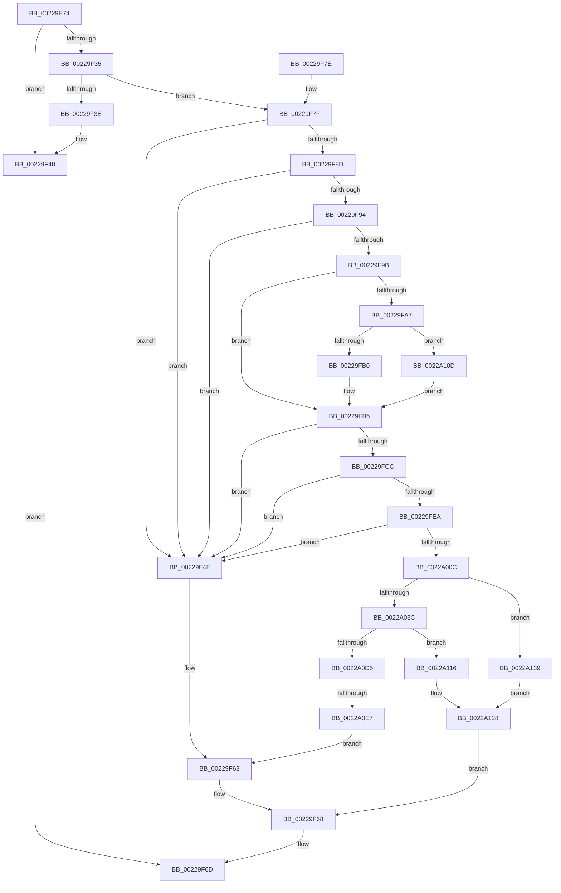

# MiCombineWithStandbyExisting

- RVA: `0x00229E74`–`0x0022A140` (길이 `716` bytes)
- VA: `0x0000000140229E74`
- 실행 섹션: `.text`
- PDB 이름 있음: `예`; PDB Function 태그: `예`
- unwind 정보 RVA: `0x0005FD38`
- 디코드: `172`개 명령, `716/716` bytes 표시
- 미해석 바이트: `0` (있으면 어셈블리에 `.byte`로 보존)

> 이 문서는 커널 이미지의 기계어와 PDB 기호를 분석해 생성했습니다. 4번과 5번은 함수 원형과 자료형을 바이너리 사용 방식에서 추정한 C 해석이며 원본 소스 복구 결과는 아닙니다.

## 1. Dependencies

- 직접 호출 지점: **12**; 고유 호출 대상: **9**
- 직접 호출자로 확인된 함수: **1**
- RIP 상대 이미지 참조: **3**

### Outgoing calls
- `0x00229F28` → [MiLockProtoPoolPage](../2B/MiLockProtoPoolPage_function_002B8B80.md) (function, `0x002B8B80`)
- `0x00229F43` → [MiUnlockProtoPoolPage](../24/MiUnlockProtoPoolPage_function_00246090.md) (function, `0x00246090`)
- `0x00229F54` → [MiUnlockProtoPoolPage](../24/MiUnlockProtoPoolPage_function_00246090.md) (function, `0x00246090`)
- `0x00229FDD` → [MiStandbyPageStillCombineCandidate](MiStandbyPageStillCombineCandidate_function_0022A148.md) (function, `0x0022A148`)
- `0x00229FFF` → [MiRecheckCombineVm](MiRecheckCombineVm_function_0022A1FC.md) (function, `0x0022A1FC`)
- `0x0022A01C` → [MiTryLockLeafPage](../37/MiTryLockLeafPage_function_003728DC.md) (function, `0x003728DC`)
- `0x0022A093` → [MiMapSinglePage](MiMapSinglePage_function_00229D00.md) (function, `0x00229D00`)
- `0x0022A0A1` → [MiConfirmCombinePageContents](../2A/MiConfirmCombinePageContents_function_002AF394.md) (function, `0x002AF394`)
- `0x0022A0DA` → [MiUnlinkPageFromListEx](../28/MiUnlinkPageFromListEx_function_00287590.md) (function, `0x00287590`)
- `0x0022A0F9` → [MiUnlockProtoPoolPage](../24/MiUnlockProtoPoolPage_function_00246090.md) (function, `0x00246090`)
- `0x0022A103` → [MiDiscardTransitionPteEx](../37/MiDiscardTransitionPteEx_function_00375954.md) (function, `0x00375954`)
- `0x0022A12D` → [MiUnlockProtoPoolPage](../24/MiUnlockProtoPoolPage_function_00246090.md) (function, `0x00246090`)

### Direct callers
- [MiConvertStandbyToProto](MiConvertStandbyToProto_function_0022A330.md) at `0x0022A3EE`

### Static image references
- `0x00229F0D` → RVA `0x00E30088` (`.data`; read)
- `0x00229F9B` → RVA `0x00E2DC80` (`.data`; read)
- `0x0022A0C7` → RVA `0x00010880` (`.rdata`; read)

## 2. Other-region calls and transfers

- 다른 실행 섹션으로 향하는 call: **0**
- call이 아닌 외부 분기/꼬리 이동: **1**
  - `0x0022A0E1` → [sub_006D7070](../6D/Unknown_function_006D7070.md) (`tail-transfer`)

## 3. Assembly (complete function range)

```asm
00229E74  48 8B C4                        mov rax, rsp
00229E77  53                              push rbx
00229E78  55                              push rbp
00229E79  56                              push rsi
00229E7A  57                              push rdi
00229E7B  41 54                           push r12
00229E7D  41 55                           push r13
00229E7F  41 56                           push r14
00229E81  41 57                           push r15
00229E83  48 83 EC 38                     sub rsp, 0x38
00229E87  48 83 60 10 00                  and qword ptr [rax + 0x10], 0
00229E8C  4C 8B E9                        mov r13, rcx
00229E8F  48 8B 01                        mov rax, qword ptr [rcx]
00229E92  48 8B 7A 10                     mov rdi, qword ptr [rdx + 0x10]
00229E96  48 8B 71 70                     mov rsi, qword ptr [rcx + 0x70]
00229E9A  48 89 84 24 98 00 00 00         mov qword ptr [rsp + 0x98], rax
00229EA2  8B 81 8C 00 00 00               mov eax, dword ptr [rcx + 0x8c]
00229EA8  89 84 24 80 00 00 00            mov dword ptr [rsp + 0x80], eax
00229EAF  48 B8 F8 FF FF FF 7F 00 00 00   movabs rax, 0x7ffffffff8
00229EB9  48 C1 EF 09                     shr rdi, 9
00229EBD  48 23 F8                        and rdi, rax
00229EC0  48 B8 00 00 00 00 80 F6 FF FF   movabs rax, 0xfffff68000000000
00229ECA  48 8B C0                        mov rax, rax
00229ECD  48 8B 69 40                     mov rbp, qword ptr [rcx + 0x40]
00229ED1  48 03 F8                        add rdi, rax
00229ED4  48 B8 00 00 00 00 00 DE FF FF   movabs rax, 0xffffde0000000000
00229EDE  48 8B C0                        mov rax, rax
00229EE1  0F B7 8E AE 00 00 00            movzx ecx, word ptr [rsi + 0xae]
00229EE8  4D 8D 70 20                     lea r14, [r8 + 0x20]
00229EEC  49 8B 58 30                     mov rbx, qword ptr [r8 + 0x30]
00229EF0  4C 8B E5                        mov r12, rbp
00229EF3  4C 2B E0                        sub r12, rax
00229EF6  4C 89 74 24 20                  mov qword ptr [rsp + 0x20], r14
00229EFB  48 B8 AB AA AA AA AA AA AA AA   movabs rax, 0xaaaaaaaaaaaaaaab
00229F05  49 C1 FC 04                     sar r12, 4
00229F09  4C 0F AF E0                     imul r12, rax
00229F0D  48 8B 05 74 61 C0 00            mov rax, qword ptr [rip + 0xc06174]
00229F14  33 D2                           xor edx, edx
00229F16  83 E3 1F                        and ebx, 0x1f
00229F19  48 8B 04 C8                     mov rax, qword ptr [rax + rcx*8]
00229F1D  49 8B CE                        mov rcx, r14
00229F20  48 89 84 24 90 00 00 00         mov qword ptr [rsp + 0x90], rax
00229F28  E8 53 EC 08 00                  call 0x1402b8b80
00229F2D  4C 8B F8                        mov r15, rax
00229F30  48 85 C0                        test rax, rax
00229F33  74 13                           je 0x140229f48
00229F35  F0 48 0F BA 6D 18 3F            lock bts qword ptr [rbp + 0x18], 0x3f
00229F3C  73 41                           jae 0x140229f7f
00229F3E  B2 11                           mov dl, 0x11
00229F40  48 8B C8                        mov rcx, rax
00229F43  E8 48 C1 01 00                  call 0x140246090
00229F48  B8 55 00 00 C0                  mov eax, 0xc0000055
00229F4D  EB 1E                           jmp 0x140229f6d
00229F4F  B2 12                           mov dl, 0x12
00229F51  49 8B CF                        mov rcx, r15
00229F54  E8 37 C1 01 00                  call 0x140246090
00229F59  49 BE FF FF FF FF FF FF FF 7F   movabs r14, 0x7fffffffffffffff
00229F63  B8 18 00 00 C0                  mov eax, 0xc0000018
00229F68  F0 4C 21 75 18                  lock and qword ptr [rbp + 0x18], r14
00229F6D  48 83 C4 38                     add rsp, 0x38
00229F71  41 5F                           pop r15
00229F73  41 5E                           pop r14
00229F75  41 5D                           pop r13
00229F77  41 5C                           pop r12
00229F79  5F                              pop rdi
00229F7A  5E                              pop rsi
00229F7B  5D                              pop rbp
00229F7C  5B                              pop rbx
00229F7D  C3                              ret
00229F7E  CC                              int3
00229F7F  48 8B 0F                        mov rcx, qword ptr [rdi]
00229F82  49 8B 45 48                     mov rax, qword ptr [r13 + 0x48]
00229F86  48 8B 00                        mov rax, qword ptr [rax]
00229F89  A8 01                           test al, 1
00229F8B  74 C2                           je 0x140229f4f
00229F8D  48 0F BA E1 0A                  bt rcx, 0xa
00229F92  72 BB                           jb 0x140229f4f
00229F94  48 0F BA E1 0B                  bt rcx, 0xb
00229F99  73 B4                           jae 0x140229f4f
00229F9B  48 8B 05 DE 3C C0 00            mov rax, qword ptr [rip + 0xc03cde]
00229FA2  48 85 C0                        test rax, rax
00229FA5  74 0F                           je 0x140229fb6
00229FA7  F6 C1 10                        test cl, 0x10
00229FAA  0F 85 5D 01 00 00               jne 0x14022a10d
00229FB0  48 F7 D0                        not rax
00229FB3  48 23 C8                        and rcx, rax
00229FB6  48 C1 E9 0C                     shr rcx, 0xc
00229FBA  48 B8 FF FF FF FF FF 00 00 00   movabs rax, 0xffffffffff
00229FC4  48 23 C8                        and rcx, rax
00229FC7  49 3B CC                        cmp rcx, r12
00229FCA  75 83                           jne 0x140229f4f
00229FCC  48 8B 94 24 90 00 00 00         mov rdx, qword ptr [rsp + 0x90]
00229FD4  44 8B CB                        mov r9d, ebx
00229FD7  4C 8B C7                        mov r8, rdi
00229FDA  48 8B CD                        mov rcx, rbp
00229FDD  E8 66 01 00 00                  call 0x14022a148
00229FE2  85 C0                           test eax, eax
00229FE4  0F 84 65 FF FF FF               je 0x140229f4f
00229FEA  8B 94 24 80 00 00 00            mov edx, dword ptr [rsp + 0x80]
00229FF1  4C 8B CE                        mov r9, rsi
00229FF4  48 8B 8C 24 98 00 00 00         mov rcx, qword ptr [rsp + 0x98]
00229FFC  4C 8B C5                        mov r8, rbp
00229FFF  E8 F8 01 00 00                  call 0x14022a1fc
0022A004  85 C0                           test eax, eax
0022A006  0F 84 43 FF FF FF               je 0x140229f4f
0022A00C  4C 8D 84 24 88 00 00 00         lea r8, [rsp + 0x88]
0022A014  BA 01 00 00 00                  mov edx, 1
0022A019  49 8B CE                        mov rcx, r14
0022A01C  E8 BB 88 14 00                  call 0x1403728dc
0022A021  48 8B 8C 24 88 00 00 00         mov rcx, qword ptr [rsp + 0x88]
0022A029  49 BE FF FF FF FF FF FF FF 7F   movabs r14, 0x7fffffffffffffff
0022A033  48 85 C9                        test rcx, rcx
0022A036  0F 84 FD 00 00 00               je 0x14022a139
0022A03C  48 B8 00 00 00 00 00 DE FF FF   movabs rax, 0xffffde0000000000
0022A046  48 8B C0                        mov rax, rax
0022A049  48 8B F9                        mov rdi, rcx
0022A04C  45 33 C9                        xor r9d, r9d
0022A04F  48 2B F8                        sub rdi, rax
0022A052  41 B8 10 00 00 C0               mov r8d, 0xc0000010
0022A058  48 B8 AB AA AA AA AA AA AA AA   movabs rax, 0xaaaaaaaaaaaaaaab
0022A062  48 C1 FF 04                     sar rdi, 4
0022A066  48 0F AF F8                     imul rdi, rax
0022A06A  48 8B 41 28                     mov rax, qword ptr [rcx + 0x28]
0022A06E  48 8B 0D 13 60 C0 00            mov rcx, qword ptr [rip + 0xc06013]
0022A075  48 8B D7                        mov rdx, rdi
0022A078  49 8B 75 60                     mov rsi, qword ptr [r13 + 0x60]
0022A07C  48 C1 E8 2B                     shr rax, 0x2b
0022A080  48 81 C6 00 10 00 00            add rsi, 0x1000
0022A087  25 FF 03 00 00                  and eax, 0x3ff
0022A08C  48 8B 1C C1                     mov rbx, qword ptr [rcx + rax*8]
0022A090  48 8B CE                        mov rcx, rsi
0022A093  E8 68 FC FF FF                  call 0x140229d00
0022A098  4C 8B C3                        mov r8, rbx
0022A09B  48 8B D7                        mov rdx, rdi
0022A09E  49 8B CD                        mov rcx, r13
0022A0A1  E8 EE 52 08 00                  call 0x1402af394
0022A0A6  48 B9 F8 FF FF FF 7F 00 00 00   movabs rcx, 0x7ffffffff8
0022A0B0  48 C1 EE 09                     shr rsi, 9
0022A0B4  48 23 F1                        and rsi, rcx
0022A0B7  48 B9 00 00 00 00 80 F6 FF FF   movabs rcx, 0xfffff68000000000
0022A0C1  48 8B C9                        mov rcx, rcx
0022A0C4  48 03 F1                        add rsi, rcx
0022A0C7  48 8B 0D B2 67 DE FF            mov rcx, qword ptr [rip - 0x21984e]
0022A0CE  48 89 0E                        mov qword ptr [rsi], rcx
0022A0D1  85 C0                           test eax, eax
0022A0D3  74 41                           je 0x14022a116
0022A0D5  33 D2                           xor edx, edx
0022A0D7  48 8B CD                        mov rcx, rbp
0022A0DA  E8 B1 D4 05 00                  call 0x140287590
0022A0DF  A8 03                           test al, 3
0022A0E1  0F 84 89 CF 4A 00               je 0x1406d7070
0022A0E7  48 8B 84 24 88 00 00 00         mov rax, qword ptr [rsp + 0x88]
0022A0EF  F0 4C 21 70 18                  lock and qword ptr [rax + 0x18], r14
0022A0F4  B2 12                           mov dl, 0x12
0022A0F6  49 8B CF                        mov rcx, r15
0022A0F9  E8 92 BF 01 00                  call 0x140246090
0022A0FE  33 D2                           xor edx, edx
0022A100  48 8B CD                        mov rcx, rbp
0022A103  E8 4C B8 14 00                  call 0x140375954
0022A108  E9 56 FE FF FF                  jmp 0x140229f63
0022A10D  48 83 E1 EF                     and rcx, 0xffffffffffffffef
0022A111  E9 A0 FE FF FF                  jmp 0x140229fb6
0022A116  48 8B 84 24 88 00 00 00         mov rax, qword ptr [rsp + 0x88]
0022A11E  F0 4C 21 70 18                  lock and qword ptr [rax + 0x18], r14
0022A123  BB 18 00 00 C0                  mov ebx, 0xc0000018
0022A128  B2 12                           mov dl, 0x12
0022A12A  49 8B CF                        mov rcx, r15
0022A12D  E8 5E BF 01 00                  call 0x140246090
0022A132  8B C3                           mov eax, ebx
0022A134  E9 2F FE FF FF                  jmp 0x140229f68
0022A139  BB 55 00 00 C0                  mov ebx, 0xc0000055
0022A13E  EB E8                           jmp 0x14022a128
```

## 4. C-style interpretation (structured pseudocode)

```c
__int64 __fastcall MiCombineWithStandbyExisting(__int64 a1, __int64 a2, __int64 a3)
{
    __int64 result;
    __int64 v_r12;
    __int64 v_rbx;
    __int64 v_rdi;
    __int64 v_rsi;
    __int64 v_rsp;
    unsigned __int64 v_stack_m58;
    unsigned __int64 v_stack_p18;
    unsigned __int64 v_stack_p20;
    unsigned int v_stack_p8;
    unsigned int v_stack_p80;
    unsigned __int64 v_stack_p88;
    unsigned __int64 v_stack_p90;
    unsigned __int64 v_stack_p98;

    v_rsp = (v_rsp) - (56);
    v_stack_p20 = *(unsigned __int64 *)(a1);
    v_stack_p8 = (unsigned int)((unsigned int)(*(unsigned int *)(a1 + 140)));
    v_rdi = (*(unsigned __int64 *)(a2 + 16)) >> (9);
    v_rdi = (v_rdi) & ((unsigned int)(*(unsigned int *)(a1 + 140)));
    v_rdi = (v_rdi) + ((unsigned int)(*(unsigned int *)(a1 + 140)));
    v_r12 = (*(unsigned __int64 *)(a1 + 64)) - ((unsigned int)(*(unsigned int *)(a1 + 140)));
    v_stack_m58 = a3 + 32;
    v_r12 = (v_r12) >> (4);
    v_r12 = (v_r12) * ((unsigned int)(*(unsigned int *)(a1 + 140)));
    a2 = 0;
    v_rbx = (unsigned int)((*(unsigned __int64 *)(a3 + 48)) & (31));
    v_stack_p18 = *(unsigned __int64 *)(*(unsigned __int64 *)(v_rip + 12607860) + *(unsigned __int16 *)(*(unsigned __int64 *)(a1 + 112) + 174) * 8);
    result = MiLockProtoPoolPage(a3 + 32, a2, a3, a4);
    if (result == 0) goto loc_00229F48;
    if (condition_is_above_or_equal) goto loc_00229F7F;
    result = MiUnlockProtoPoolPage(result, 17, a3, a4);
loc_00229F48:
    goto loc_00229F6D;
loc_00229F4F:
    result = MiUnlockProtoPoolPage(result, 18, a3, a4);
loc_00229F63:
loc_00229F68:
loc_00229F6D:
    v_rsp = (v_rsp) + (56);
    return (unsigned int)(0xC0000018ULL);
loc_00229F7F:
    if ((((unsigned __int8)(*(unsigned __int64 *)(*(unsigned __int64 *)(a1 + 72)))) & (1)) == 0) goto loc_00229F4F;
    if (condition_is_below) goto loc_00229F4F;
    if (condition_is_above_or_equal) goto loc_00229F4F;
    if (*(unsigned __int64 *)(v_rip + 12598494) == 0) goto loc_00229FB6;
    if ((((unsigned __int8)(*(unsigned __int64 *)(v_rdi))) & (16)) != 0) goto loc_0022A10D;
    result = ~(*(unsigned __int64 *)(v_rip + 12598494));
    a1 = (*(unsigned __int64 *)(v_rdi)) & (result);
loc_00229FB6:
    a1 = (a1) >> (12);
    a1 = (a1) & (result);
    if (a1 != v_r12) goto loc_00229F4F;
    result = MiStandbyPageStillCombineCandidate(*(unsigned __int64 *)(a1 + 64), v_stack_p90, v_rdi, (unsigned int)((unsigned int)(v_rbx)));
    if ((unsigned int)(result) == 0) goto loc_00229F4F;
    result = MiRecheckCombineVm(v_stack_p98, (unsigned int)(v_stack_p80), *(unsigned __int64 *)(a1 + 64), *(unsigned __int64 *)(a1 + 112));
    if ((unsigned int)(result) == 0) goto loc_00229F4F;
    result = MiTryLockLeafPage(a3 + 32, 1, v_stack_p88, *(unsigned __int64 *)(a1 + 112));
    if (v_stack_p88 == 0) goto loc_0022A139;
    a4 = 0;
    v_rdi = (v_stack_p88) - (result);
    v_rdi = (v_rdi) >> (4);
    v_rdi = (v_rdi) * (result);
    result = (*(unsigned __int64 *)(v_stack_p88 + 40)) >> (43);
    v_rsi = (*(unsigned __int64 *)(a1 + 96)) + (0x1000ULL);
    result = (unsigned int)((result) & (0x3FFULL));
    result = MiMapSinglePage(v_rsi, v_rdi, (unsigned int)(0xC0000010ULL), a4);
    result = MiConfirmCombinePageContents(a1, v_rdi, *(unsigned __int64 *)(*(unsigned __int64 *)(v_rip + 12607507) + result * 8), a4);
    v_rsi = (v_rsi) >> (9);
    v_rsi = (v_rsi) & (a1);
    v_rsi = (v_rsi) + (a1);
    *(unsigned __int64 *)(v_rsi) = *(unsigned __int64 *)(v_rip - 2201678);
    if ((unsigned int)(result) == 0) goto loc_0022A116;
    a2 = 0;
    result = MiUnlinkPageFromListEx(*(unsigned __int64 *)(a1 + 64), a2, *(unsigned __int64 *)(*(unsigned __int64 *)(v_rip + 12607507) + result * 8), a4);
    result = MiUnlockProtoPoolPage(result, 18, *(unsigned __int64 *)(*(unsigned __int64 *)(v_rip + 12607507) + result * 8), a4);
    a2 = 0;
    result = MiDiscardTransitionPteEx(*(unsigned __int64 *)(a1 + 64), a2, *(unsigned __int64 *)(*(unsigned __int64 *)(v_rip + 12607507) + result * 8), a4);
    goto loc_00229F63;
loc_0022A10D:
    a1 = (*(unsigned __int64 *)(a1 + 64)) & (-17);
    goto loc_00229FB6;
loc_0022A116:
loc_0022A128:
    result = MiUnlockProtoPoolPage(result, 18, *(unsigned __int64 *)(*(unsigned __int64 *)(v_rip + 12607507) + result * 8), a4);
    goto loc_00229F68;
loc_0022A139:
    goto loc_0022A128;
}
```

## 5. (Beta) C Style

```c
int64_t MiCombineWithStandbyExisting(void *Arg1, void *Arg2, void *Arg3)
{
    uint8_t *arg1 = (uint8_t *)Arg1;
    uint8_t *arg2 = (uint8_t *)Arg2;
    uint8_t *arg3 = (uint8_t *)Arg3;

    int64_t result;
    int64_t local_r12;
    int64_t local_rbx;
    int64_t local_rdi;
    int64_t local_rsi;
    int64_t local_rsp;
    uint64_t v_stack_m58;
    uint64_t v_stack_p18;
    uint64_t v_stack_p20;
    uint32_t v_stack_p8;
    uint32_t v_stack_p80;
    uint64_t v_stack_p88;
    uint64_t v_stack_p90;
    uint64_t v_stack_p98;

    local_rsp = (local_rsp) - (56);
    v_stack_p20 = *(uint64_t *)(arg1);
    v_stack_p8 = (uint32_t)((uint32_t)(*(uint32_t *)(arg1 + 0x8C)));
    local_rdi = (*(uint64_t *)(arg2 + 0x10)) >> (9);
    local_rdi = (local_rdi) & ((uint32_t)(*(uint32_t *)(arg1 + 0x8C)));
    local_rdi = (local_rdi) + ((uint32_t)(*(uint32_t *)(arg1 + 0x8C)));
    local_r12 = (*(uint64_t *)(arg1 + 0x40)) - ((uint32_t)(*(uint32_t *)(arg1 + 0x8C)));
    v_stack_m58 = Arg3 + 32;
    local_r12 = (local_r12) >> (4);
    local_r12 = (local_r12) * ((uint32_t)(*(uint32_t *)(arg1 + 0x8C)));
    Arg2 = 0;
    local_rbx = (uint32_t)((*(uint64_t *)(arg3 + 0x30)) & (31));
    v_stack_p18 = *(uint64_t *)(*(uint64_t *)(v_rip + 0xC06174) + *(uint16_t *)(*(uint64_t *)(arg1 + 0x70) + 0xAE) * 8);
    result = MiLockProtoPoolPage(Arg3 + 32, Arg2, Arg3, a4);
    if (result == 0) goto loc_00229F48;
    if (condition_is_above_or_equal) goto loc_00229F7F;
    result = MiUnlockProtoPoolPage(result, 17, Arg3, a4);
loc_00229F48:
    goto loc_00229F6D;
loc_00229F4F:
    result = MiUnlockProtoPoolPage(result, 18, Arg3, a4);
loc_00229F63:
loc_00229F68:
loc_00229F6D:
    local_rsp = (local_rsp) + (56);
    return (uint32_t)(0xC0000018ULL);
loc_00229F7F:
    if ((((uint8_t)(*(uint64_t *)(*(uint64_t *)(arg1 + 0x48)))) & (1)) == 0) goto loc_00229F4F;
    if (condition_is_below) goto loc_00229F4F;
    if (condition_is_above_or_equal) goto loc_00229F4F;
    if (*(uint64_t *)(v_rip + 0xC03CDE) == 0) goto loc_00229FB6;
    if ((((uint8_t)(*(uint64_t *)(local_rdi))) & (16)) != 0) goto loc_0022A10D;
    result = ~(*(uint64_t *)(v_rip + 0xC03CDE));
    Arg1 = (*(uint64_t *)(local_rdi)) & (result);
loc_00229FB6:
    Arg1 = (Arg1) >> (12);
    Arg1 = (Arg1) & (result);
    if (Arg1 != local_r12) goto loc_00229F4F;
    result = MiStandbyPageStillCombineCandidate(*(uint64_t *)(arg1 + 0x40), v_stack_p90, local_rdi, (uint32_t)((uint32_t)(local_rbx)));
    if ((uint32_t)(result) == 0) goto loc_00229F4F;
    result = MiRecheckCombineVm(v_stack_p98, (uint32_t)(v_stack_p80), *(uint64_t *)(arg1 + 0x40), *(uint64_t *)(arg1 + 0x70));
    if ((uint32_t)(result) == 0) goto loc_00229F4F;
    result = MiTryLockLeafPage(Arg3 + 32, 1, v_stack_p88, *(uint64_t *)(arg1 + 0x70));
    if (v_stack_p88 == 0) goto loc_0022A139;
    a4 = 0;
    local_rdi = (v_stack_p88) - (result);
    local_rdi = (local_rdi) >> (4);
    local_rdi = (local_rdi) * (result);
    result = (*(uint64_t *)(v_stack_p88 + 0x28)) >> (43);
    local_rsi = (*(uint64_t *)(arg1 + 0x60)) + (0x1000ULL);
    result = (uint32_t)((result) & (0x3FFULL));
    result = MiMapSinglePage(local_rsi, local_rdi, (uint32_t)(0xC0000010ULL), a4);
    result = MiConfirmCombinePageContents(Arg1, local_rdi, *(uint64_t *)(*(uint64_t *)(v_rip + 0xC06013) + result * 8), a4);
    local_rsi = (local_rsi) >> (9);
    local_rsi = (local_rsi) & (Arg1);
    local_rsi = (local_rsi) + (Arg1);
    *(uint64_t *)(local_rsi) = *(uint64_t *)(v_rip - 0x21984E);
    if ((uint32_t)(result) == 0) goto loc_0022A116;
    Arg2 = 0;
    result = MiUnlinkPageFromListEx(*(uint64_t *)(arg1 + 0x40), Arg2, *(uint64_t *)(*(uint64_t *)(v_rip + 0xC06013) + result * 8), a4);
    result = MiUnlockProtoPoolPage(result, 18, *(uint64_t *)(*(uint64_t *)(v_rip + 0xC06013) + result * 8), a4);
    Arg2 = 0;
    result = MiDiscardTransitionPteEx(*(uint64_t *)(arg1 + 0x40), Arg2, *(uint64_t *)(*(uint64_t *)(v_rip + 0xC06013) + result * 8), a4);
    goto loc_00229F63;
loc_0022A10D:
    Arg1 = (*(uint64_t *)(arg1 + 0x40)) & (-17);
    goto loc_00229FB6;
loc_0022A116:
loc_0022A128:
    result = MiUnlockProtoPoolPage(result, 18, *(uint64_t *)(*(uint64_t *)(v_rip + 0xC06013) + result * 8), a4);
    goto loc_00229F68;
loc_0022A139:
    goto loc_0022A128;
}
```

### 관측된 메모리 오프셋

구조체 형식이 확인되지 않은 접근은 인자 기준의 오프셋으로만 기록했습니다.

| 기준 인자 | 오프셋 표현 | 폭 (bit) | 접근 |
|---|---:|---:|---|
| `Arg1` | `+ 0x0` | `64` | `R` |
| `Arg1` | `+ 0x40` | `64` | `R` |
| `Arg1` | `+ 0x48` | `64` | `R` |
| `Arg1` | `+ 0x60` | `64` | `R` |
| `Arg1` | `+ 0x70` | `64` | `R` |
| `Arg1` | `+ 0x8C` | `32` | `R` |
| `Arg2` | `+ 0x10` | `64` | `R` |
| `Arg3` | `+ 0x20` | `64` | `R` |
| `Arg3` | `+ 0x30` | `64` | `R` |

## 6. Execution-region graph

[열기: 2D/3D 그래프와 함수 탐색 컨트롤 패널](../../../control-panel.html?section=text&rva=0x00229E74&view=graph)

- 2D 그래프는 위에서 아래로 흐르고, 3D 그래프는 빈 공간을 드래그해 회전합니다. Shift+드래그는 이동, 휠은 확대·축소, 함수 노드 선택은 대상 보고서 이동입니다.

### Static fallback


