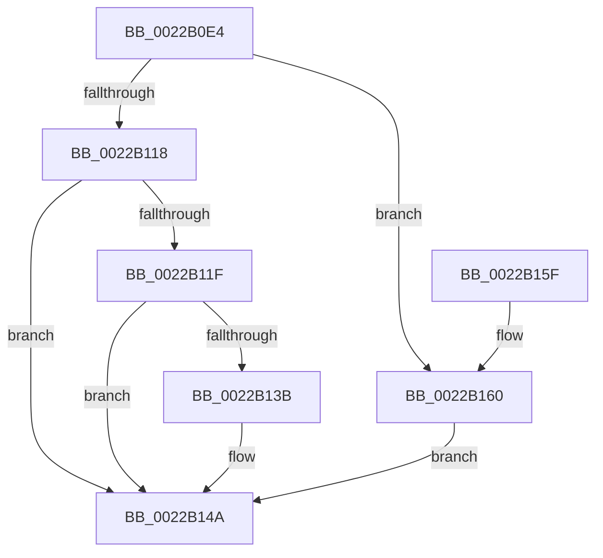

# MiConvertPrivateToProto

- RVA: `0x0022B0E4`–`0x0022B172` (길이 `142` bytes)
- VA: `0x000000014022B0E4`
- 실행 섹션: `.text`
- PDB 이름 있음: `예`; PDB Function 태그: `아니요`
- unwind 정보 RVA: `0x0005FE90`
- 디코드: `47`개 명령, `142/142` bytes 표시
- 미해석 바이트: `0` (있으면 어셈블리에 `.byte`로 보존)

> 이 문서는 커널 이미지의 기계어와 PDB 기호를 분석해 생성했습니다. 4번과 5번은 함수 원형과 자료형을 바이너리 사용 방식에서 추정한 C 해석이며 원본 소스 복구 결과는 아닙니다.

## 1. Dependencies

- 직접 호출 지점: **4**; 고유 호출 대상: **4**
- 직접 호출자로 확인된 함수: **1**
- RIP 상대 이미지 참조: **0**

### Outgoing calls
- `0x0022B10D` → [MiCreateCombineAnchor](MiCreateCombineAnchor_function_0022B178.md) (function, `0x0022B178`)
- `0x0022B130` → [MiCombineWithExisting](MiCombineWithExisting_function_0022B4B8.md) (function, `0x0022B4B8`)
- `0x0022B145` → [MiDecrementCombinedPteEx](MiDecrementCombinedPteEx_function_0022B940.md) (function, `0x0022B940`)
- `0x0022B169` → [MiCombineInitialInstance](MiCombineInitialInstance_function_0022BC0C.md) (function, `0x0022BC0C`)

### Direct callers
- [MiSharePages](../31/MiSharePages_function_00315110.md) at `0x00315B78`

### Static image references
- 디코드된 RIP-relative 메모리 참조가 없습니다.

## 2. Other-region calls and transfers

- 다른 실행 섹션으로 향하는 call: **0**
- 별도 외부 분기/꼬리 이동을 확인하지 못했습니다.

## 3. Assembly (complete function range)

```asm
0022B0E4  48 8B C4                        mov rax, rsp
0022B0E7  48 89 58 10                     mov qword ptr [rax + 0x10], rbx
0022B0EB  48 89 68 18                     mov qword ptr [rax + 0x18], rbp
0022B0EF  56                              push rsi
0022B0F0  57                              push rdi
0022B0F1  41 56                           push r14
0022B0F3  48 83 EC 20                     sub rsp, 0x20
0022B0F7  48 83 60 08 00                  and qword ptr [rax + 8], 0
0022B0FC  49 8B E8                        mov rbp, r8
0022B0FF  4C 8B 71 70                     mov r14, qword ptr [rcx + 0x70]
0022B103  4C 8D 40 08                     lea r8, [rax + 8]
0022B107  48 8B F2                        mov rsi, rdx
0022B10A  48 8B F9                        mov rdi, rcx
0022B10D  E8 66 00 00 00                  call 0x14022b178
0022B112  8B D8                           mov ebx, eax
0022B114  85 C0                           test eax, eax
0022B116  74 48                           je 0x14022b160
0022B118  3D 0A 02 00 C0                  cmp eax, 0xc000020a
0022B11D  75 2B                           jne 0x14022b14a
0022B11F  4C 8B CD                        mov r9, rbp
0022B122  48 8B D6                        mov rdx, rsi
0022B125  48 8B 6C 24 40                  mov rbp, qword ptr [rsp + 0x40]
0022B12A  48 8B CF                        mov rcx, rdi
0022B12D  4C 8B C5                        mov r8, rbp
0022B130  E8 83 03 00 00                  call 0x14022b4b8
0022B135  8B D8                           mov ebx, eax
0022B137  85 C0                           test eax, eax
0022B139  79 0F                           jns 0x14022b14a
0022B13B  48 8D 55 20                     lea rdx, [rbp + 0x20]
0022B13F  45 33 C0                        xor r8d, r8d
0022B142  49 8B CE                        mov rcx, r14
0022B145  E8 F6 07 00 00                  call 0x14022b940
0022B14A  48 8B 6C 24 50                  mov rbp, qword ptr [rsp + 0x50]
0022B14F  8B C3                           mov eax, ebx
0022B151  48 8B 5C 24 48                  mov rbx, qword ptr [rsp + 0x48]
0022B156  48 83 C4 20                     add rsp, 0x20
0022B15A  41 5E                           pop r14
0022B15C  5F                              pop rdi
0022B15D  5E                              pop rsi
0022B15E  C3                              ret
0022B15F  CC                              int3
0022B160  4C 8B C5                        mov r8, rbp
0022B163  48 8B D6                        mov rdx, rsi
0022B166  48 8B CF                        mov rcx, rdi
0022B169  E8 9E 0A 00 00                  call 0x14022bc0c
0022B16E  8B D8                           mov ebx, eax
0022B170  EB D8                           jmp 0x14022b14a
```

## 4. C-style interpretation (structured pseudocode)

```c
__int64 __fastcall MiConvertPrivateToProto(__int64 a1, __int64 a2, __int64 a3)
{
    __int64 result;
    __int64 v_rsp;
    unsigned __int64 v_stack_p10;
    unsigned __int64 v_stack_p18;
    unsigned __int64 v_stack_p8;

    *(unsigned __int64 *)(v_rsp + 16) = v_rbx;
    *(unsigned __int64 *)(v_rsp + 24) = v_rbp;
    v_rsp = (v_rsp) - (32);
    result = MiCreateCombineAnchor(a1, a2, v_rsp + 8, a4);
    if ((unsigned int)(result) == 0) goto loc_0022B160;
    if (((unsigned int)(result)) != 0xC000020AULL) goto loc_0022B14A;
    result = MiCombineWithExisting(a1, a2, v_stack_p8, a3);
    if (sign_flag) {
        a2 = v_stack_p8 + 32;
        a3 = 0;
        a1 = *(unsigned __int64 *)(a1 + 112);
        result = MiDecrementCombinedPteEx(a1, a2, a3, a3);
    }
    v_rsp = (v_rsp) + (32);
    return (unsigned int)((unsigned int)((unsigned int)((unsigned int)(result))));
loc_0022B160:
    result = MiCombineInitialInstance(a1, a2, v_stack_p18, a3);
    goto loc_0022B14A;
}
```

## 5. (Beta) C Style

```c
int64_t MiConvertPrivateToProto(void *Arg1, int64_t Arg2, int64_t Arg3)
{
    uint8_t *arg1 = (uint8_t *)Arg1;

    int64_t result;
    int64_t local_rsp;
    uint64_t v_stack_p10;
    uint64_t v_stack_p18;
    uint64_t v_stack_p8;

    *(uint64_t *)(local_rsp + 0x10) = local_rbx;
    *(uint64_t *)(local_rsp + 0x18) = local_rbp;
    local_rsp = (local_rsp) - (32);
    result = MiCreateCombineAnchor(Arg1, Arg2, local_rsp + 8, a4);
    if ((uint32_t)(result) == 0) goto loc_0022B160;
    if (((uint32_t)(result)) != 0xC000020AULL) goto loc_0022B14A;
    result = MiCombineWithExisting(Arg1, Arg2, v_stack_p8, Arg3);
    if (sign_flag) {
        Arg2 = v_stack_p8 + 32;
        Arg3 = 0;
        Arg1 = *(uint64_t *)(arg1 + 0x70);
        result = MiDecrementCombinedPteEx(Arg1, Arg2, Arg3, Arg3);
    }
    local_rsp = (local_rsp) + (32);
    return (uint32_t)((uint32_t)((uint32_t)((uint32_t)(result))));
loc_0022B160:
    result = MiCombineInitialInstance(Arg1, Arg2, v_stack_p18, Arg3);
    goto loc_0022B14A;
}
```

### 관측된 메모리 오프셋

구조체 형식이 확인되지 않은 접근은 인자 기준의 오프셋으로만 기록했습니다.

| 기준 인자 | 오프셋 표현 | 폭 (bit) | 접근 |
|---|---:|---:|---|
| `Arg1` | `+ 0x70` | `64` | `R` |

## 6. Execution-region graph

[열기: 2D/3D 그래프와 함수 탐색 컨트롤 패널](../../../control-panel.html?section=text&rva=0x0022B0E4&view=graph)

- 2D 그래프는 위에서 아래로 흐르고, 3D 그래프는 빈 공간을 드래그해 회전합니다. Shift+드래그는 이동, 휠은 확대·축소, 함수 노드 선택은 대상 보고서 이동입니다.

### Static fallback


