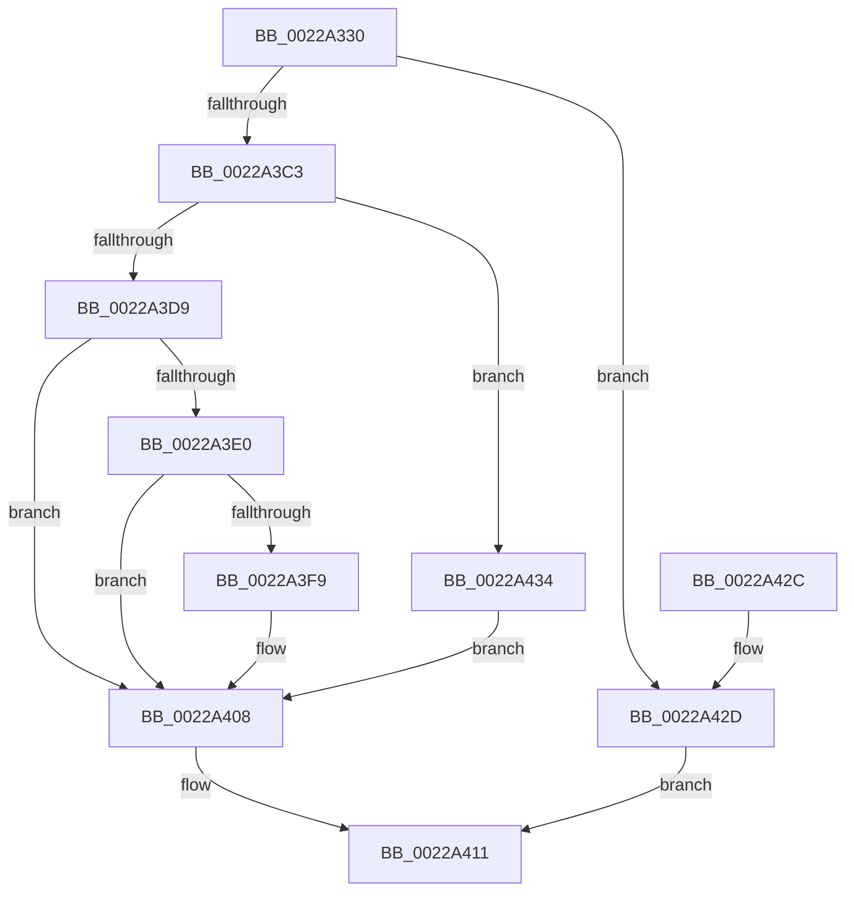

# MiConvertStandbyToProto

- RVA: `0x0022A330`–`0x0022A446` (길이 `278` bytes)
- VA: `0x000000014022A330`
- 실행 섹션: `.text`
- PDB 이름 있음: `예`; PDB Function 태그: `아니요`
- unwind 정보 RVA: `0x0005FDA8`
- 디코드: `74`개 명령, `278/278` bytes 표시
- 미해석 바이트: `0` (있으면 어셈블리에 `.byte`로 보존)

> 이 문서는 커널 이미지의 기계어와 PDB 기호를 분석해 생성했습니다. 4번과 5번은 함수 원형과 자료형을 바이너리 사용 방식에서 추정한 C 해석이며 원본 소스 복구 결과는 아닙니다.

## 1. Dependencies

- 직접 호출 지점: **6**; 고유 호출 대상: **6**
- 직접 호출자로 확인된 함수: **1**
- RIP 상대 이미지 참조: **0**

### Outgoing calls
- `0x0022A3BA` → [MiMapArbitraryPage](MiMapArbitraryPage_function_0022A44C.md) (function, `0x0022A44C`)
- `0x0022A3CE` → [MiCreateCombineAnchor](MiCreateCombineAnchor_function_0022B178.md) (function, `0x0022B178`)
- `0x0022A3EE` → [MiCombineWithStandbyExisting](MiCombineWithStandbyExisting_function_00229E74.md) (function, `0x00229E74`)
- `0x0022A403` → [MiDecrementCombinedPteEx](MiDecrementCombinedPteEx_function_0022B940.md) (function, `0x0022B940`)
- `0x0022A40C` → [MiReleaseArbitraryPage](MiReleaseArbitraryPage_function_0022A28C.md) (function, `0x0022A28C`)
- `0x0022A43D` → [MiCombineInitialInstance](MiCombineInitialInstance_function_0022BC0C.md) (function, `0x0022BC0C`)

### Direct callers
- [MiSharePages](../31/MiSharePages_function_00315110.md) at `0x00315D4E`

### Static image references
- 디코드된 RIP-relative 메모리 참조가 없습니다.

## 2. Other-region calls and transfers

- 다른 실행 섹션으로 향하는 call: **0**
- 별도 외부 분기/꼬리 이동을 확인하지 못했습니다.

## 3. Assembly (complete function range)

```asm
0022A330  48 8B C4                        mov rax, rsp
0022A333  48 89 58 10                     mov qword ptr [rax + 0x10], rbx
0022A337  48 89 68 18                     mov qword ptr [rax + 0x18], rbp
0022A33B  48 89 70 20                     mov qword ptr [rax + 0x20], rsi
0022A33F  57                              push rdi
0022A340  41 56                           push r14
0022A342  41 57                           push r15
0022A344  48 83 EC 30                     sub rsp, 0x30
0022A348  48 83 60 08 00                  and qword ptr [rax + 8], 0
0022A34D  48 8B F9                        mov rdi, rcx
0022A350  4C 8B 79 70                     mov r15, qword ptr [rcx + 0x70]
0022A354  48 8B F2                        mov rsi, rdx
0022A357  48 8B 09                        mov rcx, qword ptr [rcx]
0022A35A  48 8B 87 90 00 00 00            mov rax, qword ptr [rdi + 0x90]
0022A361  44 8B 87 8C 00 00 00            mov r8d, dword ptr [rdi + 0x8c]
0022A368  44 8B 8F 98 00 00 00            mov r9d, dword ptr [rdi + 0x98]
0022A36F  4C 8D 14 40                     lea r10, [rax + rax*2]
0022A373  49 C1 E2 04                     shl r10, 4
0022A377  48 B8 00 00 00 00 00 DE FF FF   movabs rax, 0xffffde0000000000
0022A381  4C 03 D0                        add r10, rax
0022A384  48 BA F8 FF FF FF 7F 00 00 00   movabs rdx, 0x7ffffffff8
0022A38E  4C 89 57 50                     mov qword ptr [rdi + 0x50], r10
0022A392  48 8B 47 60                     mov rax, qword ptr [rdi + 0x60]
0022A396  48 C1 E8 09                     shr rax, 9
0022A39A  48 23 C2                        and rax, rdx
0022A39D  48 BA 00 00 00 00 80 F6 FF FF   movabs rdx, 0xfffff68000000000
0022A3A7  48 03 C2                        add rax, rdx
0022A3AA  C7 44 24 20 01 00 00 00         mov dword ptr [rsp + 0x20], 1
0022A3B2  48 8D 57 10                     lea rdx, [rdi + 0x10]
0022A3B6  48 89 47 58                     mov qword ptr [rdi + 0x58], rax
0022A3BA  E8 8D 00 00 00                  call 0x14022a44c
0022A3BF  85 C0                           test eax, eax
0022A3C1  74 6A                           je 0x14022a42d
0022A3C3  4C 8D 44 24 50                  lea r8, [rsp + 0x50]
0022A3C8  48 8B D6                        mov rdx, rsi
0022A3CB  48 8B CF                        mov rcx, rdi
0022A3CE  E8 A5 0D 00 00                  call 0x14022b178
0022A3D3  8B D8                           mov ebx, eax
0022A3D5  85 C0                           test eax, eax
0022A3D7  74 5B                           je 0x14022a434
0022A3D9  3D 0A 02 00 C0                  cmp eax, 0xc000020a
0022A3DE  75 28                           jne 0x14022a408
0022A3E0  48 8B 6C 24 50                  mov rbp, qword ptr [rsp + 0x50]
0022A3E5  48 8B D6                        mov rdx, rsi
0022A3E8  4C 8B C5                        mov r8, rbp
0022A3EB  48 8B CF                        mov rcx, rdi
0022A3EE  E8 81 FA FF FF                  call 0x140229e74
0022A3F3  8B D8                           mov ebx, eax
0022A3F5  85 C0                           test eax, eax
0022A3F7  79 0F                           jns 0x14022a408
0022A3F9  48 8D 55 20                     lea rdx, [rbp + 0x20]
0022A3FD  45 33 C0                        xor r8d, r8d
0022A400  49 8B CF                        mov rcx, r15
0022A403  E8 38 15 00 00                  call 0x14022b940
0022A408  48 8D 4F 10                     lea rcx, [rdi + 0x10]
0022A40C  E8 7B FE FF FF                  call 0x14022a28c
0022A411  48 8B 6C 24 60                  mov rbp, qword ptr [rsp + 0x60]
0022A416  8B C3                           mov eax, ebx
0022A418  48 8B 5C 24 58                  mov rbx, qword ptr [rsp + 0x58]
0022A41D  48 8B 74 24 68                  mov rsi, qword ptr [rsp + 0x68]
0022A422  48 83 C4 30                     add rsp, 0x30
0022A426  41 5F                           pop r15
0022A428  41 5E                           pop r14
0022A42A  5F                              pop rdi
0022A42B  C3                              ret
0022A42C  CC                              int3
0022A42D  BB 18 00 00 C0                  mov ebx, 0xc0000018
0022A432  EB DD                           jmp 0x14022a411
0022A434  45 33 C0                        xor r8d, r8d
0022A437  48 8B D6                        mov rdx, rsi
0022A43A  48 8B CF                        mov rcx, rdi
0022A43D  E8 CA 17 00 00                  call 0x14022bc0c
0022A442  8B D8                           mov ebx, eax
0022A444  EB C2                           jmp 0x14022a408
```

## 4. C-style interpretation (structured pseudocode)

```c
__int64 __fastcall MiConvertStandbyToProto(__int64 a1, __int64 a2)
{
    __int64 result;
    __int64 v_r10;
    __int64 v_rsp;
    unsigned int v_stack_m28;
    unsigned __int64 v_stack_p10;
    unsigned __int64 v_stack_p18;
    unsigned __int64 v_stack_p20;
    unsigned __int64 v_stack_p8;

    *(unsigned __int64 *)(v_rsp + 16) = v_rbx;
    *(unsigned __int64 *)(v_rsp + 24) = v_rbp;
    *(unsigned __int64 *)(v_rsp + 32) = v_rsi;
    v_rsp = (v_rsp) - (48);
    v_r10 = (*(unsigned __int64 *)(a1 + 144) + *(unsigned __int64 *)(a1 + 144) * 2) << (4);
    v_r10 = (v_r10) + (*(unsigned __int64 *)(a1 + 144));
    *(unsigned __int64 *)(a1 + 80) = v_r10;
    result = (*(unsigned __int64 *)(a1 + 96)) >> (9);
    result = (result) & (a2);
    result = (result) + (a2);
    v_stack_m28 = 1;
    *(unsigned __int64 *)(a1 + 88) = result;
    result = MiMapArbitraryPage(*(unsigned __int64 *)(a1), a1 + 16, (unsigned int)(*(unsigned int *)(a1 + 140)), (unsigned int)(*(unsigned int *)(a1 + 152)));
    if ((unsigned int)(result) == 0) goto loc_0022A42D;
    result = MiCreateCombineAnchor(a1, a2, v_stack_p8, (unsigned int)(*(unsigned int *)(a1 + 152)));
    if ((unsigned int)(result) == 0) goto loc_0022A434;
    if (((unsigned int)(result)) != 0xC000020AULL) goto loc_0022A408;
    result = MiCombineWithStandbyExisting(a1, a2, v_stack_p8, (unsigned int)(*(unsigned int *)(a1 + 152)));
    if (sign_flag) {
        a2 = v_stack_p8 + 32;
        a3 = 0;
        a1 = *(unsigned __int64 *)(a1 + 112);
        result = MiDecrementCombinedPteEx(a1, a2, a3, (unsigned int)(*(unsigned int *)(a1 + 152)));
    }
    result = MiReleaseArbitraryPage(a1 + 16, a2, a3, (unsigned int)(*(unsigned int *)(a1 + 152)));
loc_0022A411:
    v_rsp = (v_rsp) + (48);
    return (unsigned int)((unsigned int)((unsigned int)((unsigned int)(result))));
loc_0022A42D:
    goto loc_0022A411;
loc_0022A434:
    a3 = 0;
    result = MiCombineInitialInstance(a1, v_stack_p20, a3, (unsigned int)(*(unsigned int *)(a1 + 152)));
    goto loc_0022A408;
}
```

## 5. (Beta) C Style

```c
int64_t MiConvertStandbyToProto(void *Arg1, int64_t Arg2)
{
    uint8_t *arg1 = (uint8_t *)Arg1;

    int64_t result;
    int64_t local_r10;
    int64_t local_rsp;
    uint32_t v_stack_m28;
    uint64_t v_stack_p10;
    uint64_t v_stack_p18;
    uint64_t v_stack_p20;
    uint64_t v_stack_p8;

    *(uint64_t *)(local_rsp + 0x10) = local_rbx;
    *(uint64_t *)(local_rsp + 0x18) = local_rbp;
    *(uint64_t *)(local_rsp + 0x20) = local_rsi;
    local_rsp = (local_rsp) - (48);
    local_r10 = (*(uint64_t *)(arg1 + 0x90) + *(uint64_t *)(arg1 + 0x90) * 2) << (4);
    local_r10 = (local_r10) + (*(uint64_t *)(arg1 + 0x90));
    *(uint64_t *)(arg1 + 0x50) = local_r10;
    result = (*(uint64_t *)(arg1 + 0x60)) >> (9);
    result = (result) & (Arg2);
    result = (result) + (Arg2);
    v_stack_m28 = 1;
    *(uint64_t *)(arg1 + 0x58) = result;
    result = MiMapArbitraryPage(*(uint64_t *)(arg1), Arg1 + 16, (uint32_t)(*(uint32_t *)(arg1 + 0x8C)), (uint32_t)(*(uint32_t *)(arg1 + 0x98)));
    if ((uint32_t)(result) == 0) goto loc_0022A42D;
    result = MiCreateCombineAnchor(Arg1, Arg2, v_stack_p8, (uint32_t)(*(uint32_t *)(arg1 + 0x98)));
    if ((uint32_t)(result) == 0) goto loc_0022A434;
    if (((uint32_t)(result)) != 0xC000020AULL) goto loc_0022A408;
    result = MiCombineWithStandbyExisting(Arg1, Arg2, v_stack_p8, (uint32_t)(*(uint32_t *)(arg1 + 0x98)));
    if (sign_flag) {
        Arg2 = v_stack_p8 + 32;
        a3 = 0;
        Arg1 = *(uint64_t *)(arg1 + 0x70);
        result = MiDecrementCombinedPteEx(Arg1, Arg2, a3, (uint32_t)(*(uint32_t *)(arg1 + 0x98)));
    }
    result = MiReleaseArbitraryPage(Arg1 + 16, Arg2, a3, (uint32_t)(*(uint32_t *)(arg1 + 0x98)));
loc_0022A411:
    local_rsp = (local_rsp) + (48);
    return (uint32_t)((uint32_t)((uint32_t)((uint32_t)(result))));
loc_0022A42D:
    goto loc_0022A411;
loc_0022A434:
    a3 = 0;
    result = MiCombineInitialInstance(Arg1, v_stack_p20, a3, (uint32_t)(*(uint32_t *)(arg1 + 0x98)));
    goto loc_0022A408;
}
```

### 관측된 메모리 오프셋

구조체 형식이 확인되지 않은 접근은 인자 기준의 오프셋으로만 기록했습니다.

| 기준 인자 | 오프셋 표현 | 폭 (bit) | 접근 |
|---|---:|---:|---|
| `Arg1` | `+ 0x0` | `64` | `R` |
| `Arg1` | `+ 0x10` | `64` | `R` |
| `Arg1` | `+ 0x50` | `64` | `W` |
| `Arg1` | `+ 0x58` | `64` | `W` |
| `Arg1` | `+ 0x60` | `64` | `R` |
| `Arg1` | `+ 0x70` | `64` | `R` |
| `Arg1` | `+ 0x8C` | `32` | `R` |
| `Arg1` | `+ 0x90` | `64` | `R` |
| `Arg1` | `+ 0x98` | `32` | `R` |

## 6. Execution-region graph

[열기: 2D/3D 그래프와 함수 탐색 컨트롤 패널](../../../control-panel.html?section=text&rva=0x0022A330&view=graph)

- 2D 그래프는 위에서 아래로 흐르고, 3D 그래프는 빈 공간을 드래그해 회전합니다. Shift+드래그는 이동, 휠은 확대·축소, 함수 노드 선택은 대상 보고서 이동입니다.

### Static fallback


