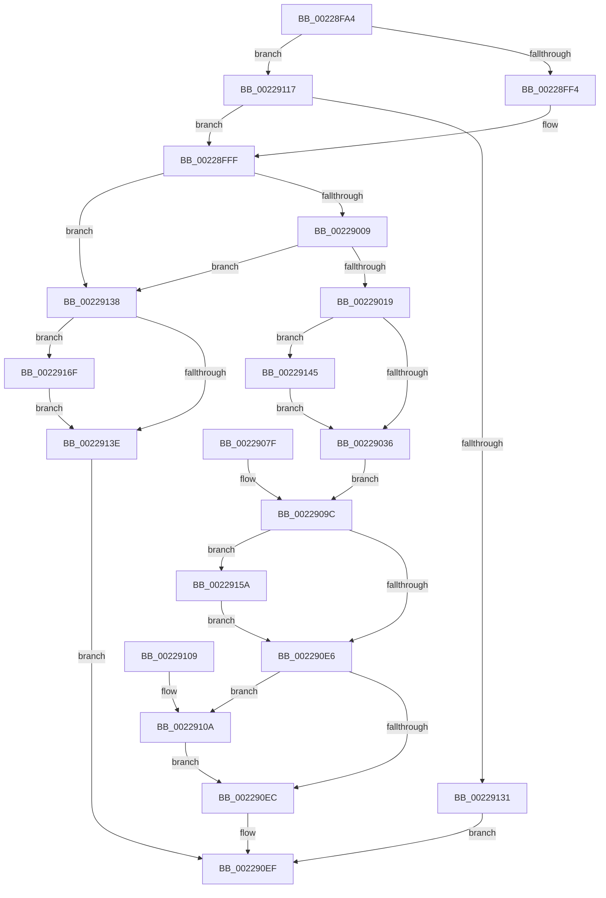

# MiCopySinglePage

- RVA: `0x00228FA4`–`0x0022917C` (길이 `472` bytes)
- VA: `0x0000000140228FA4`
- 실행 섹션: `.text`
- PDB 이름 있음: `예`; PDB Function 태그: `아니요`
- unwind 정보 RVA: `0x0005FCA4`
- 디코드: `114`개 명령, `472/472` bytes 표시
- 미해석 바이트: `0` (있으면 어셈블리에 `.byte`로 보존)

> 이 문서는 커널 이미지의 기계어와 PDB 기호를 분석해 생성했습니다. 4번과 5번은 함수 원형과 자료형을 바이너리 사용 방식에서 추정한 C 해석이며 원본 소스 복구 결과는 아닙니다.

## 1. Dependencies

- 직접 호출 지점: **9**; 고유 호출 대상: **7**
- 직접 호출자로 확인된 함수: **1**
- RIP 상대 이미지 참조: **1**

### Outgoing calls
- `0x0022900C` → [MiIsPageSecured](MiIsPageSecured_function_00228524.md) (function, `0x00228524`)
- `0x0022903E` → [MiMakeProtectionPfnCompatible](MiMakeProtectionPfnCompatible_function_00229CD0.md) (function, `0x00229CD0`)
- `0x0022904E` → [MiMapPageInHyperSpaceWorker](../33/MiMapPageInHyperSpaceWorker_function_00332B10.md) (function, `0x00332B10`)
- `0x00229078` → [memcpy](../6C/memcpy_function_006C6840.md) (function, `0x006C6840`)
- `0x00229110` → [MiUnlockPage](../31/MiUnlockPage_function_0031A3E0.md) (function, `0x0031A3E0`)
- `0x0022911A` → [MiSafeLockPage](../32/MiSafeLockPage_function_00321620.md) (function, `0x00321620`)
- `0x00229150` → [MiChangePageAttribute](../33/MiChangePageAttribute_function_00332ECC.md) (function, `0x00332ECC`)
- `0x00229165` → [MiChangePageAttribute](../33/MiChangePageAttribute_function_00332ECC.md) (function, `0x00332ECC`)
- `0x00229175` → [MiUnlockPage](../31/MiUnlockPage_function_0031A3E0.md) (function, `0x0031A3E0`)

### Direct callers
- [MmCopyMemory](MmCopyMemory_function_002285B0.md) at `0x002287B8`

### Static image references
- `0x002290CE` → RVA `0x00010880` (`.rdata`; read)

## 2. Other-region calls and transfers

- 다른 실행 섹션으로 향하는 call: **0**
- 별도 외부 분기/꼬리 이동을 확인하지 못했습니다.

## 3. Assembly (complete function range)

```asm
00228FA4  48 89 5C 24 08                  mov qword ptr [rsp + 8], rbx
00228FA9  48 89 74 24 18                  mov qword ptr [rsp + 0x18], rsi
00228FAE  48 89 54 24 10                  mov qword ptr [rsp + 0x10], rdx
00228FB3  57                              push rdi
00228FB4  41 54                           push r12
00228FB6  41 55                           push r13
00228FB8  41 56                           push r14
00228FBA  41 57                           push r15
00228FBC  48 83 EC 70                     sub rsp, 0x70
00228FC0  4D 8B E1                        mov r12, r9
00228FC3  4D 8B F8                        mov r15, r8
00228FC6  48 8B F2                        mov rsi, rdx
00228FC9  4C 8B E9                        mov r13, rcx
00228FCC  48 8D 1C 52                     lea rbx, [rdx + rdx*2]
00228FD0  48 C1 E3 04                     shl rbx, 4
00228FD4  48 B8 00 00 00 00 00 DE FF FF   movabs rax, 0xffffde0000000000
00228FDE  48 03 D8                        add rbx, rax
00228FE1  48 89 5C 24 50                  mov qword ptr [rsp + 0x50], rbx
00228FE6  F6 84 24 C0 00 00 00 01         test byte ptr [rsp + 0xc0], 1
00228FEE  0F 85 23 01 00 00               jne 0x140229117
00228FF4  40 B7 11                        mov dil, 0x11
00228FF7  40 88 BC 24 C0 00 00 00         mov byte ptr [rsp + 0xc0], dil
00228FFF  80 7B 23 00                     cmp byte ptr [rbx + 0x23], 0
00229003  0F 8C 2F 01 00 00               jl 0x140229138
00229009  48 8B CB                        mov rcx, rbx
0022900C  E8 13 F5 FF FF                  call 0x140228524
00229011  85 C0                           test eax, eax
00229013  0F 85 1F 01 00 00               jne 0x140229138
00229019  8B 43 20                        mov eax, dword ptr [rbx + 0x20]
0022901C  C1 E8 10                        shr eax, 0x10
0022901F  44 0F B6 F0                     movzx r14d, al
00229023  41 C1 EE 06                     shr r14d, 6
00229027  44 89 74 24 38                  mov dword ptr [rsp + 0x38], r14d
0022902C  41 83 FE 03                     cmp r14d, 3
00229030  0F 84 0F 01 00 00               je 0x140229145
00229036  48 8B D3                        mov rdx, rbx
00229039  B9 01 00 00 00                  mov ecx, 1
0022903E  E8 8D 0C 00 00                  call 0x140229cd0
00229043  33 D2                           xor edx, edx
00229045  41 B8 00 00 00 A0               mov r8d, 0xa0000000
0022904B  48 8B CE                        mov rcx, rsi
0022904E  E8 BD 9A 10 00                  call 0x140332b10
00229053  65 48 8B 0C 25 20 00 00 00      mov rcx, qword ptr gs:[0x20]
0022905C  48 8B 89 08 87 00 00            mov rcx, qword ptr [rcx + 0x8708]
00229063  49 8D 34 07                     lea rsi, [r15 + rax]
00229067  48 89 74 24 58                  mov qword ptr [rsp + 0x58], rsi
0022906C  45 33 FF                        xor r15d, r15d
0022906F  4D 8B C4                        mov r8, r12
00229072  48 8B D6                        mov rdx, rsi
00229075  49 8B CD                        mov rcx, r13
00229078  E8 C3 D7 49 00                  call 0x1406c6840
0022907D  EB 1D                           jmp 0x14022909c
0022907F  41 BF 09 07 00 C0               mov r15d, 0xc0000709
00229085  48 8B 5C 24 50                  mov rbx, qword ptr [rsp + 0x50]
0022908A  48 8B 74 24 58                  mov rsi, qword ptr [rsp + 0x58]
0022908F  40 8A BC 24 C0 00 00 00         mov dil, byte ptr [rsp + 0xc0]
00229097  44 8B 74 24 38                  mov r14d, dword ptr [rsp + 0x38]
0022909C  48 C1 EE 09                     shr rsi, 9
002290A0  48 B8 F8 FF FF FF 7F 00 00 00   movabs rax, 0x7ffffffff8
002290AA  48 23 F0                        and rsi, rax
002290AD  48 B8 00 00 00 00 80 F6 FF FF   movabs rax, 0xfffff68000000000
002290B7  48 03 F0                        add rsi, rax
002290BA  65 48 8B 04 25 20 00 00 00      mov rax, qword ptr gs:[0x20]
002290C3  48 8B 88 38 88 00 00            mov rcx, qword ptr [rax + 0x8838]
002290CA  48 83 21 00                     and qword ptr [rcx], 0
002290CE  48 8B 05 AB 77 DE FF            mov rax, qword ptr [rip - 0x218855]
002290D5  48 89 84 24 A8 00 00 00         mov qword ptr [rsp + 0xa8], rax
002290DD  48 89 06                        mov qword ptr [rsi], rax
002290E0  41 83 FE 03                     cmp r14d, 3
002290E4  74 74                           je 0x14022915a
002290E6  40 80 FF 11                     cmp dil, 0x11
002290EA  75 1E                           jne 0x14022910a
002290EC  41 8B C7                        mov eax, r15d
002290EF  4C 8D 5C 24 70                  lea r11, [rsp + 0x70]
002290F4  49 8B 5B 30                     mov rbx, qword ptr [r11 + 0x30]
002290F8  49 8B 73 40                     mov rsi, qword ptr [r11 + 0x40]
002290FC  49 8B E3                        mov rsp, r11
002290FF  41 5F                           pop r15
00229101  41 5E                           pop r14
00229103  41 5D                           pop r13
00229105  41 5C                           pop r12
00229107  5F                              pop rdi
00229108  C3                              ret
00229109  CC                              int3
0022910A  40 8A D7                        mov dl, dil
0022910D  48 8B CB                        mov rcx, rbx
00229110  E8 CB 12 0F 00                  call 0x14031a3e0
00229115  EB D5                           jmp 0x1402290ec
00229117  48 8B CE                        mov rcx, rsi
0022911A  E8 01 85 0F 00                  call 0x140321620
0022911F  40 8A F8                        mov dil, al
00229122  88 84 24 C0 00 00 00            mov byte ptr [rsp + 0xc0], al
00229129  3C 11                           cmp al, 0x11
0022912B  0F 85 CE FE FF FF               jne 0x140228fff
00229131  B8 41 01 00 C0                  mov eax, 0xc0000141
00229136  EB B7                           jmp 0x1402290ef
00229138  40 80 FF 11                     cmp dil, 0x11
0022913C  75 31                           jne 0x14022916f
0022913E  B8 09 07 00 C0                  mov eax, 0xc0000709
00229143  EB AA                           jmp 0x1402290ef
00229145  BA 01 00 00 00                  mov edx, 1
0022914A  44 8B C2                        mov r8d, edx
0022914D  48 8B CB                        mov rcx, rbx
00229150  E8 77 9D 10 00                  call 0x140332ecc
00229155  E9 DC FE FF FF                  jmp 0x140229036
0022915A  BA 03 00 00 00                  mov edx, 3
0022915F  44 8B C2                        mov r8d, edx
00229162  48 8B CB                        mov rcx, rbx
00229165  E8 62 9D 10 00                  call 0x140332ecc
0022916A  E9 77 FF FF FF                  jmp 0x1402290e6
0022916F  40 8A D7                        mov dl, dil
00229172  48 8B CB                        mov rcx, rbx
00229175  E8 66 12 0F 00                  call 0x14031a3e0
0022917A  EB C2                           jmp 0x14022913e
```

## 4. C-style interpretation (structured pseudocode)

```c
__int64 __fastcall MiCopySinglePage(__int64 a1, __int64 a2, __int64 a3, __int64 a4, unsigned __int8 a5)
{
    __int64 result;
    __int64 v_r14;
    __int64 v_r15;
    __int64 v_rbx;
    __int64 v_rsi;
    __int64 v_rsp;
    unsigned __int64 v_stack_m28;
    unsigned __int64 v_stack_m40;
    unsigned __int64 v_stack_m48;
    unsigned int v_stack_m60;
    unsigned __int64 v_stack_p10;
    unsigned __int64 v_stack_p18;
    unsigned __int8 v_stack_p28;
    unsigned __int8 v_stack_p50;
    unsigned __int64 v_stack_p8;

    v_stack_p8 = v_rbx;
    v_stack_p18 = v_rsi;
    v_stack_p10 = a2;
    v_rsp = (v_rsp) - (112);
    v_rbx = (a2 + a2 * 2) << (4);
    v_rbx = (v_rbx) + (result);
    v_stack_m48 = v_rbx;
    if (((a5) & (1)) != 0) goto loc_00229117;
    v_stack_p28 = 17;
loc_00228FFF:
    if ((*(unsigned __int8 *)(v_rbx + 35)) < 0) goto loc_00229138;
    result = MiIsPageSecured(v_rbx, a2, a3, a4);
    if ((unsigned int)(result) != 0) goto loc_00229138;
    result = (unsigned int)(((unsigned int)(*(unsigned int *)(v_rbx + 32))) >> (16));
    v_r14 = (unsigned int)(((unsigned __int8)(result)) >> (6));
    v_stack_m60 = (unsigned int)(v_r14);
    if (((unsigned int)(v_r14)) == 3) goto loc_00229145;
loc_00229036:
    result = MiMakeProtectionPfnCompatible(1, v_rbx, a3, a4);
    a2 = 0;
    result = MiMapPageInHyperSpaceWorker(0, a2, (unsigned int)(0xA0000000ULL), a4);
    v_stack_m40 = a3 + result * 1;
    v_r15 = 0;
    result = memcpy(a1, a3 + result * 1, a4, a4);
    goto loc_0022909C;
loc_0022909C:
    v_rsi = (a3 + result * 1) >> (9);
    v_rsi = (v_rsi) & (result);
    v_rsi = (v_rsi) + (result);
    v_stack_p10 = *(unsigned __int64 *)(v_rip - 2197589);
    *(unsigned __int64 *)(v_rsi) = *(unsigned __int64 *)(v_rip - 2197589);
    if (((unsigned int)(v_r14)) == 3) goto loc_0022915A;
loc_002290E6:
    if (17 != 17) goto loc_0022910A;
loc_002290EC:
loc_002290EF:
    return 0;
loc_0022910A:
    result = MiUnlockPage(*(unsigned __int64 *)(v_stack_m28 + 48), 17, a4, a4);
    goto loc_002290EC;
loc_00229117:
    result = MiSafeLockPage(*(unsigned __int64 *)(v_stack_m28 + 64), 17, a4, a4);
    v_stack_p50 = (unsigned __int8)(result);
    if (((unsigned __int8)(result)) != 17) goto loc_00228FFF;
    goto loc_002290EF;
loc_00229138:
    if (((unsigned __int8)((unsigned __int8)(result))) != 17) goto loc_0022916F;
loc_0022913E:
    goto loc_002290EF;
loc_00229145:
    result = MiChangePageAttribute(*(unsigned __int64 *)(v_stack_m28 + 48), 1, 1, a4);
    goto loc_00229036;
loc_0022915A:
    result = MiChangePageAttribute(*(unsigned __int64 *)(v_stack_m28 + 48), 3, 3, a4);
    goto loc_002290E6;
loc_0022916F:
    result = MiUnlockPage(*(unsigned __int64 *)(v_stack_m28 + 48), (unsigned __int8)((unsigned __int8)(result)), 3, a4);
    goto loc_0022913E;
}
```

## 5. (Beta) C Style

```c
int64_t MiCopySinglePage(int64_t Arg1, void *Arg2, void *Arg3, int64_t Arg4, uint8_t Arg5)
{
    uint8_t *arg2 = (uint8_t *)Arg2;
    uint8_t *arg3 = (uint8_t *)Arg3;

    int64_t result;
    int64_t local_r14;
    int64_t local_r15;
    int64_t local_rbx;
    int64_t local_rsi;
    int64_t local_rsp;
    uint64_t v_stack_m28;
    uint64_t v_stack_m40;
    uint64_t v_stack_m48;
    uint32_t v_stack_m60;
    uint64_t v_stack_p10;
    uint64_t v_stack_p18;
    uint8_t v_stack_p28;
    uint8_t v_stack_p50;
    uint64_t v_stack_p8;

    v_stack_p8 = local_rbx;
    v_stack_p18 = local_rsi;
    v_stack_p10 = Arg2;
    local_rsp = (local_rsp) - (112);
    local_rbx = (Arg2 + Arg2 * 2) << (4);
    local_rbx = (local_rbx) + (result);
    v_stack_m48 = local_rbx;
    if (((Arg5) & (1)) != 0) goto loc_00229117;
    v_stack_p28 = 17;
loc_00228FFF:
    if ((*(uint8_t *)(local_rbx + 0x23)) < 0) goto loc_00229138;
    result = MiIsPageSecured(local_rbx, Arg2, Arg3, Arg4);
    if ((uint32_t)(result) != 0) goto loc_00229138;
    result = (uint32_t)(((uint32_t)(*(uint32_t *)(local_rbx + 0x20))) >> (16));
    local_r14 = (uint32_t)(((uint8_t)(result)) >> (6));
    v_stack_m60 = (uint32_t)(local_r14);
    if (((uint32_t)(local_r14)) == 3) goto loc_00229145;
loc_00229036:
    result = MiMakeProtectionPfnCompatible(1, local_rbx, Arg3, Arg4);
    Arg2 = 0;
    result = MiMapPageInHyperSpaceWorker(0, Arg2, (uint32_t)(0xA0000000ULL), Arg4);
    v_stack_m40 = Arg3 + result * 1;
    local_r15 = 0;
    result = memcpy(Arg1, Arg3 + result * 1, Arg4, Arg4);
    goto loc_0022909C;
loc_0022909C:
    local_rsi = (Arg3 + result * 1) >> (9);
    local_rsi = (local_rsi) & (result);
    local_rsi = (local_rsi) + (result);
    v_stack_p10 = *(uint64_t *)(v_rip - 0x218855);
    *(uint64_t *)(local_rsi) = *(uint64_t *)(v_rip - 0x218855);
    if (((uint32_t)(local_r14)) == 3) goto loc_0022915A;
loc_002290E6:
    if (17 != 17) goto loc_0022910A;
loc_002290EC:
loc_002290EF:
    return 0;
loc_0022910A:
    result = MiUnlockPage(*(uint64_t *)(v_stack_m28 + 0x30), 17, Arg4, Arg4);
    goto loc_002290EC;
loc_00229117:
    result = MiSafeLockPage(*(uint64_t *)(v_stack_m28 + 0x40), 17, Arg4, Arg4);
    v_stack_p50 = (uint8_t)(result);
    if (((uint8_t)(result)) != 17) goto loc_00228FFF;
    goto loc_002290EF;
loc_00229138:
    if (((uint8_t)((uint8_t)(result))) != 17) goto loc_0022916F;
loc_0022913E:
    goto loc_002290EF;
loc_00229145:
    result = MiChangePageAttribute(*(uint64_t *)(v_stack_m28 + 0x30), 1, 1, Arg4);
    goto loc_00229036;
loc_0022915A:
    result = MiChangePageAttribute(*(uint64_t *)(v_stack_m28 + 0x30), 3, 3, Arg4);
    goto loc_002290E6;
loc_0022916F:
    result = MiUnlockPage(*(uint64_t *)(v_stack_m28 + 0x30), (uint8_t)((uint8_t)(result)), 3, Arg4);
    goto loc_0022913E;
}
```

### 관측된 메모리 오프셋

구조체 형식이 확인되지 않은 접근은 인자 기준의 오프셋으로만 기록했습니다.

| 기준 인자 | 오프셋 표현 | 폭 (bit) | 접근 |
|---|---:|---:|---|
| `Arg2` | `+ 0x0 + rdx*2` | `64` | `R` |
| `Arg3` | `+ 0x0 + rax*1` | `64` | `R` |

## 6. Execution-region graph

[열기: 2D/3D 그래프와 함수 탐색 컨트롤 패널](../../../control-panel.html?section=text&rva=0x00228FA4&view=graph)

- 2D 그래프는 위에서 아래로 흐르고, 3D 그래프는 빈 공간을 드래그해 회전합니다. Shift+드래그는 이동, 휠은 확대·축소, 함수 노드 선택은 대상 보고서 이동입니다.

### Static fallback


