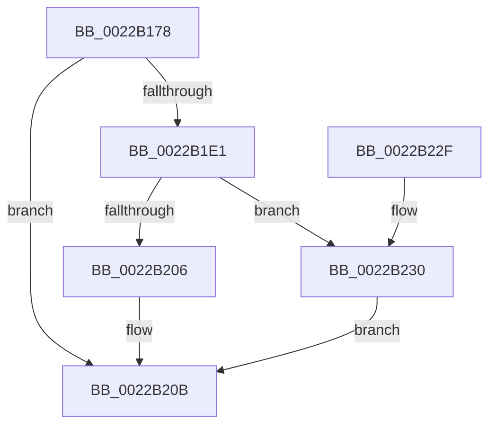

# MiCreateCombineAnchor

- RVA: `0x0022B178`–`0x0022B241` (길이 `201` bytes)
- VA: `0x000000014022B178`
- 실행 섹션: `.text`
- PDB 이름 있음: `예`; PDB Function 태그: `아니요`
- unwind 정보 RVA: `0x0005FEA8`
- 디코드: `57`개 명령, `201/201` bytes 표시
- 미해석 바이트: `0` (있으면 어셈블리에 `.byte`로 보존)

> 이 문서는 커널 이미지의 기계어와 PDB 기호를 분석해 생성했습니다. 4번과 5번은 함수 원형과 자료형을 바이너리 사용 방식에서 추정한 C 해석이며 원본 소스 복구 결과는 아닙니다.

## 1. Dependencies

- 직접 호출 지점: **4**; 고유 호출 대상: **4**
- 직접 호출자로 확인된 함수: **2**
- RIP 상대 이미지 참조: **0**

### Outgoing calls
- `0x0022B1B3` → [ExAcquireSpinLockSharedAtDpcLevel](../24/ExAcquireSpinLockSharedAtDpcLevel_function_00248E30.md) (function, `0x00248E30`)
- `0x0022B1D4` → [MiLocateCombineBlock](MiLocateCombineBlock_function_0022B3A8.md) (function, `0x0022B3A8`)
- `0x0022B1FD` → [MiReferenceCloneProto](MiReferenceCloneProto_function_0022B2F8.md) (function, `0x0022B2F8`)
- `0x0022B20F` → [ExReleaseSpinLockSharedFromDpcLevel](../24/ExReleaseSpinLockSharedFromDpcLevel_function_0024A590.md) (function, `0x0024A590`)

### Direct callers
- [MiConvertStandbyToProto](MiConvertStandbyToProto_function_0022A330.md) at `0x0022A3CE`
- [MiConvertPrivateToProto](MiConvertPrivateToProto_function_0022B0E4.md) at `0x0022B10D`

### Static image references
- 디코드된 RIP-relative 메모리 참조가 없습니다.

## 2. Other-region calls and transfers

- 다른 실행 섹션으로 향하는 call: **0**
- 별도 외부 분기/꼬리 이동을 확인하지 못했습니다.

## 3. Assembly (complete function range)

```asm
0022B178  48 89 5C 24 08                  mov qword ptr [rsp + 8], rbx
0022B17D  48 89 6C 24 10                  mov qword ptr [rsp + 0x10], rbp
0022B182  48 89 74 24 18                  mov qword ptr [rsp + 0x18], rsi
0022B187  57                              push rdi
0022B188  41 56                           push r14
0022B18A  41 57                           push r15
0022B18C  48 83 EC 30                     sub rsp, 0x30
0022B190  8B 6A 08                        mov ebp, dword ptr [rdx + 8]
0022B193  33 F6                           xor esi, esi
0022B195  48 8B 19                        mov rbx, qword ptr [rcx]
0022B198  83 E5 0F                        and ebp, 0xf
0022B19B  4C 8B 79 70                     mov r15, qword ptr [rcx + 0x70]
0022B19F  4D 8B F0                        mov r14, r8
0022B1A2  48 C1 E5 04                     shl rbp, 4
0022B1A6  48 8B FA                        mov rdi, rdx
0022B1A9  48 03 EB                        add rbp, rbx
0022B1AC  49 89 30                        mov qword ptr [r8], rsi
0022B1AF  48 8D 4D 68                     lea rcx, [rbp + 0x68]
0022B1B3  E8 78 DC 01 00                  call 0x140248e30
0022B1B8  44 8B 47 20                     mov r8d, dword ptr [rdi + 0x20]
0022B1BC  48 8D 47 18                     lea rax, [rdi + 0x18]
0022B1C0  48 8B 57 08                     mov rdx, qword ptr [rdi + 8]
0022B1C4  44 8D 4E 01                     lea r9d, [rsi + 1]
0022B1C8  41 83 E0 1F                     and r8d, 0x1f
0022B1CC  48 89 44 24 20                  mov qword ptr [rsp + 0x20], rax
0022B1D1  48 8B CB                        mov rcx, rbx
0022B1D4  E8 CF 01 00 00                  call 0x14022b3a8
0022B1D9  48 8B F8                        mov rdi, rax
0022B1DC  48 85 C0                        test rax, rax
0022B1DF  74 2A                           je 0x14022b20b
0022B1E1  48 25 00 F0 FF FF               and rax, 0xfffffffffffff000
0022B1E7  48 89 74 24 20                  mov qword ptr [rsp + 0x20], rsi
0022B1EC  4C 8D 47 20                     lea r8, [rdi + 0x20]
0022B1F0  45 33 C9                        xor r9d, r9d
0022B1F3  49 8B CF                        mov rcx, r15
0022B1F6  48 8B 58 10                     mov rbx, qword ptr [rax + 0x10]
0022B1FA  48 8B 13                        mov rdx, qword ptr [rbx]
0022B1FD  E8 F6 00 00 00                  call 0x14022b2f8
0022B202  85 C0                           test eax, eax
0022B204  75 2A                           jne 0x14022b230
0022B206  BE 9A 00 00 C0                  mov esi, 0xc000009a
0022B20B  48 8D 4D 68                     lea rcx, [rbp + 0x68]
0022B20F  E8 7C F3 01 00                  call 0x14024a590
0022B214  48 8B 5C 24 50                  mov rbx, qword ptr [rsp + 0x50]
0022B219  8B C6                           mov eax, esi
0022B21B  48 8B 74 24 60                  mov rsi, qword ptr [rsp + 0x60]
0022B220  48 8B 6C 24 58                  mov rbp, qword ptr [rsp + 0x58]
0022B225  48 83 C4 30                     add rsp, 0x30
0022B229  41 5F                           pop r15
0022B22B  41 5E                           pop r14
0022B22D  5F                              pop rdi
0022B22E  C3                              ret
0022B22F  CC                              int3
0022B230  F0 FF 83 88 01 00 00            lock inc dword ptr [rbx + 0x188]
0022B237  BE 0A 02 00 C0                  mov esi, 0xc000020a
0022B23C  49 89 3E                        mov qword ptr [r14], rdi
0022B23F  EB CA                           jmp 0x14022b20b
```

## 4. C-style interpretation (structured pseudocode)

```c
__int64 __fastcall MiCreateCombineAnchor(__int64 a1, __int64 a2, __int64 a3)
{
    __int64 result;
    __int64 v_rbp;
    __int64 v_rsi;
    __int64 v_rsp;
    unsigned __int64 v_stack_m28;
    unsigned __int64 v_stack_p10;
    unsigned __int64 v_stack_p18;
    unsigned __int64 v_stack_p8;

    v_stack_p8 = v_rbx;
    v_stack_p10 = v_rbp;
    v_stack_p18 = v_rsi;
    v_rsp = (v_rsp) - (48);
    v_rsi = 0;
    v_rbp = (unsigned int)(((unsigned int)(*(unsigned int *)(a2 + 8))) & (15));
    v_rbp = (v_rbp) << (4);
    v_rbp = (v_rbp) + (*(unsigned __int64 *)(a1));
    *(unsigned __int64 *)(a3) = 0;
    result = ExAcquireSpinLockSharedAtDpcLevel(v_rbp + 104, a2, a3, a4);
    a3 = (unsigned int)(((unsigned int)(*(unsigned int *)(a2 + 32))) & (31));
    v_stack_m28 = a2 + 24;
    result = MiLocateCombineBlock(*(unsigned __int64 *)(a1), *(unsigned __int64 *)(a2 + 8), a3, v_rsi + 1);
    if (result == 0) goto loc_0022B20B;
    result = (result) & (0xFFFFFFFFFFFFF000ULL);
    v_stack_m28 = 0;
    a4 = 0;
    result = MiReferenceCloneProto(*(unsigned __int64 *)(a1 + 112), *(unsigned __int64 *)(*(unsigned __int64 *)(result + 16)), result + 32, a4);
    if ((unsigned int)(result) != 0) goto loc_0022B230;
loc_0022B20B:
    result = ExReleaseSpinLockSharedFromDpcLevel(v_rbp + 104, *(unsigned __int64 *)(*(unsigned __int64 *)(result + 16)), result + 32, a4);
    v_rsp = (v_rsp) + (48);
    return (unsigned int)((unsigned int)((unsigned int)(0xC000009AULL)));
loc_0022B230:
    *(unsigned __int64 *)(a3) = result;
    goto loc_0022B20B;
}
```

## 5. (Beta) C Style

```c
int64_t MiCreateCombineAnchor(void *Arg1, void *Arg2, void *Arg3)
{
    uint8_t *arg1 = (uint8_t *)Arg1;
    uint8_t *arg2 = (uint8_t *)Arg2;
    uint8_t *arg3 = (uint8_t *)Arg3;

    int64_t result;
    int64_t local_rbp;
    int64_t local_rsi;
    int64_t local_rsp;
    uint64_t v_stack_m28;
    uint64_t v_stack_p10;
    uint64_t v_stack_p18;
    uint64_t v_stack_p8;

    v_stack_p8 = local_rbx;
    v_stack_p10 = local_rbp;
    v_stack_p18 = local_rsi;
    local_rsp = (local_rsp) - (48);
    local_rsi = 0;
    local_rbp = (uint32_t)(((uint32_t)(*(uint32_t *)(arg2 + 0x8))) & (15));
    local_rbp = (local_rbp) << (4);
    local_rbp = (local_rbp) + (*(uint64_t *)(arg1));
    *(uint64_t *)(arg3) = 0;
    result = ExAcquireSpinLockSharedAtDpcLevel(local_rbp + 104, Arg2, Arg3, a4);
    Arg3 = (uint32_t)(((uint32_t)(*(uint32_t *)(arg2 + 0x20))) & (31));
    v_stack_m28 = Arg2 + 24;
    result = MiLocateCombineBlock(*(uint64_t *)(arg1), *(uint64_t *)(arg2 + 0x8), Arg3, local_rsi + 1);
    if (result == 0) goto loc_0022B20B;
    result = (result) & (0xFFFFFFFFFFFFF000ULL);
    v_stack_m28 = 0;
    a4 = 0;
    result = MiReferenceCloneProto(*(uint64_t *)(arg1 + 0x70), *(uint64_t *)(*(uint64_t *)(result + 0x10)), result + 32, a4);
    if ((uint32_t)(result) != 0) goto loc_0022B230;
loc_0022B20B:
    result = ExReleaseSpinLockSharedFromDpcLevel(local_rbp + 104, *(uint64_t *)(*(uint64_t *)(result + 0x10)), result + 32, a4);
    local_rsp = (local_rsp) + (48);
    return (uint32_t)((uint32_t)((uint32_t)(0xC000009AULL)));
loc_0022B230:
    *(uint64_t *)(arg3) = result;
    goto loc_0022B20B;
}
```

### 관측된 메모리 오프셋

구조체 형식이 확인되지 않은 접근은 인자 기준의 오프셋으로만 기록했습니다.

| 기준 인자 | 오프셋 표현 | 폭 (bit) | 접근 |
|---|---:|---:|---|
| `Arg1` | `+ 0x0` | `64` | `R` |
| `Arg1` | `+ 0x70` | `64` | `R` |
| `Arg2` | `+ 0x8` | `32` | `R` |
| `Arg2` | `+ 0x8` | `64` | `R` |
| `Arg2` | `+ 0x18` | `64` | `R` |
| `Arg2` | `+ 0x20` | `32` | `R` |
| `Arg3` | `+ 0x0` | `64` | `W` |

## 6. Execution-region graph

[열기: 2D/3D 그래프와 함수 탐색 컨트롤 패널](../../../control-panel.html?section=text&rva=0x0022B178&view=graph)

- 2D 그래프는 위에서 아래로 흐르고, 3D 그래프는 빈 공간을 드래그해 회전합니다. Shift+드래그는 이동, 휠은 확대·축소, 함수 노드 선택은 대상 보고서 이동입니다.

### Static fallback


