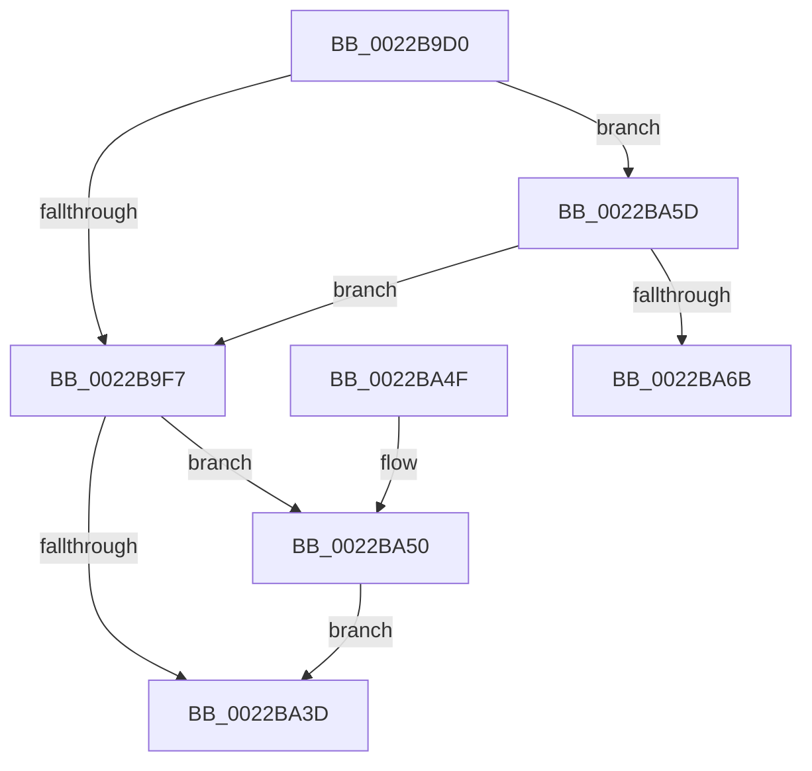

# MiDecrementCloneBlockReference

- RVA: `0x0022B9D0`–`0x0022BA86` (길이 `182` bytes)
- VA: `0x000000014022B9D0`
- 실행 섹션: `.text`
- PDB 이름 있음: `예`; PDB Function 태그: `아니요`
- unwind 정보 RVA: `0x0005FF50`
- 디코드: `47`개 명령, `182/182` bytes 표시
- 미해석 바이트: `0` (있으면 어셈블리에 `.byte`로 보존)

> 이 문서는 커널 이미지의 기계어와 PDB 기호를 분석해 생성했습니다. 4번과 5번은 함수 원형과 자료형을 바이너리 사용 방식에서 추정한 C 해석이며 원본 소스 복구 결과는 아닙니다.

## 1. Dependencies

- 직접 호출 지점: **3**; 고유 호출 대상: **3**
- 직접 호출자로 확인된 함수: **3**
- RIP 상대 이미지 참조: **0**

### Outgoing calls
- `0x0022BA26` → [MiDecrementCloneBlock](MiDecrementCloneBlock_function_0022BA8C.md) (function, `0x0022BA8C`)
- `0x0022BA56` → [MiDeleteCloneDescriptor](../4F/MiDeleteCloneDescriptor_function_004F9E28.md) (function, `0x004F9E28`)
- `0x0022BA80` → [KeBugCheckEx](../4F/KeBugCheckEx_function_004FD660.md) (function, `0x004FD660`)

### Direct callers
- [MiDecommitHandleProtoFormatPte](../24/MiDecommitHandleProtoFormatPte_function_00242D54.md) at `0x00242E40`
- [MiCopyOnWrite](../36/MiCopyOnWrite_function_00362A0C.md) at `0x00363044`
- [MiDecommitSharedPageTail](../37/MiDecommitSharedPageTail_function_00370240.md) at `0x003706FB`

### Static image references
- 디코드된 RIP-relative 메모리 참조가 없습니다.

## 2. Other-region calls and transfers

- 다른 실행 섹션으로 향하는 call: **0**
- 별도 외부 분기/꼬리 이동을 확인하지 못했습니다.

## 3. Assembly (complete function range)

```asm
0022B9D0  48 89 5C 24 08                  mov qword ptr [rsp + 8], rbx
0022B9D5  48 89 74 24 10                  mov qword ptr [rsp + 0x10], rsi
0022B9DA  57                              push rdi
0022B9DB  48 83 EC 30                     sub rsp, 0x30
0022B9DF  49 8B F8                        mov rdi, r8
0022B9E2  48 8B D9                        mov rbx, rcx
0022B9E5  45 33 C9                        xor r9d, r9d
0022B9E8  4C 8B C2                        mov r8, rdx
0022B9EB  48 8B 8F 70 02 00 00            mov rcx, qword ptr [rdi + 0x270]
0022B9F2  48 85 C9                        test rcx, rcx
0022B9F5  75 66                           jne 0x14022ba5d
0022B9F7  48 8B 43 38                     mov rax, qword ptr [rbx + 0x38]
0022B9FB  48 8B 97 10 04 00 00            mov rdx, qword ptr [rdi + 0x410]
0022BA02  48 8B 48 18                     mov rcx, qword ptr [rax + 0x18]
0022BA06  48 8B 43 60                     mov rax, qword ptr [rbx + 0x60]
0022BA0A  48 39 82 28 04 00 00            cmp qword ptr [rdx + 0x428], rax
0022BA11  48 8D 44 24 50                  lea rax, [rsp + 0x50]
0022BA16  48 8D 97 00 04 00 00            lea rdx, [rdi + 0x400]
0022BA1D  48 89 44 24 20                  mov qword ptr [rsp + 0x20], rax
0022BA22  41 0F 97 C1                     seta r9b
0022BA26  E8 61 00 00 00                  call 0x14022ba8c
0022BA2B  8B F0                           mov esi, eax
0022BA2D  48 83 C9 FF                     or rcx, 0xffffffffffffffff
0022BA31  F0 48 0F C1 4B 30               lock xadd qword ptr [rbx + 0x30], rcx
0022BA37  48 83 F9 01                     cmp rcx, 1
0022BA3B  74 13                           je 0x14022ba50
0022BA3D  48 8B 5C 24 40                  mov rbx, qword ptr [rsp + 0x40]
0022BA42  8B C6                           mov eax, esi
0022BA44  48 8B 74 24 48                  mov rsi, qword ptr [rsp + 0x48]
0022BA49  48 83 C4 30                     add rsp, 0x30
0022BA4D  5F                              pop rdi
0022BA4E  C3                              ret
0022BA4F  CC                              int3
0022BA50  48 8B D3                        mov rdx, rbx
0022BA53  48 8B CF                        mov rcx, rdi
0022BA56  E8 CD E3 2C 00                  call 0x1404f9e28
0022BA5B  EB E0                           jmp 0x14022ba3d
0022BA5D  65 48 8B 04 25 88 01 00 00      mov rax, qword ptr gs:[0x188]
0022BA66  48 3B C8                        cmp rcx, rax
0022BA69  74 8C                           je 0x14022b9f7
0022BA6B  4C 89 4C 24 20                  mov qword ptr [rsp + 0x20], r9
0022BA70  BA 45 19 06 00                  mov edx, 0x61945
0022BA75  4D 8B C8                        mov r9, r8
0022BA78  B9 1A 00 00 00                  mov ecx, 0x1a
0022BA7D  4C 8B C3                        mov r8, rbx
0022BA80  E8 DB 1B 2D 00                  call 0x1404fd660
0022BA85  CC                              int3
```

## 4. C-style interpretation (structured pseudocode)

```c
__int64 __fastcall MiDecrementCloneBlockReference(__int64 a1, __int64 a2, __int64 a3, int a4)
{
    __int64 result;
    __int64 v_rsp;
    unsigned __int64 v_stack_m18;
    unsigned __int64 v_stack_p10;
    unsigned __int64 v_stack_p18;
    unsigned __int64 v_stack_p20;
    unsigned __int64 v_stack_p8;

    v_stack_p8 = v_rbx;
    v_stack_p10 = v_rsi;
    v_rsp = (v_rsp) - (48);
    a4 = 0;
    if (*(unsigned __int64 *)(a3 + 624) != 0) goto loc_0022BA5D;
loc_0022B9F7:
    v_stack_m18 = v_stack_p18;
    a4 = ((*(unsigned __int64 *)(*(unsigned __int64 *)(a3 + 1040) + 1064)) > (*(unsigned __int64 *)(a1 + 96))) ? 1 : 0;
    result = MiDecrementCloneBlock(*(unsigned __int64 *)(*(unsigned __int64 *)(a1 + 56) + 24), a3 + 1024, a2, a4);
    a1 = (*(unsigned __int64 *)(*(unsigned __int64 *)(a1 + 56) + 24)) | (-1);
    if (a1 == 1) goto loc_0022BA50;
loc_0022BA3D:
    v_rsp = (v_rsp) + (48);
    return (unsigned int)((unsigned int)((unsigned int)((unsigned int)(result))));
loc_0022BA50:
    result = MiDeleteCloneDescriptor(a3, v_stack_p8, a2, a4);
    goto loc_0022BA3D;
loc_0022BA5D:
    if (a3 == (*(unsigned __int64 *)(gs_base + (0 + 392)))) goto loc_0022B9F7;
    v_stack_p20 = a4;
    result = KeBugCheckEx(26, (unsigned int)(0x61945ULL), v_stack_p8, a2);
    return result;
}
```

## 5. (Beta) C Style

```c
int64_t MiDecrementCloneBlockReference(void *Arg1, int64_t Arg2, void *Arg3, int32_t Arg4)
{
    uint8_t *arg1 = (uint8_t *)Arg1;
    uint8_t *arg3 = (uint8_t *)Arg3;

    int64_t result;
    int64_t local_rsp;
    uint64_t v_stack_m18;
    uint64_t v_stack_p10;
    uint64_t v_stack_p18;
    uint64_t v_stack_p20;
    uint64_t v_stack_p8;

    v_stack_p8 = local_rbx;
    v_stack_p10 = local_rsi;
    local_rsp = (local_rsp) - (48);
    Arg4 = 0;
    if (*(uint64_t *)(arg3 + 0x270) != 0) goto loc_0022BA5D;
loc_0022B9F7:
    v_stack_m18 = v_stack_p18;
    Arg4 = ((*(uint64_t *)(*(uint64_t *)(arg3 + 0x410) + 0x428)) > (*(uint64_t *)(arg1 + 0x60))) ? 1 : 0;
    result = MiDecrementCloneBlock(*(uint64_t *)(*(uint64_t *)(arg1 + 0x38) + 0x18), Arg3 + 1024, Arg2, Arg4);
    Arg1 = (*(uint64_t *)(*(uint64_t *)(arg1 + 0x38) + 0x18)) | (-1);
    if (Arg1 == 1) goto loc_0022BA50;
loc_0022BA3D:
    local_rsp = (local_rsp) + (48);
    return (uint32_t)((uint32_t)((uint32_t)((uint32_t)(result))));
loc_0022BA50:
    result = MiDeleteCloneDescriptor(Arg3, v_stack_p8, Arg2, Arg4);
    goto loc_0022BA3D;
loc_0022BA5D:
    if (Arg3 == (*(uint64_t *)(gs_base + (0 + 0x188)))) goto loc_0022B9F7;
    v_stack_p20 = Arg4;
    result = KeBugCheckEx(26, (uint32_t)(0x61945ULL), v_stack_p8, Arg2);
    return result;
}
```

### 관측된 메모리 오프셋

구조체 형식이 확인되지 않은 접근은 인자 기준의 오프셋으로만 기록했습니다.

| 기준 인자 | 오프셋 표현 | 폭 (bit) | 접근 |
|---|---:|---:|---|
| `Arg1` | `+ 0x30` | `64` | `R/W` |
| `Arg1` | `+ 0x38` | `64` | `R` |
| `Arg1` | `+ 0x60` | `64` | `R` |
| `Arg3` | `+ 0x270` | `64` | `R` |
| `Arg3` | `+ 0x400` | `64` | `R` |
| `Arg3` | `+ 0x410` | `64` | `R` |

## 6. Execution-region graph

[열기: 2D/3D 그래프와 함수 탐색 컨트롤 패널](../../../control-panel.html?section=text&rva=0x0022B9D0&view=graph)

- 2D 그래프는 위에서 아래로 흐르고, 3D 그래프는 빈 공간을 드래그해 회전합니다. Shift+드래그는 이동, 휠은 확대·축소, 함수 노드 선택은 대상 보고서 이동입니다.

### Static fallback


