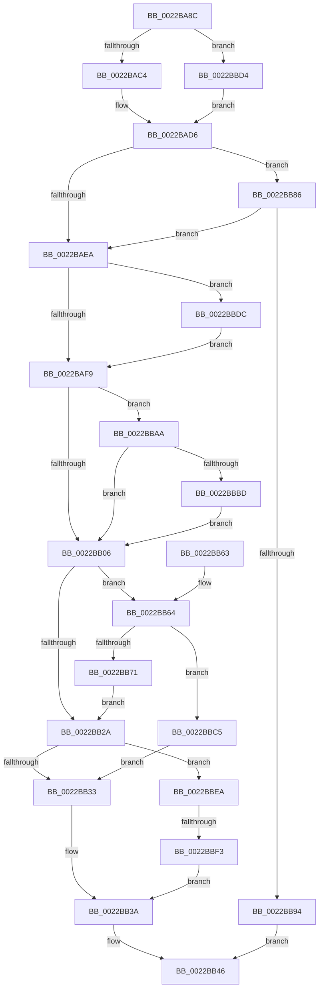

# MiDecrementCloneBlock

- RVA: `0x0022BA8C`–`0x0022BC06` (길이 `378` bytes)
- VA: `0x000000014022BA8C`
- 실행 섹션: `.text`
- PDB 이름 있음: `예`; PDB Function 태그: `예`
- unwind 정보 RVA: `0x0005FF64`
- 디코드: `94`개 명령, `378/378` bytes 표시
- 미해석 바이트: `0` (있으면 어셈블리에 `.byte`로 보존)

> 이 문서는 커널 이미지의 기계어와 PDB 기호를 분석해 생성했습니다. 4번과 5번은 함수 원형과 자료형을 바이너리 사용 방식에서 추정한 C 해석이며 원본 소스 복구 결과는 아닙니다.

## 1. Dependencies

- 직접 호출 지점: **4**; 고유 호출 대상: **4**
- 직접 호출자로 확인된 함수: **3**
- RIP 상대 이미지 참조: **2**

### Outgoing calls
- `0x0022BADB` → [MiLockCloneBlockAtDpc](../37/MiLockCloneBlockAtDpc_function_00370FD8.md) (function, `0x00370FD8`)
- `0x0022BB3F` → [MiReturnCloneCharges](../37/MiReturnCloneCharges_function_00370F50.md) (function, `0x00370F50`)
- `0x0022BB77` → [MiDeleteMergedPte](../37/MiDeleteMergedPte_function_00371040.md) (function, `0x00371040`)
- `0x0022BBAF` → [MiUpdateCloneReducedCommit](MiUpdateCloneReducedCommit_function_0022CC90.md) (function, `0x0022CC90`)

### Direct callers
- [MiDecrementCombinedPteEx](MiDecrementCombinedPteEx_function_0022B940.md) at `0x0022B982`
- [MiDecrementCloneBlockReference](MiDecrementCloneBlockReference_function_0022B9D0.md) at `0x0022BA26`
- [MiCombineInitialInstance](MiCombineInitialInstance_function_0022BC0C.md) at `0x0022C5E4`

### Static image references
- `0x0022BACB` → RVA `0x00E30088` (`.data`; read)
- `0x0022BBC5` → RVA `0x00010880` (`.rdata`; read)

## 2. Other-region calls and transfers

- 다른 실행 섹션으로 향하는 call: **0**
- call이 아닌 외부 분기/꼬리 이동: **1**
  - `0x0022BBED` → [sub_006D713A](../6D/Unknown_function_006D713A.md) (`tail-transfer`)

## 3. Assembly (complete function range)

```asm
0022BA8C  48 89 5C 24 08                  mov qword ptr [rsp + 8], rbx
0022BA91  48 89 6C 24 10                  mov qword ptr [rsp + 0x10], rbp
0022BA96  48 89 74 24 18                  mov qword ptr [rsp + 0x18], rsi
0022BA9B  57                              push rdi
0022BA9C  41 54                           push r12
0022BA9E  41 55                           push r13
0022BAA0  41 56                           push r14
0022BAA2  41 57                           push r15
0022BAA4  48 83 EC 20                     sub rsp, 0x20
0022BAA8  4C 8B 6C 24 70                  mov r13, qword ptr [rsp + 0x70]
0022BAAD  45 8B E1                        mov r12d, r9d
0022BAB0  49 8B F0                        mov rsi, r8
0022BAB3  48 8B E9                        mov rbp, rcx
0022BAB6  41 83 65 00 00                  and dword ptr [r13], 0
0022BABB  48 85 D2                        test rdx, rdx
0022BABE  0F 84 10 01 00 00               je 0x14022bbd4
0022BAC4  0F B7 92 AE 00 00 00            movzx edx, word ptr [rdx + 0xae]
0022BACB  48 8B 05 B6 45 C0 00            mov rax, qword ptr [rip + 0xc045b6]
0022BAD2  4C 8B 3C D0                     mov r15, qword ptr [rax + rdx*8]
0022BAD6  48 8B CE                        mov rcx, rsi
0022BAD9  33 DB                           xor ebx, ebx
0022BADB  E8 F8 54 14 00                  call 0x140370fd8
0022BAE0  41 F6 C4 02                     test r12b, 2
0022BAE4  0F 85 9C 00 00 00               jne 0x14022bb86
0022BAEA  41 BA 05 00 00 00               mov r10d, 5
0022BAF0  4C 3B FD                        cmp r15, rbp
0022BAF3  0F 85 E3 00 00 00               jne 0x14022bbdc
0022BAF9  45 8B F4                        mov r14d, r12d
0022BAFC  41 83 E6 01                     and r14d, 1
0022BB00  0F 85 A4 00 00 00               jne 0x14022bbaa
0022BB06  48 8B 46 18                     mov rax, qword ptr [rsi + 0x18]
0022BB0A  48 B9 FF FF FF FF FF FF FF 7F   movabs rcx, 0x7fffffffffffffff
0022BB14  48 FF C8                        dec rax
0022BB17  48 89 46 18                     mov qword ptr [rsi + 0x18], rax
0022BB1B  F0 48 21 4E 10                  lock and qword ptr [rsi + 0x10], rcx
0022BB20  BF 04 00 00 00                  mov edi, 4
0022BB25  48 85 C0                        test rax, rax
0022BB28  74 3A                           je 0x14022bb64
0022BB2A  83 FF 03                        cmp edi, 3
0022BB2D  0F 84 B7 00 00 00               je 0x14022bbea
0022BB33  45 85 F6                        test r14d, r14d
0022BB36  41 0F 45 FA                     cmovne edi, r10d
0022BB3A  8B D3                           mov edx, ebx
0022BB3C  48 8B CD                        mov rcx, rbp
0022BB3F  E8 0C 54 14 00                  call 0x140370f50
0022BB44  8B C7                           mov eax, edi
0022BB46  48 8B 5C 24 50                  mov rbx, qword ptr [rsp + 0x50]
0022BB4B  48 8B 6C 24 58                  mov rbp, qword ptr [rsp + 0x58]
0022BB50  48 8B 74 24 60                  mov rsi, qword ptr [rsp + 0x60]
0022BB55  48 83 C4 20                     add rsp, 0x20
0022BB59  41 5F                           pop r15
0022BB5B  41 5E                           pop r14
0022BB5D  41 5D                           pop r13
0022BB5F  41 5C                           pop r12
0022BB61  5F                              pop rdi
0022BB62  C3                              ret
0022BB63  CC                              int3
0022BB64  41 C7 45 00 01 00 00 00         mov dword ptr [r13], 1
0022BB6C  44 84 E7                        test dil, r12b
0022BB6F  75 54                           jne 0x14022bbc5
0022BB71  48 8B D6                        mov rdx, rsi
0022BB74  48 8B CD                        mov rcx, rbp
0022BB77  E8 C4 54 14 00                  call 0x140371040
0022BB7C  8B F8                           mov edi, eax
0022BB7E  41 BA 05 00 00 00               mov r10d, 5
0022BB84  EB A4                           jmp 0x14022bb2a
0022BB86  48 8B 4E 18                     mov rcx, qword ptr [rsi + 0x18]
0022BB8A  48 83 F9 01                     cmp rcx, 1
0022BB8E  0F 84 56 FF FF FF               je 0x14022baea
0022BB94  48 B9 FF FF FF FF FF FF FF 7F   movabs rcx, 0x7fffffffffffffff
0022BB9E  F0 48 21 4E 10                  lock and qword ptr [rsi + 0x10], rcx
0022BBA3  B8 02 00 00 00                  mov eax, 2
0022BBA8  EB 9C                           jmp 0x14022bb46
0022BBAA  33 D2                           xor edx, edx
0022BBAC  48 8B CE                        mov rcx, rsi
0022BBAF  E8 DC 10 00 00                  call 0x14022cc90
0022BBB4  48 85 C0                        test rax, rax
0022BBB7  0F 85 49 FF FF FF               jne 0x14022bb06
0022BBBD  83 CB 02                        or ebx, 2
0022BBC0  E9 41 FF FF FF                  jmp 0x14022bb06
0022BBC5  48 8B 05 B4 4C DE FF            mov rax, qword ptr [rip - 0x21b34c]
0022BBCC  48 89 06                        mov qword ptr [rsi], rax
0022BBCF  E9 5F FF FF FF                  jmp 0x14022bb33
0022BBD4  4C 8B FD                        mov r15, rbp
0022BBD7  E9 FA FE FF FF                  jmp 0x14022bad6
0022BBDC  48 83 46 08 FF                  add qword ptr [rsi + 8], -1
0022BBE1  41 0F 44 DA                     cmove ebx, r10d
0022BBE5  E9 0F FF FF FF                  jmp 0x14022baf9
0022BBEA  45 85 F6                        test r14d, r14d
0022BBED  0F 84 47 B5 4A 00               je 0x1406d713a
0022BBF3  83 E3 FD                        and ebx, 0xfffffffd
0022BBF6  41 8B FA                        mov edi, r10d
0022BBF9  F0 48 FF 8D B8 4C 00 00         lock dec qword ptr [rbp + 0x4cb8]
0022BC01  E9 34 FF FF FF                  jmp 0x14022bb3a
```

## 4. C-style interpretation (structured pseudocode)

```c
__int64 __fastcall MiDecrementCloneBlock(__int64 a1, __int64 a2, __int64 a3, int a4, __int64 a5)
{
    __int64 result;
    __int64 v_r14;
    __int64 v_rbx;
    __int64 v_rdi;
    __int64 v_rsp;
    unsigned __int64 v_stack_p10;
    unsigned __int64 v_stack_p18;
    unsigned __int64 v_stack_p8;

    v_stack_p8 = v_rbx;
    v_stack_p10 = v_rbp;
    v_stack_p18 = v_rsi;
    v_rsp = (v_rsp) - (32);
    if (a2 == 0) goto loc_0022BBD4;
loc_0022BAD6:
    v_rbx = 0;
    result = MiLockCloneBlockAtDpc(a3, *(unsigned __int16 *)(a2 + 174), a3, a4);
    if ((((unsigned __int8)((unsigned int)(a4))) & (2)) != 0) goto loc_0022BB86;
loc_0022BAEA:
    if ((*(unsigned __int64 *)(*(unsigned __int64 *)(v_rip + 12600758) + *(unsigned __int16 *)(a2 + 174) * 8)) != a1) goto loc_0022BBDC;
loc_0022BAF9:
    v_r14 = (unsigned int)(((unsigned int)((unsigned int)((unsigned int)(a4)))) & (1));
    if (condition_is_not_equal) goto loc_0022BBAA;
loc_0022BB06:
    result = (*(unsigned __int64 *)(a3 + 24)) - 1;
    *(unsigned __int64 *)(a3 + 24) = result;
    if (result == 0) goto loc_0022BB64;
loc_0022BB2A:
    if (4 == 3) goto loc_0022BBEA;
loc_0022BB33:
    v_rdi = 4;
    if ((unsigned int)(v_r14) != 0) { v_rdi = 5; }
loc_0022BB3A:
    result = MiReturnCloneCharges(a1, 0, a3, a4);
loc_0022BB46:
    v_rsp = (v_rsp) + (32);
    return (unsigned int)((unsigned int)(v_rdi));
loc_0022BB64:
    *(unsigned int *)(a5) = 1;
    if ((((unsigned __int8)(v_rdi)) & ((unsigned __int8)((unsigned int)(a4)))) != 0) goto loc_0022BBC5;
    result = MiDeleteMergedPte(v_stack_p10, v_stack_p18, a3, a4);
    goto loc_0022BB2A;
loc_0022BB86:
    if ((*(unsigned __int64 *)(v_stack_p18 + 24)) == 1) goto loc_0022BAEA;
    goto loc_0022BB46;
loc_0022BBAA:
    a2 = 0;
    result = MiUpdateCloneReducedCommit(v_stack_p18, a2, a3, a4);
    if (result != 0) goto loc_0022BB06;
    v_rbx = (unsigned int)((v_stack_p8) | (2));
    goto loc_0022BB06;
loc_0022BBC5:
    *(unsigned __int64 *)(v_stack_p18) = *(unsigned __int64 *)(v_rip - 2208588);
    goto loc_0022BB33;
loc_0022BBD4:
    goto loc_0022BAD6;
loc_0022BBDC:
    if (condition_is_equal) { v_rbx = 5; }
    goto loc_0022BAF9;
loc_0022BBEA:
    v_rbx = (unsigned int)((v_rbx) & (0xFFFFFFFDULL));
    goto loc_0022BB3A;
}
```

## 5. (Beta) C Style

```c
int64_t MiDecrementCloneBlock(void *Arg1, int64_t Arg2, void *Arg3, int32_t Arg4, void *Arg5)
{
    uint8_t *arg1 = (uint8_t *)Arg1;
    uint8_t *arg3 = (uint8_t *)Arg3;
    uint8_t *arg5 = (uint8_t *)Arg5;

    int64_t result;
    int64_t local_r14;
    int64_t local_rbx;
    int64_t local_rdi;
    int64_t local_rsp;
    uint64_t v_stack_p10;
    uint64_t v_stack_p18;
    uint64_t v_stack_p8;

    v_stack_p8 = local_rbx;
    v_stack_p10 = local_rbp;
    v_stack_p18 = local_rsi;
    local_rsp = (local_rsp) - (32);
    if (Arg2 == 0) goto loc_0022BBD4;
loc_0022BAD6:
    local_rbx = 0;
    result = MiLockCloneBlockAtDpc(Arg3, *(uint16_t *)(Arg2 + 0xAE), Arg3, Arg4);
    if ((((uint8_t)((uint32_t)(Arg4))) & (2)) != 0) goto loc_0022BB86;
loc_0022BAEA:
    if ((*(uint64_t *)(*(uint64_t *)(v_rip + 0xC045B6) + *(uint16_t *)(Arg2 + 0xAE) * 8)) != Arg1) goto loc_0022BBDC;
loc_0022BAF9:
    local_r14 = (uint32_t)(((uint32_t)((uint32_t)((uint32_t)(Arg4)))) & (1));
    if (condition_is_not_equal) goto loc_0022BBAA;
loc_0022BB06:
    result = (*(uint64_t *)(arg3 + 0x18)) - 1;
    *(uint64_t *)(arg3 + 0x18) = result;
    if (result == 0) goto loc_0022BB64;
loc_0022BB2A:
    if (4 == 3) goto loc_0022BBEA;
loc_0022BB33:
    local_rdi = 4;
    if ((uint32_t)(local_r14) != 0) { local_rdi = 5; }
loc_0022BB3A:
    result = MiReturnCloneCharges(Arg1, 0, Arg3, Arg4);
loc_0022BB46:
    local_rsp = (local_rsp) + (32);
    return (uint32_t)((uint32_t)(local_rdi));
loc_0022BB64:
    *(uint32_t *)(arg5) = 1;
    if ((((uint8_t)(local_rdi)) & ((uint8_t)((uint32_t)(Arg4)))) != 0) goto loc_0022BBC5;
    result = MiDeleteMergedPte(v_stack_p10, v_stack_p18, Arg3, Arg4);
    goto loc_0022BB2A;
loc_0022BB86:
    if ((*(uint64_t *)(v_stack_p18 + 0x18)) == 1) goto loc_0022BAEA;
    goto loc_0022BB46;
loc_0022BBAA:
    Arg2 = 0;
    result = MiUpdateCloneReducedCommit(v_stack_p18, Arg2, Arg3, Arg4);
    if (result != 0) goto loc_0022BB06;
    local_rbx = (uint32_t)((v_stack_p8) | (2));
    goto loc_0022BB06;
loc_0022BBC5:
    *(uint64_t *)(v_stack_p18) = *(uint64_t *)(v_rip - 0x21B34C);
    goto loc_0022BB33;
loc_0022BBD4:
    goto loc_0022BAD6;
loc_0022BBDC:
    if (condition_is_equal) { local_rbx = 5; }
    goto loc_0022BAF9;
loc_0022BBEA:
    local_rbx = (uint32_t)((local_rbx) & (0xFFFFFFFDULL));
    goto loc_0022BB3A;
}
```

### 관측된 메모리 오프셋

구조체 형식이 확인되지 않은 접근은 인자 기준의 오프셋으로만 기록했습니다.

| 기준 인자 | 오프셋 표현 | 폭 (bit) | 접근 |
|---|---:|---:|---|
| `Arg1` | `+ 0x4CB8` | `64` | `R/W` |
| `Arg3` | `+ 0x0` | `64` | `W` |
| `Arg3` | `+ 0x8` | `64` | `R/W` |
| `Arg3` | `+ 0x10` | `64` | `R/W` |
| `Arg3` | `+ 0x18` | `64` | `R` |
| `Arg3` | `+ 0x18` | `64` | `W` |
| `Arg5` | `+ 0x0` | `32` | `R/W` |
| `Arg5` | `+ 0x0` | `32` | `W` |

## 6. Execution-region graph

[열기: 2D/3D 그래프와 함수 탐색 컨트롤 패널](../../../control-panel.html?section=text&rva=0x0022BA8C&view=graph)

- 2D 그래프는 위에서 아래로 흐르고, 3D 그래프는 빈 공간을 드래그해 회전합니다. Shift+드래그는 이동, 휠은 확대·축소, 함수 노드 선택은 대상 보고서 이동입니다.

### Static fallback


