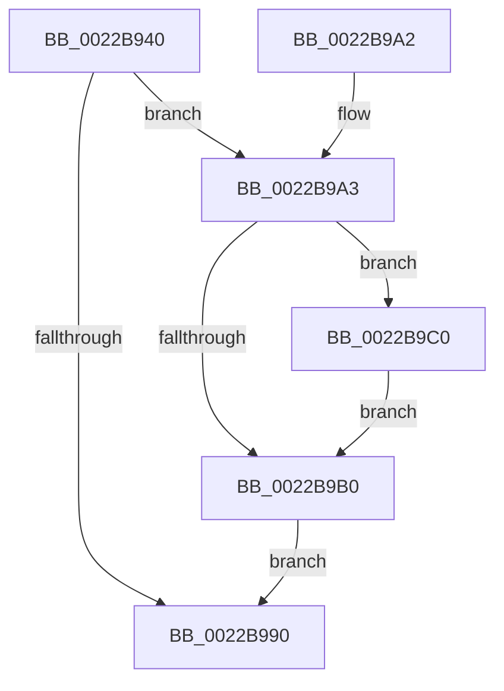

# MiDecrementCombinedPteEx

- RVA: `0x0022B940`–`0x0022B9CA` (길이 `138` bytes)
- VA: `0x000000014022B940`
- 실행 섹션: `.text`
- PDB 이름 있음: `예`; PDB Function 태그: `아니요`
- unwind 정보 RVA: `0x0005FF3C`
- 디코드: `38`개 명령, `138/138` bytes 표시
- 미해석 바이트: `0` (있으면 어셈블리에 `.byte`로 보존)

> 이 문서는 커널 이미지의 기계어와 PDB 기호를 분석해 생성했습니다. 4번과 5번은 함수 원형과 자료형을 바이너리 사용 방식에서 추정한 C 해석이며 원본 소스 복구 결과는 아닙니다.

## 1. Dependencies

- 직접 호출 지점: **3**; 고유 호출 대상: **3**
- 직접 호출자로 확인된 함수: **5**
- RIP 상대 이미지 참조: **1**

### Outgoing calls
- `0x0022B982` → [MiDecrementCloneBlock](MiDecrementCloneBlock_function_0022BA8C.md) (function, `0x0022BA8C`)
- `0x0022B9B9` → [MiFreeCombineBlock](../37/MiFreeCombineBlock_function_00372000.md) (function, `0x00372000`)
- `0x0022B9C3` → [MiLogCombinedPteDelete](../68/MiLogCombinedPteDelete_function_0068BF1C.md) (function, `0x0068BF1C`)

### Direct callers
- [MiConvertStandbyToProto](MiConvertStandbyToProto_function_0022A330.md) at `0x0022A403`
- [MiDemoteCombinedPte](MiDemoteCombinedPte_function_0022ABAC.md) at `0x0022AD45`
- [MiConvertPrivateToProto](MiConvertPrivateToProto_function_0022B0E4.md) at `0x0022B145`
- [MiCopyOnWrite](../36/MiCopyOnWrite_function_00362A0C.md) at `0x00363057`
- [sub_006D7D5E](../6D/Unknown_function_006D7D5E.md) at `0x006D7D86`

### Static image references
- `0x0022B9A3` → RVA `0x00FC6B04` (`ALMOSTRO`; read)

## 2. Other-region calls and transfers

- 다른 실행 섹션으로 향하는 call: **0**
- 별도 외부 분기/꼬리 이동을 확인하지 못했습니다.

## 3. Assembly (complete function range)

```asm
0022B940  4C 8B DC                        mov r11, rsp
0022B943  49 89 5B 08                     mov qword ptr [r11 + 8], rbx
0022B947  49 89 73 10                     mov qword ptr [r11 + 0x10], rsi
0022B94B  57                              push rdi
0022B94C  48 83 EC 30                     sub rsp, 0x30
0022B950  83 64 24 50 00                  and dword ptr [rsp + 0x50], 0
0022B955  48 8B DA                        mov rbx, rdx
0022B958  48 8B D1                        mov rdx, rcx
0022B95B  48 8D 43 E0                     lea rax, [rbx - 0x20]
0022B95F  48 25 00 F0 FF FF               and rax, 0xfffffffffffff000
0022B965  4C 8B 48 10                     mov r9, qword ptr [rax + 0x10]
0022B969  49 8D 43 18                     lea rax, [r11 + 0x18]
0022B96D  49 89 43 E8                     mov qword ptr [r11 - 0x18], rax
0022B971  49 8B 09                        mov rcx, qword ptr [r9]
0022B974  F0 41 FF 89 88 01 00 00         lock dec dword ptr [r9 + 0x188]
0022B97C  45 8B C8                        mov r9d, r8d
0022B97F  4C 8B C3                        mov r8, rbx
0022B982  E8 05 01 00 00                  call 0x14022ba8c
0022B987  83 7C 24 50 00                  cmp dword ptr [rsp + 0x50], 0
0022B98C  8B F0                           mov esi, eax
0022B98E  75 13                           jne 0x14022b9a3
0022B990  48 8B 5C 24 40                  mov rbx, qword ptr [rsp + 0x40]
0022B995  8B C6                           mov eax, esi
0022B997  48 8B 74 24 48                  mov rsi, qword ptr [rsp + 0x48]
0022B99C  48 83 C4 30                     add rsp, 0x30
0022B9A0  5F                              pop rdi
0022B9A1  C3                              ret
0022B9A2  CC                              int3
0022B9A3  44 8B 05 5A B1 D9 00            mov r8d, dword ptr [rip + 0xd9b15a]
0022B9AA  41 F6 C0 01                     test r8b, 1
0022B9AE  75 10                           jne 0x14022b9c0
0022B9B0  BA 01 00 00 00                  mov edx, 1
0022B9B5  48 8D 4B E0                     lea rcx, [rbx - 0x20]
0022B9B9  E8 42 66 14 00                  call 0x140372000
0022B9BE  EB D0                           jmp 0x14022b990
0022B9C0  48 8B CB                        mov rcx, rbx
0022B9C3  E8 54 05 46 00                  call 0x14068bf1c
0022B9C8  EB E6                           jmp 0x14022b9b0
```

## 4. C-style interpretation (structured pseudocode)

```c
__int64 __fastcall MiDecrementCombinedPteEx(__int64 a1, __int64 a2, int a3)
{
    __int64 result;
    __int64 v_rsp;
    unsigned __int64 v_stack_p10;
    unsigned int v_stack_p18;
    unsigned __int64 v_stack_p8;

    *(unsigned __int64 *)(v_rsp + 8) = v_rbx;
    *(unsigned __int64 *)(v_rsp + 16) = v_rsi;
    v_rsp = (v_rsp) - (48);
    result = (a2 - 32) & (0xFFFFFFFFFFFFF000ULL);
    *(unsigned __int64 *)(v_rsp - 24) = v_rsp + 24;
    result = MiDecrementCloneBlock(*(unsigned __int64 *)(*(unsigned __int64 *)(result + 16)), a1, a2, (unsigned int)(a3));
    if (v_stack_p18 != 0) goto loc_0022B9A3;
loc_0022B990:
    v_rsp = (v_rsp) + (48);
    return (unsigned int)((unsigned int)((unsigned int)((unsigned int)(result))));
loc_0022B9A3:
    if ((((unsigned __int8)((unsigned int)(*(unsigned int *)(v_rip + 14266714)))) & (1)) != 0) goto loc_0022B9C0;
loc_0022B9B0:
    result = MiFreeCombineBlock(v_stack_p8 - 32, 1, (unsigned int)(*(unsigned int *)(v_rip + 14266714)), (unsigned int)(a3));
    goto loc_0022B990;
loc_0022B9C0:
    result = MiLogCombinedPteDelete(v_stack_p8, 1, (unsigned int)(*(unsigned int *)(v_rip + 14266714)), (unsigned int)(a3));
    goto loc_0022B9B0;
}
```

## 5. (Beta) C Style

```c
int64_t MiDecrementCombinedPteEx(int64_t Arg1, void *Arg2, int32_t Arg3)
{
    uint8_t *arg2 = (uint8_t *)Arg2;

    int64_t result;
    int64_t local_rsp;
    uint64_t v_stack_p10;
    uint32_t v_stack_p18;
    uint64_t v_stack_p8;

    *(uint64_t *)(local_rsp + 0x8) = local_rbx;
    *(uint64_t *)(local_rsp + 0x10) = local_rsi;
    local_rsp = (local_rsp) - (48);
    result = (Arg2 - 32) & (0xFFFFFFFFFFFFF000ULL);
    *(uint64_t *)(local_rsp - 0x18) = local_rsp + 24;
    result = MiDecrementCloneBlock(*(uint64_t *)(*(uint64_t *)(result + 0x10)), Arg1, Arg2, (uint32_t)(Arg3));
    if (v_stack_p18 != 0) goto loc_0022B9A3;
loc_0022B990:
    local_rsp = (local_rsp) + (48);
    return (uint32_t)((uint32_t)((uint32_t)((uint32_t)(result))));
loc_0022B9A3:
    if ((((uint8_t)((uint32_t)(*(uint32_t *)(v_rip + 0xD9B15A)))) & (1)) != 0) goto loc_0022B9C0;
loc_0022B9B0:
    result = MiFreeCombineBlock(v_stack_p8 - 32, 1, (uint32_t)(*(uint32_t *)(v_rip + 0xD9B15A)), (uint32_t)(Arg3));
    goto loc_0022B990;
loc_0022B9C0:
    result = MiLogCombinedPteDelete(v_stack_p8, 1, (uint32_t)(*(uint32_t *)(v_rip + 0xD9B15A)), (uint32_t)(Arg3));
    goto loc_0022B9B0;
}
```

### 관측된 메모리 오프셋

구조체 형식이 확인되지 않은 접근은 인자 기준의 오프셋으로만 기록했습니다.

| 기준 인자 | 오프셋 표현 | 폭 (bit) | 접근 |
|---|---:|---:|---|
| `Arg2` | `- 0x20` | `64` | `R` |
| `Arg2` | `+ 0x10` | `64` | `R` |

## 6. Execution-region graph

[열기: 2D/3D 그래프와 함수 탐색 컨트롤 패널](../../../control-panel.html?section=text&rva=0x0022B940&view=graph)

- 2D 그래프는 위에서 아래로 흐르고, 3D 그래프는 빈 공간을 드래그해 회전합니다. Shift+드래그는 이동, 휠은 확대·축소, 함수 노드 선택은 대상 보고서 이동입니다.

### Static fallback


