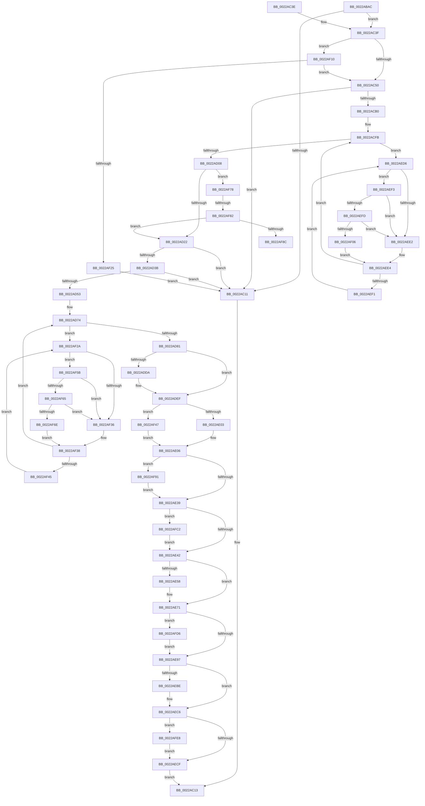

# MiDemoteCombinedPte

- RVA: `0x0022ABAC`–`0x0022B03A` (길이 `1,166` bytes)
- VA: `0x000000014022ABAC`
- 실행 섹션: `.text`
- PDB 이름 있음: `예`; PDB Function 태그: `예`
- unwind 정보 RVA: `0x0005FE44`
- 디코드: `267`개 명령, `1,166/1,166` bytes 표시
- 미해석 바이트: `0` (있으면 어셈블리에 `.byte`로 보존)

> 이 문서는 커널 이미지의 기계어와 PDB 기호를 분석해 생성했습니다. 4번과 5번은 함수 원형과 자료형을 바이너리 사용 방식에서 추정한 C 해석이며 원본 소스 복구 결과는 아닙니다.

## 1. Dependencies

- 직접 호출 지점: **19**; 고유 호출 대상: **17**
- 직접 호출자로 확인된 함수: **8**
- RIP 상대 이미지 참조: **5**

### Outgoing calls
- `0x0022AC1E` → [_security_check_cookie](../6A/_security_check_cookie_function_006AC640.md) (function, `0x006AC640`)
- `0x0022ACCF` → [MiGetWsleContents](../31/MiGetWsleContents_function_00316540.md) (function, `0x00316540`)
- `0x0022ACDA` → [MiGetContainingPageTable](../34/MiGetContainingPageTable_function_003467F0.md) (function, `0x003467F0`)
- `0x0022AD45` → [MiDecrementCombinedPteEx](MiDecrementCombinedPteEx_function_0022B940.md) (function, `0x0022B940`)
- `0x0022ADBB` → [MiSetPfnContainingFrame](../36/MiSetPfnContainingFrame_function_00363FC0.md) (function, `0x00363FC0`)
- `0x0022AE09` → [MiGetPagingFileOffset](../36/MiGetPagingFileOffset_function_0036F530.md) (function, `0x0036F530`)
- `0x0022AE6C` → [MiWriteValidPteNewProtection](../28/MiWriteValidPteNewProtection_function_00281810.md) (function, `0x00281810`)
- `0x0022AE9F` → [MiLockAndDecrementShareCount](../2A/MiLockAndDecrementShareCount_function_002A2854.md) (function, `0x002A2854`)
- `0x0022AEB4` → [MiUpdateWorkingSetPrivateSize](../36/MiUpdateWorkingSetPrivateSize_function_00362250.md) (function, `0x00362250`)
- `0x0022AEFD` → [KiCheckVpBackingLongSpinWaitHypercall](../30/KiCheckVpBackingLongSpinWaitHypercall_function_0030F490.md) (function, `0x0030F490`)
- `0x0022AF09` → [HvlNotifyLongSpinWait](../30/HvlNotifyLongSpinWait_function_0030F460.md) (function, `0x0030F460`)
- `0x0022AF4C` → [MiClearPageFileReservation](../32/MiClearPageFileReservation_function_0032B68C.md) (function, `0x0032B68C`)
- `0x0022AF65` → [KiCheckVpBackingLongSpinWaitHypercall](../30/KiCheckVpBackingLongSpinWaitHypercall_function_0030F490.md) (function, `0x0030F490`)
- `0x0022AF71` → [HvlNotifyLongSpinWait](../30/HvlNotifyLongSpinWait_function_0030F460.md) (function, `0x0030F460`)
- `0x0022AFB8` → [MiUpdatePageFileBlockOwner](MiUpdatePageFileBlockOwner_function_0022F6BC.md) (function, `0x0022F6BC`)
- `0x0022AFCC` → [MiIdentifyPfn](../31/MiIdentifyPfn_function_0031CAC0.md) (function, `0x0031CAC0`)
- `0x0022AFDE` → [MiUnlockPageTableCharges](../40/MiUnlockPageTableCharges_function_00408140.md) (function, `0x00408140`)
- `0x0022AFED` → [MiLogCombinedPteDelete](../68/MiLogCombinedPteDelete_function_0068BF1C.md) (function, `0x0068BF1C`)
- `0x0022B030` → [EtwTraceKernelEvent](../23/EtwTraceKernelEvent_function_00235350.md) (function, `0x00235350`)

### Direct callers
- [MiWalkVaCheckCommon](MiWalkVaCheckCommon_function_0022A960.md) at `0x0022A9CD`
- [MiEmptyWorkingSetHelper](../24/MiEmptyWorkingSetHelper_function_00240C00.md) at `0x00240F33`
- [sub_00241476](../24/Unknown_function_00241476.md) at `0x00241836`
- [MiActOnPte](../24/MiActOnPte_function_00244C90.md) at `0x002451D8`
- [sub_0028F8D8](../28/Unknown_function_0028F8D8.md) at `0x0028F9F2`
- [MiTrimPte](../29/MiTrimPte_function_00292F30.md) at `0x002931C2`
- [MiDeprioritizeVirtualAddresses](../42/MiDeprioritizeVirtualAddresses_function_0042AD1C.md) at `0x0042AF34`
- [NtUnlockVirtualMemory](../4E/NtUnlockVirtualMemory_function_004EE890.md) at `0x004EEC5B`

### Static image references
- `0x0022ABC3` → RVA `0x00E0A740` (`.data`; read)
- `0x0022AC85` → RVA `0x00E30088` (`.data`; read)
- `0x0022AD5F` → RVA `0x00FC6B04` (`ALMOSTRO`; read)
- `0x0022AED9` → RVA `0x00FC52AC` (`ALMOSTRO`; reference)
- `0x0022AEF3` → RVA `0x00FC6AB8` (`ALMOSTRO`; read)

## 2. Other-region calls and transfers

- 다른 실행 섹션으로 향하는 call: **0**
- call이 아닌 외부 분기/꼬리 이동: **2**
  - `0x0022AF7C` → [sub_006D7132](../6D/Unknown_function_006D7132.md) (`tail-transfer`)
  - `0x0022AF8C` → [sub_006D7132](../6D/Unknown_function_006D7132.md) (`tail-transfer`)

## 3. Assembly (complete function range)

```asm
0022ABAC  48 89 5C 24 20                  mov qword ptr [rsp + 0x20], rbx
0022ABB1  55                              push rbp
0022ABB2  56                              push rsi
0022ABB3  57                              push rdi
0022ABB4  41 54                           push r12
0022ABB6  41 55                           push r13
0022ABB8  41 56                           push r14
0022ABBA  41 57                           push r15
0022ABBC  48 81 EC A0 00 00 00            sub rsp, 0xa0
0022ABC3  48 8B 05 76 FB BD 00            mov rax, qword ptr [rip + 0xbdfb76]
0022ABCA  48 33 C4                        xor rax, rsp
0022ABCD  48 89 84 24 98 00 00 00         mov qword ptr [rsp + 0x98], rax
0022ABD5  48 8B 1A                        mov rbx, qword ptr [rdx]
0022ABD8  4D 8D 50 E0                     lea r10, [r8 - 0x20]
0022ABDC  33 C0                           xor eax, eax
0022ABDE  4C 89 44 24 30                  mov qword ptr [rsp + 0x30], r8
0022ABE3  48 89 84 24 80 00 00 00         mov qword ptr [rsp + 0x80], rax
0022ABEB  4C 8B E9                        mov r13, rcx
0022ABEE  49 8B 42 38                     mov rax, qword ptr [r10 + 0x38]
0022ABF2  B9 01 00 00 00                  mov ecx, 1
0022ABF7  48 89 54 24 40                  mov qword ptr [rsp + 0x40], rdx
0022ABFC  0F 57 C0                        xorps xmm0, xmm0
0022ABFF  48 89 5C 24 58                  mov qword ptr [rsp + 0x58], rbx
0022AC04  4C 8B DA                        mov r11, rdx
0022AC07  0F 11 44 24 70                  movups xmmword ptr [rsp + 0x70], xmm0
0022AC0C  48 3B C1                        cmp rax, rcx
0022AC0F  76 2E                           jbe 0x14022ac3f
0022AC11  33 C0                           xor eax, eax
0022AC13  48 8B 8C 24 98 00 00 00         mov rcx, qword ptr [rsp + 0x98]
0022AC1B  48 33 CC                        xor rcx, rsp
0022AC1E  E8 1D 1A 48 00                  call 0x1406ac640
0022AC23  48 8B 9C 24 F8 00 00 00         mov rbx, qword ptr [rsp + 0xf8]
0022AC2B  48 81 C4 A0 00 00 00            add rsp, 0xa0
0022AC32  41 5F                           pop r15
0022AC34  41 5E                           pop r14
0022AC36  41 5D                           pop r13
0022AC38  41 5C                           pop r12
0022AC3A  5F                              pop rdi
0022AC3B  5E                              pop rsi
0022AC3C  5D                              pop rbp
0022AC3D  C3                              ret
0022AC3E  CC                              int3
0022AC3F  41 8B 85 B8 00 00 00            mov eax, dword ptr [r13 + 0xb8]
0022AC46  33 ED                           xor ebp, ebp
0022AC48  A8 0F                           test al, 0xf
0022AC4A  0F 84 C0 02 00 00               je 0x14022af10
0022AC50  48 8B C3                        mov rax, rbx
0022AC53  48 B9 FF FF FF FF FF 00 00 00   movabs rcx, 0xffffffffff
0022AC5D  48 C1 E8 0C                     shr rax, 0xc
0022AC61  48 23 C1                        and rax, rcx
0022AC64  48 89 44 24 68                  mov qword ptr [rsp + 0x68], rax
0022AC69  48 8D 34 40                     lea rsi, [rax + rax*2]
0022AC6D  48 B8 00 00 00 00 00 DE FF FF   movabs rax, 0xffffde0000000000
0022AC77  48 C1 E6 04                     shl rsi, 4
0022AC7B  48 8B C0                        mov rax, rax
0022AC7E  48 03 F0                        add rsi, rax
0022AC81  48 8B 46 28                     mov rax, qword ptr [rsi + 0x28]
0022AC85  48 8B 15 FC 53 C0 00            mov rdx, qword ptr [rip + 0xc053fc]
0022AC8C  48 C1 E8 2B                     shr rax, 0x2b
0022AC90  25 FF 03 00 00                  and eax, 0x3ff
0022AC95  4C 8B 04 C2                     mov r8, qword ptr [rdx + rax*8]
0022AC99  41 0F B7 85 AE 00 00 00         movzx eax, word ptr [r13 + 0xae]
0022ACA1  4C 89 44 24 60                  mov qword ptr [rsp + 0x60], r8
0022ACA6  4C 39 04 C2                     cmp qword ptr [rdx + rax*8], r8
0022ACAA  0F 85 61 FF FF FF               jne 0x14022ac11
0022ACB0  4D 8B E3                        mov r12, r11
0022ACB3  49 C1 E4 19                     shl r12, 0x19
0022ACB7  48 B8 00 00 00 00 80 F6 FF FF   movabs rax, 0xfffff68000000000
0022ACC1  48 C1 E0 19                     shl rax, 0x19
0022ACC5  4C 2B E0                        sub r12, rax
0022ACC8  49 C1 FC 10                     sar r12, 0x10
0022ACCC  49 8B D4                        mov rdx, r12
0022ACCF  E8 6C B8 0E 00                  call 0x140316540
0022ACD4  49 8B CB                        mov rcx, r11
0022ACD7  40 8A F8                        mov dil, al
0022ACDA  E8 11 BB 11 00                  call 0x1403467f0
0022ACDF  49 81 E2 00 F0 FF FF            and r10, 0xfffffffffffff000
0022ACE6  48 89 44 24 50                  mov qword ptr [rsp + 0x50], rax
0022ACEB  45 33 F6                        xor r14d, r14d
0022ACEE  49 8B 4A 10                     mov rcx, qword ptr [r10 + 0x10]
0022ACF2  48 89 4C 24 48                  mov qword ptr [rsp + 0x48], rcx
0022ACF7  45 8D 7E 01                     lea r15d, [r14 + 1]
0022ACFB  F0 48 0F BA 6E 18 3F            lock bts qword ptr [rsi + 0x18], 0x3f
0022AD02  0F 82 CE 01 00 00               jb 0x14022aed6
0022AD08  8B 46 20                        mov eax, dword ptr [rsi + 0x20]
0022AD0B  49 8B CF                        mov rcx, r15
0022AD0E  4C 8B 7C 24 30                  mov r15, qword ptr [rsp + 0x30]
0022AD13  41 BE 02 00 00 00               mov r14d, 2
0022AD19  66 3B C1                        cmp ax, cx
0022AD1C  0F 85 56 02 00 00               jne 0x14022af78
0022AD22  33 C0                           xor eax, eax
0022AD24  48 B9 FF FF FF FF FF FF FF 7F   movabs rcx, 0x7fffffffffffffff
0022AD2E  F0 48 21 4E 18                  lock and qword ptr [rsi + 0x18], rcx
0022AD33  85 C0                           test eax, eax
0022AD35  0F 85 D6 FE FF FF               jne 0x14022ac11
0022AD3B  44 8D 40 06                     lea r8d, [rax + 6]
0022AD3F  49 8B D7                        mov rdx, r15
0022AD42  49 8B CD                        mov rcx, r13
0022AD45  E8 F6 0B 00 00                  call 0x14022b940
0022AD4A  41 3B C6                        cmp eax, r14d
0022AD4D  0F 84 BE FE FF FF               je 0x14022ac11
0022AD53  48 8B 44 24 48                  mov rax, qword ptr [rsp + 0x48]
0022AD58  F0 FF 88 88 01 00 00            lock dec dword ptr [rax + 0x188]
0022AD5F  44 8B 3D 9E BD D9 00            mov r15d, dword ptr [rip + 0xd9bd9e]
0022AD66  41 81 E7 01 00 00 08            and r15d, 0x8000001
0022AD6D  45 33 F6                        xor r14d, r14d
0022AD70  41 8D 5E 01                     lea ebx, [r14 + 1]
0022AD74  F0 48 0F BA 6E 18 3F            lock bts qword ptr [rsi + 0x18], 0x3f
0022AD7B  0F 82 A9 01 00 00               jb 0x14022af2a
0022AD81  8B 46 20                        mov eax, dword ptr [rsi + 0x20]
0022AD84  48 B9 FF FF FF FF FF FF FF 7F   movabs rcx, 0x7fffffffffffffff
0022AD8E  48 8B 44 24 40                  mov rax, qword ptr [rsp + 0x40]
0022AD93  48 8B 54 24 50                  mov rdx, qword ptr [rsp + 0x50]
0022AD98  48 89 46 08                     mov qword ptr [rsi + 8], rax
0022AD9C  48 8B 46 28                     mov rax, qword ptr [rsi + 0x28]
0022ADA0  48 23 C1                        and rax, rcx
0022ADA3  48 8B CE                        mov rcx, rsi
0022ADA6  48 89 46 28                     mov qword ptr [rsi + 0x28], rax
0022ADAA  48 B8 FF FF FF FF FF 00 00 00   movabs rax, 0xffffffffff
0022ADB4  4C 8B 76 28                     mov r14, qword ptr [rsi + 0x28]
0022ADB8  4C 23 F0                        and r14, rax
0022ADBB  E8 00 92 13 00                  call 0x140363fc0
0022ADC0  48 8B 4E 10                     mov rcx, qword ptr [rsi + 0x10]
0022ADC4  48 8B 5C 24 58                  mov rbx, qword ptr [rsp + 0x58]
0022ADC9  48 8B C1                        mov rax, rcx
0022ADCC  48 C1 E8 05                     shr rax, 5
0022ADD0  8B D0                           mov edx, eax
0022ADD2  83 E2 05                        and edx, 5
0022ADD5  80 FA 05                        cmp dl, 5
0022ADD8  75 15                           jne 0x14022adef
0022ADDA  83 E0 1E                        and eax, 0x1e
0022ADDD  48 81 E1 1F FC FF FF            and rcx, 0xfffffffffffffc1f
0022ADE4  48 C1 E0 05                     shl rax, 5
0022ADE8  48 0B C1                        or rax, rcx
0022ADEB  48 89 46 10                     mov qword ptr [rsi + 0x10], rax
0022ADEF  48 8B 46 10                     mov rax, qword ptr [rsi + 0x10]
0022ADF3  48 89 44 24 38                  mov qword ptr [rsp + 0x38], rax
0022ADF8  C0 E8 02                        shr al, 2
0022ADFB  A8 01                           test al, 1
0022ADFD  0F 85 44 01 00 00               jne 0x14022af47
0022AE03  45 33 D2                        xor r10d, r10d
0022AE06  49 8B CA                        mov rcx, r10
0022AE09  E8 22 47 14 00                  call 0x14036f530
0022AE0E  4C 8B 5C 24 60                  mov r11, qword ptr [rsp + 0x60]
0022AE13  49 8B CA                        mov rcx, r10
0022AE16  48 C1 E9 0C                     shr rcx, 0xc
0022AE1A  8B D0                           mov edx, eax
0022AE1C  83 E1 0F                        and ecx, 0xf
0022AE1F  41 C0 EA 02                     shr r10b, 2
0022AE23  B8 01 00 00 00                  mov eax, 1
0022AE28  4D 8B 9C CB 60 48 00 00         mov r11, qword ptr [r11 + rcx*8 + 0x4860]
0022AE30  44 84 D0                        test al, r10b
0022AE33  0F 85 58 01 00 00               jne 0x14022af91
0022AE39  45 85 FF                        test r15d, r15d
0022AE3C  0F 85 80 01 00 00               jne 0x14022afc2
0022AE42  48 B8 FF FF FF FF FF FF FF 7F   movabs rax, 0x7fffffffffffffff
0022AE4C  F0 48 21 46 18                  lock and qword ptr [rsi + 0x18], rax
0022AE51  48 0F BA E3 09                  bt rbx, 9
0022AE56  73 19                           jae 0x14022ae71
0022AE58  48 8B 4C 24 40                  mov rcx, qword ptr [rsp + 0x40]
0022AE5D  48 0F BA F3 09                  btr rbx, 9
0022AE62  48 81 CB 20 08 00 00            or rbx, 0x820
0022AE69  48 8B D3                        mov rdx, rbx
0022AE6C  E8 9F 69 05 00                  call 0x140281810
0022AE71  4B 8D 1C 76                     lea rbx, [r14 + r14*2]
0022AE75  48 B8 00 00 00 00 00 DE FF FF   movabs rax, 0xffffde0000000000
0022AE7F  48 C1 E3 04                     shl rbx, 4
0022AE83  48 8B C0                        mov rax, rax
0022AE86  48 03 D8                        add rbx, rax
0022AE89  40 80 E7 0F                     and dil, 0xf
0022AE8D  40 80 FF 08                     cmp dil, 8
0022AE91  0F 84 3F 01 00 00               je 0x14022afd6
0022AE97  BA 02 00 00 00                  mov edx, 2
0022AE9C  48 8B CB                        mov rcx, rbx
0022AE9F  E8 B0 79 07 00                  call 0x1402a2854
0022AEA4  45 33 C9                        xor r9d, r9d
0022AEA7  49 8B D4                        mov rdx, r12
0022AEAA  49 8B CD                        mov rcx, r13
0022AEAD  41 8D 59 01                     lea ebx, [r9 + 1]
0022AEB1  44 8B C3                        mov r8d, ebx
0022AEB4  E8 97 73 13 00                  call 0x140362250
0022AEB9  48 85 ED                        test rbp, rbp
0022AEBC  74 08                           je 0x14022aec6
0022AEBE  F0 48 FF 85 88 02 00 00         lock inc qword ptr [rbp + 0x288]
0022AEC6  45 85 FF                        test r15d, r15d
0022AEC9  0F 85 19 01 00 00               jne 0x14022afe8
0022AECF  8B C3                           mov eax, ebx
0022AED1  E9 3D FD FF FF                  jmp 0x14022ac13
0022AED6  45 03 F7                        add r14d, r15d
0022AED9  44 85 35 CC A3 D9 00            test dword ptr [rip + 0xd9a3cc], r14d
0022AEE0  74 11                           je 0x14022aef3
0022AEE2  F3 90                           pause
0022AEE4  48 8B 46 18                     mov rax, qword ptr [rsi + 0x18]
0022AEE8  48 85 C0                        test rax, rax
0022AEEB  0F 89 0A FE FF FF               jns 0x14022acfb
0022AEF1  EB E3                           jmp 0x14022aed6
0022AEF3  8B 05 BF BB D9 00               mov eax, dword ptr [rip + 0xd9bbbf]
0022AEF9  A8 40                           test al, 0x40
0022AEFB  74 E5                           je 0x14022aee2
0022AEFD  E8 8E 45 0E 00                  call 0x14030f490
0022AF02  84 C0                           test al, al
0022AF04  74 DC                           je 0x14022aee2
0022AF06  41 8B CE                        mov ecx, r14d
0022AF09  E8 52 45 0E 00                  call 0x14030f460
0022AF0E  EB D4                           jmp 0x14022aee4
0022AF10  49 8D AD 00 FC FF FF            lea rbp, [r13 - 0x400]
0022AF17  48 83 BD 70 02 00 00 00         cmp qword ptr [rbp + 0x270], 0
0022AF1F  0F 84 2B FD FF FF               je 0x14022ac50
0022AF25  E9 E7 FC FF FF                  jmp 0x14022ac11
0022AF2A  44 03 F3                        add r14d, ebx
0022AF2D  44 85 35 78 A3 D9 00            test dword ptr [rip + 0xd9a378], r14d
0022AF34  74 25                           je 0x14022af5b
0022AF36  F3 90                           pause
0022AF38  48 8B 46 18                     mov rax, qword ptr [rsi + 0x18]
0022AF3C  48 85 C0                        test rax, rax
0022AF3F  0F 89 2F FE FF FF               jns 0x14022ad74
0022AF45  EB E3                           jmp 0x14022af2a
0022AF47  48 8D 4C 24 38                  lea rcx, [rsp + 0x38]
0022AF4C  E8 3B 07 10 00                  call 0x14032b68c
0022AF51  4C 8B 54 24 38                  mov r10, qword ptr [rsp + 0x38]
0022AF56  E9 AB FE FF FF                  jmp 0x14022ae06
0022AF5B  8B 05 57 BB D9 00               mov eax, dword ptr [rip + 0xd9bb57]
0022AF61  A8 40                           test al, 0x40
0022AF63  74 D1                           je 0x14022af36
0022AF65  E8 26 45 0E 00                  call 0x14030f490
0022AF6A  84 C0                           test al, al
0022AF6C  74 C8                           je 0x14022af36
0022AF6E  41 8B CE                        mov ecx, r14d
0022AF71  E8 EA 44 0E 00                  call 0x14030f460
0022AF76  EB C0                           jmp 0x14022af38
0022AF78  66 41 3B C6                     cmp ax, r14w
0022AF7C  0F 85 B0 C1 4A 00               jne 0x1406d7132
0022AF82  F6 46 22 08                     test byte ptr [rsi + 0x22], 8
0022AF86  0F 85 96 FD FF FF               jne 0x14022ad22
0022AF8C  E9 A1 C1 4A 00                  jmp 0x1406d7132
0022AF91  0F B6 4E 22                     movzx ecx, byte ptr [rsi + 0x22]
0022AF95  48 B8 FF FF FF FF FF FF FF 7F   movabs rax, 0x7fffffffffffffff
0022AF9F  4C 8B 4C 24 30                  mov r9, qword ptr [rsp + 0x30]
0022AFA4  4C 8B 46 08                     mov r8, qword ptr [rsi + 8]
0022AFA8  4C 23 C8                        and r9, rax
0022AFAB  C1 E9 03                        shr ecx, 3
0022AFAE  83 E1 01                        and ecx, 1
0022AFB1  89 4C 24 20                     mov dword ptr [rsp + 0x20], ecx
0022AFB5  49 8B CB                        mov rcx, r11
0022AFB8  E8 FF 46 00 00                  call 0x14022f6bc
0022AFBD  E9 77 FE FF FF                  jmp 0x14022ae39
0022AFC2  48 8B 4C 24 68                  mov rcx, qword ptr [rsp + 0x68]
0022AFC7  48 8D 54 24 70                  lea rdx, [rsp + 0x70]
0022AFCC  E8 EF 1A 0F 00                  call 0x14031cac0
0022AFD1  E9 6C FE FF FF                  jmp 0x14022ae42
0022AFD6  BA 01 00 00 00                  mov edx, 1
0022AFDB  48 8B CB                        mov rcx, rbx
0022AFDE  E8 5D D1 1D 00                  call 0x140408140
0022AFE3  E9 AF FE FF FF                  jmp 0x14022ae97
0022AFE8  48 8B 4C 24 30                  mov rcx, qword ptr [rsp + 0x30]
0022AFED  E8 2A 0F 46 00                  call 0x14068bf1c
0022AFF2  83 A4 24 94 00 00 00 00         and dword ptr [rsp + 0x94], 0
0022AFFA  48 8D 4C 24 70                  lea rcx, [rsp + 0x70]
0022AFFF  48 89 8C 24 88 00 00 00         mov qword ptr [rsp + 0x88], rcx
0022B007  41 B9 76 02 00 00               mov r9d, 0x276
0022B00D  48 8D 8C 24 88 00 00 00         lea rcx, [rsp + 0x88]
0022B015  C7 84 24 90 00 00 00 18 00 00 00  mov dword ptr [rsp + 0x90], 0x18
0022B020  41 B8 01 00 00 28               mov r8d, 0x28000001
0022B026  C7 44 24 20 04 1B 50 11         mov dword ptr [rsp + 0x20], 0x11501b04
0022B02E  8B D3                           mov edx, ebx
0022B030  E8 1B A3 00 00                  call 0x140235350
0022B035  E9 95 FE FF FF                  jmp 0x14022aecf
```

## 4. C-style interpretation (structured pseudocode)

```c
__int64 __fastcall MiDemoteCombinedPte(__int64 a1, __int64 a2, __int64 a3, int a4)
{
    __int64 result;
    __int64 v_r10;
    __int64 v_r12;
    __int64 v_r14;
    __int64 v_r15;
    __int64 v_rbp;
    __int64 v_rbx;
    __int64 v_rdi;
    __int64 v_rsi;
    __int64 v_rsp;
    unsigned __int64 v_stack_m40;
    unsigned __int64 v_stack_m58;
    unsigned __int64 v_stack_m68;
    unsigned __int64 v_stack_m80;
    unsigned __int64 v_stack_m98;
    unsigned __int64 v_stack_mA8;
    unsigned __int64 v_stack_p20;
    unsigned __int64 v_stack_p30;
    unsigned __int64 v_stack_p38;
    unsigned __int64 v_stack_p40;
    unsigned __int64 v_stack_p48;
    unsigned __int64 v_stack_p50;
    unsigned __int64 v_stack_p58;
    unsigned __int64 v_stack_p60;
    unsigned __int64 v_stack_p68;
    unsigned __int64 v_stack_p70;
    unsigned __int64 v_stack_p88;
    unsigned int v_stack_p90;
    unsigned int v_stack_p94;

    v_stack_p20 = v_rbx;
    v_rsp = (v_rsp) - (160);
    result = (*(unsigned __int64 *)(v_rip + 12450678)) ^ (v_rsp);
    v_stack_m40 = result;
    result = 0;
    v_stack_mA8 = a3;
    v_stack_m58 = 0;
    v_stack_m98 = a2;
    v_stack_m80 = *(unsigned __int64 *)(a2);
    v_stack_m68 = v_xmm0;
    if ((*(unsigned __int64 *)(a3 - 32 + 56)) <= 1) goto loc_0022AC3F;
loc_0022AC11:
    result = 0;
loc_0022AC13:
    a1 = (v_stack_m40) ^ (v_rsp);
    result = _security_check_cookie(a1, a2, a3, a4);
    v_rsp = (v_rsp) + (160);
    return result;
loc_0022AC3F:
    v_rbp = 0;
    if ((((unsigned __int8)((unsigned int)(*(unsigned int *)(a1 + 184)))) & (15)) == 0) goto loc_0022AF10;
loc_0022AC50:
    result = (v_stack_p20) >> (12);
    result = (result) & (a1);
    v_stack_p68 = result;
    v_rsi = (result + result * 2) << (4);
    v_rsi = (v_rsi) + (result);
    result = (*(unsigned __int64 *)(v_rsi + 40)) >> (43);
    result = (unsigned int)((result) & (0x3FFULL));
    v_stack_p60 = *(unsigned __int64 *)(*(unsigned __int64 *)(v_rip + 12604412) + result * 8);
    if ((*(unsigned __int64 *)(*(unsigned __int64 *)(v_rip + 12604412) + *(unsigned __int16 *)(a1 + 174) * 8)) != (*(unsigned __int64 *)(*(unsigned __int64 *)(v_rip + 12604412) + result * 8))) goto loc_0022AC11;
    v_r12 = (a2) << (25);
    result = (*(unsigned __int16 *)(a1 + 174)) << (25);
    v_r12 = (v_r12) - (result);
    v_r12 = (v_r12) >> (16);
    result = MiGetWsleContents(a1, v_r12, *(unsigned __int64 *)(*(unsigned __int64 *)(v_rip + 12604412) + result * 8), a4);
    result = MiGetContainingPageTable(a2, v_r12, *(unsigned __int64 *)(*(unsigned __int64 *)(v_rip + 12604412) + result * 8), a4);
    v_r10 = (a3 - 32) & (0xFFFFFFFFFFFFF000ULL);
    v_stack_p50 = result;
    v_r14 = 0;
    v_stack_p48 = *(unsigned __int64 *)(v_r10 + 16);
loc_0022ACFB:
    if (condition_is_below) goto loc_0022AED6;
    if (((unsigned __int16)((unsigned int)(*(unsigned int *)(v_rsi + 32)))) != ((unsigned __int16)(v_r14 + 1))) goto loc_0022AF78;
loc_0022AD22:
    result = 0;
    if (0 != 0) goto loc_0022AC11;
    result = MiDecrementCombinedPteEx(a1, v_stack_p30, result + 6, a4);
    if (((unsigned int)(result)) == 2) goto loc_0022AC11;
    v_r15 = (unsigned int)(((unsigned int)(*(unsigned int *)(v_rip + 14269854))) & (0x8000001ULL));
    v_r14 = 0;
loc_0022AD74:
    if (condition_is_below) goto loc_0022AF2A;
    *(unsigned __int64 *)(v_rsi + 8) = v_stack_p40;
    result = (*(unsigned __int64 *)(v_rsi + 40)) & (a1);
    *(unsigned __int64 *)(v_rsi + 40) = result;
    v_r14 = (*(unsigned __int64 *)(v_rsi + 40)) & (result);
    result = MiSetPfnContainingFrame(v_rsi, v_stack_p50, result + 6, a4);
    result = (*(unsigned __int64 *)(v_rsi + 16)) >> (5);
    a2 = (unsigned int)(((unsigned int)((unsigned int)(result))) & (5));
    if (((unsigned __int8)(a2)) == 5) {
        result = (unsigned int)((result) & (30));
        a1 = (*(unsigned __int64 *)(v_rsi + 16)) & (-993);
        result = (result) << (5);
        result = (result) | (a1);
        *(unsigned __int64 *)(v_rsi + 16) = result;
    }
    v_stack_p38 = *(unsigned __int64 *)(v_rsi + 16);
    result = (unsigned __int8)((*(unsigned __int64 *)(v_rsi + 16)) >> (2));
    if ((((unsigned __int8)(result)) & (1)) != 0) goto loc_0022AF47;
    v_r10 = 0;
loc_0022AE06:
    result = MiGetPagingFileOffset(0, a2, result + 6, a4);
    a1 = (0) >> (12);
    a1 = (unsigned int)((a1) & (15));
    v_r10 = (unsigned __int8)((v_r10) >> (2));
    if (((1) & ((unsigned __int8)(v_r10))) != 0) goto loc_0022AF91;
loc_0022AE39:
    if ((unsigned int)(v_r15) != 0) goto loc_0022AFC2;
loc_0022AE42:
    result = 1;
    v_rbx = v_stack_p58;
    if (!(condition_is_above_or_equal)) {
        a1 = v_stack_p40;
        v_rbx = (v_stack_p58) | (0x820ULL);
        a2 = v_rbx;
        result = MiWriteValidPteNewProtection(a1, a2, result + 6, a4);
    }
    v_rbx = (v_r14 + v_r14 * 2) << (4);
    v_rbx = (v_rbx) + (result);
    v_rdi = (unsigned __int8)(((unsigned __int8)(result)) & (15));
    if (((unsigned __int8)(v_rdi)) == 8) goto loc_0022AFD6;
loc_0022AE97:
    result = MiLockAndDecrementShareCount(v_rbx, 2, result + 6, a4);
    a4 = 0;
    result = MiUpdateWorkingSetPrivateSize(a1, v_r12, (unsigned int)((unsigned int)(a4 + 1)), a4);
    if (0 != 0) {
    }
    if ((unsigned int)(v_r15) != 0) goto loc_0022AFE8;
loc_0022AECF:
    goto loc_0022AC13;
loc_0022AED6:
    v_r14 = (unsigned int)((v_r14) + ((unsigned int)(v_r15)));
    if (((*(unsigned int *)(v_rip + 14263244)) & ((unsigned int)(v_r14))) == 0) goto loc_0022AEF3;
loc_0022AEE2:
loc_0022AEE4:
    if (!sign_flag) goto loc_0022ACFB;
    goto loc_0022AED6;
loc_0022AEF3:
    if ((((unsigned __int8)((unsigned int)(*(unsigned int *)(v_rip + 14269375)))) & (64)) == 0) goto loc_0022AEE2;
    result = KiCheckVpBackingLongSpinWaitHypercall(a1, v_r12, (unsigned int)((unsigned int)(a4 + 1)), a4);
    if ((unsigned __int8)(result) == 0) goto loc_0022AEE2;
    result = HvlNotifyLongSpinWait((unsigned int)((unsigned int)(v_r14)), v_r12, (unsigned int)((unsigned int)(a4 + 1)), a4);
    goto loc_0022AEE4;
loc_0022AF10:
    if ((*(unsigned __int64 *)(a1 - 1024 + 624)) == 0) goto loc_0022AC50;
    goto loc_0022AC11;
loc_0022AF2A:
    v_r14 = (unsigned int)((v_r14) + ((unsigned int)(a4 + 1)));
    if (((*(unsigned int *)(v_rip + 14263160)) & ((unsigned int)(v_r14))) == 0) goto loc_0022AF5B;
loc_0022AF36:
loc_0022AF38:
    if (!sign_flag) goto loc_0022AD74;
    goto loc_0022AF2A;
loc_0022AF47:
    result = MiClearPageFileReservation(v_stack_p38, v_r12, (unsigned int)((unsigned int)(a4 + 1)), a4);
    goto loc_0022AE06;
loc_0022AF5B:
    if ((((unsigned __int8)((unsigned int)(*(unsigned int *)(v_rip + 14269271)))) & (64)) == 0) goto loc_0022AF36;
    result = KiCheckVpBackingLongSpinWaitHypercall(v_stack_p38, v_r12, (unsigned int)((unsigned int)(a4 + 1)), a4);
    if ((unsigned __int8)(result) == 0) goto loc_0022AF36;
    result = HvlNotifyLongSpinWait((unsigned int)((unsigned int)(v_r14)), v_r12, (unsigned int)((unsigned int)(a4 + 1)), a4);
    goto loc_0022AF38;
loc_0022AF78:
    if (((*(unsigned __int8 *)(v_rsi + 34)) & (8)) != 0) goto loc_0022AD22;
loc_0022AF91:
    a4 = (v_stack_p30) & (result);
    a1 = (unsigned int)((*(unsigned __int8 *)(v_rsi + 34)) >> (3));
    a1 = (unsigned int)((a1) & (1));
    v_stack_p20 = (unsigned int)(a1);
    result = MiUpdatePageFileBlockOwner(*(unsigned __int64 *)(v_stack_p60 + a1 * 8 + 18528), v_r12, *(unsigned __int64 *)(v_rsi + 8), a4);
    goto loc_0022AE39;
loc_0022AFC2:
    result = MiIdentifyPfn(v_stack_p68, v_stack_p70, *(unsigned __int64 *)(v_rsi + 8), a4);
    goto loc_0022AE42;
loc_0022AFD6:
    result = MiUnlockPageTableCharges(a4 + 1, 1, *(unsigned __int64 *)(v_rsi + 8), a4);
    goto loc_0022AE97;
loc_0022AFE8:
    result = MiLogCombinedPteDelete(v_stack_p30, 1, *(unsigned __int64 *)(v_rsi + 8), a4);
    v_stack_p88 = v_stack_p70;
    v_stack_p90 = 24;
    v_stack_p20 = 0x11501B04ULL;
    result = EtwTraceKernelEvent(v_stack_p88, (unsigned int)((unsigned int)(a4 + 1)), (unsigned int)(0x28000001ULL), 630);
    goto loc_0022AECF;
}
```

## 5. (Beta) C Style

```c
int64_t MiDemoteCombinedPte(void *Arg1, void *Arg2, void *Arg3, int32_t Arg4)
{
    uint8_t *arg1 = (uint8_t *)Arg1;
    uint8_t *arg2 = (uint8_t *)Arg2;
    uint8_t *arg3 = (uint8_t *)Arg3;

    int64_t result;
    int64_t local_r10;
    int64_t local_r12;
    int64_t local_r14;
    int64_t local_r15;
    int64_t local_rbp;
    int64_t local_rbx;
    int64_t local_rdi;
    int64_t local_rsi;
    int64_t local_rsp;
    uint64_t v_stack_m40;
    uint64_t v_stack_m58;
    uint64_t v_stack_m68;
    uint64_t v_stack_m80;
    uint64_t v_stack_m98;
    uint64_t v_stack_mA8;
    uint64_t v_stack_p20;
    uint64_t v_stack_p30;
    uint64_t v_stack_p38;
    uint64_t v_stack_p40;
    uint64_t v_stack_p48;
    uint64_t v_stack_p50;
    uint64_t v_stack_p58;
    uint64_t v_stack_p60;
    uint64_t v_stack_p68;
    uint64_t v_stack_p70;
    uint64_t v_stack_p88;
    uint32_t v_stack_p90;
    uint32_t v_stack_p94;

    v_stack_p20 = local_rbx;
    local_rsp = (local_rsp) - (160);
    result = (*(uint64_t *)(v_rip + 0xBDFB76)) ^ (local_rsp);
    v_stack_m40 = result;
    result = 0;
    v_stack_mA8 = Arg3;
    v_stack_m58 = 0;
    v_stack_m98 = Arg2;
    v_stack_m80 = *(uint64_t *)(arg2);
    v_stack_m68 = v_xmm0;
    if ((*(uint64_t *)(arg3 - 0x20 + 0x38)) <= 1) goto loc_0022AC3F;
loc_0022AC11:
    result = 0;
loc_0022AC13:
    Arg1 = (v_stack_m40) ^ (local_rsp);
    result = _security_check_cookie(Arg1, Arg2, Arg3, Arg4);
    local_rsp = (local_rsp) + (160);
    return result;
loc_0022AC3F:
    local_rbp = 0;
    if ((((uint8_t)((uint32_t)(*(uint32_t *)(arg1 + 0xB8)))) & (15)) == 0) goto loc_0022AF10;
loc_0022AC50:
    result = (v_stack_p20) >> (12);
    result = (result) & (Arg1);
    v_stack_p68 = result;
    local_rsi = (result + result * 2) << (4);
    local_rsi = (local_rsi) + (result);
    result = (*(uint64_t *)(local_rsi + 0x28)) >> (43);
    result = (uint32_t)((result) & (0x3FFULL));
    v_stack_p60 = *(uint64_t *)(*(uint64_t *)(v_rip + 0xC053FC) + result * 8);
    if ((*(uint64_t *)(*(uint64_t *)(v_rip + 0xC053FC) + *(uint16_t *)(arg1 + 0xAE) * 8)) != (*(uint64_t *)(*(uint64_t *)(v_rip + 0xC053FC) + result * 8))) goto loc_0022AC11;
    local_r12 = (Arg2) << (25);
    result = (*(uint16_t *)(arg1 + 0xAE)) << (25);
    local_r12 = (local_r12) - (result);
    local_r12 = (local_r12) >> (16);
    result = MiGetWsleContents(Arg1, local_r12, *(uint64_t *)(*(uint64_t *)(v_rip + 0xC053FC) + result * 8), Arg4);
    result = MiGetContainingPageTable(Arg2, local_r12, *(uint64_t *)(*(uint64_t *)(v_rip + 0xC053FC) + result * 8), Arg4);
    local_r10 = (Arg3 - 32) & (0xFFFFFFFFFFFFF000ULL);
    v_stack_p50 = result;
    local_r14 = 0;
    v_stack_p48 = *(uint64_t *)(local_r10 + 0x10);
loc_0022ACFB:
    if (condition_is_below) goto loc_0022AED6;
    if (((uint16_t)((uint32_t)(*(uint32_t *)(local_rsi + 0x20)))) != ((uint16_t)(local_r14 + 1))) goto loc_0022AF78;
loc_0022AD22:
    result = 0;
    if (0 != 0) goto loc_0022AC11;
    result = MiDecrementCombinedPteEx(Arg1, v_stack_p30, result + 6, Arg4);
    if (((uint32_t)(result)) == 2) goto loc_0022AC11;
    local_r15 = (uint32_t)(((uint32_t)(*(uint32_t *)(v_rip + 0xD9BD9E))) & (0x8000001ULL));
    local_r14 = 0;
loc_0022AD74:
    if (condition_is_below) goto loc_0022AF2A;
    *(uint64_t *)(local_rsi + 0x8) = v_stack_p40;
    result = (*(uint64_t *)(local_rsi + 0x28)) & (Arg1);
    *(uint64_t *)(local_rsi + 0x28) = result;
    local_r14 = (*(uint64_t *)(local_rsi + 0x28)) & (result);
    result = MiSetPfnContainingFrame(local_rsi, v_stack_p50, result + 6, Arg4);
    result = (*(uint64_t *)(local_rsi + 0x10)) >> (5);
    Arg2 = (uint32_t)(((uint32_t)((uint32_t)(result))) & (5));
    if (((uint8_t)(Arg2)) == 5) {
        result = (uint32_t)((result) & (30));
        Arg1 = (*(uint64_t *)(local_rsi + 0x10)) & (-993);
        result = (result) << (5);
        result = (result) | (Arg1);
        *(uint64_t *)(local_rsi + 0x10) = result;
    }
    v_stack_p38 = *(uint64_t *)(local_rsi + 0x10);
    result = (uint8_t)((*(uint64_t *)(local_rsi + 0x10)) >> (2));
    if ((((uint8_t)(result)) & (1)) != 0) goto loc_0022AF47;
    local_r10 = 0;
loc_0022AE06:
    result = MiGetPagingFileOffset(0, Arg2, result + 6, Arg4);
    Arg1 = (0) >> (12);
    Arg1 = (uint32_t)((Arg1) & (15));
    local_r10 = (uint8_t)((local_r10) >> (2));
    if (((1) & ((uint8_t)(local_r10))) != 0) goto loc_0022AF91;
loc_0022AE39:
    if ((uint32_t)(local_r15) != 0) goto loc_0022AFC2;
loc_0022AE42:
    result = 1;
    local_rbx = v_stack_p58;
    if (!(condition_is_above_or_equal)) {
        Arg1 = v_stack_p40;
        local_rbx = (v_stack_p58) | (0x820ULL);
        Arg2 = local_rbx;
        result = MiWriteValidPteNewProtection(Arg1, Arg2, result + 6, Arg4);
    }
    local_rbx = (local_r14 + local_r14 * 2) << (4);
    local_rbx = (local_rbx) + (result);
    local_rdi = (uint8_t)(((uint8_t)(result)) & (15));
    if (((uint8_t)(local_rdi)) == 8) goto loc_0022AFD6;
loc_0022AE97:
    result = MiLockAndDecrementShareCount(local_rbx, 2, result + 6, Arg4);
    Arg4 = 0;
    result = MiUpdateWorkingSetPrivateSize(Arg1, local_r12, (uint32_t)((uint32_t)(Arg4 + 1)), Arg4);
    if (0 != 0) {
    }
    if ((uint32_t)(local_r15) != 0) goto loc_0022AFE8;
loc_0022AECF:
    goto loc_0022AC13;
loc_0022AED6:
    local_r14 = (uint32_t)((local_r14) + ((uint32_t)(local_r15)));
    if (((*(uint32_t *)(v_rip + 0xD9A3CC)) & ((uint32_t)(local_r14))) == 0) goto loc_0022AEF3;
loc_0022AEE2:
loc_0022AEE4:
    if (!sign_flag) goto loc_0022ACFB;
    goto loc_0022AED6;
loc_0022AEF3:
    if ((((uint8_t)((uint32_t)(*(uint32_t *)(v_rip + 0xD9BBBF)))) & (64)) == 0) goto loc_0022AEE2;
    result = KiCheckVpBackingLongSpinWaitHypercall(Arg1, local_r12, (uint32_t)((uint32_t)(Arg4 + 1)), Arg4);
    if ((uint8_t)(result) == 0) goto loc_0022AEE2;
    result = HvlNotifyLongSpinWait((uint32_t)((uint32_t)(local_r14)), local_r12, (uint32_t)((uint32_t)(Arg4 + 1)), Arg4);
    goto loc_0022AEE4;
loc_0022AF10:
    if ((*(uint64_t *)(arg1 - 0x400 + 0x270)) == 0) goto loc_0022AC50;
    goto loc_0022AC11;
loc_0022AF2A:
    local_r14 = (uint32_t)((local_r14) + ((uint32_t)(Arg4 + 1)));
    if (((*(uint32_t *)(v_rip + 0xD9A378)) & ((uint32_t)(local_r14))) == 0) goto loc_0022AF5B;
loc_0022AF36:
loc_0022AF38:
    if (!sign_flag) goto loc_0022AD74;
    goto loc_0022AF2A;
loc_0022AF47:
    result = MiClearPageFileReservation(v_stack_p38, local_r12, (uint32_t)((uint32_t)(Arg4 + 1)), Arg4);
    goto loc_0022AE06;
loc_0022AF5B:
    if ((((uint8_t)((uint32_t)(*(uint32_t *)(v_rip + 0xD9BB57)))) & (64)) == 0) goto loc_0022AF36;
    result = KiCheckVpBackingLongSpinWaitHypercall(v_stack_p38, local_r12, (uint32_t)((uint32_t)(Arg4 + 1)), Arg4);
    if ((uint8_t)(result) == 0) goto loc_0022AF36;
    result = HvlNotifyLongSpinWait((uint32_t)((uint32_t)(local_r14)), local_r12, (uint32_t)((uint32_t)(Arg4 + 1)), Arg4);
    goto loc_0022AF38;
loc_0022AF78:
    if (((*(uint8_t *)(local_rsi + 0x22)) & (8)) != 0) goto loc_0022AD22;
loc_0022AF91:
    Arg4 = (v_stack_p30) & (result);
    Arg1 = (uint32_t)((*(uint8_t *)(local_rsi + 0x22)) >> (3));
    Arg1 = (uint32_t)((Arg1) & (1));
    v_stack_p20 = (uint32_t)(Arg1);
    result = MiUpdatePageFileBlockOwner(*(uint64_t *)(v_stack_p60 + arg1 * 8 + 0x4860), local_r12, *(uint64_t *)(local_rsi + 0x8), Arg4);
    goto loc_0022AE39;
loc_0022AFC2:
    result = MiIdentifyPfn(v_stack_p68, v_stack_p70, *(uint64_t *)(local_rsi + 0x8), Arg4);
    goto loc_0022AE42;
loc_0022AFD6:
    result = MiUnlockPageTableCharges(Arg4 + 1, 1, *(uint64_t *)(local_rsi + 0x8), Arg4);
    goto loc_0022AE97;
loc_0022AFE8:
    result = MiLogCombinedPteDelete(v_stack_p30, 1, *(uint64_t *)(local_rsi + 0x8), Arg4);
    v_stack_p88 = v_stack_p70;
    v_stack_p90 = 24;
    v_stack_p20 = 0x11501B04ULL;
    result = EtwTraceKernelEvent(v_stack_p88, (uint32_t)((uint32_t)(Arg4 + 1)), (uint32_t)(0x28000001ULL), 630);
    goto loc_0022AECF;
}
```

### 관측된 메모리 오프셋

구조체 형식이 확인되지 않은 접근은 인자 기준의 오프셋으로만 기록했습니다.

| 기준 인자 | 오프셋 표현 | 폭 (bit) | 접근 |
|---|---:|---:|---|
| `Arg1` | `- 0x400` | `64` | `R` |
| `Arg1` | `+ 0xAE` | `16` | `R` |
| `Arg1` | `+ 0xB8` | `32` | `R` |
| `Arg1` | `+ 0x270` | `64` | `R` |
| `Arg2` | `+ 0x0` | `64` | `R` |
| `Arg3` | `- 0x20` | `64` | `R` |
| `Arg3` | `+ 0x38` | `64` | `R` |

## 6. Execution-region graph

[열기: 2D/3D 그래프와 함수 탐색 컨트롤 패널](../../../control-panel.html?section=text&rva=0x0022ABAC&view=graph)

- 2D 그래프는 위에서 아래로 흐르고, 3D 그래프는 빈 공간을 드래그해 회전합니다. Shift+드래그는 이동, 휠은 확대·축소, 함수 노드 선택은 대상 보고서 이동입니다.

### Static fallback


