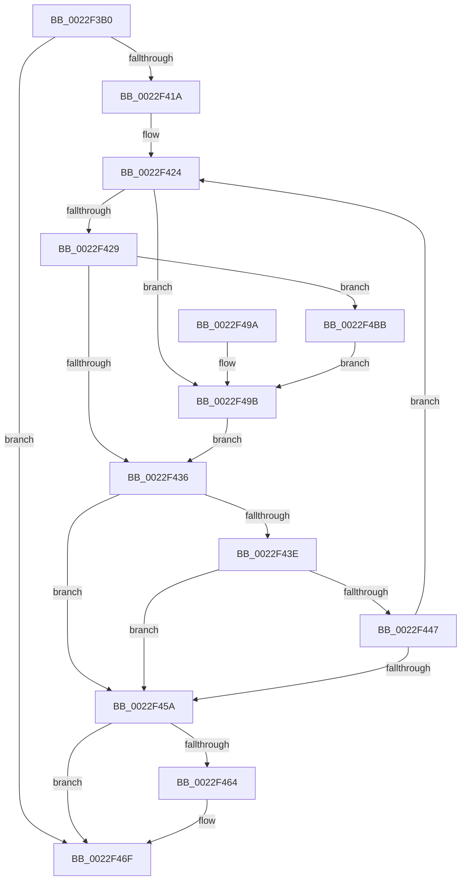

# MiEncodeProtoFill

- RVA: `0x0022F3B0`–`0x0022F4C8` (길이 `280` bytes)
- VA: `0x000000014022F3B0`
- 실행 섹션: `.text`
- PDB 이름 있음: `예`; PDB Function 태그: `아니요`
- unwind 정보 RVA: `0x000600E4`
- 디코드: `78`개 명령, `280/280` bytes 표시
- 미해석 바이트: `0` (있으면 어셈블리에 `.byte`로 보존)

> 이 문서는 커널 이미지의 기계어와 PDB 기호를 분석해 생성했습니다. 4번과 5번은 함수 원형과 자료형을 바이너리 사용 방식에서 추정한 C 해석이며 원본 소스 복구 결과는 아닙니다.

## 1. Dependencies

- 직접 호출 지점: **6**; 고유 호출 대상: **5**
- 직접 호출자로 확인된 함수: **1**
- RIP 상대 이미지 참조: **1**

### Outgoing calls
- `0x0022F409` → [MiLockWorkingSetShared](../27/MiLockWorkingSetShared_function_0027CBF0.md) (function, `0x0027CBF0`)
- `0x0022F43E` → [IS_PTE_NOT_DEMAND_ZERO](IS_PTE_NOT_DEMAND_ZERO_function_0022F4D0.md) (function, `0x0022F4D0`)
- `0x0022F46A` → [MiUnlockPageTable](../21/MiUnlockPageTable_function_00216EC0.md) (function, `0x00216EC0`)
- `0x0022F475` → [MiUnlockWorkingSetShared](../27/MiUnlockWorkingSetShared_function_0027D690.md) (function, `0x0027D690`)
- `0x0022F4B1` → [MiLockNestedPageTable](../23/MiLockNestedPageTable_function_0023E890.md) (function, `0x0023E890`)
- `0x0022F4C1` → [MiUnlockPageTable](../21/MiUnlockPageTable_function_00216EC0.md) (function, `0x00216EC0`)

### Direct callers
- [MiInitializePrototypePtes](../../page/98/MiInitializePrototypePtes_function_009829AC.md) at `0x00982A90`

### Static image references
- `0x0022F3F7` → RVA `0x00E380C0` (`.data`; read)

## 2. Other-region calls and transfers

- 다른 실행 섹션으로 향하는 call: **0**
- 별도 외부 분기/꼬리 이동을 확인하지 못했습니다.

## 3. Assembly (complete function range)

```asm
0022F3B0  48 89 5C 24 10                  mov qword ptr [rsp + 0x10], rbx
0022F3B5  48 89 6C 24 18                  mov qword ptr [rsp + 0x18], rbp
0022F3BA  48 89 74 24 20                  mov qword ptr [rsp + 0x20], rsi
0022F3BF  57                              push rdi
0022F3C0  41 54                           push r12
0022F3C2  41 55                           push r13
0022F3C4  41 56                           push r14
0022F3C6  41 57                           push r15
0022F3C8  48 83 EC 20                     sub rsp, 0x20
0022F3CC  48 8B F1                        mov rsi, rcx
0022F3CF  49 BD 00 00 00 00 80 F6 FF FF   movabs r13, 0xfffff68000000000
0022F3D9  48 C1 EE 09                     shr rsi, 9
0022F3DD  48 B8 F8 FF FF FF 7F 00 00 00   movabs rax, 0x7ffffffff8
0022F3E7  48 23 F0                        and rsi, rax
0022F3EA  49 8B D8                        mov rbx, r8
0022F3ED  49 8B C5                        mov rax, r13
0022F3F0  48 03 F0                        add rsi, rax
0022F3F3  48 C1 EA 09                     shr rdx, 9
0022F3F7  4C 8D 25 C2 8C C0 00            lea r12, [rip + 0xc08cc2]
0022F3FE  33 ED                           xor ebp, ebp
0022F400  49 8B CC                        mov rcx, r12
0022F403  33 FF                           xor edi, edi
0022F405  4C 8D 34 D6                     lea r14, [rsi + rdx*8]
0022F409  E8 E2 D7 04 00                  call 0x14027cbf0
0022F40E  88 44 24 50                     mov byte ptr [rsp + 0x50], al
0022F412  44 8A F8                        mov r15b, al
0022F415  49 3B F6                        cmp rsi, r14
0022F418  73 55                           jae 0x14022f46f
0022F41A  49 BF F8 FF FF FF 7F 00 00 00   movabs r15, 0x7ffffffff8
0022F424  48 85 FF                        test rdi, rdi
0022F427  74 72                           je 0x14022f49b
0022F429  48 F7 C6 FF 0F 00 00            test rsi, 0xfff
0022F430  0F 84 85 00 00 00               je 0x14022f4bb
0022F436  48 8B 0E                        mov rcx, qword ptr [rsi]
0022F439  F6 C1 01                        test cl, 1
0022F43C  75 1C                           jne 0x14022f45a
0022F43E  E8 8D 00 00 00                  call 0x14022f4d0
0022F443  85 C0                           test eax, eax
0022F445  75 13                           jne 0x14022f45a
0022F447  48 89 1E                        mov qword ptr [rsi], rbx
0022F44A  48 81 C5 00 02 00 00            add rbp, 0x200
0022F451  48 83 C6 08                     add rsi, 8
0022F455  49 3B F6                        cmp rsi, r14
0022F458  72 CA                           jb 0x14022f424
0022F45A  44 8A 7C 24 50                  mov r15b, byte ptr [rsp + 0x50]
0022F45F  48 85 FF                        test rdi, rdi
0022F462  74 0B                           je 0x14022f46f
0022F464  48 8B D7                        mov rdx, rdi
0022F467  49 8B CC                        mov rcx, r12
0022F46A  E8 51 7A FE FF                  call 0x140216ec0
0022F46F  41 8A D7                        mov dl, r15b
0022F472  49 8B CC                        mov rcx, r12
0022F475  E8 16 E2 04 00                  call 0x14027d690
0022F47A  48 8B 5C 24 58                  mov rbx, qword ptr [rsp + 0x58]
0022F47F  48 8B C5                        mov rax, rbp
0022F482  48 8B 6C 24 60                  mov rbp, qword ptr [rsp + 0x60]
0022F487  48 8B 74 24 68                  mov rsi, qword ptr [rsp + 0x68]
0022F48C  48 83 C4 20                     add rsp, 0x20
0022F490  41 5F                           pop r15
0022F492  41 5E                           pop r14
0022F494  41 5D                           pop r13
0022F496  41 5C                           pop r12
0022F498  5F                              pop rdi
0022F499  C3                              ret
0022F49A  CC                              int3
0022F49B  48 8B FE                        mov rdi, rsi
0022F49E  48 C1 EF 09                     shr rdi, 9
0022F4A2  49 23 FF                        and rdi, r15
0022F4A5  49 8B C5                        mov rax, r13
0022F4A8  48 03 F8                        add rdi, rax
0022F4AB  49 8B CC                        mov rcx, r12
0022F4AE  48 8B D7                        mov rdx, rdi
0022F4B1  E8 DA F3 00 00                  call 0x14023e890
0022F4B6  E9 7B FF FF FF                  jmp 0x14022f436
0022F4BB  48 8B D7                        mov rdx, rdi
0022F4BE  49 8B CC                        mov rcx, r12
0022F4C1  E8 FA 79 FE FF                  call 0x140216ec0
0022F4C6  EB D3                           jmp 0x14022f49b
```

## 4. C-style interpretation (structured pseudocode)

```c
__int64 __fastcall MiEncodeProtoFill(__int64 a1, __int64 a2, __int64 a3)
{
    __int64 result;
    __int64 v_rbp;
    __int64 v_rdi;
    __int64 v_rsi;
    __int64 v_rsp;
    unsigned __int64 v_stack_p10;
    unsigned __int64 v_stack_p18;
    unsigned __int64 v_stack_p20;
    unsigned __int8 v_stack_p8;

    v_stack_p10 = v_rbx;
    v_stack_p18 = v_rbp;
    v_stack_p20 = v_rsi;
    v_rsp = (v_rsp) - (32);
    v_rsi = (a1) >> (9);
    v_rsi = (v_rsi) & (result);
    v_rsi = (v_rsi) + (v_r13);
    a2 = (a2) >> (9);
    v_rbp = 0;
    v_rdi = 0;
    result = MiLockWorkingSetShared(v_rip + 12618946, a2, a3, a4);
    v_stack_p8 = (unsigned __int8)(result);
    if (v_rsi >= (v_rsi + a2 * 8)) goto loc_0022F46F;
loc_0022F424:
    if (0 == 0) goto loc_0022F49B;
    if (((v_rsi) & (0xFFFULL)) == 0) goto loc_0022F4BB;
loc_0022F436:
    if ((((unsigned __int8)(*(unsigned __int64 *)(v_rsi))) & (1)) != 0) goto loc_0022F45A;
    result = IS_PTE_NOT_DEMAND_ZERO(*(unsigned __int64 *)(v_rsi), a2, a3, a4);
    if ((unsigned int)(result) != 0) goto loc_0022F45A;
    *(unsigned __int64 *)(v_rsi) = a3;
    v_rbp = (v_rbp) + (512);
    v_rsi = (v_rsi) + (8);
    if (v_rsi < (v_rsi + a2 * 8)) goto loc_0022F424;
loc_0022F45A:
    if (0 != 0) {
        a2 = 0;
        a1 = v_rip + 12618946;
        result = MiUnlockPageTable(a1, a2, a3, a4);
    }
    result = MiUnlockWorkingSetShared(v_rip + 12618946, (unsigned __int8)(v_stack_p8), a3, a4);
    v_rsp = (v_rsp) + (32);
    return v_rbp;
loc_0022F49B:
    v_rdi = (v_stack_p20) >> (9);
    v_rdi = (v_rdi) & (v_stack_p8);
    v_rdi = (v_rdi) + (v_r13);
    result = MiLockNestedPageTable(v_rip + 12618946, v_rdi, a3, a4);
    goto loc_0022F436;
loc_0022F4BB:
    result = MiUnlockPageTable(v_rip + 12618946, v_rdi, a3, a4);
    goto loc_0022F49B;
}
```

## 5. (Beta) C Style

```c
int64_t MiEncodeProtoFill(int64_t Arg1, int64_t Arg2, int64_t Arg3)
{
    int64_t result;
    int64_t local_rbp;
    int64_t local_rdi;
    int64_t local_rsi;
    int64_t local_rsp;
    uint64_t v_stack_p10;
    uint64_t v_stack_p18;
    uint64_t v_stack_p20;
    uint8_t v_stack_p8;

    v_stack_p10 = local_rbx;
    v_stack_p18 = local_rbp;
    v_stack_p20 = local_rsi;
    local_rsp = (local_rsp) - (32);
    local_rsi = (Arg1) >> (9);
    local_rsi = (local_rsi) & (result);
    local_rsi = (local_rsi) + (local_r13);
    Arg2 = (Arg2) >> (9);
    local_rbp = 0;
    local_rdi = 0;
    result = MiLockWorkingSetShared(v_rip + 12618946, Arg2, Arg3, a4);
    v_stack_p8 = (uint8_t)(result);
    if (local_rsi >= (local_rsi + Arg2 * 8)) goto loc_0022F46F;
loc_0022F424:
    if (0 == 0) goto loc_0022F49B;
    if (((local_rsi) & (0xFFFULL)) == 0) goto loc_0022F4BB;
loc_0022F436:
    if ((((uint8_t)(*(uint64_t *)(local_rsi))) & (1)) != 0) goto loc_0022F45A;
    result = IS_PTE_NOT_DEMAND_ZERO(*(uint64_t *)(local_rsi), Arg2, Arg3, a4);
    if ((uint32_t)(result) != 0) goto loc_0022F45A;
    *(uint64_t *)(local_rsi) = Arg3;
    local_rbp = (local_rbp) + (512);
    local_rsi = (local_rsi) + (8);
    if (local_rsi < (local_rsi + Arg2 * 8)) goto loc_0022F424;
loc_0022F45A:
    if (0 != 0) {
        Arg2 = 0;
        Arg1 = v_rip + 12618946;
        result = MiUnlockPageTable(Arg1, Arg2, Arg3, a4);
    }
    result = MiUnlockWorkingSetShared(v_rip + 12618946, (uint8_t)(v_stack_p8), Arg3, a4);
    local_rsp = (local_rsp) + (32);
    return local_rbp;
loc_0022F49B:
    local_rdi = (v_stack_p20) >> (9);
    local_rdi = (local_rdi) & (v_stack_p8);
    local_rdi = (local_rdi) + (local_r13);
    result = MiLockNestedPageTable(v_rip + 12618946, local_rdi, Arg3, a4);
    goto loc_0022F436;
loc_0022F4BB:
    result = MiUnlockPageTable(v_rip + 12618946, local_rdi, Arg3, a4);
    goto loc_0022F49B;
}
```

## 6. Execution-region graph

[열기: 2D/3D 그래프와 함수 탐색 컨트롤 패널](../../../control-panel.html?section=text&rva=0x0022F3B0&view=graph)

- 2D 그래프는 위에서 아래로 흐르고, 3D 그래프는 빈 공간을 드래그해 회전합니다. Shift+드래그는 이동, 휠은 확대·축소, 함수 노드 선택은 대상 보고서 이동입니다.

### Static fallback


