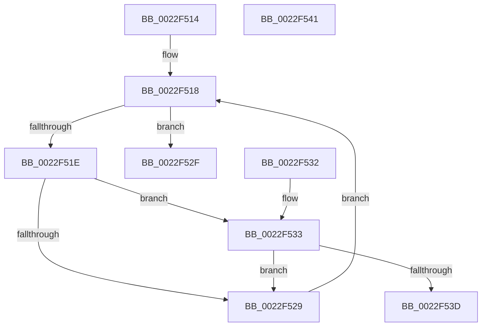

# MiFindZeroCloneBlock

- RVA: `0x0022F514`–`0x0022F542` (길이 `46` bytes)
- VA: `0x000000014022F514`
- 실행 섹션: `.text`
- PDB 이름 있음: `예`; PDB Function 태그: `아니요`
- unwind 정보 RVA: `0x000DB714`
- 디코드: `18`개 명령, `46/46` bytes 표시
- 미해석 바이트: `0` (있으면 어셈블리에 `.byte`로 보존)

> 이 문서는 커널 이미지의 기계어와 PDB 기호를 분석해 생성했습니다. 4번과 5번은 함수 원형과 자료형을 바이너리 사용 방식에서 추정한 C 해석이며 원본 소스 복구 결과는 아닙니다.

## 1. Dependencies

- 직접 호출 지점: **0**; 고유 호출 대상: **0**
- 직접 호출자로 확인된 함수: **1**
- RIP 상대 이미지 참조: **0**

### Outgoing calls
- 직접 디코드된 call 명령이 없습니다.

### Direct callers
- [MiBuildForkPte](MiBuildForkPte_function_0022E32C.md) at `0x0022E850`
- [MiBuildForkPte](MiBuildForkPte_function_0022E32C.md) at `0x0022EF62`

### Static image references
- 디코드된 RIP-relative 메모리 참조가 없습니다.

## 2. Other-region calls and transfers

- 다른 실행 섹션으로 향하는 call: **0**
- 별도 외부 분기/꼬리 이동을 확인하지 못했습니다.

## 3. Assembly (complete function range)

```asm
0022F514  4C 8B 41 18                     mov r8, qword ptr [rcx + 0x18]
0022F518  4C 3B 41 20                     cmp r8, qword ptr [rcx + 0x20]
0022F51C  77 11                           ja 0x14022f52f
0022F51E  49 8B 40 10                     mov rax, qword ptr [r8 + 0x10]
0022F522  83 E0 1F                        and eax, 0x1f
0022F525  3B C2                           cmp eax, edx
0022F527  74 0A                           je 0x14022f533
0022F529  49 83 C0 20                     add r8, 0x20
0022F52D  EB E9                           jmp 0x14022f518
0022F52F  33 C0                           xor eax, eax
0022F531  C3                              ret
0022F532  CC                              int3
0022F533  49 8B 40 18                     mov rax, qword ptr [r8 + 0x18]
0022F537  48 83 F8 FF                     cmp rax, -1
0022F53B  74 EC                           je 0x14022f529
0022F53D  49 8B C0                        mov rax, r8
0022F540  C3                              ret
0022F541  CC                              int3
```

## 4. C-style interpretation (structured pseudocode)

```c
__int64 __fastcall MiFindZeroCloneBlock(__int64 a1, int a2)
{
    __int64 result;

loc_0022F518:
    if ((*(unsigned __int64 *)(a1 + 24)) > (*(unsigned __int64 *)(a1 + 32))) goto loc_0022F52F;
    result = (unsigned int)((*(unsigned __int64 *)(*(unsigned __int64 *)(a1 + 24) + 16)) & (31));
    if (((unsigned int)(result)) == a2) goto loc_0022F533;
loc_0022F529:
    a3 = (*(unsigned __int64 *)(a1 + 24)) + (32);
    goto loc_0022F518;
loc_0022F52F:
    result = 0;
    return result;
loc_0022F533:
    if ((*(unsigned __int64 *)(a3 + 24)) == -1) goto loc_0022F529;
    return a3;
}
```

## 5. (Beta) C Style

```c
int64_t MiFindZeroCloneBlock(void *Arg1, int32_t Arg2)
{
    uint8_t *arg1 = (uint8_t *)Arg1;

    int64_t result;

loc_0022F518:
    if ((*(uint64_t *)(arg1 + 0x18)) > (*(uint64_t *)(arg1 + 0x20))) goto loc_0022F52F;
    result = (uint32_t)((*(uint64_t *)(*(uint64_t *)(arg1 + 0x18) + 0x10)) & (31));
    if (((uint32_t)(result)) == Arg2) goto loc_0022F533;
loc_0022F529:
    a3 = (*(uint64_t *)(arg1 + 0x18)) + (32);
    goto loc_0022F518;
loc_0022F52F:
    result = 0;
    return result;
loc_0022F533:
    if ((*(uint64_t *)(a3 + 0x18)) == -1) goto loc_0022F529;
    return a3;
}
```

### 관측된 메모리 오프셋

구조체 형식이 확인되지 않은 접근은 인자 기준의 오프셋으로만 기록했습니다.

| 기준 인자 | 오프셋 표현 | 폭 (bit) | 접근 |
|---|---:|---:|---|
| `Arg1` | `+ 0x18` | `64` | `R` |
| `Arg1` | `+ 0x20` | `64` | `R` |

## 6. Execution-region graph

[열기: 2D/3D 그래프와 함수 탐색 컨트롤 패널](../../../control-panel.html?section=text&rva=0x0022F514&view=graph)

- 2D 그래프는 위에서 아래로 흐르고, 3D 그래프는 빈 공간을 드래그해 회전합니다. Shift+드래그는 이동, 휠은 확대·축소, 함수 노드 선택은 대상 보고서 이동입니다.

### Static fallback


