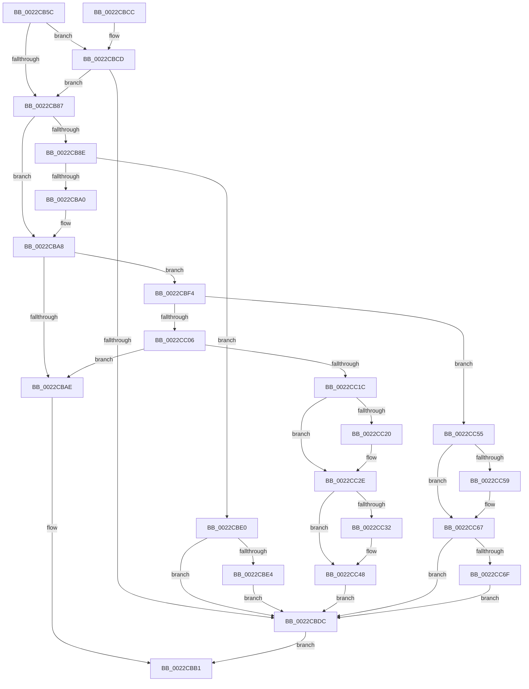

# MiGetCloneCharges

- RVA: `0x0022CB5C`–`0x0022CC8A` (길이 `302` bytes)
- VA: `0x000000014022CB5C`
- 실행 섹션: `.text`
- PDB 이름 있음: `예`; PDB Function 태그: `아니요`
- unwind 정보 RVA: `0x0005FFE4`
- 디코드: `92`개 명령, `302/302` bytes 표시
- 미해석 바이트: `0` (있으면 어셈블리에 `.byte`로 보존)

> 이 문서는 커널 이미지의 기계어와 PDB 기호를 분석해 생성했습니다. 4번과 5번은 함수 원형과 자료형을 바이너리 사용 방식에서 추정한 C 해석이며 원본 소스 복구 결과는 아닙니다.

## 1. Dependencies

- 직접 호출 지점: **10**; 고유 호출 대상: **5**
- 직접 호출자로 확인된 함수: **5**
- RIP 상대 이미지 참조: **0**

### Outgoing calls
- `0x0022CB97` → [MiChargeCommit](../28/MiChargeCommit_function_00286EB0.md) (function, `0x00286EB0`)
- `0x0022CBD3` → [MiChargeCommit](../28/MiChargeCommit_function_00286EB0.md) (function, `0x00286EB0`)
- `0x0022CBED` → [MiReturnCommit](../24/MiReturnCommit_function_00248410.md) (function, `0x00248410`)
- `0x0022CBFD` → [MiChargeResident](../28/MiChargeResident_function_0028A0F0.md) (function, `0x0028A0F0`)
- `0x0022CC13` → [MiGetCrossPartitionCharges](../32/MiGetCrossPartitionCharges_function_00325BFC.md) (function, `0x00325BFC`)
- `0x0022CC29` → [MiReturnCommit](../24/MiReturnCommit_function_00248410.md) (function, `0x00248410`)
- `0x0022CC3B` → [MiReturnCommit](../24/MiReturnCommit_function_00248410.md) (function, `0x00248410`)
- `0x0022CC4E` → [MiReturnResident](../28/MiReturnResident_function_00286890.md) (function, `0x00286890`)
- `0x0022CC62` → [MiReturnCommit](../24/MiReturnCommit_function_00248410.md) (function, `0x00248410`)
- `0x0022CC78` → [MiReturnCommit](../24/MiReturnCommit_function_00248410.md) (function, `0x00248410`)

### Direct callers
- [MiCombineInitialInstance](MiCombineInitialInstance_function_0022BC0C.md) at `0x0022C601`
- [MiCombineInitialInstance](MiCombineInitialInstance_function_0022BC0C.md) at `0x0022C6CC`
- [MiChargeCrossPartitionSharedPage](MiChargeCrossPartitionSharedPage_function_0022CA9C.md) at `0x0022CB1F`
- [MiHandleForkTransitionPte](MiHandleForkTransitionPte_function_0022D34C.md) at `0x0022D426`
- [MiBuildForkPte](MiBuildForkPte_function_0022E32C.md) at `0x0022E88F`
- [MiBuildForkPte](MiBuildForkPte_function_0022E32C.md) at `0x0022EDA4`
- [MiWriteSharedDemandZeroPte](../4A/MiWriteSharedDemandZeroPte_function_004A8DDC.md) at `0x004A8ED2`

### Static image references
- 디코드된 RIP-relative 메모리 참조가 없습니다.

## 2. Other-region calls and transfers

- 다른 실행 섹션으로 향하는 call: **0**
- 별도 외부 분기/꼬리 이동을 확인하지 못했습니다.

## 3. Assembly (complete function range)

```asm
0022CB5C  48 8B C4                        mov rax, rsp
0022CB5F  48 89 58 08                     mov qword ptr [rax + 8], rbx
0022CB63  48 89 68 10                     mov qword ptr [rax + 0x10], rbp
0022CB67  48 89 70 18                     mov qword ptr [rax + 0x18], rsi
0022CB6B  48 89 78 20                     mov qword ptr [rax + 0x20], rdi
0022CB6F  41 56                           push r14
0022CB71  48 83 EC 20                     sub rsp, 0x20
0022CB75  8B FA                           mov edi, edx
0022CB77  41 BE 01 00 00 00               mov r14d, 1
0022CB7D  8B EA                           mov ebp, edx
0022CB7F  48 8B D9                        mov rbx, rcx
0022CB82  41 23 FE                        and edi, r14d
0022CB85  75 46                           jne 0x14022cbcd
0022CB87  8B F5                           mov esi, ebp
0022CB89  83 E6 02                        and esi, 2
0022CB8C  74 1A                           je 0x14022cba8
0022CB8E  45 33 C0                        xor r8d, r8d
0022CB91  49 8B D6                        mov rdx, r14
0022CB94  48 8B CB                        mov rcx, rbx
0022CB97  E8 14 A3 05 00                  call 0x140286eb0
0022CB9C  85 C0                           test eax, eax
0022CB9E  74 40                           je 0x14022cbe0
0022CBA0  F0 4C 01 B3 B8 4C 00 00         lock add qword ptr [rbx + 0x4cb8], r14
0022CBA8  40 F6 C5 04                     test bpl, 4
0022CBAC  75 46                           jne 0x14022cbf4
0022CBAE  41 8B C6                        mov eax, r14d
0022CBB1  48 8B 5C 24 30                  mov rbx, qword ptr [rsp + 0x30]
0022CBB6  48 8B 6C 24 38                  mov rbp, qword ptr [rsp + 0x38]
0022CBBB  48 8B 74 24 40                  mov rsi, qword ptr [rsp + 0x40]
0022CBC0  48 8B 7C 24 48                  mov rdi, qword ptr [rsp + 0x48]
0022CBC5  48 83 C4 20                     add rsp, 0x20
0022CBC9  41 5E                           pop r14
0022CBCB  C3                              ret
0022CBCC  CC                              int3
0022CBCD  45 33 C0                        xor r8d, r8d
0022CBD0  49 8B D6                        mov rdx, r14
0022CBD3  E8 D8 A2 05 00                  call 0x140286eb0
0022CBD8  85 C0                           test eax, eax
0022CBDA  75 AB                           jne 0x14022cb87
0022CBDC  33 C0                           xor eax, eax
0022CBDE  EB D1                           jmp 0x14022cbb1
0022CBE0  85 FF                           test edi, edi
0022CBE2  74 F8                           je 0x14022cbdc
0022CBE4  45 33 C0                        xor r8d, r8d
0022CBE7  49 8B D6                        mov rdx, r14
0022CBEA  48 8B CB                        mov rcx, rbx
0022CBED  E8 1E B8 01 00                  call 0x140248410
0022CBF2  EB E8                           jmp 0x14022cbdc
0022CBF4  45 33 C0                        xor r8d, r8d
0022CBF7  49 8B D6                        mov rdx, r14
0022CBFA  48 8B CB                        mov rcx, rbx
0022CBFD  E8 EE D4 05 00                  call 0x14028a0f0
0022CC02  85 C0                           test eax, eax
0022CC04  74 4F                           je 0x14022cc55
0022CC06  45 33 C0                        xor r8d, r8d
0022CC09  4D 8B CE                        mov r9, r14
0022CC0C  48 8B CB                        mov rcx, rbx
0022CC0F  41 8D 50 06                     lea edx, [r8 + 6]
0022CC13  E8 E4 8F 0F 00                  call 0x140325bfc
0022CC18  85 C0                           test eax, eax
0022CC1A  79 92                           jns 0x14022cbae
0022CC1C  85 FF                           test edi, edi
0022CC1E  74 0E                           je 0x14022cc2e
0022CC20  45 33 C0                        xor r8d, r8d
0022CC23  49 8B D6                        mov rdx, r14
0022CC26  48 8B CB                        mov rcx, rbx
0022CC29  E8 E2 B7 01 00                  call 0x140248410
0022CC2E  85 F6                           test esi, esi
0022CC30  74 16                           je 0x14022cc48
0022CC32  45 33 C0                        xor r8d, r8d
0022CC35  49 8B D6                        mov rdx, r14
0022CC38  48 8B CB                        mov rcx, rbx
0022CC3B  E8 D0 B7 01 00                  call 0x140248410
0022CC40  F0 48 FF 8B B8 4C 00 00         lock dec qword ptr [rbx + 0x4cb8]
0022CC48  49 8B D6                        mov rdx, r14
0022CC4B  48 8B CB                        mov rcx, rbx
0022CC4E  E8 3D 9C 05 00                  call 0x140286890
0022CC53  EB 87                           jmp 0x14022cbdc
0022CC55  85 FF                           test edi, edi
0022CC57  74 0E                           je 0x14022cc67
0022CC59  45 33 C0                        xor r8d, r8d
0022CC5C  49 8B D6                        mov rdx, r14
0022CC5F  48 8B CB                        mov rcx, rbx
0022CC62  E8 A9 B7 01 00                  call 0x140248410
0022CC67  85 F6                           test esi, esi
0022CC69  0F 84 6D FF FF FF               je 0x14022cbdc
0022CC6F  45 33 C0                        xor r8d, r8d
0022CC72  49 8B D6                        mov rdx, r14
0022CC75  48 8B CB                        mov rcx, rbx
0022CC78  E8 93 B7 01 00                  call 0x140248410
0022CC7D  F0 48 FF 8B B8 4C 00 00         lock dec qword ptr [rbx + 0x4cb8]
0022CC85  E9 52 FF FF FF                  jmp 0x14022cbdc
```

## 4. C-style interpretation (structured pseudocode)

```c
__int64 __fastcall MiGetCloneCharges(__int64 a1, int a2, int a3)
{
    __int64 result;
    __int64 v_rdi;
    __int64 v_rsi;
    __int64 v_rsp;
    unsigned __int64 v_stack_p10;
    unsigned __int64 v_stack_p18;
    unsigned __int64 v_stack_p20;
    unsigned __int64 v_stack_p8;

    *(unsigned __int64 *)(v_rsp + 8) = v_rbx;
    *(unsigned __int64 *)(v_rsp + 16) = v_rbp;
    *(unsigned __int64 *)(v_rsp + 24) = v_rsi;
    *(unsigned __int64 *)(v_rsp + 32) = v_rdi;
    v_rsp = (v_rsp) - (32);
    v_rdi = (unsigned int)(((unsigned int)(a2)) & (1));
    if (condition_is_not_equal) goto loc_0022CBCD;
loc_0022CB87:
    v_rsi = (unsigned int)(((unsigned int)((unsigned int)((unsigned int)(a2)))) & (2));
    if (condition_is_equal) goto loc_0022CBA8;
    a3 = 0;
    result = MiChargeCommit(a1, 1, a3, a4);
    if ((unsigned int)(result) == 0) goto loc_0022CBE0;
loc_0022CBA8:
    if ((((unsigned __int8)((unsigned int)(a2))) & (4)) != 0) goto loc_0022CBF4;
loc_0022CBAE:
loc_0022CBB1:
    v_rsp = (v_rsp) + (32);
    return 1;
loc_0022CBCD:
    a3 = 0;
    result = MiChargeCommit(a1, 1, a3, a4);
    if ((unsigned int)(result) != 0) goto loc_0022CB87;
loc_0022CBDC:
    result = 0;
    goto loc_0022CBB1;
loc_0022CBE0:
    if ((unsigned int)(v_stack_p20) == 0) goto loc_0022CBDC;
    a3 = 0;
    result = MiReturnCommit(v_stack_p8, 1, a3, a4);
    goto loc_0022CBDC;
loc_0022CBF4:
    a3 = 0;
    result = MiChargeResident(v_stack_p8, 1, a3, a4);
    if ((unsigned int)(result) == 0) goto loc_0022CC55;
    a3 = 0;
    result = MiGetCrossPartitionCharges(v_stack_p8, a3 + 6, a3, 1);
    if (!sign_flag) goto loc_0022CBAE;
    if ((unsigned int)(v_stack_p20) != 0) {
        a3 = 0;
        a2 = 1;
        a1 = v_stack_p8;
        result = MiReturnCommit(a1, a2, a3, 1);
    }
    if ((unsigned int)(v_stack_p18) != 0) {
        a3 = 0;
        a2 = 1;
        a1 = v_stack_p8;
        result = MiReturnCommit(a1, a2, a3, 1);
    }
    result = MiReturnResident(v_stack_p8, 1, a3, 1);
    goto loc_0022CBDC;
loc_0022CC55:
    if ((unsigned int)(v_stack_p20) != 0) {
        a3 = 0;
        a2 = 1;
        a1 = v_stack_p8;
        result = MiReturnCommit(a1, a2, a3, 1);
    }
    if ((unsigned int)(v_stack_p18) == 0) goto loc_0022CBDC;
    a3 = 0;
    result = MiReturnCommit(v_stack_p8, 1, a3, 1);
    goto loc_0022CBDC;
}
```

## 5. (Beta) C Style

```c
int64_t MiGetCloneCharges(void *Arg1, int32_t Arg2, int32_t Arg3)
{
    uint8_t *arg1 = (uint8_t *)Arg1;

    int64_t result;
    int64_t local_rdi;
    int64_t local_rsi;
    int64_t local_rsp;
    uint64_t v_stack_p10;
    uint64_t v_stack_p18;
    uint64_t v_stack_p20;
    uint64_t v_stack_p8;

    *(uint64_t *)(local_rsp + 0x8) = local_rbx;
    *(uint64_t *)(local_rsp + 0x10) = local_rbp;
    *(uint64_t *)(local_rsp + 0x18) = local_rsi;
    *(uint64_t *)(local_rsp + 0x20) = local_rdi;
    local_rsp = (local_rsp) - (32);
    local_rdi = (uint32_t)(((uint32_t)(Arg2)) & (1));
    if (condition_is_not_equal) goto loc_0022CBCD;
loc_0022CB87:
    local_rsi = (uint32_t)(((uint32_t)((uint32_t)((uint32_t)(Arg2)))) & (2));
    if (condition_is_equal) goto loc_0022CBA8;
    Arg3 = 0;
    result = MiChargeCommit(Arg1, 1, Arg3, a4);
    if ((uint32_t)(result) == 0) goto loc_0022CBE0;
loc_0022CBA8:
    if ((((uint8_t)((uint32_t)(Arg2))) & (4)) != 0) goto loc_0022CBF4;
loc_0022CBAE:
loc_0022CBB1:
    local_rsp = (local_rsp) + (32);
    return 1;
loc_0022CBCD:
    Arg3 = 0;
    result = MiChargeCommit(Arg1, 1, Arg3, a4);
    if ((uint32_t)(result) != 0) goto loc_0022CB87;
loc_0022CBDC:
    result = 0;
    goto loc_0022CBB1;
loc_0022CBE0:
    if ((uint32_t)(v_stack_p20) == 0) goto loc_0022CBDC;
    Arg3 = 0;
    result = MiReturnCommit(v_stack_p8, 1, Arg3, a4);
    goto loc_0022CBDC;
loc_0022CBF4:
    Arg3 = 0;
    result = MiChargeResident(v_stack_p8, 1, Arg3, a4);
    if ((uint32_t)(result) == 0) goto loc_0022CC55;
    Arg3 = 0;
    result = MiGetCrossPartitionCharges(v_stack_p8, Arg3 + 6, Arg3, 1);
    if (!sign_flag) goto loc_0022CBAE;
    if ((uint32_t)(v_stack_p20) != 0) {
        Arg3 = 0;
        Arg2 = 1;
        Arg1 = v_stack_p8;
        result = MiReturnCommit(Arg1, Arg2, Arg3, 1);
    }
    if ((uint32_t)(v_stack_p18) != 0) {
        Arg3 = 0;
        Arg2 = 1;
        Arg1 = v_stack_p8;
        result = MiReturnCommit(Arg1, Arg2, Arg3, 1);
    }
    result = MiReturnResident(v_stack_p8, 1, Arg3, 1);
    goto loc_0022CBDC;
loc_0022CC55:
    if ((uint32_t)(v_stack_p20) != 0) {
        Arg3 = 0;
        Arg2 = 1;
        Arg1 = v_stack_p8;
        result = MiReturnCommit(Arg1, Arg2, Arg3, 1);
    }
    if ((uint32_t)(v_stack_p18) == 0) goto loc_0022CBDC;
    Arg3 = 0;
    result = MiReturnCommit(v_stack_p8, 1, Arg3, 1);
    goto loc_0022CBDC;
}
```

### 관측된 메모리 오프셋

구조체 형식이 확인되지 않은 접근은 인자 기준의 오프셋으로만 기록했습니다.

| 기준 인자 | 오프셋 표현 | 폭 (bit) | 접근 |
|---|---:|---:|---|
| `Arg1` | `+ 0x4CB8` | `64` | `R/W` |

## 6. Execution-region graph

[열기: 2D/3D 그래프와 함수 탐색 컨트롤 패널](../../../control-panel.html?section=text&rva=0x0022CB5C&view=graph)

- 2D 그래프는 위에서 아래로 흐르고, 3D 그래프는 빈 공간을 드래그해 회전합니다. Shift+드래그는 이동, 휠은 확대·축소, 함수 노드 선택은 대상 보고서 이동입니다.

### Static fallback


