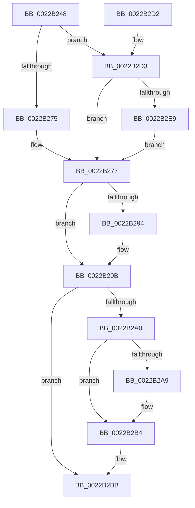

# MiIncrementCombinedPte

- RVA: `0x0022B248`–`0x0022B2F2` (길이 `170` bytes)
- VA: `0x000000014022B248`
- 실행 섹션: `.text`
- PDB 이름 있음: `예`; PDB Function 태그: `아니요`
- unwind 정보 RVA: `0x0005FEC4`
- 디코드: `48`개 명령, `170/170` bytes 표시
- 미해석 바이트: `0` (있으면 어셈블리에 `.byte`로 보존)

> 이 문서는 커널 이미지의 기계어와 PDB 기호를 분석해 생성했습니다. 4번과 5번은 함수 원형과 자료형을 바이너리 사용 방식에서 추정한 C 해석이며 원본 소스 복구 결과는 아닙니다.

## 1. Dependencies

- 직접 호출 지점: **3**; 고유 호출 대상: **3**
- 직접 호출자로 확인된 함수: **2**
- RIP 상대 이미지 참조: **1**

### Outgoing calls
- `0x0022B289` → [MiReferenceCloneProto](MiReferenceCloneProto_function_0022B2F8.md) (function, `0x0022B2F8`)
- `0x0022B2AF` → [KiLowerIrqlProcessIrqlFlags](../4F/KiLowerIrqlProcessIrqlFlags_function_004F5698.md) (function, `0x004F5698`)
- `0x0022B2EB` → [KiRaiseIrqlProcessIrqlFlags](../4F/KiRaiseIrqlProcessIrqlFlags_function_004F56FC.md) (function, `0x004F56FC`)

### Direct callers
- [MiBuildForkPte](MiBuildForkPte_function_0022E32C.md) at `0x0022EA00`
- [MiBuildForkPte](MiBuildForkPte_function_0022E32C.md) at `0x0022F242`
- [MiMapImageScpCfgPages](../29/MiMapImageScpCfgPages_function_00294FA4.md) at `0x00295045`

### Static image references
- `0x0022B2A0` → RVA `0x00FC6D20` (`ALMOSTRO`; read)

## 2. Other-region calls and transfers

- 다른 실행 섹션으로 향하는 call: **0**
- 별도 외부 분기/꼬리 이동을 확인하지 못했습니다.

## 3. Assembly (complete function range)

```asm
0022B248  48 89 5C 24 08                  mov qword ptr [rsp + 8], rbx
0022B24D  48 89 6C 24 10                  mov qword ptr [rsp + 0x10], rbp
0022B252  48 89 74 24 18                  mov qword ptr [rsp + 0x18], rsi
0022B257  57                              push rdi
0022B258  48 83 EC 30                     sub rsp, 0x30
0022B25C  48 8D 42 E0                     lea rax, [rdx - 0x20]
0022B260  48 8B F2                        mov rsi, rdx
0022B263  48 25 00 F0 FF FF               and rax, 0xfffffffffffff000
0022B269  48 8B E9                        mov rbp, rcx
0022B26C  48 8B 78 10                     mov rdi, qword ptr [rax + 0x10]
0022B270  45 85 C0                        test r8d, r8d
0022B273  74 5E                           je 0x14022b2d3
0022B275  B3 11                           mov bl, 0x11
0022B277  48 8B 17                        mov rdx, qword ptr [rdi]
0022B27A  45 33 C9                        xor r9d, r9d
0022B27D  48 83 64 24 20 00               and qword ptr [rsp + 0x20], 0
0022B283  4C 8B C6                        mov r8, rsi
0022B286  48 8B CD                        mov rcx, rbp
0022B289  E8 6A 00 00 00                  call 0x14022b2f8
0022B28E  8B F0                           mov esi, eax
0022B290  85 C0                           test eax, eax
0022B292  74 07                           je 0x14022b29b
0022B294  F0 FF 87 88 01 00 00            lock inc dword ptr [rdi + 0x188]
0022B29B  80 FB 11                        cmp bl, 0x11
0022B29E  74 1B                           je 0x14022b2bb
0022B2A0  83 3D 79 BA D9 00 00            cmp dword ptr [rip + 0xd9ba79], 0
0022B2A7  74 0B                           je 0x14022b2b4
0022B2A9  44 0F 20 C1                     mov rcx, cr8
0022B2AD  8A D3                           mov dl, bl
0022B2AF  E8 E4 A3 2C 00                  call 0x1404f5698
0022B2B4  0F B6 C3                        movzx eax, bl
0022B2B7  44 0F 22 C0                     mov cr8, rax
0022B2BB  48 8B 5C 24 40                  mov rbx, qword ptr [rsp + 0x40]
0022B2C0  8B C6                           mov eax, esi
0022B2C2  48 8B 74 24 50                  mov rsi, qword ptr [rsp + 0x50]
0022B2C7  48 8B 6C 24 48                  mov rbp, qword ptr [rsp + 0x48]
0022B2CC  48 83 C4 30                     add rsp, 0x30
0022B2D0  5F                              pop rdi
0022B2D1  C3                              ret
0022B2D2  CC                              int3
0022B2D3  44 0F 20 C3                     mov rbx, cr8
0022B2D7  BA 02 00 00 00                  mov edx, 2
0022B2DC  44 0F 22 C2                     mov cr8, rdx
0022B2E0  83 3D 39 BA D9 00 00            cmp dword ptr [rip + 0xd9ba39], 0
0022B2E7  74 8E                           je 0x14022b277
0022B2E9  8A CB                           mov cl, bl
0022B2EB  E8 0C A4 2C 00                  call 0x1404f56fc
0022B2F0  EB 85                           jmp 0x14022b277
```

## 4. C-style interpretation (structured pseudocode)

```c
__int64 __fastcall MiIncrementCombinedPte(__int64 a1, __int64 a2, int a3, int a4)
{
    __int64 result;
    __int64 v_rsp;
    unsigned __int64 v_stack_m18;
    unsigned __int64 v_stack_p10;
    unsigned __int64 v_stack_p18;
    unsigned __int64 v_stack_p8;

    v_stack_p8 = v_rbx;
    v_stack_p10 = v_rbp;
    v_stack_p18 = v_rsi;
    v_rsp = (v_rsp) - (48);
    result = (a2 - 32) & (0xFFFFFFFFFFFFF000ULL);
    if (a3 == 0) goto loc_0022B2D3;
loc_0022B277:
    a4 = 0;
    result = MiReferenceCloneProto(a1, *(unsigned __int64 *)(*(unsigned __int64 *)(result + 16)), a2, a4);
    if ((unsigned int)(result) != 0) {
    }
    if (17 == 17) goto loc_0022B2BB;
    if ((*(unsigned int *)(v_rip + 14269049)) != 0) {
        a1 = v_cr8;
        a2 = 17;
        result = KiLowerIrqlProcessIrqlFlags(a1, a2, a2, a4);
    }
loc_0022B2BB:
    v_rsp = (v_rsp) + (48);
    return (unsigned int)((unsigned int)((unsigned int)((unsigned int)(result))));
loc_0022B2D3:
    if ((*(unsigned int *)(v_rip + 14268985)) == 0) goto loc_0022B277;
    result = KiRaiseIrqlProcessIrqlFlags(17, 2, a2, a4);
    goto loc_0022B277;
}
```

## 5. (Beta) C Style

```c
int64_t MiIncrementCombinedPte(int64_t Arg1, void *Arg2, int32_t Arg3, int32_t Arg4)
{
    uint8_t *arg2 = (uint8_t *)Arg2;

    int64_t result;
    int64_t local_rsp;
    uint64_t v_stack_m18;
    uint64_t v_stack_p10;
    uint64_t v_stack_p18;
    uint64_t v_stack_p8;

    v_stack_p8 = local_rbx;
    v_stack_p10 = local_rbp;
    v_stack_p18 = local_rsi;
    local_rsp = (local_rsp) - (48);
    result = (Arg2 - 32) & (0xFFFFFFFFFFFFF000ULL);
    if (Arg3 == 0) goto loc_0022B2D3;
loc_0022B277:
    Arg4 = 0;
    result = MiReferenceCloneProto(Arg1, *(uint64_t *)(*(uint64_t *)(result + 0x10)), Arg2, Arg4);
    if ((uint32_t)(result) != 0) {
    }
    if (17 == 17) goto loc_0022B2BB;
    if ((*(uint32_t *)(v_rip + 0xD9BA79)) != 0) {
        Arg1 = v_cr8;
        Arg2 = 17;
        result = KiLowerIrqlProcessIrqlFlags(Arg1, Arg2, Arg2, Arg4);
    }
loc_0022B2BB:
    local_rsp = (local_rsp) + (48);
    return (uint32_t)((uint32_t)((uint32_t)((uint32_t)(result))));
loc_0022B2D3:
    if ((*(uint32_t *)(v_rip + 0xD9BA39)) == 0) goto loc_0022B277;
    result = KiRaiseIrqlProcessIrqlFlags(17, 2, Arg2, Arg4);
    goto loc_0022B277;
}
```

### 관측된 메모리 오프셋

구조체 형식이 확인되지 않은 접근은 인자 기준의 오프셋으로만 기록했습니다.

| 기준 인자 | 오프셋 표현 | 폭 (bit) | 접근 |
|---|---:|---:|---|
| `Arg2` | `- 0x20` | `64` | `R` |
| `Arg2` | `+ 0x10` | `64` | `R` |

## 6. Execution-region graph

[열기: 2D/3D 그래프와 함수 탐색 컨트롤 패널](../../../control-panel.html?section=text&rva=0x0022B248&view=graph)

- 2D 그래프는 위에서 아래로 흐르고, 3D 그래프는 빈 공간을 드래그해 회전합니다. Shift+드래그는 이동, 휠은 확대·축소, 함수 노드 선택은 대상 보고서 이동입니다.

### Static fallback


