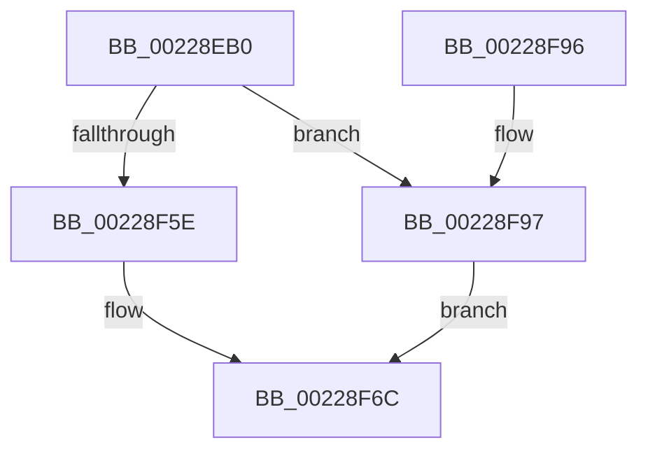

# MiInitializePageFaultPacket

- RVA: `0x00228EB0`–`0x00228F9B` (길이 `235` bytes)
- VA: `0x0000000140228EB0`
- 실행 섹션: `.text`
- PDB 이름 있음: `예`; PDB Function 태그: `아니요`
- unwind 정보 RVA: `0x0005FC94`
- 디코드: `62`개 명령, `235/235` bytes 표시
- 미해석 바이트: `0` (있으면 어셈블리에 `.byte`로 보존)

> 이 문서는 커널 이미지의 기계어와 PDB 기호를 분석해 생성했습니다. 4번과 5번은 함수 원형과 자료형을 바이너리 사용 방식에서 추정한 C 해석이며 원본 소스 복구 결과는 아닙니다.

## 1. Dependencies

- 직접 호출 지점: **0**; 고유 호출 대상: **0**
- 직접 호출자로 확인된 함수: **5**
- RIP 상대 이미지 참조: **0**

### Outgoing calls
- 직접 디코드된 call 명령이 없습니다.

### Direct callers
- [MiTranslatePageForCopy](MiTranslatePageForCopy_function_00228960.md) at `0x002289F7`
- [sub_0027F36E](../27/Unknown_function_0027F36E.md) at `0x0027F469`
- [MiWalkEntireImage](../36/MiWalkEntireImage_function_00365D70.md) at `0x00366C62`
- [MiPfCompleteInPageSupport](../36/MiPfCompleteInPageSupport_function_0036D738.md) at `0x0036D7AC`
- [MiFlushWaitForReadInProgress](../40/MiFlushWaitForReadInProgress_function_004032E0.md) at `0x0040333A`

### Static image references
- 디코드된 RIP-relative 메모리 참조가 없습니다.

## 2. Other-region calls and transfers

- 다른 실행 섹션으로 향하는 call: **0**
- 별도 외부 분기/꼬리 이동을 확인하지 못했습니다.

## 3. Assembly (complete function range)

```asm
00228EB0  48 89 5C 24 08                  mov qword ptr [rsp + 8], rbx
00228EB5  48 89 7C 24 10                  mov qword ptr [rsp + 0x10], rdi
00228EBA  48 8B 44 24 30                  mov rax, qword ptr [rsp + 0x30]
00228EBF  0F 57 C0                        xorps xmm0, xmm0
00228EC2  4C 8B DA                        mov r11, rdx
00228EC5  48 BB 00 00 00 00 80 F6 FF FF   movabs rbx, 0xfffff68000000000
00228ECF  4C 8B D1                        mov r10, rcx
00228ED2  48 C1 EA 09                     shr rdx, 9
00228ED6  33 C9                           xor ecx, ecx
00228ED8  48 BF F8 FF FF FF 7F 00 00 00   movabs rdi, 0x7ffffffff8
00228EE2  0F 11 00                        movups xmmword ptr [rax], xmm0
00228EE5  48 23 D7                        and rdx, rdi
00228EE8  0F 11 40 10                     movups xmmword ptr [rax + 0x10], xmm0
00228EEC  0F 11 40 20                     movups xmmword ptr [rax + 0x20], xmm0
00228EF0  0F 11 40 30                     movups xmmword ptr [rax + 0x30], xmm0
00228EF4  0F 11 40 40                     movups xmmword ptr [rax + 0x40], xmm0
00228EF8  0F 11 40 50                     movups xmmword ptr [rax + 0x50], xmm0
00228EFC  0F 11 40 60                     movups xmmword ptr [rax + 0x60], xmm0
00228F00  0F 11 40 70                     movups xmmword ptr [rax + 0x70], xmm0
00228F04  0F 11 80 80 00 00 00            movups xmmword ptr [rax + 0x80], xmm0
00228F0B  48 89 88 90 00 00 00            mov qword ptr [rax + 0x90], rcx
00228F12  48 8B CB                        mov rcx, rbx
00228F15  48 03 D1                        add rdx, rcx
00228F18  48 89 50 18                     mov qword ptr [rax + 0x18], rdx
00228F1C  48 C1 EA 09                     shr rdx, 9
00228F20  48 23 D7                        and rdx, rdi
00228F23  48 8B CB                        mov rcx, rbx
00228F26  48 03 D1                        add rdx, rcx
00228F29  48 89 50 20                     mov qword ptr [rax + 0x20], rdx
00228F2D  48 C1 EA 09                     shr rdx, 9
00228F31  48 23 D7                        and rdx, rdi
00228F34  48 8B CB                        mov rcx, rbx
00228F37  48 03 D1                        add rdx, rcx
00228F3A  48 89 50 28                     mov qword ptr [rax + 0x28], rdx
00228F3E  48 C1 EA 09                     shr rdx, 9
00228F42  48 23 D7                        and rdx, rdi
00228F45  48 8B CB                        mov rcx, rbx
00228F48  48 03 D1                        add rdx, rcx
00228F4B  48 8B 4C 24 28                  mov rcx, qword ptr [rsp + 0x28]
00228F50  48 89 50 30                     mov qword ptr [rax + 0x30], rdx
00228F54  48 89 48 60                     mov qword ptr [rax + 0x60], rcx
00228F58  41 F6 C2 40                     test r10b, 0x40
00228F5C  74 39                           je 0x140228f97
00228F5E  8B 50 50                        mov edx, dword ptr [rax + 0x50]
00228F61  0F BA EA 07                     bts edx, 7
00228F65  89 50 50                        mov dword ptr [rax + 0x50], edx
00228F68  49 83 E2 FD                     and r10, 0xfffffffffffffffd
00228F6C  48 8B 5C 24 08                  mov rbx, qword ptr [rsp + 8]
00228F71  48 8B 7C 24 10                  mov rdi, qword ptr [rsp + 0x10]
00228F76  41 0F BE C8                     movsx ecx, r8b
00228F7A  C1 E1 08                        shl ecx, 8
00228F7D  33 CA                           xor ecx, edx
00228F7F  4C 89 50 08                     mov qword ptr [rax + 8], r10
00228F83  81 E1 00 01 00 00               and ecx, 0x100
00228F89  4C 89 18                        mov qword ptr [rax], r11
00228F8C  33 CA                           xor ecx, edx
00228F8E  4C 89 48 10                     mov qword ptr [rax + 0x10], r9
00228F92  89 48 50                        mov dword ptr [rax + 0x50], ecx
00228F95  C3                              ret
00228F96  CC                              int3
00228F97  33 D2                           xor edx, edx
00228F99  EB D1                           jmp 0x140228f6c
```

## 4. C-style interpretation (structured pseudocode)

```c
__int64 __fastcall MiInitializePageFaultPacket(__int64 a1, __int64 a2, unsigned __int8 a3, __int64 a4, __int64 a5, __int64 a6)
{
    __int64 v_r10;
    unsigned __int64 v_stack_p10;
    unsigned __int64 v_stack_p8;

    v_stack_p8 = v_rbx;
    v_stack_p10 = v_rdi;
    a2 = (a2) >> (9);
    a1 = 0;
    *(unsigned __int64 *)(a6) = v_xmm0;
    a2 = (a2) & (v_rdi);
    *(unsigned __int64 *)(a6 + 16) = v_xmm0;
    *(unsigned __int64 *)(a6 + 32) = v_xmm0;
    *(unsigned __int64 *)(a6 + 48) = v_xmm0;
    *(unsigned __int64 *)(a6 + 64) = v_xmm0;
    *(unsigned __int64 *)(a6 + 80) = v_xmm0;
    *(unsigned __int64 *)(a6 + 96) = v_xmm0;
    *(unsigned __int64 *)(a6 + 112) = v_xmm0;
    *(unsigned __int64 *)(a6 + 128) = v_xmm0;
    *(unsigned __int64 *)(a6 + 144) = 0;
    a2 = (a2) + (v_rbx);
    *(unsigned __int64 *)(a6 + 24) = a2;
    a2 = (a2) >> (9);
    a2 = (a2) & (v_rdi);
    a2 = (a2) + (v_rbx);
    *(unsigned __int64 *)(a6 + 32) = a2;
    a2 = (a2) >> (9);
    a2 = (a2) & (v_rdi);
    a2 = (a2) + (v_rbx);
    *(unsigned __int64 *)(a6 + 40) = a2;
    a2 = (a2) >> (9);
    a2 = (a2) & (v_rdi);
    a2 = (a2) + (v_rbx);
    *(unsigned __int64 *)(a6 + 48) = a2;
    *(unsigned __int64 *)(a6 + 96) = a5;
    if (((0) & (64)) == 0) goto loc_00228F97;
    *(unsigned int *)(a6 + 80) = (unsigned int)((unsigned int)(*(unsigned int *)(a6 + 80)));
    v_r10 = (a1) & (-3);
loc_00228F6C:
    a1 = (unsigned int)(((__int8)(a3)) << (8));
    a1 = (unsigned int)((a1) ^ ((unsigned int)((unsigned int)(*(unsigned int *)(a6 + 80)))));
    *(unsigned __int64 *)(a6 + 8) = v_r10;
    a1 = (unsigned int)((a1) & (256));
    *(unsigned __int64 *)(a6) = a2;
    a1 = (unsigned int)((a1) ^ ((unsigned int)((unsigned int)(*(unsigned int *)(a6 + 80)))));
    *(unsigned __int64 *)(a6 + 16) = a4;
    *(unsigned int *)(a6 + 80) = (unsigned int)(a1);
    return a6;
loc_00228F97:
    a2 = 0;
    goto loc_00228F6C;
}
```

## 5. (Beta) C Style

```c
void *MiInitializePageFaultPacket(int64_t Arg1, int64_t Arg2, uint8_t Arg3, int64_t Arg4, int64_t Arg5, void *Arg6)
{
    uint8_t *arg6 = (uint8_t *)Arg6;

    int64_t local_r10;
    uint64_t v_stack_p10;
    uint64_t v_stack_p8;

    v_stack_p8 = local_rbx;
    v_stack_p10 = local_rdi;
    Arg2 = (Arg2) >> (9);
    Arg1 = 0;
    *(uint64_t *)(arg6) = v_xmm0;
    Arg2 = (Arg2) & (local_rdi);
    *(uint64_t *)(arg6 + 0x10) = v_xmm0;
    *(uint64_t *)(arg6 + 0x20) = v_xmm0;
    *(uint64_t *)(arg6 + 0x30) = v_xmm0;
    *(uint64_t *)(arg6 + 0x40) = v_xmm0;
    *(uint64_t *)(arg6 + 0x50) = v_xmm0;
    *(uint64_t *)(arg6 + 0x60) = v_xmm0;
    *(uint64_t *)(arg6 + 0x70) = v_xmm0;
    *(uint64_t *)(arg6 + 0x80) = v_xmm0;
    *(uint64_t *)(arg6 + 0x90) = 0;
    Arg2 = (Arg2) + (local_rbx);
    *(uint64_t *)(arg6 + 0x18) = Arg2;
    Arg2 = (Arg2) >> (9);
    Arg2 = (Arg2) & (local_rdi);
    Arg2 = (Arg2) + (local_rbx);
    *(uint64_t *)(arg6 + 0x20) = Arg2;
    Arg2 = (Arg2) >> (9);
    Arg2 = (Arg2) & (local_rdi);
    Arg2 = (Arg2) + (local_rbx);
    *(uint64_t *)(arg6 + 0x28) = Arg2;
    Arg2 = (Arg2) >> (9);
    Arg2 = (Arg2) & (local_rdi);
    Arg2 = (Arg2) + (local_rbx);
    *(uint64_t *)(arg6 + 0x30) = Arg2;
    *(uint64_t *)(arg6 + 0x60) = Arg5;
    if (((0) & (64)) == 0) goto loc_00228F97;
    *(uint32_t *)(arg6 + 0x50) = (uint32_t)((uint32_t)(*(uint32_t *)(arg6 + 0x50)));
    local_r10 = (Arg1) & (-3);
loc_00228F6C:
    Arg1 = (uint32_t)(((int8_t)(Arg3)) << (8));
    Arg1 = (uint32_t)((Arg1) ^ ((uint32_t)((uint32_t)(*(uint32_t *)(arg6 + 0x50)))));
    *(uint64_t *)(arg6 + 0x8) = local_r10;
    Arg1 = (uint32_t)((Arg1) & (256));
    *(uint64_t *)(arg6) = Arg2;
    Arg1 = (uint32_t)((Arg1) ^ ((uint32_t)((uint32_t)(*(uint32_t *)(arg6 + 0x50)))));
    *(uint64_t *)(arg6 + 0x10) = Arg4;
    *(uint32_t *)(arg6 + 0x50) = (uint32_t)(Arg1);
    return Arg6;
loc_00228F97:
    Arg2 = 0;
    goto loc_00228F6C;
}
```

### 관측된 메모리 오프셋

구조체 형식이 확인되지 않은 접근은 인자 기준의 오프셋으로만 기록했습니다.

| 기준 인자 | 오프셋 표현 | 폭 (bit) | 접근 |
|---|---:|---:|---|
| `Arg6` | `+ 0x0` | `64` | `W` |
| `Arg6` | `+ 0x0` | `128` | `R` |
| `Arg6` | `+ 0x8` | `64` | `W` |
| `Arg6` | `+ 0x10` | `64` | `W` |
| `Arg6` | `+ 0x10` | `128` | `R` |
| `Arg6` | `+ 0x18` | `64` | `W` |
| `Arg6` | `+ 0x20` | `64` | `W` |
| `Arg6` | `+ 0x20` | `128` | `R` |
| `Arg6` | `+ 0x28` | `64` | `W` |
| `Arg6` | `+ 0x30` | `64` | `W` |
| `Arg6` | `+ 0x30` | `128` | `R` |
| `Arg6` | `+ 0x40` | `128` | `R` |
| `Arg6` | `+ 0x50` | `32` | `R` |
| `Arg6` | `+ 0x50` | `32` | `W` |
| `Arg6` | `+ 0x50` | `128` | `R` |
| `Arg6` | `+ 0x60` | `64` | `W` |
| `Arg6` | `+ 0x60` | `128` | `R` |
| `Arg6` | `+ 0x70` | `128` | `R` |
| `Arg6` | `+ 0x80` | `128` | `R` |
| `Arg6` | `+ 0x90` | `64` | `W` |

## 6. Execution-region graph

[열기: 2D/3D 그래프와 함수 탐색 컨트롤 패널](../../../control-panel.html?section=text&rva=0x00228EB0&view=graph)

- 2D 그래프는 위에서 아래로 흐르고, 3D 그래프는 빈 공간을 드래그해 회전합니다. Shift+드래그는 이동, 휠은 확대·축소, 함수 노드 선택은 대상 보고서 이동입니다.

### Static fallback


