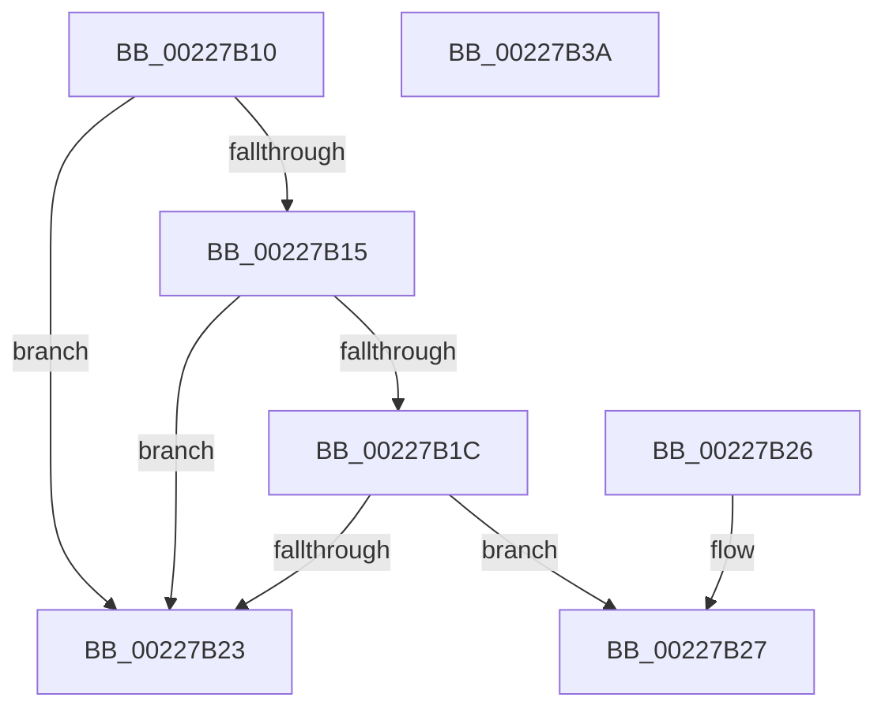

# MiIsLazyStampedPte

- RVA: `0x00227B10`–`0x00227B3B` (길이 `43` bytes)
- VA: `0x0000000140227B10`
- 실행 섹션: `.text`
- PDB 이름 있음: `예`; PDB Function 태그: `아니요`
- unwind 정보 RVA: `0x000DB714`
- 디코드: `15`개 명령, `43/43` bytes 표시
- 미해석 바이트: `0` (있으면 어셈블리에 `.byte`로 보존)

> 이 문서는 커널 이미지의 기계어와 PDB 기호를 분석해 생성했습니다. 4번과 5번은 함수 원형과 자료형을 바이너리 사용 방식에서 추정한 C 해석이며 원본 소스 복구 결과는 아닙니다.

## 1. Dependencies

- 직접 호출 지점: **0**; 고유 호출 대상: **0**
- 직접 호출자로 확인된 함수: **6**
- RIP 상대 이미지 참조: **0**

### Outgoing calls
- 직접 디코드된 call 명령이 없습니다.

### Direct callers
- [MiIsPdeOrAboveAccessible](MiIsPdeOrAboveAccessible_function_00227A10.md) at `0x00227ADE`
- [sub_002760C1](../27/Unknown_function_002760C1.md) at `0x002761B7`
- [MiDeleteVa](../27/MiDeleteVa_function_002789E0.md) at `0x00278FA0`
- [sub_0027BF19](../27/Unknown_function_0027BF19.md) at `0x0027BFD5`
- [MiGetWorkingSetInfoList](../2A/MiGetWorkingSetInfoList_function_002AF770.md) at `0x002B0858`
- [MiQueryAddressState](../32/MiQueryAddressState_function_0032C380.md) at `0x0032D5AF`
- [MiQueryAddressState](../32/MiQueryAddressState_function_0032C380.md) at `0x0032D5CA`

### Static image references
- 디코드된 RIP-relative 메모리 참조가 없습니다.

## 2. Other-region calls and transfers

- 다른 실행 섹션으로 향하는 call: **0**
- 별도 외부 분기/꼬리 이동을 확인하지 못했습니다.

## 3. Assembly (complete function range)

```asm
00227B10  F6 C1 01                        test cl, 1
00227B13  75 0E                           jne 0x140227b23
00227B15  48 0F BA E1 0A                  bt rcx, 0xa
00227B1A  72 07                           jb 0x140227b23
00227B1C  48 0F BA E1 0B                  bt rcx, 0xb
00227B21  73 04                           jae 0x140227b27
00227B23  33 C0                           xor eax, eax
00227B25  C3                              ret
00227B26  CC                              int3
00227B27  33 C0                           xor eax, eax
00227B29  81 E1 E0 03 00 00               and ecx, 0x3e0
00227B2F  48 81 F9 00 03 00 00            cmp rcx, 0x300
00227B36  0F 94 C0                        sete al
00227B39  C3                              ret
00227B3A  CC                              int3
```

## 4. C-style interpretation (structured pseudocode)

```c
__int64 __fastcall MiIsLazyStampedPte(__int64 a1)
{
    __int64 result;

    if ((((unsigned __int8)(a1)) & (1)) != 0) goto loc_00227B23;
    if (condition_is_below) goto loc_00227B23;
    if (condition_is_above_or_equal) goto loc_00227B27;
loc_00227B23:
    result = 0;
    return result;
loc_00227B27:
    result = 0;
    a1 = (unsigned int)((a1) & (992));
    result = (a1 == 768) ? 1 : 0;
    return result;
}
```

## 5. (Beta) C Style

```c
int64_t MiIsLazyStampedPte(int64_t Arg1)
{
    int64_t result;

    if ((((uint8_t)(Arg1)) & (1)) != 0) goto loc_00227B23;
    if (condition_is_below) goto loc_00227B23;
    if (condition_is_above_or_equal) goto loc_00227B27;
loc_00227B23:
    result = 0;
    return result;
loc_00227B27:
    result = 0;
    Arg1 = (uint32_t)((Arg1) & (992));
    result = (Arg1 == 768) ? 1 : 0;
    return result;
}
```

## 6. Execution-region graph

[열기: 2D/3D 그래프와 함수 탐색 컨트롤 패널](../../../control-panel.html?section=text&rva=0x00227B10&view=graph)

- 2D 그래프는 위에서 아래로 흐르고, 3D 그래프는 빈 공간을 드래그해 회전합니다. Shift+드래그는 이동, 휠은 확대·축소, 함수 노드 선택은 대상 보고서 이동입니다.

### Static fallback


