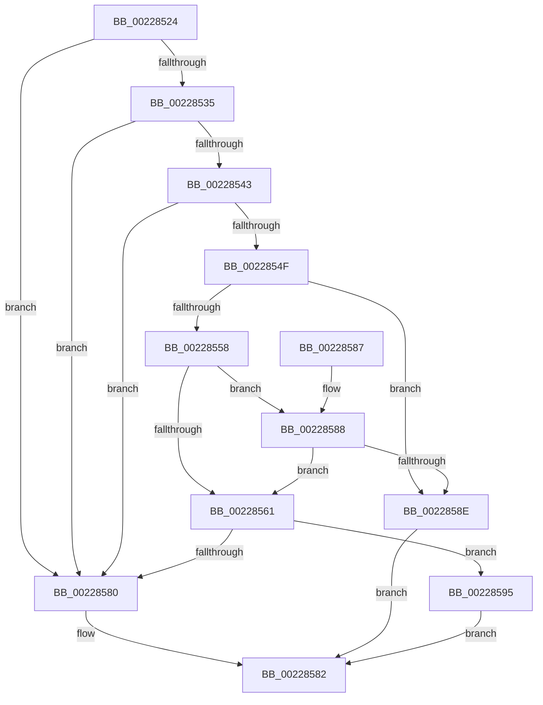

# MiIsPageSecured

- RVA: `0x00228524`–`0x002285A4` (길이 `128` bytes)
- VA: `0x0000000140228524`
- 실행 섹션: `.text`
- PDB 이름 있음: `예`; PDB Function 태그: `아니요`
- unwind 정보 RVA: `0x0005FC2C`
- 디코드: `37`개 명령, `128/128` bytes 표시
- 미해석 바이트: `0` (있으면 어셈블리에 `.byte`로 보존)

> 이 문서는 커널 이미지의 기계어와 PDB 기호를 분석해 생성했습니다. 4번과 5번은 함수 원형과 자료형을 바이너리 사용 방식에서 추정한 C 해석이며 원본 소스 복구 결과는 아닙니다.

## 1. Dependencies

- 직접 호출 지점: **1**; 고유 호출 대상: **1**
- 직접 호출자로 확인된 함수: **4**
- RIP 상대 이미지 참조: **1**

### Outgoing calls
- `0x00228558` → [MiIsFreeSlabPage](../4F/MiIsFreeSlabPage_function_004FCDE4.md) (function, `0x004FCDE4`)

### Direct callers
- [MiCopySinglePage](MiCopySinglePage_function_00228FA4.md) at `0x0022900C`
- [MmTryIdentifyPage](../67/MmTryIdentifyPage_function_00678738.md) at `0x006787D9`
- [MiAddNonSecuredPagesToDump](../67/MiAddNonSecuredPagesToDump_function_0067CDDC.md) at `0x0067CE23`
- [MiFilterCrashDumpPte](../67/MiFilterCrashDumpPte_function_0067D4D0.md) at `0x0067D6AD`

### Static image references
- `0x00228528` → RVA `0x00FC6A88` (`ALMOSTRO`; read)

## 2. Other-region calls and transfers

- 다른 실행 섹션으로 향하는 call: **0**
- 별도 외부 분기/꼬리 이동을 확인하지 못했습니다.

## 3. Assembly (complete function range)

```asm
00228524  48 83 EC 28                     sub rsp, 0x28
00228528  48 F7 05 55 E5 D9 00 00 40 00 00  test qword ptr [rip + 0xd9e555], 0x4000
00228533  74 4B                           je 0x140228580
00228535  48 8B 41 28                     mov rax, qword ptr [rcx + 0x28]
00228539  48 C1 E8 3C                     shr rax, 0x3c
0022853D  24 07                           and al, 7
0022853F  3C 03                           cmp al, 3
00228541  75 3D                           jne 0x140228580
00228543  48 8B 41 28                     mov rax, qword ptr [rcx + 0x28]
00228547  45 33 C9                        xor r9d, r9d
0022854A  48 85 C0                        test rax, rax
0022854D  78 31                           js 0x140228580
0022854F  4C 8B 51 08                     mov r10, qword ptr [rcx + 8]
00228553  4D 85 D2                        test r10, r10
00228556  74 36                           je 0x14022858e
00228558  E8 87 48 2D 00                  call 0x1404fcde4
0022855D  85 C0                           test eax, eax
0022855F  75 27                           jne 0x140228588
00228561  48 BA 00 00 00 00 80 F6 FF FF   movabs rdx, 0xfffff68000000000
0022856B  48 8B CA                        mov rcx, rdx
0022856E  48 B8 78 FF FF FF 3F 00 00 00   movabs rax, 0x3fffffff78
00228578  48 03 C8                        add rcx, rax
0022857B  4C 3B D1                        cmp r10, rcx
0022857E  76 15                           jbe 0x140228595
00228580  33 C0                           xor eax, eax
00228582  48 83 C4 28                     add rsp, 0x28
00228586  C3                              ret
00228587  CC                              int3
00228588  49 83 FA FE                     cmp r10, -2
0022858C  75 D3                           jne 0x140228561
0022858E  B8 01 00 00 00                  mov eax, 1
00228593  EB ED                           jmp 0x140228582
00228595  48 8B CA                        mov rcx, rdx
00228598  4C 3B D1                        cmp r10, rcx
0022859B  41 0F 93 C1                     setae r9b
0022859F  41 8B C1                        mov eax, r9d
002285A2  EB DE                           jmp 0x140228582
```

## 4. C-style interpretation (structured pseudocode)

```c
__int64 __fastcall MiIsPageSecured(__int64 a1, __int64 a2, __int64 a3, int a4)
{
    __int64 result;
    __int64 v_rsp;

    v_rsp = (v_rsp) - (40);
    if (((*(unsigned __int64 *)(v_rip + 14280021)) & (0x4000ULL)) == 0) goto loc_00228580;
    result = (*(unsigned __int64 *)(a1 + 40)) >> (60);
    result = (unsigned __int8)((result) & (7));
    if (((unsigned __int8)(result)) != 3) goto loc_00228580;
    a4 = 0;
    if (sign_flag) goto loc_00228580;
    if (*(unsigned __int64 *)(a1 + 8) == 0) goto loc_0022858E;
    result = MiIsFreeSlabPage(a1, a2, a3, a4);
    if ((unsigned int)(result) != 0) goto loc_00228588;
loc_00228561:
    a1 = (a2) + (result);
    if ((*(unsigned __int64 *)(a1 + 8)) <= a1) goto loc_00228595;
loc_00228580:
    result = 0;
loc_00228582:
    v_rsp = (v_rsp) + (40);
    return result;
loc_00228588:
    if ((*(unsigned __int64 *)(a1 + 8)) != -2) goto loc_00228561;
loc_0022858E:
    goto loc_00228582;
loc_00228595:
    a4 = ((*(unsigned __int64 *)(a1 + 8)) >= a2) ? 1 : 0;
    goto loc_00228582;
}
```

## 5. (Beta) C Style

```c
int64_t MiIsPageSecured(void *Arg1, int64_t Arg2, int64_t Arg3, int32_t Arg4)
{
    uint8_t *arg1 = (uint8_t *)Arg1;

    int64_t result;
    int64_t local_rsp;

    local_rsp = (local_rsp) - (40);
    if (((*(uint64_t *)(v_rip + 0xD9E555)) & (0x4000ULL)) == 0) goto loc_00228580;
    result = (*(uint64_t *)(arg1 + 0x28)) >> (60);
    result = (uint8_t)((result) & (7));
    if (((uint8_t)(result)) != 3) goto loc_00228580;
    Arg4 = 0;
    if (sign_flag) goto loc_00228580;
    if (*(uint64_t *)(arg1 + 0x8) == 0) goto loc_0022858E;
    result = MiIsFreeSlabPage(Arg1, Arg2, Arg3, Arg4);
    if ((uint32_t)(result) != 0) goto loc_00228588;
loc_00228561:
    Arg1 = (Arg2) + (result);
    if ((*(uint64_t *)(arg1 + 0x8)) <= Arg1) goto loc_00228595;
loc_00228580:
    result = 0;
loc_00228582:
    local_rsp = (local_rsp) + (40);
    return result;
loc_00228588:
    if ((*(uint64_t *)(arg1 + 0x8)) != -2) goto loc_00228561;
loc_0022858E:
    goto loc_00228582;
loc_00228595:
    Arg4 = ((*(uint64_t *)(arg1 + 0x8)) >= Arg2) ? 1 : 0;
    goto loc_00228582;
}
```

### 관측된 메모리 오프셋

구조체 형식이 확인되지 않은 접근은 인자 기준의 오프셋으로만 기록했습니다.

| 기준 인자 | 오프셋 표현 | 폭 (bit) | 접근 |
|---|---:|---:|---|
| `Arg1` | `+ 0x8` | `64` | `R` |
| `Arg1` | `+ 0x28` | `64` | `R` |

## 6. Execution-region graph

[열기: 2D/3D 그래프와 함수 탐색 컨트롤 패널](../../../control-panel.html?section=text&rva=0x00228524&view=graph)

- 2D 그래프는 위에서 아래로 흐르고, 3D 그래프는 빈 공간을 드래그해 회전합니다. Shift+드래그는 이동, 휠은 확대·축소, 함수 노드 선택은 대상 보고서 이동입니다.

### Static fallback


