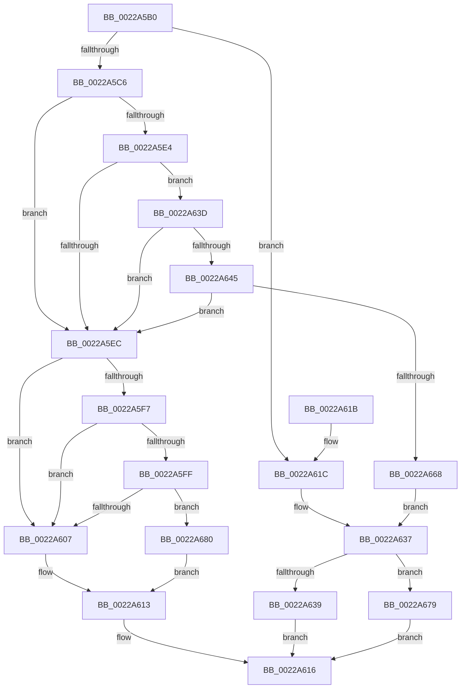

# MiIsPageTableLocked

- RVA: `0x0022A5B0`–`0x0022A6AF` (길이 `255` bytes)
- VA: `0x000000014022A5B0`
- 실행 섹션: `.text`
- PDB 이름 있음: `예`; PDB Function 태그: `아니요`
- unwind 정보 RVA: `0x0005FDE4`
- 디코드: `67`개 명령, `255/255` bytes 표시
- 미해석 바이트: `0` (있으면 어셈블리에 `.byte`로 보존)

> 이 문서는 커널 이미지의 기계어와 PDB 기호를 분석해 생성했습니다. 4번과 5번은 함수 원형과 자료형을 바이너리 사용 방식에서 추정한 C 해석이며 원본 소스 복구 결과는 아닙니다.

## 1. Dependencies

- 직접 호출 지점: **2**; 고유 호출 대상: **2**
- 직접 호출자로 확인된 함수: **4**
- RIP 상대 이미지 참조: **1**

### Outgoing calls
- `0x0022A60A` → [MI_READ_PTE_LOCK_FREE](../28/MI_READ_PTE_LOCK_FREE_function_002828A0.md) (function, `0x002828A0`)
- `0x0022A629` → [MiTranslateVmToLock](MiTranslateVmToLock_function_0022AB30.md) (function, `0x0022AB30`)

### Direct callers
- [MiEmptyWorkingSetHelper](../24/MiEmptyWorkingSetHelper_function_00240C00.md) at `0x00240FF1`
- [sub_00241476](../24/Unknown_function_00241476.md) at `0x002418A6`
- [sub_0028FA52](../28/Unknown_function_0028FA52.md) at `0x0028FA73`
- [MiTrimPte](../29/MiTrimPte_function_00292F30.md) at `0x00293254`

### Static image references
- `0x0022A69B` → RVA `0x00E2F1AC` (`.data`; read)

## 2. Other-region calls and transfers

- 다른 실행 섹션으로 향하는 call: **0**
- 별도 외부 분기/꼬리 이동을 확인하지 못했습니다.

## 3. Assembly (complete function range)

```asm
0022A5B0  48 83 EC 38                     sub rsp, 0x38
0022A5B4  4C 8B C1                        mov r8, rcx
0022A5B7  48 B8 68 DF BE 7D FB F6 FF FF   movabs rax, 0xfffff6fb7dbedf68
0022A5C1  48 3B D0                        cmp rdx, rax
0022A5C4  74 56                           je 0x14022a61c
0022A5C6  8B 81 B8 00 00 00               mov eax, dword ptr [rcx + 0xb8]
0022A5CC  49 B9 00 D0 BE 7D FB F6 FF FF   movabs r9, 0xfffff6fb7dbed000
0022A5D6  49 BA FF DF BE 7D FB F6 FF FF   movabs r10, 0xfffff6fb7dbedfff
0022A5E0  A8 0F                           test al, 0xf
0022A5E2  75 08                           jne 0x14022a5ec
0022A5E4  49 8B C1                        mov rax, r9
0022A5E7  48 3B D0                        cmp rdx, rax
0022A5EA  73 51                           jae 0x14022a63d
0022A5EC  41 8B 80 B8 00 00 00            mov eax, dword ptr [r8 + 0xb8]
0022A5F3  A8 0F                           test al, 0xf
0022A5F5  74 10                           je 0x14022a607
0022A5F7  49 8B C1                        mov rax, r9
0022A5FA  48 3B D0                        cmp rdx, rax
0022A5FD  72 08                           jb 0x14022a607
0022A5FF  49 8B C2                        mov rax, r10
0022A602  48 3B D0                        cmp rdx, rax
0022A605  76 79                           jbe 0x14022a680
0022A607  48 8B CA                        mov rcx, rdx
0022A60A  E8 91 82 05 00                  call 0x1402828a0
0022A60F  48 C1 E8 3C                     shr rax, 0x3c
0022A613  83 E0 01                        and eax, 1
0022A616  48 83 C4 38                     add rsp, 0x38
0022A61A  C3                              ret
0022A61B  CC                              int3
0022A61C  0F 57 C0                        xorps xmm0, xmm0
0022A61F  48 8D 54 24 20                  lea rdx, [rsp + 0x20]
0022A624  0F 11 44 24 20                  movups xmmword ptr [rsp + 0x20], xmm0
0022A629  E8 02 05 00 00                  call 0x14022ab30
0022A62E  48 8B 44 24 20                  mov rax, qword ptr [rsp + 0x20]
0022A633  48 83 38 00                     cmp qword ptr [rax], 0
0022A637  75 40                           jne 0x14022a679
0022A639  33 C0                           xor eax, eax
0022A63B  EB D9                           jmp 0x14022a616
0022A63D  49 8B C2                        mov rax, r10
0022A640  48 3B D0                        cmp rdx, rax
0022A643  77 A7                           ja 0x14022a5ec
0022A645  65 48 8B 04 25 88 01 00 00      mov rax, qword ptr gs:[0x188]
0022A64E  48 8B 88 B8 00 00 00            mov rcx, qword ptr [rax + 0xb8]
0022A655  48 8B 81 10 04 00 00            mov rax, qword ptr [rcx + 0x410]
0022A65C  48 8B 80 68 05 00 00            mov rax, qword ptr [rax + 0x568]
0022A663  48 85 C0                        test rax, rax
0022A666  74 84                           je 0x14022a5ec
0022A668  48 C1 EA 03                     shr rdx, 3
0022A66C  81 E2 FF 01 00 00               and edx, 0x1ff
0022A672  8B 04 90                        mov eax, dword ptr [rax + rdx*4]
0022A675  85 C0                           test eax, eax
0022A677  EB BE                           jmp 0x14022a637
0022A679  B8 01 00 00 00                  mov eax, 1
0022A67E  EB 96                           jmp 0x14022a616
0022A680  49 8B C1                        mov rax, r9
0022A683  48 2B D0                        sub rdx, rax
0022A686  41 8B 80 B8 00 00 00            mov eax, dword ptr [r8 + 0xb8]
0022A68D  48 C1 FA 03                     sar rdx, 3
0022A691  03 D2                           add edx, edx
0022A693  8B C2                           mov eax, edx
0022A695  8B CA                           mov ecx, edx
0022A697  48 C1 E8 05                     shr rax, 5
0022A69B  48 8D 15 0A 4B C0 00            lea rdx, [rip + 0xc04b0a]
0022A6A2  83 E1 1F                        and ecx, 0x1f
0022A6A5  8B 04 82                        mov eax, dword ptr [rdx + rax*4]
0022A6A8  D3 E8                           shr eax, cl
0022A6AA  E9 64 FF FF FF                  jmp 0x14022a613
```

## 4. C-style interpretation (structured pseudocode)

```c
__int64 __fastcall MiIsPageTableLocked(__int64 a1, __int64 a2)
{
    __int64 result;
    __int64 v_rsp;
    unsigned __int64 v_stack_p20;

    v_rsp = (v_rsp) - (56);
    if (a2 == result) goto loc_0022A61C;
    if ((((unsigned __int8)((unsigned int)(*(unsigned int *)(a1 + 184)))) & (15)) != 0) goto loc_0022A5EC;
    if (a2 >= a4) goto loc_0022A63D;
loc_0022A5EC:
    if ((((unsigned __int8)((unsigned int)(*(unsigned int *)(a1 + 184)))) & (15)) == 0) goto loc_0022A607;
    if (a2 < a4) goto loc_0022A607;
    if (a2 <= v_r10) goto loc_0022A680;
loc_0022A607:
    result = MI_READ_PTE_LOCK_FREE(a2, a2, a1, a4);
    result = (result) >> (60);
loc_0022A613:
    result = (unsigned int)((result) & (1));
loc_0022A616:
    v_rsp = (v_rsp) + (56);
    return result;
loc_0022A61C:
    v_stack_p20 = v_xmm0;
    result = MiTranslateVmToLock(a2, v_stack_p20, a1, a4);
loc_0022A637:
    if ((*(unsigned __int64 *)(v_stack_p20)) != 0) goto loc_0022A679;
    result = 0;
    goto loc_0022A616;
loc_0022A63D:
    if (v_stack_p20 > v_r10) goto loc_0022A5EC;
    if (*(unsigned __int64 *)(*(unsigned __int64 *)(*(unsigned __int64 *)(*(unsigned __int64 *)(gs_base + (0 + 392)) + 184) + 1040) + 1384) == 0) goto loc_0022A5EC;
    a2 = (v_stack_p20) >> (3);
    a2 = (unsigned int)((a2) & (511));
    goto loc_0022A637;
loc_0022A679:
    goto loc_0022A616;
loc_0022A680:
    a2 = (a2) - (a4);
    a2 = (a2) >> (3);
    a2 = (unsigned int)((a2) + ((unsigned int)(a2)));
    result = ((unsigned int)((unsigned int)(a2))) >> (5);
    a1 = (unsigned int)(((unsigned int)((unsigned int)(a2))) & (31));
    result = (unsigned int)(((unsigned int)(*(unsigned int *)(v_rip + 12602122 + result * 4))) >> ((unsigned __int8)(a1)));
    goto loc_0022A613;
}
```

## 5. (Beta) C Style

```c
int64_t MiIsPageTableLocked(void *Arg1, int64_t Arg2)
{
    uint8_t *arg1 = (uint8_t *)Arg1;

    int64_t result;
    int64_t local_rsp;
    uint64_t v_stack_p20;

    local_rsp = (local_rsp) - (56);
    if (Arg2 == result) goto loc_0022A61C;
    if ((((uint8_t)((uint32_t)(*(uint32_t *)(arg1 + 0xB8)))) & (15)) != 0) goto loc_0022A5EC;
    if (Arg2 >= a4) goto loc_0022A63D;
loc_0022A5EC:
    if ((((uint8_t)((uint32_t)(*(uint32_t *)(arg1 + 0xB8)))) & (15)) == 0) goto loc_0022A607;
    if (Arg2 < a4) goto loc_0022A607;
    if (Arg2 <= local_r10) goto loc_0022A680;
loc_0022A607:
    result = MI_READ_PTE_LOCK_FREE(Arg2, Arg2, Arg1, a4);
    result = (result) >> (60);
loc_0022A613:
    result = (uint32_t)((result) & (1));
loc_0022A616:
    local_rsp = (local_rsp) + (56);
    return result;
loc_0022A61C:
    v_stack_p20 = v_xmm0;
    result = MiTranslateVmToLock(Arg2, v_stack_p20, Arg1, a4);
loc_0022A637:
    if ((*(uint64_t *)(v_stack_p20)) != 0) goto loc_0022A679;
    result = 0;
    goto loc_0022A616;
loc_0022A63D:
    if (v_stack_p20 > local_r10) goto loc_0022A5EC;
    if (*(uint64_t *)(*(uint64_t *)(*(uint64_t *)(*(uint64_t *)(gs_base + (0 + 0x188)) + 0xB8) + 0x410) + 0x568) == 0) goto loc_0022A5EC;
    Arg2 = (v_stack_p20) >> (3);
    Arg2 = (uint32_t)((Arg2) & (511));
    goto loc_0022A637;
loc_0022A679:
    goto loc_0022A616;
loc_0022A680:
    Arg2 = (Arg2) - (a4);
    Arg2 = (Arg2) >> (3);
    Arg2 = (uint32_t)((Arg2) + ((uint32_t)(Arg2)));
    result = ((uint32_t)((uint32_t)(Arg2))) >> (5);
    Arg1 = (uint32_t)(((uint32_t)((uint32_t)(Arg2))) & (31));
    result = (uint32_t)(((uint32_t)(*(uint32_t *)(v_rip + 0xC04B0A + result * 4))) >> ((uint8_t)(Arg1)));
    goto loc_0022A613;
}
```

### 관측된 메모리 오프셋

구조체 형식이 확인되지 않은 접근은 인자 기준의 오프셋으로만 기록했습니다.

| 기준 인자 | 오프셋 표현 | 폭 (bit) | 접근 |
|---|---:|---:|---|
| `Arg1` | `+ 0xB8` | `32` | `R` |

## 6. Execution-region graph

[열기: 2D/3D 그래프와 함수 탐색 컨트롤 패널](../../../control-panel.html?section=text&rva=0x0022A5B0&view=graph)

- 2D 그래프는 위에서 아래로 흐르고, 3D 그래프는 빈 공간을 드래그해 회전합니다. Shift+드래그는 이동, 휠은 확대·축소, 함수 노드 선택은 대상 보고서 이동입니다.

### Static fallback


