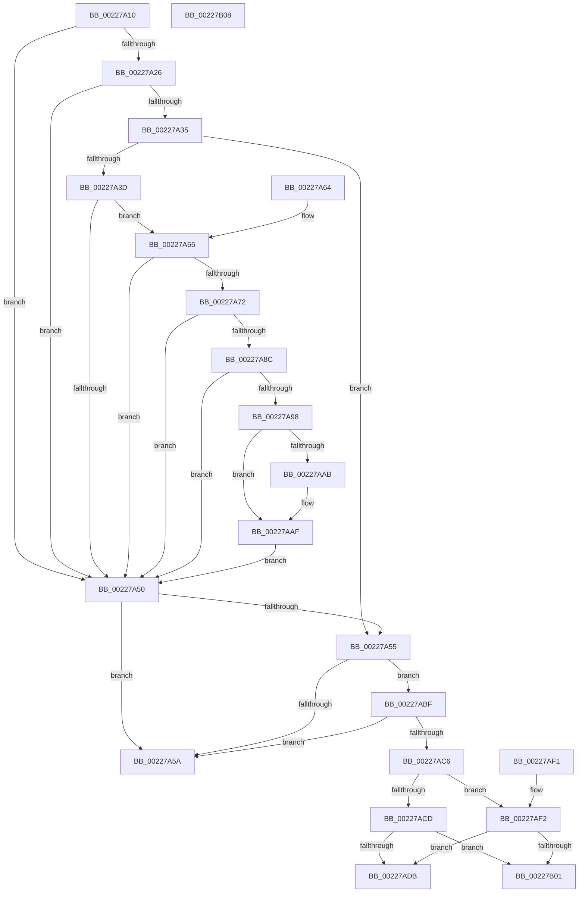

# MiIsPdeOrAboveAccessible

- RVA: `0x00227A10`–`0x00227B09` (길이 `249` bytes)
- VA: `0x0000000140227A10`
- 실행 섹션: `.text`
- PDB 이름 있음: `예`; PDB Function 태그: `아니요`
- unwind 정보 RVA: `0x0005FB84`
- 디코드: `71`개 명령, `249/249` bytes 표시
- 미해석 바이트: `0` (있으면 어셈블리에 `.byte`로 보존)

> 이 문서는 커널 이미지의 기계어와 PDB 기호를 분석해 생성했습니다. 4번과 5번은 함수 원형과 자료형을 바이너리 사용 방식에서 추정한 C 해석이며 원본 소스 복구 결과는 아닙니다.

## 1. Dependencies

- 직접 호출 지점: **2**; 고유 호출 대상: **2**
- 직접 호출자로 확인된 함수: **2**
- RIP 상대 이미지 참조: **1**

### Outgoing calls
- `0x00227ADE` → [MiIsLazyStampedPte](MiIsLazyStampedPte_function_00227B10.md) (function, `0x00227B10`)
- `0x00227AF7` → [MiMakeDemandZeroPte](../33/MiMakeDemandZeroPte_function_00337A00.md) (function, `0x00337A00`)

### Direct callers
- [MiReplacePageTablePage](MiReplacePageTablePage_function_00229184.md) at `0x0022985C`
- [sub_0027BF19](../27/Unknown_function_0027BF19.md) at `0x0027BFC5`

### Static image references
- `0x00227A65` → RVA `0x00FC6A88` (`ALMOSTRO`; read)

## 2. Other-region calls and transfers

- 다른 실행 섹션으로 향하는 call: **0**
- 별도 외부 분기/꼬리 이동을 확인하지 못했습니다.

## 3. Assembly (complete function range)

```asm
00227A10  48 83 EC 28                     sub rsp, 0x28
00227A14  48 8B 11                        mov rdx, qword ptr [rcx]
00227A17  48 B8 00 D0 BE 7D FB F6 FF FF   movabs rax, 0xfffff6fb7dbed000
00227A21  48 3B C8                        cmp rcx, rax
00227A24  72 2A                           jb 0x140227a50
00227A26  48 B8 F8 D7 BE 7D FB F6 FF FF   movabs rax, 0xfffff6fb7dbed7f8
00227A30  48 3B C8                        cmp rcx, rax
00227A33  77 1B                           ja 0x140227a50
00227A35  48 8B C2                        mov rax, rdx
00227A38  F6 C2 01                        test dl, 1
00227A3B  74 18                           je 0x140227a55
00227A3D  F6 C2 42                        test dl, 0x42
00227A40  41 0F 95 C1                     setne r9b
00227A44  F6 C2 20                        test dl, 0x20
00227A47  41 0F 95 C0                     setne r8b
00227A4B  45 84 C8                        test r8b, r9b
00227A4E  74 15                           je 0x140227a65
00227A50  F6 C2 01                        test dl, 1
00227A53  75 05                           jne 0x140227a5a
00227A55  48 85 D2                        test rdx, rdx
00227A58  75 65                           jne 0x140227abf
00227A5A  B8 01 00 00 00                  mov eax, 1
00227A5F  48 83 C4 28                     add rsp, 0x28
00227A63  C3                              ret
00227A64  CC                              int3
00227A65  48 F7 05 18 F0 D9 00 00 00 60 00  test qword ptr [rip + 0xd9f018], 0x600000
00227A70  74 DE                           je 0x140227a50
00227A72  65 4C 8B 04 25 88 01 00 00      mov r8, qword ptr gs:[0x188]
00227A7B  4D 8B 88 B8 00 00 00            mov r9, qword ptr [r8 + 0xb8]
00227A82  41 80 B9 60 01 00 00 01         cmp byte ptr [r9 + 0x160], 1
00227A8A  74 C4                           je 0x140227a50
00227A8C  4D 8B 81 08 05 00 00            mov r8, qword ptr [r9 + 0x508]
00227A93  4D 85 C0                        test r8, r8
00227A96  74 B8                           je 0x140227a50
00227A98  48 C1 E9 03                     shr rcx, 3
00227A9C  81 E1 FF 01 00 00               and ecx, 0x1ff
00227AA2  49 8B 0C C8                     mov rcx, qword ptr [r8 + rcx*8]
00227AA6  F6 C1 20                        test cl, 0x20
00227AA9  74 04                           je 0x140227aaf
00227AAB  48 83 C8 20                     or rax, 0x20
00227AAF  48 8B D0                        mov rdx, rax
00227AB2  48 83 CA 42                     or rdx, 0x42
00227AB6  F6 C1 42                        test cl, 0x42
00227AB9  48 0F 44 D0                     cmove rdx, rax
00227ABD  EB 91                           jmp 0x140227a50
00227ABF  48 0F BA E2 0A                  bt rdx, 0xa
00227AC4  72 94                           jb 0x140227a5a
00227AC6  48 0F BA E2 0B                  bt rdx, 0xb
00227ACB  73 25                           jae 0x140227af2
00227ACD  48 8B C2                        mov rax, rdx
00227AD0  48 C1 E8 05                     shr rax, 5
00227AD4  83 E0 1F                        and eax, 0x1f
00227AD7  3C 18                           cmp al, 0x18
00227AD9  74 26                           je 0x140227b01
00227ADB  48 8B CA                        mov rcx, rdx
00227ADE  E8 2D 00 00 00                  call 0x140227b10
00227AE3  33 C9                           xor ecx, ecx
00227AE5  85 C0                           test eax, eax
00227AE7  0F 94 C1                        sete cl
00227AEA  8B C1                           mov eax, ecx
00227AEC  48 83 C4 28                     add rsp, 0x28
00227AF0  C3                              ret
00227AF1  CC                              int3
00227AF2  B9 10 00 00 00                  mov ecx, 0x10
00227AF7  E8 04 FF 10 00                  call 0x140337a00
00227AFC  48 3B D0                        cmp rdx, rax
00227AFF  75 DA                           jne 0x140227adb
00227B01  33 C0                           xor eax, eax
00227B03  48 83 C4 28                     add rsp, 0x28
00227B07  C3                              ret
00227B08  CC                              int3
```

## 4. C-style interpretation (structured pseudocode)

```c
__int64 __fastcall MiIsPdeOrAboveAccessible(__int64 a1)
{
    __int64 result;
    __int64 v_rsp;

    v_rsp = (v_rsp) - (40);
    if (a1 < result) goto loc_00227A50;
    if (a1 > result) goto loc_00227A50;
    if ((((unsigned __int8)(*(unsigned __int64 *)(a1))) & (1)) == 0) goto loc_00227A55;
    a4 = ((((unsigned __int8)(*(unsigned __int64 *)(a1))) & (66)) != 0) ? 1 : 0;
    a3 = ((((unsigned __int8)(*(unsigned __int64 *)(a1))) & (32)) != 0) ? 1 : 0;
    if ((((unsigned __int8)(a3)) & ((unsigned __int8)(a4))) == 0) goto loc_00227A65;
loc_00227A50:
    if ((((unsigned __int8)(*(unsigned __int64 *)(a1))) & (1)) != 0) goto loc_00227A5A;
loc_00227A55:
    if (*(unsigned __int64 *)(a1) != 0) goto loc_00227ABF;
loc_00227A5A:
    v_rsp = (v_rsp) + (40);
    return 1;
loc_00227A65:
    if (((*(unsigned __int64 *)(v_rip + 14282776)) & (0x600000ULL)) == 0) goto loc_00227A50;
    if ((*(unsigned __int8 *)(*(unsigned __int64 *)(*(unsigned __int64 *)(gs_base + (0 + 392)) + 184) + 352)) == 1) goto loc_00227A50;
    if (*(unsigned __int64 *)(*(unsigned __int64 *)(*(unsigned __int64 *)(gs_base + (0 + 392)) + 184) + 1288) == 0) goto loc_00227A50;
    a1 = (a1) >> (3);
    a1 = (unsigned int)((a1) & (511));
    result = 1;
    if ((((unsigned __int8)(*(unsigned __int64 *)(*(unsigned __int64 *)(*(unsigned __int64 *)(*(unsigned __int64 *)(gs_base + (0 + 392)) + 184) + 1288) + a1 * 8))) & (32)) != 0) {
        result = (1) | (32);
    }
    a2 = (result) | (66);
    if ((((unsigned __int8)(*(unsigned __int64 *)(*(unsigned __int64 *)(*(unsigned __int64 *)(*(unsigned __int64 *)(gs_base + (0 + 392)) + 184) + 1288) + a1 * 8))) & (66)) == 0) { a2 = result; }
    goto loc_00227A50;
loc_00227ABF:
    if (condition_is_below) goto loc_00227A5A;
    if (condition_is_above_or_equal) goto loc_00227AF2;
    result = (a2) >> (5);
    result = (unsigned int)((result) & (31));
    if (((unsigned __int8)(result)) == 24) goto loc_00227B01;
loc_00227ADB:
    result = MiIsLazyStampedPte(a2, a2, *(unsigned __int64 *)(*(unsigned __int64 *)(*(unsigned __int64 *)(gs_base + (0 + 392)) + 184) + 1288), *(unsigned __int64 *)(*(unsigned __int64 *)(gs_base + (0 + 392)) + 184));
    a1 = 0;
    a1 = ((unsigned int)(result) == 0) ? 1 : 0;
    v_rsp = (v_rsp) + (40);
    return (unsigned int)((unsigned int)(a1));
loc_00227AF2:
    result = MiMakeDemandZeroPte(16, a2, *(unsigned __int64 *)(*(unsigned __int64 *)(*(unsigned __int64 *)(gs_base + (0 + 392)) + 184) + 1288), *(unsigned __int64 *)(*(unsigned __int64 *)(gs_base + (0 + 392)) + 184));
    if (a2 != result) goto loc_00227ADB;
loc_00227B01:
    result = 0;
    v_rsp = (v_rsp) + (40);
    return result;
}
```

## 5. (Beta) C Style

```c
int64_t MiIsPdeOrAboveAccessible(void *Arg1)
{
    uint8_t *arg1 = (uint8_t *)Arg1;

    int64_t result;
    int64_t local_rsp;

    local_rsp = (local_rsp) - (40);
    if (Arg1 < result) goto loc_00227A50;
    if (Arg1 > result) goto loc_00227A50;
    if ((((uint8_t)(*(uint64_t *)(arg1))) & (1)) == 0) goto loc_00227A55;
    a4 = ((((uint8_t)(*(uint64_t *)(arg1))) & (66)) != 0) ? 1 : 0;
    a3 = ((((uint8_t)(*(uint64_t *)(arg1))) & (32)) != 0) ? 1 : 0;
    if ((((uint8_t)(a3)) & ((uint8_t)(a4))) == 0) goto loc_00227A65;
loc_00227A50:
    if ((((uint8_t)(*(uint64_t *)(arg1))) & (1)) != 0) goto loc_00227A5A;
loc_00227A55:
    if (*(uint64_t *)(arg1) != 0) goto loc_00227ABF;
loc_00227A5A:
    local_rsp = (local_rsp) + (40);
    return 1;
loc_00227A65:
    if (((*(uint64_t *)(v_rip + 0xD9F018)) & (0x600000ULL)) == 0) goto loc_00227A50;
    if ((*(uint8_t *)(*(uint64_t *)(*(uint64_t *)(gs_base + (0 + 0x188)) + 0xB8) + 0x160)) == 1) goto loc_00227A50;
    if (*(uint64_t *)(*(uint64_t *)(*(uint64_t *)(gs_base + (0 + 0x188)) + 0xB8) + 0x508) == 0) goto loc_00227A50;
    Arg1 = (Arg1) >> (3);
    Arg1 = (uint32_t)((Arg1) & (511));
    result = 1;
    if ((((uint8_t)(*(uint64_t *)(*(uint64_t *)(*(uint64_t *)(*(uint64_t *)(gs_base + (0 + 0x188)) + 0xB8) + 0x508) + arg1 * 8))) & (32)) != 0) {
        result = (1) | (32);
    }
    a2 = (result) | (66);
    if ((((uint8_t)(*(uint64_t *)(*(uint64_t *)(*(uint64_t *)(*(uint64_t *)(gs_base + (0 + 0x188)) + 0xB8) + 0x508) + arg1 * 8))) & (66)) == 0) { a2 = result; }
    goto loc_00227A50;
loc_00227ABF:
    if (condition_is_below) goto loc_00227A5A;
    if (condition_is_above_or_equal) goto loc_00227AF2;
    result = (a2) >> (5);
    result = (uint32_t)((result) & (31));
    if (((uint8_t)(result)) == 24) goto loc_00227B01;
loc_00227ADB:
    result = MiIsLazyStampedPte(a2, a2, *(uint64_t *)(*(uint64_t *)(*(uint64_t *)(gs_base + (0 + 0x188)) + 0xB8) + 0x508), *(uint64_t *)(*(uint64_t *)(gs_base + (0 + 0x188)) + 0xB8));
    Arg1 = 0;
    Arg1 = ((uint32_t)(result) == 0) ? 1 : 0;
    local_rsp = (local_rsp) + (40);
    return (uint32_t)((uint32_t)(Arg1));
loc_00227AF2:
    result = MiMakeDemandZeroPte(16, a2, *(uint64_t *)(*(uint64_t *)(*(uint64_t *)(gs_base + (0 + 0x188)) + 0xB8) + 0x508), *(uint64_t *)(*(uint64_t *)(gs_base + (0 + 0x188)) + 0xB8));
    if (a2 != result) goto loc_00227ADB;
loc_00227B01:
    result = 0;
    local_rsp = (local_rsp) + (40);
    return result;
}
```

### 관측된 메모리 오프셋

구조체 형식이 확인되지 않은 접근은 인자 기준의 오프셋으로만 기록했습니다.

| 기준 인자 | 오프셋 표현 | 폭 (bit) | 접근 |
|---|---:|---:|---|
| `Arg1` | `+ 0x0` | `64` | `R` |

## 6. Execution-region graph

[열기: 2D/3D 그래프와 함수 탐색 컨트롤 패널](../../../control-panel.html?section=text&rva=0x00227A10&view=graph)

- 2D 그래프는 위에서 아래로 흐르고, 3D 그래프는 빈 공간을 드래그해 회전합니다. Shift+드래그는 이동, 휠은 확대·축소, 함수 노드 선택은 대상 보고서 이동입니다.

### Static fallback


