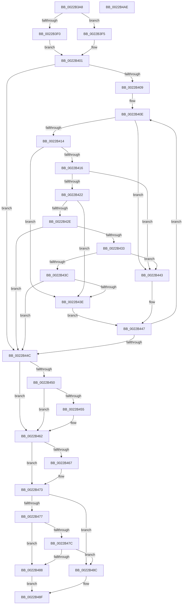

# MiLocateCombineBlock

- RVA: `0x0022B3A8`–`0x0022B4AF` (길이 `263` bytes)
- VA: `0x000000014022B3A8`
- 실행 섹션: `.text`
- PDB 이름 있음: `예`; PDB Function 태그: `아니요`
- unwind 정보 RVA: `0x0005FEF8`
- 디코드: `88`개 명령, `263/263` bytes 표시
- 미해석 바이트: `0` (있으면 어셈블리에 `.byte`로 보존)

> 이 문서는 커널 이미지의 기계어와 PDB 기호를 분석해 생성했습니다. 4번과 5번은 함수 원형과 자료형을 바이너리 사용 방식에서 추정한 C 해석이며 원본 소스 복구 결과는 아닙니다.

## 1. Dependencies

- 직접 호출 지점: **3**; 고유 호출 대상: **3**
- 직접 호출자로 확인된 함수: **2**
- RIP 상대 이미지 참조: **0**

### Outgoing calls
- `0x0022B3D1` → [Feature_Servicing_Mm_LocateCombineBlockFix__private_IsEnabledDeviceUsageNoInline](../68/Feature_Servicing_Mm_LocateCombineBlockFix__private_IsEnabledDeviceUsageNoInline_function_0068B948.md) (function, `0x0068B948`)
- `0x0022B3F9` → [ExAcquireSpinLockShared](../24/ExAcquireSpinLockShared_function_0024DCE0.md) (function, `0x0024DCE0`)
- `0x0022B46E` → [MiReleaseSpinLockShared](../34/MiReleaseSpinLockShared_function_00348BF0.md) (function, `0x00348BF0`)

### Direct callers
- [MiCreateCombineAnchor](MiCreateCombineAnchor_function_0022B178.md) at `0x0022B1D4`
- [MiProcessCrcList](../../page/9F/MiProcessCrcList_function_009F6F94.md) at `0x009F710A`
- [MiProcessCrcList](../../page/9F/MiProcessCrcList_function_009F6F94.md) at `0x009F7440`

### Static image references
- 디코드된 RIP-relative 메모리 참조가 없습니다.

## 2. Other-region calls and transfers

- 다른 실행 섹션으로 향하는 call: **0**
- 별도 외부 분기/꼬리 이동을 확인하지 못했습니다.

## 3. Assembly (complete function range)

```asm
0022B3A8  48 8B C4                        mov rax, rsp
0022B3AB  48 89 58 08                     mov qword ptr [rax + 8], rbx
0022B3AF  48 89 68 10                     mov qword ptr [rax + 0x10], rbp
0022B3B3  48 89 70 18                     mov qword ptr [rax + 0x18], rsi
0022B3B7  48 89 78 20                     mov qword ptr [rax + 0x20], rdi
0022B3BB  41 54                           push r12
0022B3BD  41 56                           push r14
0022B3BF  41 57                           push r15
0022B3C1  48 83 EC 20                     sub rsp, 0x20
0022B3C5  45 8B E1                        mov r12d, r9d
0022B3C8  45 8B F8                        mov r15d, r8d
0022B3CB  4C 8B F2                        mov r14, rdx
0022B3CE  48 8B D9                        mov rbx, rcx
0022B3D1  E8 72 05 46 00                  call 0x14068b948
0022B3D6  49 8B FE                        mov rdi, r14
0022B3D9  33 F6                           xor esi, esi
0022B3DB  83 E7 0F                        and edi, 0xf
0022B3DE  8B E8                           mov ebp, eax
0022B3E0  48 83 C7 06                     add rdi, 6
0022B3E4  48 C1 E7 04                     shl rdi, 4
0022B3E8  48 03 FB                        add rdi, rbx
0022B3EB  45 85 E4                        test r12d, r12d
0022B3EE  74 05                           je 0x14022b3f5
0022B3F0  41 B0 11                        mov r8b, 0x11
0022B3F3  EB 0C                           jmp 0x14022b401
0022B3F5  48 8D 4F 08                     lea rcx, [rdi + 8]
0022B3F9  E8 E2 28 02 00                  call 0x14024dce0
0022B3FE  44 8A C0                        mov r8b, al
0022B401  48 8B 1F                        mov rbx, qword ptr [rdi]
0022B404  48 85 DB                        test rbx, rbx
0022B407  74 43                           je 0x14022b44c
0022B409  48 8B 54 24 60                  mov rdx, qword ptr [rsp + 0x60]
0022B40E  4C 3B 73 18                     cmp r14, qword ptr [rbx + 0x18]
0022B412  77 2F                           ja 0x14022b443
0022B414  72 28                           jb 0x14022b43e
0022B416  48 8B 43 30                     mov rax, qword ptr [rbx + 0x30]
0022B41A  83 E0 1F                        and eax, 0x1f
0022B41D  44 3B F8                        cmp r15d, eax
0022B420  77 21                           ja 0x14022b443
0022B422  48 8B 43 30                     mov rax, qword ptr [rbx + 0x30]
0022B426  83 E0 1F                        and eax, 0x1f
0022B429  44 3B F8                        cmp r15d, eax
0022B42C  72 10                           jb 0x14022b43e
0022B42E  48 85 D2                        test rdx, rdx
0022B431  74 19                           je 0x14022b44c
0022B433  48 8B 02                        mov rax, qword ptr [rdx]
0022B436  48 3B 43 40                     cmp rax, qword ptr [rbx + 0x40]
0022B43A  77 07                           ja 0x14022b443
0022B43C  73 0E                           jae 0x14022b44c
0022B43E  48 8B 1B                        mov rbx, qword ptr [rbx]
0022B441  EB 04                           jmp 0x14022b447
0022B443  48 8B 5B 08                     mov rbx, qword ptr [rbx + 8]
0022B447  48 85 DB                        test rbx, rbx
0022B44A  75 C2                           jne 0x14022b40e
0022B44C  85 ED                           test ebp, ebp
0022B44E  74 12                           je 0x14022b462
0022B450  48 85 DB                        test rbx, rbx
0022B453  74 0D                           je 0x14022b462
0022B455  48 8B 43 38                     mov rax, qword ptr [rbx + 0x38]
0022B459  48 F7 D8                        neg rax
0022B45C  48 1B F6                        sbb rsi, rsi
0022B45F  48 23 F3                        and rsi, rbx
0022B462  45 85 E4                        test r12d, r12d
0022B465  75 0C                           jne 0x14022b473
0022B467  48 8D 4F 08                     lea rcx, [rdi + 8]
0022B46B  41 8A D0                        mov dl, r8b
0022B46E  E8 7D D7 11 00                  call 0x140348bf0
0022B473  85 ED                           test ebp, ebp
0022B475  75 15                           jne 0x14022b48c
0022B477  48 85 DB                        test rbx, rbx
0022B47A  74 0C                           je 0x14022b488
0022B47C  48 8B 43 38                     mov rax, qword ptr [rbx + 0x38]
0022B480  48 8B F3                        mov rsi, rbx
0022B483  48 85 C0                        test rax, rax
0022B486  75 04                           jne 0x14022b48c
0022B488  33 C0                           xor eax, eax
0022B48A  EB 03                           jmp 0x14022b48f
0022B48C  48 8B C6                        mov rax, rsi
0022B48F  48 8B 5C 24 40                  mov rbx, qword ptr [rsp + 0x40]
0022B494  48 8B 6C 24 48                  mov rbp, qword ptr [rsp + 0x48]
0022B499  48 8B 74 24 50                  mov rsi, qword ptr [rsp + 0x50]
0022B49E  48 8B 7C 24 58                  mov rdi, qword ptr [rsp + 0x58]
0022B4A3  48 83 C4 20                     add rsp, 0x20
0022B4A7  41 5F                           pop r15
0022B4A9  41 5E                           pop r14
0022B4AB  41 5C                           pop r12
0022B4AD  C3                              ret
0022B4AE  CC                              int3
```

## 4. C-style interpretation (structured pseudocode)

```c
__int64 __fastcall MiLocateCombineBlock(__int64 a1, __int64 a2, int a3, int a4, __int64 a5)
{
    __int64 result;
    __int64 v_rdi;
    __int64 v_rsi;
    __int64 v_rsp;
    unsigned __int64 v_stack_p10;
    unsigned __int64 v_stack_p18;
    unsigned __int64 v_stack_p20;
    unsigned __int64 v_stack_p8;

    *(unsigned __int64 *)(v_rsp + 8) = v_rbx;
    *(unsigned __int64 *)(v_rsp + 16) = v_rbp;
    *(unsigned __int64 *)(v_rsp + 24) = v_rsi;
    *(unsigned __int64 *)(v_rsp + 32) = v_rdi;
    v_rsp = (v_rsp) - (32);
    result = Feature_Servicing_Mm_LocateCombineBlockFix__private_IsEnabledDeviceUsageNoInline(a1, a2, a3, a4);
    v_rsi = 0;
    v_rdi = (unsigned int)((a2) & (15));
    v_rdi = (v_rdi) + (6);
    v_rdi = (v_rdi) << (4);
    v_rdi = (v_rdi) + (a1);
    if ((unsigned int)((unsigned int)(a4)) == 0) goto loc_0022B3F5;
    goto loc_0022B401;
loc_0022B3F5:
    result = ExAcquireSpinLockShared(v_rdi + 8, a2, 17, a4);
loc_0022B401:
    if (*(unsigned __int64 *)(v_rdi) == 0) goto loc_0022B44C;
loc_0022B40E:
    if (a2 > (*(unsigned __int64 *)(*(unsigned __int64 *)(v_rdi) + 24))) goto loc_0022B443;
    if (a2 < (*(unsigned __int64 *)(*(unsigned __int64 *)(v_rdi) + 24))) goto loc_0022B43E;
    result = (unsigned int)((*(unsigned __int64 *)(*(unsigned __int64 *)(v_rdi) + 48)) & (31));
    if (((unsigned int)((unsigned int)(a3))) > ((unsigned int)(result))) goto loc_0022B443;
    result = (unsigned int)((*(unsigned __int64 *)(*(unsigned __int64 *)(v_rdi) + 48)) & (31));
    if (((unsigned int)((unsigned int)(a3))) < ((unsigned int)(result))) goto loc_0022B43E;
    if (a5 == 0) goto loc_0022B44C;
    if ((*(unsigned __int64 *)(a5)) > (*(unsigned __int64 *)(*(unsigned __int64 *)(v_rdi) + 64))) goto loc_0022B443;
    if ((*(unsigned __int64 *)(a5)) >= (*(unsigned __int64 *)(*(unsigned __int64 *)(v_rdi) + 64))) goto loc_0022B44C;
loc_0022B43E:
    goto loc_0022B447;
loc_0022B443:
loc_0022B447:
    if (*(unsigned __int64 *)(*(unsigned __int64 *)(*(unsigned __int64 *)(v_rdi)) + 8) != 0) goto loc_0022B40E;
loc_0022B44C:
    if ((unsigned int)((unsigned int)((unsigned int)(result))) == 0) goto loc_0022B462;
    result = *(unsigned __int64 *)(a5);
    if (*(unsigned __int64 *)(*(unsigned __int64 *)(*(unsigned __int64 *)(v_rdi)) + 8) != 0) {
        result = *(unsigned __int64 *)(*(unsigned __int64 *)(*(unsigned __int64 *)(*(unsigned __int64 *)(v_rdi)) + 8) + 56);
        result = -(result);
        v_rsi = (v_rsi) & (*(unsigned __int64 *)(*(unsigned __int64 *)(*(unsigned __int64 *)(v_rdi)) + 8));
    }
    if ((unsigned int)((unsigned int)(a4)) == 0) {
        a1 = v_rdi + 8;
        a2 = (unsigned __int8)((unsigned __int8)(result));
        result = MiReleaseSpinLockShared(a1, a2, (unsigned __int8)(result), a4);
    }
    if ((unsigned int)((unsigned int)((unsigned int)(result))) != 0) goto loc_0022B48C;
    if (*(unsigned __int64 *)(*(unsigned __int64 *)(*(unsigned __int64 *)(v_rdi)) + 8) == 0) goto loc_0022B488;
    if (*(unsigned __int64 *)(*(unsigned __int64 *)(*(unsigned __int64 *)(*(unsigned __int64 *)(v_rdi)) + 8) + 56) != 0) goto loc_0022B48C;
loc_0022B488:
    result = 0;
    goto loc_0022B48F;
loc_0022B48C:
loc_0022B48F:
    v_rsp = (v_rsp) + (32);
    return *(unsigned __int64 *)(*(unsigned __int64 *)(*(unsigned __int64 *)(v_rdi)) + 8);
}
```

## 5. (Beta) C Style

```c
int64_t MiLocateCombineBlock(int64_t Arg1, int64_t Arg2, int32_t Arg3, int32_t Arg4, int64_t Arg5)
{
    int64_t result;
    int64_t local_rdi;
    int64_t local_rsi;
    int64_t local_rsp;
    uint64_t v_stack_p10;
    uint64_t v_stack_p18;
    uint64_t v_stack_p20;
    uint64_t v_stack_p8;

    *(uint64_t *)(local_rsp + 0x8) = local_rbx;
    *(uint64_t *)(local_rsp + 0x10) = local_rbp;
    *(uint64_t *)(local_rsp + 0x18) = local_rsi;
    *(uint64_t *)(local_rsp + 0x20) = local_rdi;
    local_rsp = (local_rsp) - (32);
    result = Feature_Servicing_Mm_LocateCombineBlockFix__private_IsEnabledDeviceUsageNoInline(Arg1, Arg2, Arg3, Arg4);
    local_rsi = 0;
    local_rdi = (uint32_t)((Arg2) & (15));
    local_rdi = (local_rdi) + (6);
    local_rdi = (local_rdi) << (4);
    local_rdi = (local_rdi) + (Arg1);
    if ((uint32_t)((uint32_t)(Arg4)) == 0) goto loc_0022B3F5;
    goto loc_0022B401;
loc_0022B3F5:
    result = ExAcquireSpinLockShared(local_rdi + 8, Arg2, 17, Arg4);
loc_0022B401:
    if (*(uint64_t *)(local_rdi) == 0) goto loc_0022B44C;
loc_0022B40E:
    if (Arg2 > (*(uint64_t *)(*(uint64_t *)(local_rdi) + 0x18))) goto loc_0022B443;
    if (Arg2 < (*(uint64_t *)(*(uint64_t *)(local_rdi) + 0x18))) goto loc_0022B43E;
    result = (uint32_t)((*(uint64_t *)(*(uint64_t *)(local_rdi) + 0x30)) & (31));
    if (((uint32_t)((uint32_t)(Arg3))) > ((uint32_t)(result))) goto loc_0022B443;
    result = (uint32_t)((*(uint64_t *)(*(uint64_t *)(local_rdi) + 0x30)) & (31));
    if (((uint32_t)((uint32_t)(Arg3))) < ((uint32_t)(result))) goto loc_0022B43E;
    if (Arg5 == 0) goto loc_0022B44C;
    if ((*(uint64_t *)(Arg5)) > (*(uint64_t *)(*(uint64_t *)(local_rdi) + 0x40))) goto loc_0022B443;
    if ((*(uint64_t *)(Arg5)) >= (*(uint64_t *)(*(uint64_t *)(local_rdi) + 0x40))) goto loc_0022B44C;
loc_0022B43E:
    goto loc_0022B447;
loc_0022B443:
loc_0022B447:
    if (*(uint64_t *)(*(uint64_t *)(*(uint64_t *)(local_rdi)) + 0x8) != 0) goto loc_0022B40E;
loc_0022B44C:
    if ((uint32_t)((uint32_t)((uint32_t)(result))) == 0) goto loc_0022B462;
    result = *(uint64_t *)(Arg5);
    if (*(uint64_t *)(*(uint64_t *)(*(uint64_t *)(local_rdi)) + 0x8) != 0) {
        result = *(uint64_t *)(*(uint64_t *)(*(uint64_t *)(*(uint64_t *)(local_rdi)) + 0x8) + 0x38);
        result = -(result);
        local_rsi = (local_rsi) & (*(uint64_t *)(*(uint64_t *)(*(uint64_t *)(local_rdi)) + 0x8));
    }
    if ((uint32_t)((uint32_t)(Arg4)) == 0) {
        Arg1 = local_rdi + 8;
        Arg2 = (uint8_t)((uint8_t)(result));
        result = MiReleaseSpinLockShared(Arg1, Arg2, (uint8_t)(result), Arg4);
    }
    if ((uint32_t)((uint32_t)((uint32_t)(result))) != 0) goto loc_0022B48C;
    if (*(uint64_t *)(*(uint64_t *)(*(uint64_t *)(local_rdi)) + 0x8) == 0) goto loc_0022B488;
    if (*(uint64_t *)(*(uint64_t *)(*(uint64_t *)(*(uint64_t *)(local_rdi)) + 0x8) + 0x38) != 0) goto loc_0022B48C;
loc_0022B488:
    result = 0;
    goto loc_0022B48F;
loc_0022B48C:
loc_0022B48F:
    local_rsp = (local_rsp) + (32);
    return *(uint64_t *)(*(uint64_t *)(*(uint64_t *)(local_rdi)) + 0x8);
}
```

## 6. Execution-region graph

[열기: 2D/3D 그래프와 함수 탐색 컨트롤 패널](../../../control-panel.html?section=text&rva=0x0022B3A8&view=graph)

- 2D 그래프는 위에서 아래로 흐르고, 3D 그래프는 빈 공간을 드래그해 회전합니다. Shift+드래그는 이동, 휠은 확대·축소, 함수 노드 선택은 대상 보고서 이동입니다.

### Static fallback


