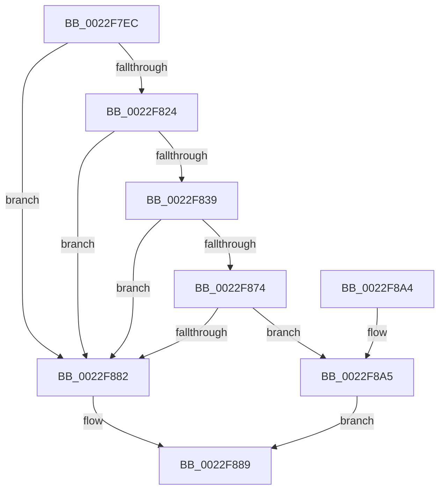

# MiMakePerSessionProtoPte

- RVA: `0x0022F7EC`–`0x0022F8DB` (길이 `239` bytes)
- VA: `0x000000014022F7EC`
- 실행 섹션: `.text`
- PDB 이름 있음: `예`; PDB Function 태그: `아니요`
- unwind 정보 RVA: `0x0006016C`
- 디코드: `63`개 명령, `239/239` bytes 표시
- 미해석 바이트: `0` (있으면 어셈블리에 `.byte`로 보존)

> 이 문서는 커널 이미지의 기계어와 PDB 기호를 분석해 생성했습니다. 4번과 5번은 함수 원형과 자료형을 바이너리 사용 방식에서 추정한 C 해석이며 원본 소스 복구 결과는 아닙니다.

## 1. Dependencies

- 직접 호출 지점: **6**; 고유 호출 대상: **4**
- 직접 호출자로 확인된 함수: **1**
- RIP 상대 이미지 참조: **1**

### Outgoing calls
- `0x0022F80E` → [PsGetProcessSessionIdEx](PsGetProcessSessionIdEx_function_0022F8F0.md) (function, `0x0022F8F0`)
- `0x0022F818` → [PsGetProcessSessionIdEx](PsGetProcessSessionIdEx_function_0022F8F0.md) (function, `0x0022F8F0`)
- `0x0022F867` → [MiGetProtoPteAddress](../32/MiGetProtoPteAddress_function_0032E970.md) (function, `0x0032E970`)
- `0x0022F8AF` → [MiGetSharedProtos](../34/MiGetSharedProtos_function_00348D58.md) (function, `0x00348D58`)
- `0x0022F8C7` → [MiGetSharedProtos](../34/MiGetSharedProtos_function_00348D58.md) (function, `0x00348D58`)
- `0x0022F8D4` → [MiMakePrototypePteDirect](../29/MiMakePrototypePteDirect_function_00294DE0.md) (function, `0x00294DE0`)

### Direct callers
- [MiBuildForkPte](MiBuildForkPte_function_0022E32C.md) at `0x0022E96D`
- [MiBuildForkPte](MiBuildForkPte_function_0022E32C.md) at `0x0022ECBC`

### Static image references
- `0x0022F882` → RVA `0x00010880` (`.rdata`; read)

## 2. Other-region calls and transfers

- 다른 실행 섹션으로 향하는 call: **0**
- 별도 외부 분기/꼬리 이동을 확인하지 못했습니다.

## 3. Assembly (complete function range)

```asm
0022F7EC  48 8B C4                        mov rax, rsp
0022F7EF  48 89 58 08                     mov qword ptr [rax + 8], rbx
0022F7F3  48 89 68 10                     mov qword ptr [rax + 0x10], rbp
0022F7F7  48 89 70 18                     mov qword ptr [rax + 0x18], rsi
0022F7FB  48 89 78 20                     mov qword ptr [rax + 0x20], rdi
0022F7FF  41 56                           push r14
0022F801  48 83 EC 30                     sub rsp, 0x30
0022F805  49 8B F1                        mov rsi, r9
0022F808  49 8B F8                        mov rdi, r8
0022F80B  48 8B DA                        mov rbx, rdx
0022F80E  E8 DD 00 00 00                  call 0x14022f8f0
0022F813  48 8B CB                        mov rcx, rbx
0022F816  8B E8                           mov ebp, eax
0022F818  E8 D3 00 00 00                  call 0x14022f8f0
0022F81D  44 8B F0                        mov r14d, eax
0022F820  3B E8                           cmp ebp, eax
0022F822  74 5E                           je 0x14022f882
0022F824  48 8B 4E 48                     mov rcx, qword ptr [rsi + 0x48]
0022F828  48 89 4C 24 20                  mov qword ptr [rsp + 0x20], rcx
0022F82D  48 8B 19                        mov rbx, qword ptr [rcx]
0022F830  F7 43 38 00 00 00 08            test dword ptr [rbx + 0x38], 0x8000000
0022F837  74 49                           je 0x14022f882
0022F839  48 C1 E7 19                     shl rdi, 0x19
0022F83D  48 B9 00 00 00 00 80 F6 FF FF   movabs rcx, 0xfffff68000000000
0022F847  48 C1 E1 19                     shl rcx, 0x19
0022F84B  4C 8D 4C 24 20                  lea r9, [rsp + 0x20]
0022F850  48 2B F9                        sub rdi, rcx
0022F853  41 B8 08 00 00 00               mov r8d, 8
0022F859  48 C1 FF 10                     sar rdi, 0x10
0022F85D  48 8B CE                        mov rcx, rsi
0022F860  48 C1 EF 0C                     shr rdi, 0xc
0022F864  48 8B D7                        mov rdx, rdi
0022F867  E8 04 F1 0F 00                  call 0x14032e970
0022F86C  48 8B F8                        mov rdi, rax
0022F86F  48 85 C0                        test rax, rax
0022F872  74 0E                           je 0x14022f882
0022F874  48 8B 4C 24 20                  mov rcx, qword ptr [rsp + 0x20]
0022F879  8B 49 20                        mov ecx, dword ptr [rcx + 0x20]
0022F87C  0F BA E1 11                     bt ecx, 0x11
0022F880  72 23                           jb 0x14022f8a5
0022F882  48 8B 05 F7 0F DE FF            mov rax, qword ptr [rip - 0x21f009]
0022F889  48 8B 5C 24 40                  mov rbx, qword ptr [rsp + 0x40]
0022F88E  48 8B 6C 24 48                  mov rbp, qword ptr [rsp + 0x48]
0022F893  48 8B 74 24 50                  mov rsi, qword ptr [rsp + 0x50]
0022F898  48 8B 7C 24 58                  mov rdi, qword ptr [rsp + 0x58]
0022F89D  48 83 C4 30                     add rsp, 0x30
0022F8A1  41 5E                           pop r14
0022F8A3  C3                              ret
0022F8A4  CC                              int3
0022F8A5  4C 8B 44 24 20                  mov r8, qword ptr [rsp + 0x20]
0022F8AA  8B D5                           mov edx, ebp
0022F8AC  48 8B CB                        mov rcx, rbx
0022F8AF  E8 A4 94 11 00                  call 0x140348d58
0022F8B4  4C 8B 44 24 20                  mov r8, qword ptr [rsp + 0x20]
0022F8B9  41 8B D6                        mov edx, r14d
0022F8BC  48 8B CB                        mov rcx, rbx
0022F8BF  48 2B 78 48                     sub rdi, qword ptr [rax + 0x48]
0022F8C3  48 C1 FF 03                     sar rdi, 3
0022F8C7  E8 8C 94 11 00                  call 0x140348d58
0022F8CC  48 8B 48 48                     mov rcx, qword ptr [rax + 0x48]
0022F8D0  48 8D 0C F9                     lea rcx, [rcx + rdi*8]
0022F8D4  E8 07 55 06 00                  call 0x140294de0
0022F8D9  EB AE                           jmp 0x14022f889
```

## 4. C-style interpretation (structured pseudocode)

```c
__int64 __fastcall MiMakePerSessionProtoPte(__int64 a1, __int64 a2, __int64 a3, __int64 a4)
{
    __int64 result;
    __int64 v_rdi;
    __int64 v_rsp;
    unsigned __int64 v_stack_m18;
    unsigned __int64 v_stack_p10;
    unsigned __int64 v_stack_p18;
    unsigned __int64 v_stack_p20;
    unsigned __int64 v_stack_p8;

    *(unsigned __int64 *)(v_rsp + 8) = v_rbx;
    *(unsigned __int64 *)(v_rsp + 16) = v_rbp;
    *(unsigned __int64 *)(v_rsp + 24) = v_rsi;
    *(unsigned __int64 *)(v_rsp + 32) = v_rdi;
    v_rsp = (v_rsp) - (48);
    result = PsGetProcessSessionIdEx(a1, a2, a3, a4);
    result = PsGetProcessSessionIdEx(a2, a2, a3, a4);
    if (((unsigned int)((unsigned int)((unsigned int)(result)))) == ((unsigned int)(result))) goto loc_0022F882;
    v_stack_m18 = *(unsigned __int64 *)(a4 + 72);
    if (((*(unsigned int *)(*(unsigned __int64 *)(*(unsigned __int64 *)(a4 + 72)) + 56)) & (0x8000000ULL)) == 0) goto loc_0022F882;
    v_rdi = (a3) << (25);
    a1 = (*(unsigned __int64 *)(a4 + 72)) << (25);
    v_rdi = (v_rdi) - (a1);
    v_rdi = (v_rdi) >> (16);
    v_rdi = (v_rdi) >> (12);
    result = MiGetProtoPteAddress(a4, v_rdi, 8, v_stack_m18);
    if (result == 0) goto loc_0022F882;
    if (condition_is_below) goto loc_0022F8A5;
loc_0022F882:
loc_0022F889:
    v_rsp = (v_rsp) + (48);
    return *(unsigned __int64 *)(v_rip - 2224137);
loc_0022F8A5:
    result = MiGetSharedProtos(v_stack_p8, (unsigned int)((unsigned int)(v_stack_p10)), v_stack_p20, v_stack_m18);
    v_rdi = (v_stack_p20) - (*(unsigned __int64 *)(result + 72));
    v_rdi = (v_rdi) >> (3);
    result = MiGetSharedProtos(v_stack_p8, (unsigned int)((unsigned int)((unsigned int)((unsigned int)(result)))), v_stack_p20, v_stack_m18);
    result = MiMakePrototypePteDirect(*(unsigned __int64 *)(result + 72) + v_rdi * 8, (unsigned int)((unsigned int)((unsigned int)((unsigned int)(result)))), v_stack_p20, v_stack_m18);
    goto loc_0022F889;
}
```

## 5. (Beta) C Style

```c
int64_t MiMakePerSessionProtoPte(int64_t Arg1, int64_t Arg2, int64_t Arg3, void *Arg4)
{
    uint8_t *arg4 = (uint8_t *)Arg4;

    int64_t result;
    int64_t local_rdi;
    int64_t local_rsp;
    uint64_t v_stack_m18;
    uint64_t v_stack_p10;
    uint64_t v_stack_p18;
    uint64_t v_stack_p20;
    uint64_t v_stack_p8;

    *(uint64_t *)(local_rsp + 0x8) = local_rbx;
    *(uint64_t *)(local_rsp + 0x10) = local_rbp;
    *(uint64_t *)(local_rsp + 0x18) = local_rsi;
    *(uint64_t *)(local_rsp + 0x20) = local_rdi;
    local_rsp = (local_rsp) - (48);
    result = PsGetProcessSessionIdEx(Arg1, Arg2, Arg3, Arg4);
    result = PsGetProcessSessionIdEx(Arg2, Arg2, Arg3, Arg4);
    if (((uint32_t)((uint32_t)((uint32_t)(result)))) == ((uint32_t)(result))) goto loc_0022F882;
    v_stack_m18 = *(uint64_t *)(arg4 + 0x48);
    if (((*(uint32_t *)(*(uint64_t *)(*(uint64_t *)(arg4 + 0x48)) + 0x38)) & (0x8000000ULL)) == 0) goto loc_0022F882;
    local_rdi = (Arg3) << (25);
    Arg1 = (*(uint64_t *)(arg4 + 0x48)) << (25);
    local_rdi = (local_rdi) - (Arg1);
    local_rdi = (local_rdi) >> (16);
    local_rdi = (local_rdi) >> (12);
    result = MiGetProtoPteAddress(Arg4, local_rdi, 8, v_stack_m18);
    if (result == 0) goto loc_0022F882;
    if (condition_is_below) goto loc_0022F8A5;
loc_0022F882:
loc_0022F889:
    local_rsp = (local_rsp) + (48);
    return *(uint64_t *)(v_rip - 0x21F009);
loc_0022F8A5:
    result = MiGetSharedProtos(v_stack_p8, (uint32_t)((uint32_t)(v_stack_p10)), v_stack_p20, v_stack_m18);
    local_rdi = (v_stack_p20) - (*(uint64_t *)(result + 0x48));
    local_rdi = (local_rdi) >> (3);
    result = MiGetSharedProtos(v_stack_p8, (uint32_t)((uint32_t)((uint32_t)((uint32_t)(result)))), v_stack_p20, v_stack_m18);
    result = MiMakePrototypePteDirect(*(uint64_t *)(result + 0x48) + local_rdi * 8, (uint32_t)((uint32_t)((uint32_t)((uint32_t)(result)))), v_stack_p20, v_stack_m18);
    goto loc_0022F889;
}
```

### 관측된 메모리 오프셋

구조체 형식이 확인되지 않은 접근은 인자 기준의 오프셋으로만 기록했습니다.

| 기준 인자 | 오프셋 표현 | 폭 (bit) | 접근 |
|---|---:|---:|---|
| `Arg4` | `+ 0x48` | `64` | `R` |

## 6. Execution-region graph

[열기: 2D/3D 그래프와 함수 탐색 컨트롤 패널](../../../control-panel.html?section=text&rva=0x0022F7EC&view=graph)

- 2D 그래프는 위에서 아래로 흐르고, 3D 그래프는 빈 공간을 드래그해 회전합니다. Shift+드래그는 이동, 휠은 확대·축소, 함수 노드 선택은 대상 보고서 이동입니다.

### Static fallback


