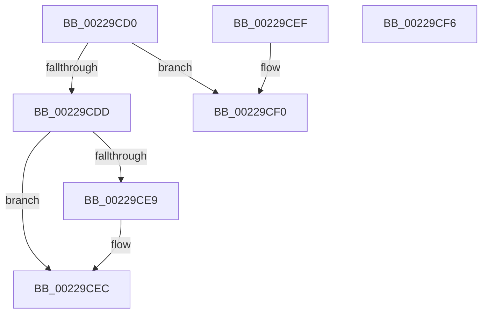

# MiMakeProtectionPfnCompatible

- RVA: `0x00229CD0`–`0x00229CF7` (길이 `39` bytes)
- VA: `0x0000000140229CD0`
- 실행 섹션: `.text`
- PDB 이름 있음: `예`; PDB Function 태그: `아니요`
- unwind 정보 RVA: `0x000DB714`
- 디코드: `18`개 명령, `39/39` bytes 표시
- 미해석 바이트: `0` (있으면 어셈블리에 `.byte`로 보존)

> 이 문서는 커널 이미지의 기계어와 PDB 기호를 분석해 생성했습니다. 4번과 5번은 함수 원형과 자료형을 바이너리 사용 방식에서 추정한 C 해석이며 원본 소스 복구 결과는 아닙니다.

## 1. Dependencies

- 직접 호출 지점: **0**; 고유 호출 대상: **0**
- 직접 호출자로 확인된 함수: **22**
- RIP 상대 이미지 참조: **0**

### Outgoing calls
- 직접 디코드된 call 명령이 없습니다.

### Direct callers
- [MmProtectMdlSystemAddress](MmProtectMdlSystemAddress_function_00227B50.md) at `0x00227D26`
- [MiCopySinglePage](MiCopySinglePage_function_00228FA4.md) at `0x0022903E`
- [MiReplacePageTablePage](MiReplacePageTablePage_function_00229184.md) at `0x002292AB`
- [MiMapSinglePage](MiMapSinglePage_function_00229D00.md) at `0x00229D8B`
- [MiMapArbitraryPage](MiMapArbitraryPage_function_0022A44C.md) at `0x0022A518`
- [MiInsertPhysicalPteMapping](../2A/MiInsertPhysicalPteMapping_function_002AE26C.md) at `0x002AE48C`
- [MiComputeCombineHash](../32/MiComputeCombineHash_function_003227C0.md) at `0x003228A9`
- [MiReplacePageOfProtoPool](../36/MiReplacePageOfProtoPool_function_00364BB8.md) at `0x00364CB7`
- [MiPrivateFixup](../36/MiPrivateFixup_function_003693E8.md) at `0x0036969E`
- [MiScrubPage](../3F/MiScrubPage_function_003F954C.md) at `0x003F95D3`
- [MiInitializeNewUltraHugeContext](../3F/MiInitializeNewUltraHugeContext_function_003FB974.md) at `0x003FBBC4`
- [MiUpdateImagePfnImportRelocations](../44/MiUpdateImagePfnImportRelocations_function_00449E84.md) at `0x00449F2F`
- [MiMapMemoryDumpMdl](../4A/MiMapMemoryDumpMdl_function_004A619C.md) at `0x004A63AD`
- [MiMapMdlWithLargePages](../4D/MiMapMdlWithLargePages_function_004D10B8.md) at `0x004D1368`
- [MiMapMdlCommon](../67/MiMapMdlCommon_function_00674524.md) at `0x00674696`
- [MiMapMdlCommon](../67/MiMapMdlCommon_function_00674524.md) at `0x006749BF`
- [MiInitializeSlowPte](../67/MiInitializeSlowPte_function_0067E1F8.md) at `0x0067E241`
- [MiDbgTranslatePhysicalAddress](../68/MiDbgTranslatePhysicalAddress_function_00685760.md) at `0x0068592C`
- [MiScrubLargePage](../69/MiScrubLargePage_function_006942E8.md) at `0x00694556`
- [MiCopyMemoryPagefileData](../69/MiCopyMemoryPagefileData_function_00694C04.md) at `0x00694E2F`
- [MiCopyMemoryPagefileData](../69/MiCopyMemoryPagefileData_function_00694C04.md) at `0x00694E84`
- [MiValidateImagePfn](../../page/93/MiValidateImagePfn_function_0093EA08.md) at `0x0093EB2C`
- [MiRelocateImagePfn](../../page/93/MiRelocateImagePfn_function_0093F2A8.md) at `0x0093F4AE`
- [MiProtectSharedUserPage](../../init/C6/MiProtectSharedUserPage_function_00C60F44.md) at `0x00C61027`
- [MiProtectSharedUserPage](../../init/C6/MiProtectSharedUserPage_function_00C60F44.md) at `0x00C610EF`

### Static image references
- 디코드된 RIP-relative 메모리 참조가 없습니다.

## 2. Other-region calls and transfers

- 다른 실행 섹션으로 향하는 call: **0**
- 별도 외부 분기/꼬리 이동을 확인하지 못했습니다.

## 3. Assembly (complete function range)

```asm
00229CD0  8B 42 20                        mov eax, dword ptr [rdx + 0x20]
00229CD3  83 E1 07                        and ecx, 7
00229CD6  C1 E8 10                        shr eax, 0x10
00229CD9  3C 40                           cmp al, 0x40
00229CDB  72 13                           jb 0x140229cf0
00229CDD  8B 42 20                        mov eax, dword ptr [rdx + 0x20]
00229CE0  C1 E8 10                        shr eax, 0x10
00229CE3  24 C0                           and al, 0xc0
00229CE5  3C 80                           cmp al, 0x80
00229CE7  75 03                           jne 0x140229cec
00229CE9  83 C9 18                        or ecx, 0x18
00229CEC  8B C1                           mov eax, ecx
00229CEE  C3                              ret
00229CEF  CC                              int3
00229CF0  83 C9 08                        or ecx, 8
00229CF3  8B C1                           mov eax, ecx
00229CF5  C3                              ret
00229CF6  CC                              int3
```

## 4. C-style interpretation (structured pseudocode)

```c
__int64 __fastcall MiMakeProtectionPfnCompatible(int a1, __int64 a2)
{
    __int64 result;

    a1 = (unsigned int)((a1) & (7));
    result = (unsigned int)(((unsigned int)(*(unsigned int *)(a2 + 32))) >> (16));
    if (((unsigned __int8)(result)) < 64) goto loc_00229CF0;
    result = (unsigned int)(((unsigned int)(*(unsigned int *)(a2 + 32))) >> (16));
    result = (unsigned __int8)((result) & (192));
    if (((unsigned __int8)(result)) == 128) {
        a1 = (unsigned int)((a1) | (24));
    }
    return (unsigned int)(a1);
loc_00229CF0:
    a1 = (unsigned int)((a1) | (8));
    return (unsigned int)(a1);
}
```

## 5. (Beta) C Style

```c
int64_t MiMakeProtectionPfnCompatible(int32_t Arg1, void *Arg2)
{
    uint8_t *arg2 = (uint8_t *)Arg2;

    int64_t result;

    Arg1 = (uint32_t)((Arg1) & (7));
    result = (uint32_t)(((uint32_t)(*(uint32_t *)(arg2 + 0x20))) >> (16));
    if (((uint8_t)(result)) < 64) goto loc_00229CF0;
    result = (uint32_t)(((uint32_t)(*(uint32_t *)(arg2 + 0x20))) >> (16));
    result = (uint8_t)((result) & (192));
    if (((uint8_t)(result)) == 128) {
        Arg1 = (uint32_t)((Arg1) | (24));
    }
    return (uint32_t)(Arg1);
loc_00229CF0:
    Arg1 = (uint32_t)((Arg1) | (8));
    return (uint32_t)(Arg1);
}
```

### 관측된 메모리 오프셋

구조체 형식이 확인되지 않은 접근은 인자 기준의 오프셋으로만 기록했습니다.

| 기준 인자 | 오프셋 표현 | 폭 (bit) | 접근 |
|---|---:|---:|---|
| `Arg2` | `+ 0x20` | `32` | `R` |

## 6. Execution-region graph

[열기: 2D/3D 그래프와 함수 탐색 컨트롤 패널](../../../control-panel.html?section=text&rva=0x00229CD0&view=graph)

- 2D 그래프는 위에서 아래로 흐르고, 3D 그래프는 빈 공간을 드래그해 회전합니다. Shift+드래그는 이동, 휠은 확대·축소, 함수 노드 선택은 대상 보고서 이동입니다.

### Static fallback


