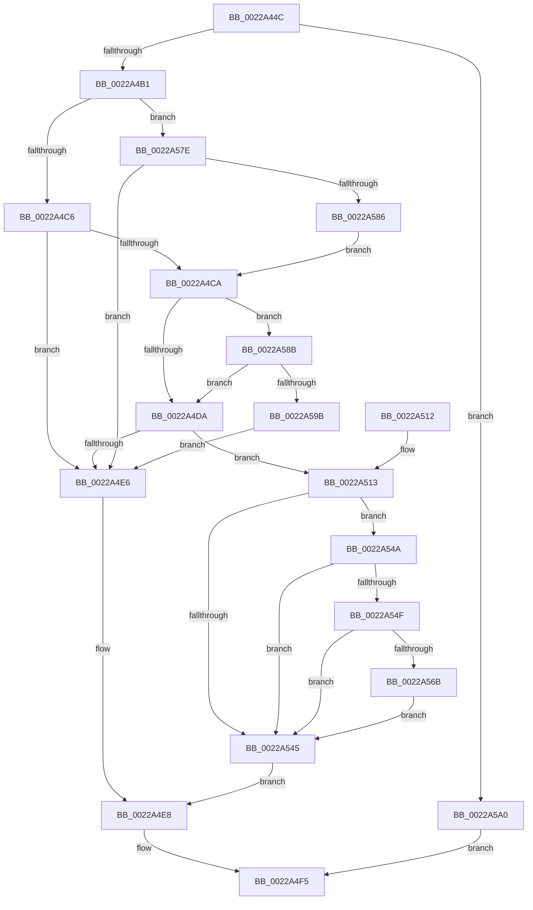

# MiMapArbitraryPage

- RVA: `0x0022A44C`–`0x0022A5A7` (길이 `347` bytes)
- VA: `0x000000014022A44C`
- 실행 섹션: `.text`
- PDB 이름 있음: `예`; PDB Function 태그: `아니요`
- unwind 정보 RVA: `0x0005FDC4`
- 디코드: `96`개 명령, `347/347` bytes 표시
- 미해석 바이트: `0` (있으면 어셈블리에 `.byte`로 보존)

> 이 문서는 커널 이미지의 기계어와 PDB 기호를 분석해 생성했습니다. 4번과 5번은 함수 원형과 자료형을 바이너리 사용 방식에서 추정한 C 해석이며 원본 소스 복구 결과는 아닙니다.

## 1. Dependencies

- 직접 호출 지점: **6**; 고유 호출 대상: **6**
- 직접 호출자로 확인된 함수: **1**
- RIP 상대 이미지 참조: **1**

### Outgoing calls
- `0x0022A4A1` → [MiSafeLockPage](../32/MiSafeLockPage_function_00321620.md) (function, `0x00321620`)
- `0x0022A4B9` → [MiCombineCandidate](../31/MiCombineCandidate_function_00316290.md) (function, `0x00316290`)
- `0x0022A4EE` → [MiUnlockPage](../31/MiUnlockPage_function_0031A3E0.md) (function, `0x0031A3E0`)
- `0x0022A518` → [MiMakeProtectionPfnCompatible](MiMakeProtectionPfnCompatible_function_00229CD0.md) (function, `0x00229CD0`)
- `0x0022A52A` → [MiMakeValidPte](../2C/MiMakeValidPte_function_002C5590.md) (function, `0x002C5590`)
- `0x0022A577` → [MiCheckLinearProtectedPteAccessedBit](../29/MiCheckLinearProtectedPteAccessedBit_function_00292D80.md) (function, `0x00292D80`)

### Direct callers
- [MiConvertStandbyToProto](MiConvertStandbyToProto_function_0022A330.md) at `0x0022A3BA`

### Static image references
- `0x0022A53A` → RVA `0x00FC6A88` (`ALMOSTRO`; read)

## 2. Other-region calls and transfers

- 다른 실행 섹션으로 향하는 call: **0**
- 별도 외부 분기/꼬리 이동을 확인하지 못했습니다.

## 3. Assembly (complete function range)

```asm
0022A44C  48 89 5C 24 08                  mov qword ptr [rsp + 8], rbx
0022A451  48 89 6C 24 10                  mov qword ptr [rsp + 0x10], rbp
0022A456  48 89 74 24 18                  mov qword ptr [rsp + 0x18], rsi
0022A45B  57                              push rdi
0022A45C  41 54                           push r12
0022A45E  41 55                           push r13
0022A460  41 56                           push r14
0022A462  41 57                           push r15
0022A464  48 83 EC 20                     sub rsp, 0x20
0022A468  48 8B 72 40                     mov rsi, qword ptr [rdx + 0x40]
0022A46C  41 8B F9                        mov edi, r9d
0022A46F  4C 8B 72 48                     mov r14, qword ptr [rdx + 0x48]
0022A473  41 8B E8                        mov ebp, r8d
0022A476  4C 8B EA                        mov r13, rdx
0022A479  4C 8B F9                        mov r15, rcx
0022A47C  48 B8 00 00 00 00 00 DE FF FF   movabs rax, 0xffffde0000000000
0022A486  48 8B DE                        mov rbx, rsi
0022A489  48 2B D8                        sub rbx, rax
0022A48C  48 B8 AB AA AA AA AA AA AA AA   movabs rax, 0xaaaaaaaaaaaaaaab
0022A496  48 C1 FB 04                     sar rbx, 4
0022A49A  48 0F AF D8                     imul rbx, rax
0022A49E  48 8B CB                        mov rcx, rbx
0022A4A1  E8 7A 71 0F 00                  call 0x140321620
0022A4A6  44 8A E0                        mov r12b, al
0022A4A9  3C 11                           cmp al, 0x11
0022A4AB  0F 84 EF 00 00 00               je 0x14022a5a0
0022A4B1  4C 8B C6                        mov r8, rsi
0022A4B4  8B D5                           mov edx, ebp
0022A4B6  49 8B CF                        mov rcx, r15
0022A4B9  E8 D2 BD 0E 00                  call 0x140316290
0022A4BE  85 FF                           test edi, edi
0022A4C0  0F 85 B8 00 00 00               jne 0x14022a57e
0022A4C6  85 C0                           test eax, eax
0022A4C8  74 1C                           je 0x14022a4e6
0022A4CA  83 7C 24 70 00                  cmp dword ptr [rsp + 0x70], 0
0022A4CF  BF 01 00 00 00                  mov edi, 1
0022A4D4  0F 85 B1 00 00 00               jne 0x14022a58b
0022A4DA  8B 46 20                        mov eax, dword ptr [rsi + 0x20]
0022A4DD  C1 E8 10                        shr eax, 0x10
0022A4E0  24 C0                           and al, 0xc0
0022A4E2  3C C0                           cmp al, 0xc0
0022A4E4  75 2D                           jne 0x14022a513
0022A4E6  33 FF                           xor edi, edi
0022A4E8  41 8A D4                        mov dl, r12b
0022A4EB  48 8B CE                        mov rcx, rsi
0022A4EE  E8 ED FE 0E 00                  call 0x14031a3e0
0022A4F3  8B C7                           mov eax, edi
0022A4F5  48 8B 5C 24 50                  mov rbx, qword ptr [rsp + 0x50]
0022A4FA  48 8B 6C 24 58                  mov rbp, qword ptr [rsp + 0x58]
0022A4FF  48 8B 74 24 60                  mov rsi, qword ptr [rsp + 0x60]
0022A504  48 83 C4 20                     add rsp, 0x20
0022A508  41 5F                           pop r15
0022A50A  41 5E                           pop r14
0022A50C  41 5D                           pop r13
0022A50E  41 5C                           pop r12
0022A510  5F                              pop rdi
0022A511  C3                              ret
0022A512  CC                              int3
0022A513  48 8B D6                        mov rdx, rsi
0022A516  8B CF                           mov ecx, edi
0022A518  E8 B3 F7 FF FF                  call 0x140229cd0
0022A51D  0F BA E8 1D                     bts eax, 0x1d
0022A521  48 8B D3                        mov rdx, rbx
0022A524  44 8B C0                        mov r8d, eax
0022A527  49 8B CE                        mov rcx, r14
0022A52A  E8 61 B0 09 00                  call 0x1402c5590
0022A52F  4D 89 75 38                     mov qword ptr [r13 + 0x38], r14
0022A533  48 8B D8                        mov rbx, rax
0022A536  49 89 75 30                     mov qword ptr [r13 + 0x30], rsi
0022A53A  48 0F BA 25 45 C5 D9 00 24      bt qword ptr [rip + 0xd9c545], 0x24
0022A543  72 05                           jb 0x14022a54a
0022A545  49 89 1E                        mov qword ptr [r14], rbx
0022A548  EB 9E                           jmp 0x14022a4e8
0022A54A  F6 C3 20                        test bl, 0x20
0022A54D  75 F6                           jne 0x14022a545
0022A54F  48 B8 00 00 00 00 80 F6 FF FF   movabs rax, 0xfffff68000000000
0022A559  48 B9 00 00 00 00 40 00 00 00   movabs rcx, 0x4000000000
0022A563  48 03 C1                        add rax, rcx
0022A566  4C 3B F0                        cmp r14, rax
0022A569  72 DA                           jb 0x14022a545
0022A56B  41 B8 80 00 00 00               mov r8d, 0x80
0022A571  48 8B D3                        mov rdx, rbx
0022A574  49 8B CE                        mov rcx, r14
0022A577  E8 04 88 06 00                  call 0x140292d80
0022A57C  EB C7                           jmp 0x14022a545
0022A57E  3B C7                           cmp eax, edi
0022A580  0F 85 60 FF FF FF               jne 0x14022a4e6
0022A586  E9 3F FF FF FF                  jmp 0x14022a4ca
0022A58B  8A 46 22                        mov al, byte ptr [rsi + 0x22]
0022A58E  24 07                           and al, 7
0022A590  2C 02                           sub al, 2
0022A592  40 3A C7                        cmp al, dil
0022A595  0F 86 3F FF FF FF               jbe 0x14022a4da
0022A59B  E9 46 FF FF FF                  jmp 0x14022a4e6
0022A5A0  33 C0                           xor eax, eax
0022A5A2  E9 4E FF FF FF                  jmp 0x14022a4f5
```

## 4. C-style interpretation (structured pseudocode)

```c
__int64 __fastcall MiMapArbitraryPage(__int64 a1, __int64 a2, int a3, int a4, unsigned int a5)
{
    __int64 result;
    __int64 v_rbx;
    __int64 v_rdi;
    __int64 v_rsp;
    unsigned __int64 v_stack_p10;
    unsigned __int64 v_stack_p18;
    unsigned __int64 v_stack_p8;

    v_stack_p8 = v_rbx;
    v_stack_p10 = v_rbp;
    v_stack_p18 = v_rsi;
    v_rsp = (v_rsp) - (32);
    v_rbx = (*(unsigned __int64 *)(a2 + 64)) - (result);
    v_rbx = (v_rbx) >> (4);
    v_rbx = (v_rbx) * (result);
    result = MiSafeLockPage(v_rbx, a2, a3, a4);
    if (((unsigned __int8)(result)) == 17) goto loc_0022A5A0;
    result = MiCombineCandidate(a1, (unsigned int)((unsigned int)((unsigned int)(a3))), *(unsigned __int64 *)(a2 + 64), a4);
    if ((unsigned int)((unsigned int)(a4)) != 0) goto loc_0022A57E;
    if ((unsigned int)(result) == 0) goto loc_0022A4E6;
loc_0022A4CA:
    if (a5 != 0) goto loc_0022A58B;
loc_0022A4DA:
    result = (unsigned int)(((unsigned int)(*(unsigned int *)(*(unsigned __int64 *)(a2 + 64) + 32))) >> (16));
    result = (unsigned __int8)((result) & (192));
    if (((unsigned __int8)(result)) != 192) goto loc_0022A513;
loc_0022A4E6:
    v_rdi = 0;
loc_0022A4E8:
    result = MiUnlockPage(*(unsigned __int64 *)(a2 + 64), (unsigned __int8)((unsigned __int8)(result)), *(unsigned __int64 *)(a2 + 64), a4);
loc_0022A4F5:
    v_rsp = (v_rsp) + (32);
    return 0;
loc_0022A513:
    result = MiMakeProtectionPfnCompatible(0, v_stack_p18, *(unsigned __int64 *)(a2 + 64), a4);
    result = MiMakeValidPte(*(unsigned __int64 *)(a2 + 72), v_stack_p8, (unsigned int)((unsigned int)(result)), a4);
    *(unsigned __int64 *)(a2 + 56) = *(unsigned __int64 *)(a2 + 72);
    *(unsigned __int64 *)(a2 + 48) = v_stack_p18;
    if (condition_is_below) goto loc_0022A54A;
loc_0022A545:
    *(unsigned __int64 *)(*(unsigned __int64 *)(a2 + 72)) = result;
    goto loc_0022A4E8;
loc_0022A54A:
    if ((((unsigned __int8)(result)) & (32)) != 0) goto loc_0022A545;
    result = (result) + (*(unsigned __int64 *)(a2 + 72));
    if ((*(unsigned __int64 *)(a2 + 72)) < result) goto loc_0022A545;
    result = MiCheckLinearProtectedPteAccessedBit(*(unsigned __int64 *)(a2 + 72), result, 128, a4);
    goto loc_0022A545;
loc_0022A57E:
    if (((unsigned int)(result)) != 0) goto loc_0022A4E6;
    goto loc_0022A4CA;
loc_0022A58B:
    result = (unsigned __int8)((*(unsigned __int8 *)(v_stack_p18 + 34)) & (7));
    result = (unsigned __int8)((result) - (2));
    if (((unsigned __int8)(result)) <= 0) goto loc_0022A4DA;
    goto loc_0022A4E6;
loc_0022A5A0:
    result = 0;
    goto loc_0022A4F5;
}
```

## 5. (Beta) C Style

```c
int64_t MiMapArbitraryPage(int64_t Arg1, void *Arg2, int32_t Arg3, int32_t Arg4, uint32_t Arg5)
{
    uint8_t *arg2 = (uint8_t *)Arg2;

    int64_t result;
    int64_t local_rbx;
    int64_t local_rdi;
    int64_t local_rsp;
    uint64_t v_stack_p10;
    uint64_t v_stack_p18;
    uint64_t v_stack_p8;

    v_stack_p8 = local_rbx;
    v_stack_p10 = local_rbp;
    v_stack_p18 = local_rsi;
    local_rsp = (local_rsp) - (32);
    local_rbx = (*(uint64_t *)(arg2 + 0x40)) - (result);
    local_rbx = (local_rbx) >> (4);
    local_rbx = (local_rbx) * (result);
    result = MiSafeLockPage(local_rbx, Arg2, Arg3, Arg4);
    if (((uint8_t)(result)) == 17) goto loc_0022A5A0;
    result = MiCombineCandidate(Arg1, (uint32_t)((uint32_t)((uint32_t)(Arg3))), *(uint64_t *)(arg2 + 0x40), Arg4);
    if ((uint32_t)((uint32_t)(Arg4)) != 0) goto loc_0022A57E;
    if ((uint32_t)(result) == 0) goto loc_0022A4E6;
loc_0022A4CA:
    if (Arg5 != 0) goto loc_0022A58B;
loc_0022A4DA:
    result = (uint32_t)(((uint32_t)(*(uint32_t *)(*(uint64_t *)(arg2 + 0x40) + 0x20))) >> (16));
    result = (uint8_t)((result) & (192));
    if (((uint8_t)(result)) != 192) goto loc_0022A513;
loc_0022A4E6:
    local_rdi = 0;
loc_0022A4E8:
    result = MiUnlockPage(*(uint64_t *)(arg2 + 0x40), (uint8_t)((uint8_t)(result)), *(uint64_t *)(arg2 + 0x40), Arg4);
loc_0022A4F5:
    local_rsp = (local_rsp) + (32);
    return 0;
loc_0022A513:
    result = MiMakeProtectionPfnCompatible(0, v_stack_p18, *(uint64_t *)(arg2 + 0x40), Arg4);
    result = MiMakeValidPte(*(uint64_t *)(arg2 + 0x48), v_stack_p8, (uint32_t)((uint32_t)(result)), Arg4);
    *(uint64_t *)(arg2 + 0x38) = *(uint64_t *)(arg2 + 0x48);
    *(uint64_t *)(arg2 + 0x30) = v_stack_p18;
    if (condition_is_below) goto loc_0022A54A;
loc_0022A545:
    *(uint64_t *)(*(uint64_t *)(arg2 + 0x48)) = result;
    goto loc_0022A4E8;
loc_0022A54A:
    if ((((uint8_t)(result)) & (32)) != 0) goto loc_0022A545;
    result = (result) + (*(uint64_t *)(arg2 + 0x48));
    if ((*(uint64_t *)(arg2 + 0x48)) < result) goto loc_0022A545;
    result = MiCheckLinearProtectedPteAccessedBit(*(uint64_t *)(arg2 + 0x48), result, 128, Arg4);
    goto loc_0022A545;
loc_0022A57E:
    if (((uint32_t)(result)) != 0) goto loc_0022A4E6;
    goto loc_0022A4CA;
loc_0022A58B:
    result = (uint8_t)((*(uint8_t *)(v_stack_p18 + 0x22)) & (7));
    result = (uint8_t)((result) - (2));
    if (((uint8_t)(result)) <= 0) goto loc_0022A4DA;
    goto loc_0022A4E6;
loc_0022A5A0:
    result = 0;
    goto loc_0022A4F5;
}
```

### 관측된 메모리 오프셋

구조체 형식이 확인되지 않은 접근은 인자 기준의 오프셋으로만 기록했습니다.

| 기준 인자 | 오프셋 표현 | 폭 (bit) | 접근 |
|---|---:|---:|---|
| `Arg2` | `+ 0x30` | `64` | `W` |
| `Arg2` | `+ 0x38` | `64` | `W` |
| `Arg2` | `+ 0x40` | `64` | `R` |
| `Arg2` | `+ 0x48` | `64` | `R` |

## 6. Execution-region graph

[열기: 2D/3D 그래프와 함수 탐색 컨트롤 패널](../../../control-panel.html?section=text&rva=0x0022A44C&view=graph)

- 2D 그래프는 위에서 아래로 흐르고, 3D 그래프는 빈 공간을 드래그해 회전합니다. Shift+드래그는 이동, 휠은 확대·축소, 함수 노드 선택은 대상 보고서 이동입니다.

### Static fallback


